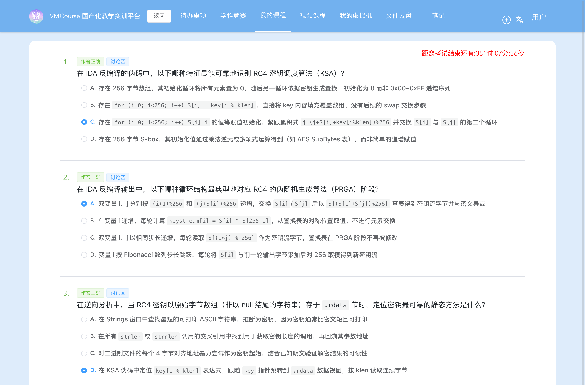

# 8-2 系统层漏洞利用与逆向分析 · 软件逆向静态分析-G2（PE32+ 校验器中的 RC4 识别与静态解密）

## 题目信息

| 项目 | 内容 |
| --- | --- |
| 题目名称 | 系统层漏洞利用与逆向分析-软件逆向静态分析-G2（sectionID `6719`，课程内 number 31，题目内部编号 `C036-G2-F`） |
| 分类 | 逆向分析 / 密码算法识别（Windows PE32+ x86-64：静态识别 RC4 的 KSA+PRGA → 提取 `.rdata` 中的原始字节数组密钥与常量密文 → 逆运算还原 flag） |
| 题目描述 | 题面提供**一个** PE 附件 `challenge.exe`，要求静态分析这个「教科书上出现过无数次」的加密算法、认出它并解出 flag。**本题没有靶机实例**（章节 `experimentID=0`），flag 完全来自对附件的静态分析（外加指令级模拟验证），不涉及任何网络端点。 |
| Flag 题（questionID=9445，`questionType=4` 代码/Flag 题）题干原文 | > * 这个加密算法在教科书上出现过无数次，你能认出它吗？flag 格式为 `flag{}`。*<br>> `{{input}}` |

Note：本题与同批的 **8-1** 同属「无靶机、纯静态分析附件」的题，但线索形态正好互补，可以合起来当作一组经验：

- **8-1**：`challenge.elf` 是**静态链接 stripped 的 ELF64**，线索在字符串与「最简单的运算」（XOR 类编码），难点是**在巨型二进制里定位校验逻辑**；
- **8-2（本题）**：`challenge.exe` 只有 17408 B，`strings` 一把就抓到 `Enter the flag: ` / `Correct!` / `Wrong!`，**难点不在定位、而在「认出算法 + 找到不可打印的密钥」**：密钥是 `.rdata` 里的**原始字节数组**（`2f 9e 4a c3 71 85 d6 1b`），`strings` 里根本不存在，必须顺着 KSA 伪码里的 `key[i % klen]` 指针 + `klen` 立即数回到数据段按长度读。
- 两题的 Flag 题都是 **`questionType=4`**，提交格式为 `{"answer":["flag{...}"],"num":1}`（实测一次通过）。

## 环境信息

| 项目 | 内容 |
| --- | --- |
| 平台 | VMCourse 国产化教学实训平台（自签名证书，`curl` 需加 `-k --noproxy '*'`），课程 ID `1639`，本章节 `sectionID` `6719`（课程内 number 31）。平台账号与口令只保存在本地未跟踪的 `.local/` 目录（不入库），本文不记录任何凭据、cookie 或个人身份信息 |
| 题目分组 | `10021`(C036-G2-S1) / `10023`(S2) / `10025`(S3) / `10027`(C036-G2-M) / `10029`(C036-G2-F) |
| 题型 | 3 道单选（9415 / 9417 / 9419，`questionType=2`）+ 1 道多选（9421，`questionType=3`）+ 1 道 Flag 题（9445，**`questionType=4`**），共 5 题，`answersTotal=5` |
| 靶机实例 | **没有**：`GET /api/section?ID=6719` 与课程接口返回 `experimentID=0`，本题不存在实验环境；全流程**未创建、未启动任何实例**，也没有 SSH/HTTP 端点可连（与 8-1 同型，区别于 7-4 的裸 TCP 服务） |
| Flag 题附件表 | `questionFiles[0]`：`id=1361`、`filename=challenge.exe`、`size=17408`（作答页显示 `17K`），与本地文件一致 |
| 附件 | `.local/process/8-2-scripts/files/challenge.exe`，**17408 B**，MD5 **`64a144efb08124f53c9516d2f5bfcc35`**（来源 `GET /api/student/section/file/challenge.exe?ID=6719&decryptStr=`） |
| 附件属性 | `PE32+ executable (console) x86-64 (stripped to external PDB), for MS Windows`；`strings` 可见 `GCC: (GNU) 15.2.0` ⇒ **MinGW-w64 编译**；PE 关键字段：`e_lfanew=0x80`、`magic=0x020b`（PE32+）、`nsec=9`、`entry=0x1440`、`ImageBase=0x140000000`、`DllCharacteristics=0x0160` |
| 判分机会 | `newTestPaper` 返回 `isResubmit=false`；提交前 `answerHistory?sectionID=6719` 返回 `answerQuestion: []` ⇒ 本题此前从未提交过 |
| 本机工具 | Apple `objdump`（支持 `coff-x86-64`）、`strings` / `file` / `md5` / `stat`、Python 3.14（本机 PIL 12.2.0）；**本机无 wine、无 pefile、无 Ghidra**；Docker Desktop 29.4.3（可用，但见步骤 7 的 wine 失败）；另建 `/tmp/uni` venv 安装 **Unicorn 2.1.4** 做指令级模拟；截图用无头 Chrome（playwright-core 驱动系统 Chrome），脱敏用 PIL/numpy |
| 选择题判分 | **9415=C、9417=A、9419=D、9421=B+C（`num:2`）**；`GET /api/student/get/answerHistory?sectionID=6719&contestMode=0` 返回 **5/5 `isCorrect=true`**（含 9445）。按惯例本文只在环境信息备注结果，不展开选择题解析 |

## 解题过程

### 1. 附件侦察：PE32+、三串关键字符串与节表（截图 01）

```console
$ cd .local/process/8-2-scripts
$ file files/challenge.exe ; stat -f "%z" files/challenge.exe ; md5 files/challenge.exe
files/challenge.exe: PE32+ executable (console) x86-64 (stripped to external PDB), for MS Windows
17408
MD5 (files/challenge.exe) = 64a144efb08124f53c9516d2f5bfcc35
```

```console
$ strings -a -t x files/challenge.exe > logs/00-strings.txt      # macOS BSD strings 不接受合并写法 -tx
```

关键行（`logs/00-strings.txt`）：

```text
 2400 Enter the flag: 
 2413 Wrong!
 241a Correct!
 2990 GCC: (GNU) 15.2.0
 3ba2 _cexit / 3bfe _initterm / 3cae fflush / 3cb8 fgets / 3cc0 puts
 3cd2 strcspn / 3cdc strlen / 3ce6 strncmp / 3b72 memcmp / 3b7c memcpy
 3d18 KERNEL32.dll ; 3d2c…3ea8 api-ms-win-crt-*.dll
```

⇒ 常识判断已经能定方向：`Enter the flag: ` → `Correct!` / `Wrong!`，导入表里有 `fgets / strcspn / strlen / memcmp / puts`，是一个典型的「读入 → 长度/变换 → 比较」**校验器**。

自写 `parse_pe.py` 解析 PE 头 / 可选头 / 数据目录 / 节表（`logs/01-pe-headers.txt`）：

```text
magic 020b  nsec 9  chars 022e
entry 00001440 imagebase 0000000140000000 secalign 1000 filealign 200 nrva 16
  [Import      ] rva=00008000 size=000008cc
  [Exception   ] rva=00005000 size=00000234      ← .pdata（RUNTIME_FUNCTION 函数表，47 项）
  [.text] VA=00001000 RAW=00000400 RS=00001e00
  [.data] VA=00003000 RAW=00002200 RS=00000200
  [.rdata] VA=00004000 RAW=00002400 RS=00000c00
  [.pdata] VA=00005000 RAW=00003000 RS=00000400
DllCharacteristics = 0x0160
```

⇒ 记住这条映射：**`.rdata` 虚拟地址 `0x4000` = 文件偏移 `0x2400`**（`VA - 节 VA + 节 RAW`）。后面取密钥、取密文全靠它——`strings` 打印的 `2400` 也正是 `Enter the flag: ` 的文件偏移。


### 2. 用 `.pdata` 恢复函数边界，定位 `main` 与 RC4 函数（截图 02）

MinGW-w64 生成的 `.pdata` 就是 RUNTIME_FUNCTION 数组（12 B/项：Begin、End、UnwindInfo[RVA]），异常目录 `size=0x234` ⇒ 共 **47** 项，这就等于给了一份免费的「函数边界表」：

```console
$ python3 - <<'EOF'      # 以 RVA 为单位解析 .pdata（VA 0x5000 → RAW 0x3000）
for i in range(0x234//12): print(struct.unpack_from('<III', d, 0x3000+i*12))
EOF
  [08] start=000014c0 end=00001602 unwind=0000606c   ← rc4_crypt（被调用一次的那个函数）
  [09] start=00001602 end=000016ed unwind=0000607c   ← main（校验器）
  [10] start=00001700 end=00001742 unwind=00006088   ← 另一个 CRT 相关函数（记录里推测为 __do_global_dtors 一类）
```

```console
$ objdump -d files/challenge.exe > logs/03-objdump-text.txt      # 2043 行
$ grep -n "140004000\|1400014c0\|140004040\|140004070" logs/03-objdump-text.txt
375:14000160f: 48 8d 0d ea 29 00 00   leaq 0x29ea(%rip),%rcx   # 0x140004000  "Enter the flag: "
406:14000169e: 48 8d 0d cb 29 00 00   leaq 0x29cb(%rip),%rcx   # 0x140004070  ← key
407:1400016a5: e8 16 fe ff ff         callq 0x1400014c0          # ← rc4_crypt 唯一调用点
409:1400016b0: 48 8d 15 89 29 00 00   leaq 0x2989(%rip),%rdx   # 0x140004040  密文(42B)
```

复核计数：`0x140004000`（提示串）在全文件反汇编里**只被引用 1 次**、`0x140004070`（key）**只被引用 1 次**、`callq 0x1400014c0` **只有 1 处**——所以「`0x140001602` 就是 `main`、`0x1400014c0` 就是那个唯一的加密函数」不是猜的，是 `.pdata` 边界 + 交叉引用双重限定的。

### 3. 复原 `main` 的校验语义（截图 02）

`logs/03-objdump-text.txt` 第 330–470 行（节选，逐条注解）：

```asm
140001602: pushq %rbx ; subq $0xa0,%rsp          ; main 序言（.pdata [09] 的起点）
14000160a: callq 0x1400017d0                     ; CRT/__main
14000160f: leaq 0x29ea(%rip),%rcx  # 0x140004000 ; "Enter the flag: "
140001616: callq 0x1400029e0                     ; printf
140001620: callq *0x6d9a(%rip)                   ; __acrt_iob_func(0)
140001626: movq %rax,%r8                         ; r8 = stdin
140001629: leaq 0x60(%rsp),%rcx                  ; buf
14000162e: movl $0x40,%edx                       ; 64
140001633: callq 0x140002b88                     ; fgets(buf, 64, stdin)
140001638: testq %rax,%rax
14000163b: je 0x1400016e6                        ; 读失败 -> movl $0x1,%ebx；return 1
140001641: leaq 0x60(%rsp),%rbx
140001646: leaq 0x29c4(%rip),%rdx  # 0x140004011 ; "\n"
140001650: callq 0x140002b40                     ; strcspn(buf,"\n")
140001655: movb $0x0,0x60(%rsp,%rax)             ; buf[len]=0（去掉换行）
14000165d: callq 0x140002b48                     ; strlen(buf)
140001662: cmpq $0x2a,%rax                       ; ★ 长度必须 == 42
140001666: je 0x140001684
140001668: leaq 0x29a4(%rip),%rcx  # 0x140004013 ; "Wrong!"
14000166f: callq 0x140002b90                     ; puts
140001674: movl $0x1,%ebx                        ; return 1
140001684: leaq 0x30(%rsp),%rbx                  ; out（栈上 42 B）
140001689: movq %rbx,0x20(%rsp)                  ; ★ 第 5 个参数 out（压栈）
14000168e: movl $0x2a,%r9d                       ; ★ 参数 4：len = 42
140001694: leaq 0x60(%rsp),%r8                   ; 参数 3：in  = buf（用户输入）
140001699: movl $0x8,%edx                        ; ★ 参数 2：klen = 8（立即数，不走 strlen）
14000169e: leaq 0x29cb(%rip),%rcx  # 0x140004070 ; ★ 参数 1：key
1400016a5: callq 0x1400014c0                     ; rc4_crypt(key, 8, in, 42, out)
1400016aa: movl $0x2a,%r8d
1400016b0: leaq 0x2989(%rip),%rdx  # 0x140004040 ; ★ 目标密文
1400016b7: movq %rbx,%rcx
1400016ba: callq 0x140002c18                     ; memcmp(out, 0x140004040, 42)
1400016bf: movl %eax,%ebx                        ; ebx = memcmp 的返回值
1400016c1: testl %eax,%eax
1400016c3: jne 0x1400016d3                       ; 不等 -> 0x140004013 "Wrong!"；movl $0x0,%ebx
1400016c5: leaq 0x294e(%rip),%rcx  # 0x14000401a ; "Correct!"
1400016cc: callq 0x140002b90                     ; puts
1400016d1: jmp 0x140001679
140001679: movl %ebx,%eax ; ... ; retq           ; 相等时 eax = ebx = memcmp 结果 = 0
```

**逻辑一句话**：

```c
if (fgets(buf, 64, stdin) == NULL)            return 1;
strcspn(buf, "\n"); buf[len] = 0;
if (strlen(buf) != 0x2a) { puts("Wrong!");    return 1; }   // 42 字节硬检查
rc4_crypt(key = 0x140004070, klen = 8, in = buf, len = 42, out = stack);
if (memcmp(out, 0x140004040, 42) == 0) { puts("Correct!"); return 0; }
else                                   { puts("Wrong!");   return 0; }
```

两点容易被记错的细节（以反汇编为准）：

- 被 RC4 变换的是**用户输入**，比较对象是 `.rdata` 里的**常量密文**。RC4 的密钥流与明文异或、且 XOR 自反 ⇒ **对那段常量密文做同一组 `RC4(key)` 就得到唯一满足校验的输入**，也就是 flag 的方向（不需要爆破）。
- `memcmp` 的两个分支 `return` 值都是 **0**（`1400016bf: movl %eax,%ebx` 先取 memcmp 结果，正确分支不再改写；错误分支 `1400016df: movl $0x0,%ebx` 显式置 0）；只有「`fgets` 失败」与「`strlen != 42`」两条前置失败分支 `return 1`。

![静态定位 `main`：`.pdata`（RUNTIME_FUNCTION）给出的函数边界 `[08] 0x14c0–0x1602` / `[09] 0x1602–0x16ed`，交叉引用 grep 结果（提示串/key 各 1 次、`callq 0x1400014c0` 仅 1 处），以及 `main` 全段反汇编逐条注解（`strlen==0x2a` → `rc4_crypt(key=0x140004070,klen=8,len=42,out=栈)` → `memcmp(out,0x140004040,42)`）；真实命令回显的渲染稿（非终端实拍）](screenshots/02-定位main与校验流程.png)

### 4. 复原 `rc4_crypt`：逐条指令确认「这就是 RC4」（截图 03）

`objdump -d` 覆盖 `0x1400014c0–0x140001601`（`.pdata` [08] 的完整区间），逐条指令与 RC4 教科书结构一一对上：

```asm
; ---- 序言：参数落地（x64 前 4 参在寄存器，第 5 参在栈上）----
1400014c0: pushq %rbp / %rdi / %rsi / %rbx ; 1400014c4: subq $0x108,%rsp
1400014cb: movq %rcx,%rsi          ; rsi = key
1400014ce: movq %rdx,%rbx          ; rbx = klen
1400014d1: movq %r8,%rdi           ; rdi = in
1400014d4: movq 0x150(%rsp),%rbp   ; rbp = out（第 5 参数）
1400014dc: movq %rsp,%r10          ; r10 = &S[0] 的游标
1400014df: movq %rsp,%rdx          ; rdx = &S[0]
1400014e2: movl $0x0,%eax          ; i = 0

; ---- KSA 第 1 段：S[i] = i（0x00..0xFF 递增，不是全 0）----
140001500: movb %al,(%rdx)   ; S[i] = (uint8_t)i
140001502: addq $0x1,%rax
140001506: addq $0x1,%rdx
14000150a: cmpq $0x100,%rax ; 140001510: jne 0x140001500     ← 循环 256 次

; ---- KSA 第 2 段：j = (j + S[i] + key[i % klen]) % 256 然后双 swap ----
140001512: movl $0x0,%ecx    ; i = 0
140001517: movl $0x0,%r11d   ; j = 0
140001540: movzbl (%r10),%r8d        ; r8d = S[i]
140001544: movq %rcx,%rax
140001547: movl $0x0,%edx
14000154c: divq %rbx                 ; ★ 无符号取模：rdx = i % klen
14000154f: movl %r8d,%eax
140001552: addb (%rsi,%rdx),%al      ; ★ S[i] + key[i % klen]
140001555: addl %eax,%r11d           ; j += …
140001558: movzbl %r11b,%eax         ; j &= 0xFF
14000155c: movzbl (%rsp,%rax),%edx   ; S[j]
140001560: movb %dl,(%r10)           ; ★ swap1：S[i] = S[j]
140001563: movb %r8b,(%rsp,%rax)     ; ★ swap2：S[j] = 旧 S[i]
140001567: addq $0x1,%rcx ; 14000156b: addq $0x1,%r10
14000156f: cmpq $0x100,%rcx ; 140001576: jne 0x140001540     ← 循环 256 次

; ---- PRGA：双变量 + 双 swap + S[(S[i]+S[j])%256] 与输入异或 ----
140001578: testq %r9,%r9 ; 14000157b: je 0x1400015f6          ; len == 0 直接返回
14000157d: movl $0x1,%edx    ; i = 1（从 1 开始，用 -0x1(%rdi,%rdx) 的负偏移取 in[0]）
140001582: movl $0x0,%r8d    ; j = 0
140001588: addq $0x1,%r9     ; r9 = len+1（配合 i 从 1 开始的循环终点）
1400015c0: movzbl %dl,%ecx
1400015c3: movzbl (%rsp,%rcx),%eax   ; S[i]
1400015c7: addl %eax,%r8d            ; ★ j += S[i]
1400015ca: movzbl %r8b,%r10d         ; j &= 0xFF
1400015ce: movzbl (%rsp,%r10),%r11d  ; S[j]
1400015d3: movb %r11b,(%rsp,%rcx)    ; ★ swap1：S[i] = S[j]
1400015d7: movb %al,(%rsp,%r10)      ; ★ swap2：S[j] = 旧 S[i]
1400015db: addb (%rsp,%rcx),%al      ; S[i] + S[j]（8 位截断 = %256）
1400015de: movzbl %al,%eax
1400015e1: movzbl (%rsp,%rax),%eax   ; ★ 密钥流 = S[(S[i]+S[j]) % 256]
1400015e5: xorb -0x1(%rdi,%rdx),%al  ; ★ ^ in[idx]
1400015e9: movb %al,-0x1(%rbp,%rdx)  ; ★ 写 out[idx]
1400015ed: addq $0x1,%rdx
1400015f1: cmpq %r9,%rdx ; 1400015f4: jne 0x1400015c0       ← 循环 len 次
1400015f6: addq $0x108,%rsp ; popq ×4 ; 140001601: retq
```

**RC4 三要素齐备**，且每一处都能指到具体指令：

| RC4 要素 | 本题机器码证据 | 为什么这条证据足够 |
| --- | --- | --- |
| `S[i] = i` 恒等初始化 | `140001500: movb %al,(%rdx)` + `cmpq $0x100,%rax` | 是**把递增的 `al` 写进数组**（`movb %al`）。若写成「全置 0」应为 `movb $0x0`；若是 AES 的 S-box，则应出现乘法逆元/仿射变换或 256 B 常量表，都不存在 |
| KSA 累积 + 双 swap | `divq %rbx` 取 `i % klen` → `addb (%rsi,%rdx),%al` → `addl %eax,%r11d` → `movb %dl,(%r10)` / `movb %r8b,(%rsp,%rax)` | 用**真除法**做无符号取模、以 `klen` 为除数、索引处正好是 `key` 指针（`rsi`）；两次相反方向的写回就是 swap |
| PRGA 双变量 + swap + `S[(S[i]+S[j])%256]` | `1400015c7: addl %eax,%r8d`（`j+=S[i]`）、`1400015d3/15d7` 双 swap、`1400015db: addb …,%al` + `1400015e1: movzbl (%rsp,%rax),%eax`（置换表自索引取流）、`1400015e5: xorb`（与输入异或） | 密钥流字节来自**置换表自索引**而不是常量表/线性同余；`addb` 的 8 位截断天然等价 `% 256` |

![`rc4_crypt@0x1400014c0` 的逐条指令复原：`S[i]=i` 初始化（KSA 第 1 段）、`divq` 取模的累积 `j` 与双 swap（KSA 第 2 段）、双变量 + 双 swap + `S[(S[i]+S[j])%256]` 异或输出的 PRGA；真实命令回显的渲染稿（非终端实拍）](screenshots/03-静态确认-RC4函数逐条复原.png)

### 5. 静态提取密钥与密文：不可打印的 8 字节密钥（截图 04）

`.rdata` VA `0x4000` → 文件偏移 `0x2400`，dump 前 `0xa0` 字节（`logs/02-data-dump.txt`、`logs/04-targets.txt`）：

```text
00004000  45 6e 74 65 72 20 74 68 65 20 66 6c 61 67 3a 20  Enter the flag: 
00004010  00 0a 00 57 72 6f 6e 67 21 00 43 6f 72 72 65 63  ...Wrong!.Correc
00004020  74 21 00 00 00 …                                t!..............
00004040  20 ff ea f6 ae 95 1d 9d 5e f4 48 da e6 ab 70 a8  .......^.H...p.
00004050  90 ea d9 87 47 40 dd 0c 25 58 13 9d 3a ff c4 31  ....G@..%X..:..1
00004060  d6 86 a3 13 cf 12 7f 89 f0 ec 00 00 00 00 00 00  ................
00004070  2f 9e 4a c3 71 85 d6 1b 00 00 00 00 00 00 00 00  /.J.q...........
```

```text
key @ .rdata 0x140004070（8 B）  = 2f 9e 4a c3 71 85 d6 1b            （不可打印）
ct  @ .rdata 0x140004040（42 B） = 20ffeaf6ae951d9d5ef448dae6ab70a890ead9874740dd0c2558139d3affc431d686a313cf127f89f0ec
```

**为什么密钥只能这样找**（这也是本题选择题 9419 的考点）：密钥是**原始字节数组**、`movl $0x8,%edx` 是**立即数常量**（不经过 `strlen`），所以两条捷径都走不通——

```console
$ strings -a files/challenge.exe | grep -c "2f9e"        # 在 strings 输出里找密钥字节的十六进制文本
0
$ python3 -c "k=bytes.fromhex('2f9e4ac37185d61b'); print(sum(32<=b<127 for b in k))"
3        # 8 个字节里只有 3 个落在可打印 ASCII 区间（'/'、'J'、'q'），且彼此被非可打印字节隔开
```

即：密钥里**最长连续可打印长度只有 1**，而 `strings` 默认最短 4 个连续可打印字符才会输出 ⇒ `strings` 的输出里**不可能出现任何对应密钥的候选串**。

⇒ 唯一可靠路径：在 KSA 伪码里定位 `key[i % klen]`（`divq %rbx` + `addb (%rsi,%rdx)`），沿 `key` 指针（`14000169e: leaq … # 0x140004070`）跳到 `.rdata` **数据视图**，按 `klen=8` 连续读 8 字节；密文同理，按 `memcmp` 的第 2 个参数（`1400016b0: leaq … # 0x140004040`）与长度 `0x2a` 读 42 字节。


### 6. Python 复现 RC4 解密：flag 的三条互证 + 负对照（截图 05）

拿到 `key` 与 `ct` 后，用 Python 独立复现解密（`logs/05-rc4-decrypt.txt`、`logs/06-verify-full.txt`）。**刻意写了两份实现**：

```console
$ python3 rc4_decrypt.py
# 实现一：严格按反汇编逐指令语义复现（divq 取模、r11d 累积、%dl/%r8b 窄化、双 swap、xorb）
# 实现二：教科书版 RC4
ASM-style RC4 plaintext: flag{d4c8a271-f930-4e85-b762-093e5f1d4a86}
len: 42            ← 与 main 的 cmpq $0x2a 完全吻合
std RC4 plaintext      : flag{d4c8a271-f930-4e85-b762-093e5f1d4a86}
two implementations agree: True
re-encrypt == ct: True      ← 把明文重新用同一 key 加密，字节级还原 .rdata 密文
```

**flag = `flag{d4c8a271-f930-4e85-b762-093e5f1d4a86}`，42 字节**。三条**相互独立**的互证：

1. **实现互证**：逐指令语义复现版（把 `divq` 取模、`r11d` 累积、`%dl`/`%r8b` 窄化都照着写）与教科书版输出**完全相同** ⇒ 说明反汇编读出来的结构确实是标准 RC4，而不是「长得像」的变体；
2. **可逆互证**：把得到的明文重新用同一 key 加密，**逐字节还原** `.rdata` 里的 42 字节密文（`re-encrypt == ct: True`）⇒ 说明这不是「碰巧解出可读串」，而是该密文在 RC4 下的唯一原像；
3. **长度互证**：明文 42 字节，与 `140001662: cmpq $0x2a,%rax` 的强制长度检查吻合 ⇒ 候选若长度不符，程序根本走不到 `rc4_crypt`/`memcmp`。

**负对照**（证明对明文与密钥都敏感，`logs/06-verify-full.txt`）：

```text
# 负对照 1：把明文第 6–8 个字符（d4c）改成 000（长度仍 42），再用同一 key 加密
wrong-flag ct[0:8] = 20ffeaf6aec119ce   vs   真实 ct[0:8] = 20ffeaf6ae951d9d   ← 从第 6 字节起即分叉
# 负对照 2：key 每个字节翻转 1 bit，8 个变体的输出全部是不可读乱码（日志逐个列出）
flip key byte 0 -> b'\xf0|\xab\x0c\xceh\xadNf\x93\x8e\x17w\x12\x95p'
flip key byte 3 -> b'\xd0H\xeb\xe3|oZ0/\xd0\xc5\x05\x93\xe3\x13~'
```

> 口径说明：截图 05 的图内注释把负对照 1 简写为「改 1 个字符」；按日志与本次复算，该行对应的其实是明文 **5/6/7 三个字节** `d4c → 000` 的改动（长度保持 42）。数值本身与日志逐字一致。


### 7. 失败尝试：wine 路线在本机不可用（截图 06）

静态结论已经自洽，但「让真实二进制真正跑起来做端到端验证」是最强的一步，于是先试 wine。本机是 macOS（Apple Silicon），**没有原生 wine**，只能借 Docker 的 `linux/amd64` 镜像：

```console
$ docker pull --platform linux/amd64 scottyhardy/docker-wine:latest        # 拉取成功
$ docker run --rm --platform linux/amd64 -v "$PWD/files:/work:ro" scottyhardy/docker-wine:latest \
    /bin/bash -lc 'cd /work && wine --version; echo "flag{...}" | wine challenge.exe; echo rc=$?'
wine-11.0
wine: dlls/ntdll/unix/virtual.c:267: anon_mmap_fixed: Assertion `!((UINT_PTR)start & host_page_mask)' failed.
qemu: uncaught target signal 6 (Aborted) - core dumped
rc=134
```

进一步换 `WINEPREFIX=/tmp/wp` + `wineboot -i` 预初始化，`wineboot` 本身崩在**同一个断言**上（同样 `rc=134`）。

⇒ 结论：Docker Desktop 在 Apple Silicon 上跑 `linux/amd64` 走的是 **qemu-user**，wine 的 `dlls/ntdll/unix/virtual.c` 依赖 4 KB 对齐的 `MAP_FIXED`，host 页大小不匹配即断言崩溃——**wine 自己都起不来，与本题附件无关**。这条失败路径如实保留（图中含原始报错），不做任何美化。

**调整思路**：不去"跑整个 Windows 程序"，而是**只执行附件里那段真实的机器码**——用 Unicorn 指令级模拟 `rc4_crypt`，既保住「跑的是真代码、不是我复写的算法」这一强度，又绕开 wine/系统调用。

### 8. 动态验证：Unicorn 直接执行附件真实机器码，5787 条指令（截图 06）

```console
$ python3 -m venv /tmp/uni && /tmp/uni/bin/pip install unicorn    # 2.1.4
$ /tmp/uni/bin/python unicorn_verify.py | tee logs/30-unicorn-verify.txt
```

做法：按节表把 `.text`/`.rdata` **原样映射**进 Unicorn（x86-64，ImageBase `0x140000000`），复刻 `main` 在 `0x140001684–0x1400016a5` 的调用点参数（RCX=key、RDX=klen、R8=in、R9=len，第 5 参数 `out` 由调用方 `140001689: movq %rbx,0x20(%rsp)` 压栈），从 `0x1400014c0` 执行到 `ret`。

```text
== 0. 前置：确认目标地址上的机器码与反汇编一致 ==
   rc4_crypt[0x14c0:0x14d0] = 555756534881ec080100004889ce4889
   期望(反汇编)            = 555756534881ec080100004889ce4889d34c89c7

== 1. 用附件里的真实机器码跑 rc4_crypt(key=0x140004070, klen=8, in, len=42) ==
   in  = .rdata 密文(42B)
   out = b'flag{d4c8a271-f930-4e85-b762-093e5f1d4a86}'      ← 真代码直接算出 flag
   指令数 = 5787
   == flag ? <真>
   in  = flag(42B)
   out = 20ffeaf6ae951d9d5ef448dae6ab70a890ead9874740dd0c2558139d3affc431d686a313cf127f89f0ec
   == .rdata 密文 ? <真>                                     ← 反方向也成立（正是 main 的校验方向）

== 2. 负对照 ==
   key 第 0..7 字节各翻转 1 bit → 8 个变体输出全部为乱码，无一得到 flag：True
   把候选 flag 第 6 字符改成 "0" 再用真代码"加密" → 前 8 字节 = 20ffeaf6aec11d9d
   == .rdata 密文前 8 字节(20ffeaf6ae951d9d) ? <假：不符 → 会被判 Wrong!>

== 3. memcmp 判定（复刻 main 0x1400016ba 的调用）==
   正确 flag [len=42]        → memcmp 一致 = True
   同长度但内容错误 [len=42]  → False
   少一个字符(41B) [len=41]   → False
   动态验证结果： PASS
```

三个关键点：

- **第 0 步是前提**：先在 Unicorn 里读 `0x1400014c0` 处的字节，与 `objdump` 反汇编出的字节序列逐字节比对，确认「模拟的确实是附件里那段代码」；
- **双方向互验**：密文 → flag、flag → 密文都成立，说明这条变换链是**可逆自洽**的，而不是单向凑数；
- **负对照排除假阳性**：8 个密钥 bit 翻转变体、1 个错误候选、1 个长度不符候选全部判否 ⇒ 「换 key 也能得到看似合理的可读串」「只要长度对就行」这两种假阳性都不成立。

Unicorn 路线本身也踩了两个坑（值得一提，因为它们反过来印证了调用约定）：第一次把 `out` 放在入口 `[rsp+0x20]`（影子空间惯性）→ `UC_ERR_WRITE_UNMAPPED addr=0x0`；改用**偏移探针**分别试 `0x20 / 0x28 / 0x150`，只有 **`0x28`** 能正常写出 42 字节并直接算出 flag——与 `pushq×4(0x20) + subq $0x108` 之后帧内 `[rsp+0x150]` 的对应关系完全吻合。另一次是 `OUTBUF` 与已映射栈区间重叠导致 `UC_ERR_MAP`，把缓冲区移到 `0x800000000000` 后解决。


### 9. 提交答案与平台判分（截图 07、08、11、11b）

四道选择题在提交前已独立判定并落盘（`.local/process/8-2-answers-reasoning.md`，每题都附了与本题反汇编/数据的对应实证），并确认 `answerHistory` 当时为 `answerQuestion: []`；随后**只提交一次**，type-4 用任务书建议格式一次命中：

```bash
curl -sS -k --noproxy '*' -m 60 -b .local/vmc-cookies.txt \
  -X POST "$VMC_BASE_IP/api/student/submitAnswers" \
  -F 'sectionID=6719' \
  -F 'answers={"questionID": 9415, "answer": "{\"answer\": [\"C\"], \"num\": 1}"}' \
  -F 'answers={"questionID": 9417, "answer": "{\"answer\": [\"A\"], \"num\": 1}"}' \
  -F 'answers={"questionID": 9419, "answer": "{\"answer\": [\"D\"], \"num\": 1}"}' \
  -F 'answers={"questionID": 9421, "answer": "{\"answer\": [\"B\",\"C\"], \"num\": 2}"}' \
  -F 'answers={"questionID": 9445, "answer": "{\"answer\": [\"flag{d4c8a271-f930-4e85-b762-093e5f1d4a86}\"], \"num\": 1}"}' \
  -F 'contestMode=0'
```

原始响应（`logs/15-submit-attempt1.txt`，`HTTP 200`）：5 条记录 `answerTimes` **均为 1**，其中

```text
9415 {"answer": ["C"], "num": 1}
9417 {"answer": ["A"], "num": 1}
9419 {"answer": ["D"], "num": 1}
9421 {"answer": ["B","C"], "num": 2}
9445 {"answer": ["flag{d4c8a271-f930-4e85-b762-093e5f1d4a86}"], "num": 1}
… "code":0, "isCorrect":false, "msg":"success"
```

- **type-4（`questionType=4` 代码/Flag 题）的格式确认**：`{"answer":["flag{...}"],"num":1}`，**一次就被接受**，不需要换格式、不需要占位空串（与 5-x/7-4 填空题那种 `{"num":3,"answer":["","","vmc{...}"]}` 写法不同）；
- 顶层 `isCorrect:false`、各条 `scoreRate:0` 是平台已知现象（未判分前不返回分数），**不作为判分依据**。

判分以 `GET /api/student/get/answerHistory?sectionID=6719&contestMode=0` 为准（`logs/16-answerhistory-post1.json`、`logs/17-history-summary-post1.txt`）：

| order | questionID | 题型 | 提交值 | isCorrect |
| --- | --- | --- | --- | --- |
| 1 | 9415 | 2 单选 | `{"answer":["C"],"num":1}` | **true** |
| 2 | 9417 | 2 单选 | `{"answer":["A"],"num":1}` | **true** |
| 3 | 9419 | 2 单选 | `{"answer":["D"],"num":1}` | **true** |
| 4 | 9421 | 3 多选 | `{"answer":["B","C"],"num":2}` | **true** |
| 5 | 9445 | **4 代码/Flag** | `{"answer":["flag{d4c8a271-f930-4e85-b762-093e5f1d4a86}"],"num":1}` | **true** |

**5/5 全部 `isCorrect=true`。** 另有第二个接口交叉核对（`logs/46-paper-types.json`）：`9415/9417/9419 → questionType=2`、`9421 → 3`、**`9445 → 4`**，且 `isResubmit: false`、`questionFiles[0] = challenge.exe 17408`。

![`submitAnswers` 的请求与原始返回：5 题 `answerTimes=1`、type-4 的 `{"answer":["flag{...}"],"num":1}` 一次被接受（响应中的 `currentUser` 已整段删除）；真实命令回显的渲染稿（非终端实拍）](screenshots/07-平台提交响应.png)

![`answerHistory?sectionID=6719` 的 5 条记录 `isCorrect` 全为 `true`，并注明提交前该接口为 `answerQuestion: []`（一次提交即成）；响应中的 `currentUser` 已整段删除后渲染；真实命令回显的渲染稿（非终端实拍）](screenshots/08-平台判分-answerHistory.png)


![同一接口响应的尾部：`9445` 的 **`questionType: 4`**、`questionFiles[0]` 为 `challenge.exe`（17408 B）、`isResubmit: false` 与已提交答案；同样为真实接口返回 + 删去 `currentUser` 后的浏览器内渲染稿](screenshots/11b-VMC题面-newTestPaper-Q4Q5题型与已提交答案.png)

### 10. VMC 作答页核对：5 题「作答正确」（截图 09-VMC、10-VMC）

平台作答页（`/student/course/answer/6719`）实测 `correctCount = 5`、`hasQ5 = true`：上半页是顶栏 + 第 1–3 题已选项与「作答正确」标记，下半页是第 4 题（多选 B、C 已勾选）与第 5 题（Flag 输入框内为最终 flag）以及附件表 `challenge.exe 17K`，每题均显示「作答正确」。这两张图与 `answerHistory` 的 5 条 `true` 互为独立证据（页面走的是作答页渲染，判分走的是接口）。




### 11. 教学问答：4 问 4 答，如实记录模型两处口径偏差（截图 09-AI、10-AI、12）

围绕本题主题向课程教学问答平台（Qwen2.5）提了 **4 个问题**，覆盖算法原理 / 静态定位方法论 / 弱点与攻击历史 / 检测与整改四个维度；脚本 `qa_ask.py`（SSE 拼接，相邻提问间隔 13 s，原始流 `logs/21-qa-raw.txt`），每题各自独立成一个会话：

| # | 覆盖维度 | 问题要点 | cid | 回答长度 |
| --- | --- | --- | --- | --- |
| Q1 | 算法原理 | 256 B S 盒 `S[i]=i` + 累积 `j` 与 swap + `S[(S[i]+S[j])%256]` 异或输出，对应哪个算法；KSA/PRGA 的数学作用 | **5637** | 668 |
| Q2 | 机制细节 | `.rdata` 原始字节数组密钥 + 立即数 `klen` 的静态定位方法论（识别 `key[i%klen]`、定 `klen`、验证候选） | **5639** | 844 |
| Q3 | 弱点原理 | RC4 偏置（FMS / Bar Mitzvah）与「两次加密不能复用同一密钥流」为何致命 | **5641** | 914 |
| Q4 | 检测与整改 | 代码审计 / YARA / 流量侧检测 + 替代算法选型与密钥管理 | **5643** | 1080 |

**模型回答中两处不准确的表述（如实记录，不作为解题依据）**：

1. **Q1 把 RC4 称为「非对称的流密码算法」——有误**：RC4 是**对称**流密码（收发双方使用同一密钥/同一密钥流）。该回答里关于 KSA/PRGA 的作用、以及「S 盒全 0 初始化或省掉 swap 就已经不是该算法」的解释是对的。
2. **Q3 把 RC4 偏置的成因归为「初始化过程中的字节填充方式」——表述不严谨**：偏置的根因是 **KSA 产生的置换并非均匀随机**（弱密钥下更明显），导致密钥流字节偏离 `1/256`（例如第二个输出字节为 0 的概率约为 `2/256`），而不是"填充方式"本身的语法问题。该回答里对 FMS / Bar Mitzvah 的定位与「复用同一密钥流是致命错误」的结论是对的。

⇒ 口径说明：以上偏差**均不作为解题依据**——本题的算法判定、密钥定位、flag 全部以 `objdump` 反汇编、`.rdata` 字节、Python 复算与 Unicorn 执行真实机器码为准；教学模型的回答只用来梳理思路与列排查清单。

问答页截图（会话 5637）用**逐字指纹**核对：以 Q1 原文的 4 个片段（`256 字节的 S 盒（初始化为 0x00-0xFF 递增）`、`j=(j+S[i]+key[i%klen])%256 与 S[i]、S[j] 交换的循环`、`这套结构对应的密码算法是著名的RC4流密码算法`、`密钥调度算法(KSA)和伪随机生成算法(PRGA)`）先经 `/api/chat/history?conversation_id=5637` 取回原文逐字比对，**4/4 命中**后才截图（平台每次提问独立成会话，所以本题 4 问分属 4 个会话，跨问关键词不会出现在同一页）。


### 12. 失败尝试与踩坑清单

| # | 尝试 | 现象 | 原因 | 如何调整 |
| --- | --- | --- | --- | --- |
| 1 | `strings -tx files/challenge.exe` | `unknown flag: -tx` | macOS BSD `strings` 不接受合并写法的 `-tx` | 改用 `strings -a -t x`（输出 `logs/00-strings.txt`） |
| 2 | Docker 里 `wine challenge.exe` | `wine: dlls/ntdll/unix/virtual.c:267: anon_mmap_fixed: Assertion … failed` + `qemu: uncaught target signal 6 (Aborted)`，`rc=134` | Apple Silicon 上 Docker Desktop 以 **qemu-user** 跑 `linux/amd64`；wine 需要 4 KB 对齐的 `MAP_FIXED`，host 页大小不匹配即断言崩溃。**与本题附件无关**（wine 自身起不来） | ① 换 `WINEPREFIX=/tmp/wp` + `wineboot -i` 预初始化 → 同样崩在同一断言；② 改用 **Unicorn 指令级模拟执行附件真实机器码**（步骤 8），验证强度不减 |
| 3 | Unicorn 首次运行 | `UC_ERR_WRITE_UNMAPPED addr=0x0`（`rip=0x1400015e9`，正在写 `out[0]`） | 按 x86-64 影子空间惯性把第 5 参数 `out` 放在入口 `[rsp+0x20]`；但该函数序言是 `pushq×4(0x20) + subq $0x108`，帧内 `[rsp+0x150]` 实际对应入口 `[rsp+0x28]` | 用偏移探针分别试 `0x20 / 0x28 / 0x150`：**只有 `0x28` 成功并直接算出 flag**，据此修正脚本 |
| 4 | Unicorn 启动前映射 | `UC_ERR_MAP`（`OUTBUF=0x7fff00010000` 与 `STACK=0x7fff00000000+0x20000` 区间重叠） | 输出/输入缓冲区地址落进了已映射的栈区间 | 把 `OUTBUF/INBUF` 移到 `0x800000000000 / 0x800000001000` |
| 5 | 问答页 `page.goto(..., waitUntil:'networkidle')` | 最后一步超时 30 s | 该 SPA 有持续轮询类请求，`networkidle` 难以达成 | 抓关键图改用 `domcontentloaded` + 显式 `waitForTimeout`；最后一处裁剪复核改为在已抓到的整页图上用 PIL 裁剪 |
| 6 | 问答历史面板点击「外层 `#hist-list > *`」 | 无效（`#log` 始终 103 字符 = 空态） | 真正的处理器绑在子元素 `button.hist-open` 上（`/static/chat.js?v=16` 第 168–186 行：`row.className="hist-item"`，`open.addEventListener("click", …)`） | 改为点 `#hist-list .hist-item[data-id="5637"] .hist-open`，成功载入本题会话 |
| 7 | 首版「问答平台指纹」写入 Q3/Q4 的关键词（`Fluhrer-Mantin`、`仍在使用的 RC4`） | 校验始终 `hits=false` | 平台**每次提问独立成会话**，会话 5637 里只有 Q1 那一问一答两条消息，跨问关键词当然不在同一页 | 指纹改为 Q1 原文的 4 个片段，先经 `/api/chat/history?conversation_id=5637` 取回原文逐字比对，**4/4 命中**后才截图 |
| 8 | `#log.scrollTop = #log.scrollHeight` 后截 top/bottom 两张图 | 两张图字节完全相同 | 该页 `#log` 内层 `clientHeight≈699` 却无独立滚动，整页高度仅 1250 CSS px，视口 1100 时 `fullPage` 已含全部内容 | 改为对同一张 `fullPage` 图分别裁剪「顶栏 + Q1 提问 + 回答开头」与「回答结尾 + 输入区」，得到两张真正不同的图 |
| 9 | 第一次抓的「VMC 我的实例」页 | 页面上只有 `DVWA实验` 与 `C035-G4-F`（后者属**别的题目** 7-4 的环境） | 「我的实例」是账号级列表，不按章节过滤；本题 `experimentID=0` 本来就无实例 | **删除该截图**，不写进交付物（避免与其他题目的环境混淆）；「本题无实例」改由 `section 6719.experimentID=0` + `newTestPaper` 的 `questionFiles` 直接佐证 |
| 10 | `mask_account.py` 首次 dry-run | `FileNotFoundError: …/_qa-top.png` | `shots_qa.mjs` 里日志路径是绝对路径，而 mask 脚本当时按 `SCRIPTS` 目录拼路径 | 把 `QA_SRC` 的源图路径统一改为 `LOGS` 目录下的绝对路径 |

### 13. 截图真实性与脱敏说明

`8-2/screenshots/` 共 **15 张 PNG，无其他文件**（渲染源 HTML 在 `.local/process/8-2-scripts/render/`，脚本与原始日志在 `.local/process/8-2-scripts/`，均不入库）。按取证方式分三类，**图注与正文均如实区分**：

| 文件 | 内容 | 真实性 | 脱敏 |
| --- | --- | --- | --- |
| `01-附件信息与PE头.png` | `file`/`md5`/`stat` + PE 头与节表 + `strings` 关键行 | **真实命令回显的渲染稿**（非终端实拍，图内顶部自带标注） | 无个人信息 |
| `02-定位main与校验流程.png` | `.pdata` 函数边界 + `main` 全段反汇编（长度 42 + RC4 + `memcmp` 密文） | 同上 | 无 |
| `03-静态确认-RC4函数逐条复原.png` | `rc4_crypt` 逐条指令复原（KSA 两段 + PRGA） | 同上 | 无 |
| `04-静态提取密钥与密文.png` | `.rdata` dump、key(8B)/ct(42B)、`strings` 查不到密钥的对照 | 同上 | 无 |
| `05-Python复现RC4解密取flag.png` | 两种 RC4 实现输出一致 + 重新加密还原密文 + 负对照 | 同上 | 无（flag 为题解内容） |
| `06-动态验证-Unicorn模拟真实机器码.png` | Unicorn 双方向结果 + 负对照 + **wine 失败的原始报错** | 同上 | 无 |
| `07-平台提交响应.png` | `submitAnswers` 请求与原始响应 | 渲染稿（平台 API 真实返回） | **渲染前整段删除 `currentUser`** |
| `08-平台判分-answerHistory.png` | `answerHistory` 5 条 `isCorrect:true` | 渲染稿（平台 API 真实返回） | 同上 |
| `09-VMC作答页-五题已提交-上半.png` | VMC 作答页顶部：顶栏 + Q1–Q3 已选项 + 「作答正确」 | **真实页面截图**（无头 Chrome，view 1440×1640、`dSF=2`、`fullPage` ⇒ PNG 2880×1900） | 顶栏账号区经实测为通用标签「用户」，**未涂白**（判据见下） |
| `10-VMC作答页-五题已提交-下半Q4Q5.png` | Q4（B、C 已勾选）+ Q5 Flag 输入框 + 附件表 + 每题「作答正确」 | 真实页面截图（同参数） | 同图上半，无个人信息元素 |
| `11-VMC题面-newTestPaper题型清单.png` | `/api/student/newTestPaper` 原始 JSON 前半：9415/9417/9419 `questionType:2` | **真实接口返回 + 浏览器内渲染稿**（无头 Chrome 带登录态请求真实接口，删 `currentUser` 后以 `<pre>` 渲染截图） | 删去响应中的 `currentUser` |
| `11b-VMC题面-newTestPaper-Q4Q5题型与已提交答案.png` | 同响应尾部：**9445 `questionType: 4`**、`studentAnswer` = `{"answer":["flag{…}"],"num":1}`、`questionFiles[0] challenge.exe 17408`、`isResubmit: false` | 同上 | 同上 |
| `09-AI问答-教学平台真实页面-本题会话.png` | 问答平台 `/chat` 载入**会话 5637**：左侧历史列表 + 右侧 Q1 提问与回答开头 | **真实页面截图**（view 1440×1100、`dSF=2`、`fullPage` ⇒ PNG 2880×1680） | **已涂白**账号胶囊 |
| `10-AI问答-教学平台真实页面-本题会话-Q1回答结尾.png` | 同一会话 5637 的回答结尾 + 输入区 + `context 46%` | 真实页面截图（同一整页图的下段裁剪，PNG 2880×1100） | **已涂白**账号胶囊 |
| `12-AI问答-本题问答总览.png` | 4 问原文总览 + 每问 `conversation_id` + 口径说明 | **本地渲染稿**（问答原文的真实返回，图内标注「非平台页面实拍」） | 原文不含账号字段，无需涂白 |

> 注：`09`/`10` 各有 VMC 与问答两组，**文件名不同**，目录内共 15 张：8 张终端渲染稿（01–08）+ 1 张问答原文渲染稿（12）+ 6 张真实页面/接口截图（09-VMC、10-VMC、11、11b、09-AI、10-AI）。

**为什么终端/接口类是渲染稿**：本题是**纯静态分析题、没有靶机服务**，不存在可实拍的终端或页面；本机 Agent 进程又没有屏幕录制权限（`screencapture` 报 `could not create image from display`）。因此 `01`–`08` 把真实命令与原始日志输出逐字复制渲染成黑底白字 HTML 再截图，**每张图顶部都标注「【非终端实拍】本图为真实命令回显的渲染稿」**，渲染脚本只做 `html.escape`、未手工改写字符；`11`/`11b` 是「真实接口返回 + 浏览器内渲染」的混合形态，也已在图注与上表写明，不冒充平台原页面。

**脱敏实测参数（脚本 `.local/process/8-2-scripts/mask_account.py`，`--check` 干跑 / `--apply` 落盘；坐标本次实测，未照抄他人）**

**(A) 教学问答平台顶栏账号胶囊 —— 含真实姓名 + 学号，必须涂白（已涂）**

- 位置来源：playwright `page.evaluate` 取 `header.top .who span` 的 `getBoundingClientRect()` = `x 1070.05, y 25.00, w 169.55, h 26.48`（CSS px）；本次 viewport `1440×1100`、`deviceScaleFactor=2` ⇒ device px `(2140.1, 50.0)–(2479.2, 103.0)`，实测墨迹簇落在 `2142–2456`，两端留余量；
- **实测涂白 box（device px）= `(2130, 42, 2492, 112)`**；填充色 `rgb(255,252,247)`（= `header.top` 的计算背景色 css `var(--card)`）；文字色 `rgb(92,88,82)`；写入标签「账号已脱敏」；
- ink 判据：以 RGB 曼哈顿距离和 `> 60` 记 ink 像素。该 box 内涂白前 ink = **3624**，涂白后 = **1032**（残留 ink 全部来自「账号已脱敏」5 个字本身；本次复核对 `09-AI`、`10-AI` 两张图重算仍为 **1032**）；
- 复验：涂白后裁剪该矩形目视确认——`logs/crops/09-AI问答-教学平台真实页面-本题会话-who-crop.png` 与 `…-Q1回答结尾-who-crop.png`，画面只剩「账号已脱敏」。

**(B) VMC 实训平台顶栏右侧账号区 —— 本次实测无个人信息，故不涂白**

- 位置来源：`getBoundingClientRect()` of `.menubar-right .user-name` = `x 1309, y 35.30, w 59, h 23`（CSS px）× 2 ⇒ device `(2618, 70.6)–(2736, 116.6)`；量测 box 取 `(2610, 64, 2744, 124)`，顶栏背景色 `rgb(114,177,239)`；
- 实测 ink 簇（`x>2400`）：`[(2473,2515), (2541,2576), (2619,2651), (2655,2686)]` —— 前两组是顶栏的图标按钮，后两组是「用户」两个字；box 内 ink 像素 = **928**（本次复核重算仍为 928）；
- 放大裁剪目视确认：`logs/crops/answerpage-topright-zoom.png` 与 `logs/crops/09-VMC作答页-五题已提交-上半-topright.png`，可见文字就是通用标签「**用户**」，**没有渲染昵称/学号**（该页面 DOM 里该节点的 `text` 字段也是 `"用户"`）⇒ 判定 `VMC_NEED_MASK=False`，**不涂白**，以免在图里凭空制造"已脱敏"的假象；
- 判据可复核性：是否涂白完全由「该节点的实测文本 + ink 像素是否只对应通用标签」决定，而不是"别的题涂了所以我们也要涂"；若后续批次该顶栏改为渲染昵称，需按**当时 viewport 重新实测坐标**再涂。

**(C) 其它含账号信息的原始响应 —— 渲染前整段删除**

- `submitAnswers` / `answerHistory` / `newTestPaper` 的原始 JSON 都含 `currentUser`（`username`/`nickname`/`className`/`lastIP`/`registerIdCard` 等）。处理：渲染前 `obj.pop('currentUser')`（Python 渲染脚本与 Node 页面注入两处都做），并在图上写明「已删去响应中的 `currentUser`（账号/姓名/学号/班级/lastIP）」。
- `12-AI问答-本题问答总览.png` 是对 `.local/process/8-2-qa-transcript.json` 的渲染，正文不含任何账号字段。

本文正文同样不记录任何凭据、cookie 或个人身份信息。

### 14. 靶机与遗留物

| 位置 | 内容 | 说明 |
| --- | --- | --- |
| 靶机 | **无** | 章节 `experimentID=0`，全流程未创建任何实例，也没有可清理的容器/进程 |
| 本机 | `/tmp/uni`（Unicorn 2.1.4 venv）、`/tmp/shot`（playwright-core，此前已有）、Docker 镜像 `scottyhardy/docker-wine:latest`（约 1.5 GB，**为失败尝试 2 拉取**，可 `docker rmi` 回收） | 均不影响仓库 |
| 仓库 | `.local/process/8-2-scripts/`（脚本 + `files/challenge.exe` + `logs/` 原始输出 + `render/` 渲染源 + `logs/crops/` 复验裁剪图）、`.local/process/8-2-answers-reasoning.md`、`.local/process/8-2-qa-transcript.json`、`.local/process/8-2-ctf-process.md`、`8-2/screenshots/`（15 张 PNG）；本文件 `8-2/writeup.md` | `.local/` 均不入库 |

## 分析路径与关键证据

> 本题没有靶机，**所有关键结论都必须能在这一份 17408 B 的二进制里指到具体字节**。下面按「问题 → 结论 → 证据（地址/字节/命令）→ 为什么这条证据足够」组织。

### 问题与结论一览

| 问题 | 结论 | 关键证据 |
| --- | --- | --- |
| 程序是干什么的？ | 读一行输入当 flag 的**校验器** | `strings`：`0x2400 "Enter the flag: "`、`0x2413 "Wrong!"`、`0x241a "Correct!"`；导入 `fgets / strcspn / strlen / memcmp / puts` |
| 校验器在哪个函数？ | `main = 0x140001602–0x1400016ed` | `.pdata` 第 [09] 项（`Exception` 目录 47 项之一）；`0x140004000` 在全文件反汇编里**只被 `0x14000160f` 引用一次** |
| 变换函数在哪？ | `rc4_crypt = 0x1400014c0–0x140001601`（480 B） | `.pdata` 第 [08] 项；`callq 0x1400014c0` 全文件**只有 1 处**（`0x1400016a5`） |
| 校验逻辑是什么？ | `strlen(input)==42` 且 `RC4(key,8,input) == ct` | `140001662: cmpq $0x2a,%rax`；`1400016a5: callq 0x1400014c0`；`1400016ba: callq 0x140002c18`（`memcmp(out, 0x140004040, 0x2a)`） |
| 加密算法是什么？ | **RC4**（标准 KSA + PRGA，无魔改） | `140001500` 起 `S[i]=i`；`140001540` 起 `j += S[i] + key[i%klen]` + 双 swap；`1400015c0` 起双变量 + 双 swap + `S[(S[i]+S[j])&0xff]` 异或 |
| 密钥在哪、多长？ | `.rdata` `0x140004070`，**8 字节** `2f 9e 4a c3 71 85 d6 1b` | `140001699: movl $0x8,%edx`（立即数）；`14000169e: leaq … # 0x140004070`；`.rdata` VA `0x4000` → RAW `0x2400` ⇒ 文件偏移 `0x2470` |
| 目标密文在哪、多长？ | `.rdata` `0x140004040`，**42 字节** | `1400016b0: leaq … # 0x140004040`；`1400016aa/1400016b0: movl $0x2a` ⇒ 文件偏移 `0x2440` |
| flag 是什么？ | `flag{d4c8a271-f930-4e85-b762-093e5f1d4a86}` | Python 两份实现互证 + 重加密还原密文 + Unicorn 执行真实机器码双方向互验 |

### 每条关键证据为什么足够（可复核性）

1. **函数边界不是猜的**：MinGW-w64 会为每个函数生成 `.pdata` 项（`Begin`/`End`/`UnwindInfo`），本题 `.pdata` 共 **47 项**，`[08] 0x1400014c0–0x140001602`、`[09] 0x140001602–0x1400016ed` 正好把「被调用一次的加密函数」与「从 `printf` 到 `ret` 的校验器」分开；再叠加交叉引用计数（`0x140004000` 1 次、`0x140004070` 1 次、`callq 0x1400014c0` 1 处），`main` 与 `rc4_crypt` 的身份是双重限定的。
2. **参数语义有寄存器与栈的双重证据**：调用前 `rcx`/`rdx`/`r8`/`r9` 分别被写入 `0x140004070`（key）、`8`（klen）、`rsp+0x60`（输入 buf）、`0x2a`（len），第 5 参数 `out` 由 `140001689: movq %rbx,0x20(%rsp)` 压栈；被调方 `1400014d4: movq 0x150(%rsp),%rbp` 与之严格对应（入口 `[rsp+0x28]`，经 `pushq×4 + subq $0x108` 后落在 `[rsp+0x150]`）。这条对应关系在 Unicorn 里用**偏移探针**反向验证过：只有 `0x28` 能让函数正常写出 42 字节。
3. **算法判定靠指令级特征，不靠直觉**：
   - `S[i]=i`：`movb %al,(%rdx)` + `cmpq $0x100,%rax` ⇒ 把 **0..255 的递增值**写入数组（若"全置 0"应是 `movb $0x0`；若是 AES 的 S-box 应出现乘法逆元/仿射变换或常量表）；
   - KSA 取模用的是**真除法** `divq %rbx`（无符号 `i % klen`），紧接着 `addb (%rsi,%rdx),%al` 精确对应 `key[i % klen]`；
   - PRGA 的密钥流字节来自**置换表自索引** `S[(S[i]+S[j])%256]`（`addb …,%al` 后 `movzbl (%rsp,%rax),%eax`），并与输入异或后写出——这是 RC4 而非任何"类 RC4"变体的判别点。
4. **密钥「不可打印」这一条本身就是判据**：`strings -a | grep -c "2f9e" → 0`，8 个密钥字节里只有 3 个落在可打印 ASCII 区间（`'/'`、`'J'`、`'q'`，且最长连续可打印长度只有 1），klen 又来自 `movl $0x8,%edx` 立即数（**不经过 `strlen`**）⇒ 只能沿 KSA 里的 `key` 指针 + klen 常量去 `.rdata` 按长度读。反过来，若按"在 Strings 里找可打印短串"来做，必然找不到密钥。
5. **flag 有三条独立互证**：实现互证（逐指令语义复现版 vs 教科书版输出相同）、可逆互证（明文重加密**字节级还原** 42 B 密文）、长度互证（明文 42 B 与 `cmpq $0x2a` 吻合；长度不符的候选根本走不到 `rc4_crypt`/`memcmp`）。
6. **动态验证跑的是真代码，不是"再实现一遍算法"**：`unicorn_verify.py` 把 `.text`/`.rdata` 原样映射后从 `0x1400014c0` 执行 **5787 条指令**，两个方向都成立（密文→flag、flag→密文），并且 8 个密钥 bit 变体 + 2 个错误候选全部判否 ⇒ 排除「换 key 也能得到看似合理的可读串」「长度对就够了」这类假阳性。
7. **判分侧另有独立证据两处**：`newTestPaper` 回显每题 `questionType` 与 `studentScoreRate`，`answerHistory` 返回 5 条 `isCorrect: true`；且提交前该接口为 `answerQuestion: []`，说明是**一次提交即成**，不存在"多次覆盖才蒙对"。

### 从"看不清"到"看清"的两个转折点

- **转折一：`.pdata` 当函数表用**。这类 MinGW PE 没有符号表（`stripped to external PDB`），但 `.pdata` 等于白送一份函数边界清单；先用它把 `main`/`rc4_crypt` 圈出来，再用 `strings` 里的 `Enter the flag: ` 反查引用次数确认，比从头顺着入口点（`entry=0x1440`，`__tmainCRTStartup` 一类 CRT 启动代码）一路读下去快得多。
- **转折二：把"运行"降级为"只运行那 480 字节"**。在 macOS + Apple Silicon 上，wine 这条完整运行路线被 qemu-user 的页对齐断言堵死（`rc=134`）；但验证目标其实只是"我读出来的算法语义对不对"，用 Unicorn 直接执行附件里 `0x1400014c0` 的真实机器码、按调用约定把 5 个参数摆好，就能在不依赖 Windows/POSIX 运行环境的前提下拿到同等强度的证据。

## Flag

```text
flag{d4c8a271-f930-4e85-b762-093e5f1d4a86}
```

该 flag 由三条独立路径互证取得：① Python 两份 RC4 实现（逐指令语义复现版与教科书版）对 `.rdata` 的 42 B 密文解密结果一致；② 把该明文用同一 key 重新加密，与原密文**逐字节相同**；③ **Unicorn 直接执行附件 `0x1400014c0` 处的真实机器码 5787 条指令**，密文→flag、flag→密文双向成立，8 个密钥变体与 2 个错误候选全部判否。另与平台 `answerHistory` 第 5 条（questionID 9445）判定为正确的提交值、作答页第 5 题输入框内的值三者逐字一致。

## 总结与心得

### 算法原理

1. **RC4 是"两层循环 + 一张置换表"的流密码，识别点其实很硬**：KSA 先把 `S[i]=i` 初始化成恒等置换，再用密钥把 `j` 累积着搅动 256 次（`j = (j + S[i] + key[i % klen]) % 256`，每次 swap `S[i]`/`S[j]`）；PRGA 每轮只做 `i=(i+1)%256`、`j=(j+S[i])%256`、交换 `S[i]`/`S[j]`，然后取 `S[(S[i]+S[j])%256]` 作为密钥流字节与数据异或。**判据可以落到指令上**：`S[i]=i` 是"把递增的 `al` 写进数组"，`key[i%klen]` 是一次以 `klen` 为除数、以 `key` 指针为基址的**真除法取模**，PRGA 的取流是**置换表自索引**。本题三处一处不缺，所以敢断定"就是 RC4 而不是变体"。
2. **"改一点就不再是它"也很有信息量**：S 盒若初始化成全 0、或省掉 swap，得到的都不是 RC4——前者丢掉了初始置换的均匀性，后者直接让置换表不再变化（退化成"按索引查固定表"）。本题 `movb %al,(%rdx)` + 两次相反方向写回，正是这两个必要条件的机器码形态。
3. **本题的"加密"方向与校验方向是反的**：程序拿**用户输入**做 RC4、再与 `.rdata` 常量密文比较。由于 RC4 的密钥流与明文无关、且异或自反，**同一组 `RC4(key)` 作用在密文上就得到那唯一满足校验的明文**——flag 不需要爆破、不需要已知明文，只要把 key 和 ct 提取正确即可。这也是流密码"可逆 + 复用同一密钥流"两面性的直观体现：本题的合法性完全依赖"密钥不泄露 + 只用一次"，一旦密钥硬编码进二进制，整个校验就等于把答案连同加密一起交出去。
4. **硬编码密钥的隐蔽性只是障眼法**：`2f 9e 4a c3 71 85 d6 1b` 不可打印、`strings` 查不到，看起来"藏得好"；但对逆向者而言，**算法结构本身就是索引**——KSA 里的 `key` 指针 + 立即数 `klen` 已经把地址和长度都写在指令里了。这正是选择题 9419 想强调的点：定位原始字节数组密钥不能靠 Strings，要靠伪码里的 `key[i % klen]` 反查数据段。

### 做题方法

- **先花 30 秒做"廉价侦察"，再决定要不要深挖**：`file` + `md5` + `strings` 三件套就能确认 PE32+/MinGW、三个关键字符串与导入表（`fgets/strcspn/strlen/memcmp/puts`）⇒ 这是校验器而不是恶意软件，且"读入→变换→比较"的骨架已经清楚。**廉价线索没给答案时，再上结构性线索。**
- **没有符号表不等于没有函数边界**：Windows x64 的 `.pdata`（RUNTIME_FUNCTION）是现成的函数表，解析 12 B/项即可列出 `[start, end)`；再配合"某常量的交叉引用次数"就能把 `main` 与目标函数钉死。这比从入口点 `0x1440`（CRT 启动代码）一路读下去快一个数量级。
- **"指针 + 长度立即数"是数据段取值的钥匙**：遇到 `.rdata`/`.data` 里的字节数组，不要指望 `strings`；要找的是"谁把它的地址装进寄存器、谁给了长度"。本题 `lea … # 0x140004070` + `movl $0x8,%edx` 就是完整的 `(地址, 长度)` 对，而 `.rdata` VA→RAW 的节表映射把虚拟地址翻译成文件偏移，两者一拼就能 dump。
- **把算法判据写成"指令级 checklist"**：与其说"这里看着像 RC4"，不如列出三条可验证的机器码特征（递增初始化 / 真除法取模的累积与双 swap / 置换表自索引取流）。这样既能自证，也能在算法被轻微改写时立刻发现"哪一条不满足"。
- **验证要做"互证"而不是"重复"**：同一份算法写两遍（逐指令语义版 + 教科书版）只是**实现互证**；把明文重加密回去比密文是**可逆互证**；长度 42 与 `cmpq $0x2a` 吻合是**约束互证**；用 Unicorn 跑真代码是**执行互证**（动态层面，独立于前三条）。任意一条单独成立都不够，四条同时成立才排除了"碰巧解出可读串"。
- **"跑不起来"要拆成可验证的子目标**：本题的真实障碍只是"本机跑不了 Windows 程序"，而**验证目标**是"算法语义与调用约定是否读对"。把它降级成"只模拟那 480 字节 + 按约定摆参数"，问题就从一个环境问题变成了一个 20 行的脚本问题。顺带一提，这次踩的第 5 参数偏移坑（`[rsp+0x20]` vs `[rsp+0x28]`）正是靠**探针实验**而不是靠"经验"解决的——这类地方一定要实测。
- **对教学模型的回答保持复核**：本题 4 问里 Q1（把 RC4 说成"非对称流密码"）与 Q3（把偏置成因归为"字节填充方式"）都有明确偏差；教学问答适合梳理思路、列检测清单，**结论必须回到反汇编、`.rdata` 字节与复算/模拟上验证**。

### 修复与加固建议

- **不要在客户端二进制里做"答案校验"**：本题的 flag 之所以能被静态解出，根因不是"RC4 被识别"（算法公开、识别本来就是预期的），而是**答案与密钥、密文一起硬编码在同一个文件里**，且校验完全在本地完成。任何"离线可判定的秘密"在攻击者拿到二进制的那一刻就已经泄露——无论用 RC4、AES 还是自定义算法。正确做法是把校验放到**服务端**，客户端只提交凭据；哪怕是课程练习，也应假定"二进制是公开的"来设计。
- **算法选型的现实建议**：RC4 已被主流标准淘汰（RFC 7465 明确禁止在 TLS 中使用，WEP/WPA-TKIP 的实战攻击史充分说明其弱点），新代码不应再使用；需要流加密时选 **ChaCha20-Poly1305**（AEAD、带完整性）或 **AES-GCM**；需要"校验/派生"时用 **HMAC / HKDF / Argon2** 这类专用构造，而不是"自写 RC4 + memcmp"。特别地，**`memcmp` 比较秘密会引入时序侧信道**，应改用恒定时间比较（如 `CRYPTO_memcmp`）。
- **密钥管理**：任何密钥都不应硬编码在客户端二进制里（本题就是反例）；确需嵌入时应评估"能否被提取"这一前提，把密钥放在受控服务端或硬件安全模块（HSM）/系统密钥库中，并支持轮换；对自实现加密做代码审计时，重点看"密钥从哪来、有没有复用同一密钥流、长度/取值是否来自可信来源"。
- **检测与应急排查要点**：① **代码审计**——搜索自实现的 256 B `S` 盒初始化（`for(i=0;i<256;i++)S[i]=i`）、`% klen` 取模的密钥累积、`S[(S[i]+S[j])%256]` 自索引取流这三条模式，以及 `rc4`、`ARCFOUR`、`EVP_rc4` 等符号/字符串；② **二进制扫描**——YARA 规则匹配上述指令模式与 256 B 常量表附近的自索引代码，注意"符号被 strip 掉"的自实现（本题就是），所以要靠**结构特征**而不是名字；同时留意 `.rdata`/`.data` 里长度恰为 8/16/32 且熵较高的字节数组与邻近的立即数长度；③ **流量侧**——TLS 握手中出现 `RC4`/`ARCFOUR` 套件（属于合规问题，应直接禁用在策略层），以及"同一密钥流被两次使用"的可疑重复异或模式；④ **应急处置**——对已确认使用硬编码密钥/自实现 RC4 的样本，提取密钥与密文后**在隔离环境里复算验证**，评估影响范围并推动替换；对本题这类"附带件的静态题"，处置就是"认定二进制公开、迁移到服务端校验"。可落地的检查点：`openssl ciphers -v | grep -i rc4`、TLS 策略白名单（只允许 AEAD 套件）、静态扫描中的 `S[(S[i]+S[j])%256]` 自索引特征、以及自实现加密代码的 review checklist（密钥来源 / 一次性密钥流 / 恒定时间比较）。

原始过程记录：`.local/process/8-2-ctf-process.md`（含「分析路径与关键证据」专节与 10 条失败尝试）；教学问答原文：`.local/process/8-2-qa-transcript.json`（cid 5637/5639/5641/5643）；选择题判定预登记：`.local/process/8-2-answers-reasoning.md`；Lead 独立复核（自己解析 PE 节表取 `.rdata` 密钥与 42 B 密文、教科书 RC4 解密并回加密自洽）：`.local/process/7-4-8-1-8-2-lead-verification.md`；脚本与全部证据日志：`.local/process/8-2-scripts/`（`parse_pe.py`：PE 头/节表解析；`unicorn_verify.py`：指令级模拟真实机器码；`qa_ask.py`：问答 SSE 采集；`gen_render.py` / `shots_render.mjs`：渲染稿；`shots_vmc*.mjs` / `shots_qa.mjs`：真实页面截图；`mask_account.py`：脱敏与 ink 量测；`files/challenge.exe`；`logs/` 原始输出；`render/` 渲染源；`logs/crops/` 复验裁剪图）。
