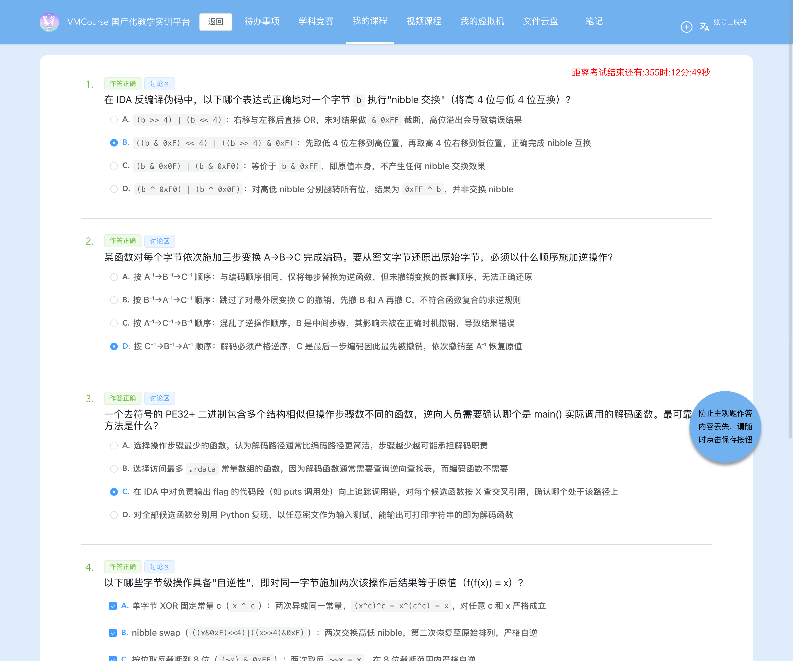

# 8-3 系统层漏洞利用与逆向分析 · 软件逆向静态分析-G3（PE32+ 校验器里的 nibble 查表 + 循环移位，逆序求逆还原 flag）

## 题目信息

| 项目 | 内容 |
| --- | --- |
| 题目名称 | 系统层漏洞利用与逆向分析-软件逆向静态分析-G3（sectionID `6721`，课程内 number 32，题目内部编号 `C036-G3-F`） |
| 分类 | 逆向分析 / 自实现字节变换识别（Windows PE32+ x86-64：静态复原 `ROL4 → ROR3 → 逐 nibble 查表` 的复合变换 → 按**逆序**求逆还原 flag） |
| 题目描述 | 题面提供**一个** PE 附件 `challenge.exe`，要求判断「这是什么算法，好像没有见过」并解出 flag。**本题没有靶机实例**（章节 `experimentID=0`），flag 完全来自对附件的静态分析 + 指令级（Unicorn）动态验证，不涉及任何网络端点。 |
| Flag 题（questionID=9447，`questionType=4` 代码/Flag 题）题干原文 | > * 这是什么算法，好像没有见过。flag 格式为 `flag{}`。*<br>> `{{input}}` |

Note：本题与同批的 8-1、8-2 同属「无靶机、纯附件分析」的题，但三题的线索形态正好递进，可以合起来当作一组经验：

- **8-1**：`challenge.elf` 是静态链接 stripped 的 ELF64，线索在字符串与最简单的 XOR，难点是**在巨型二进制里定位校验逻辑**；
- **8-2**：`challenge.exe` 里是**标准 RC4**，难点是「认出算法 + 找到不可打印的密钥」；
- **8-3（本题）**：`challenge.exe` 里**没有任何标准算法**，只有三个自写的小 helper 复合成一条字节变换 —— 难点变成了「**把变换链读准，并且知道求逆必须逆序**」。三题的正确性验证手段也逐级加码：本题除了 Python 复算，还用 **Unicorn 直接执行附件里的真实机器码**，把 256 个输入值全部跑一遍建立完整映射，再逆查表求 flag。

## 环境信息

| 项目 | 内容 |
| --- | --- |
| 平台 | VMCourse 国产化教学实训平台（自签名证书，`curl` 需加 `-k --noproxy '*'`），课程 ID `1639`，本章节 `sectionID` `6721`（课程内 number 32，title「系统层漏洞利用与逆向分析-软件逆向静态分析-G3」）。平台账号与口令只保存在本地未跟踪的 `.local/` 目录（不入库），本文不记录任何凭据、cookie 或个人身份信息 |
| 题目分组 | `10031`(G3-1/9423) / `10033`(G3-2/9425) / `10035`(G3-3/9427) / `10037`(G3-4/9429) / `10039`(G3-5/9447)，`needNum=1`、`envIDs="0"` |
| 题型 | 3 道单选（9423 / 9425 / 9427，`questionType=2`）+ 1 道多选（9429，`questionType=3`）+ 1 道 Flag 题（9447，**`questionType=4`**），共 5 题，`answersTotal=5`、`endOrNot=true` |
| 靶机实例 | **没有**：章节 `experimentID=0`，`sectionFiles` 为空，`GET /api/student/lab/vm` 查询为 `environment:null`；全流程**未创建、未启动任何实例**，也没有 SSH/HTTP/端口映射可连。附件挂在 Flag 题上（`questionFiles[0]`），不在章节附件里 |
| Flag 题附件表 | `questionFiles[0]`：`id=1381`、`filename=challenge.exe`、`size=16896`（作答页显示 `16.5K`），与本地文件一致 |
| 附件 | `.local/process/8-3-scripts/files/challenge.exe`，**16896 B**，MD5 **`9162d0c83fa78900c50b7573927fed9b`** |
| 附件属性 | `PE32+ executable (console) x86-64 (stripped to external PDB), for MS Windows`；`nsec=9`、`ImageBase=0x140000000`、`EntryPoint RVA=0x1440`、`DllCharacteristics=0x0160`（含 NX / DYNAMICBASE / HIGH_ENTROPY_VA / TERMINAL_SERVER_AWARE）；`.pdata` 51 条 `RUNTIME_FUNCTION` |
| 判分机会 | `newTestPaper` 返回 `isResubmit=false`；提交前 5 题的 `studentAnswer` 全为空 ⇒ 本题此前从未提交过，只有一次判分机会，因此四道选择题在提交**之前**就按附件实证独立判定并落盘 |
| 本机工具 | Apple LLVM `objdump`（原生支持 `coff-x86-64`，本题全量反汇编 1986 行）、`strings` / `file` / `md5` / `stat`、Python 3.14；**无 pefile / capstone / Ghidra / IDA**；Docker Desktop 29.4.3 **可用**（`--platform linux/amd64` 能起 x86_64 容器；`scottyhardy/docker-wine` 实测 `wine --version` = `wine-11.0`，但无头环境下跑 PE 无输出，见步骤 7 的 #2/#7）；另用 `/tmp/uni` venv 里的 **Unicorn 2.1.4** 做指令级模拟；截图用无头 Chrome（playwright-core 驱动系统 Chrome），脱敏用 PIL/numpy |
| 选择题判分备注 | **9423=B、9425=D、9427=C、9429=A,B,C,D**（9447 为 flag）；`GET /api/student/get/answerHistory?sectionID=6721&contestMode=0` 返回 **5/5 `isCorrect=true`**。按惯例本文只在环境信息备注结果，不展开选择题解析 |
| 时间 | 本机时区 2026-10-17（+08）；附件核验 22:13、提交 22:14:45、判分复核 22:14:46、问答 22:15–22:18；VMC/问答页截图 22:16–22:19，渲染稿 22:19–22:20（补试 wine 后 01–08、13 于 22:25 重新生成） |

## 解题过程

### 1. 附件侦察：PE32+、三串关键字符串与节表（截图 01）

```console
$ cd .local/process/8-3-scripts
$ file files/challenge.exe && stat -f "%z" files/challenge.exe && md5 files/challenge.exe
files/challenge.exe: PE32+ executable (console) x86-64 (stripped to external PDB), for MS Windows
16896
MD5 (files/challenge.exe) = 9162d0c83fa78900c50b7573927fed9b
```

与任务书给的 16896 B / MD5 一致 ⇒ 附件完整、没有加壳。自写 `parse_pe.py` 解析 PE 头 / 数据目录 / 节表（`logs/00-parse-pe.txt`）：

```text
file size 16896  magic 0x20b  machine 0x8664  nsec 9
ImageBase 0x140000000  EntryPoint RVA 0x1440  SizeOfImage 0xb000  Subsystem 3  DllCharacteristics 0x0160

name             VA     VSize    RawPtr   RawSize  chars
.text        0x1000    0x1bb0     0x400    0x1c00  0x60000020
.data        0x3000      0xa0    0x2000     0x200  0xc0000040
.rdata       0x4000     0xa48    0x2200     0xc00  0x40000040
.pdata       0x5000     0x264    0x2e00     0x400  0x40000040
.xdata       0x6000     0x1cc    0x3200     0x200  0x40000040
.bss         0x7000     0x180       0x0       0x0  0xc0000080
.idata       0x8000     0x8ac    0x3400     0xa00  0x40000040
.tls         0x9000      0x10    0x3e00     0x200  0xc0000040
.reloc       0xa000      0x60    0x4000     0x200  0x42000040

.pdata: 51 个 RUNTIME_FUNCTION（12 字节/项）—— 即全部函数边界
```

`strings` 一把就抓到三串关键字符串（`logs/01-objdump-full.txt` 里也能看到对应 `lea`）：

```console
$ strings -a -t x files/challenge.exe | grep -E "Enter the flag|Wrong|Correct"
 2200 Enter the flag: 
 2213 Wrong!
 221a Correct!
```

记住这条映射：**`.rdata` VA `0x4000` = 文件偏移 `0x2200`**，所以 `0x2200/0x2213/0x221a` 就是 `VA 0x140004000 / 0x140004013 / 0x14000401a` —— 后面 `grep` 交叉引用时用的正是这三个地址。导入表是 `fgets / strcspn / strlen / puts / __acrt_iob_func`，`api-ms-win-crt-*` 系 CRT，`.pdata` + `.xdata` 说明是 MSVC 风格工具链 ⇒ 典型「读入 → 变换 → 比较 → `Correct!`/`Wrong!`」的**校验器**。


### 2. 用 `.pdata` 定界 + 字符串 xref 定位 `main`（截图 02）

`.pdata` 有 **51** 条 `RUNTIME_FUNCTION`（12 B/项：`BeginAddress / EndAddress / UnwindInfoAddress`）——`stripped to external PDB` 只是没了符号名，函数边界是白送的。第 **11、12** 项正好是两个结构相似的小函数，第 **13** 项就是 `main`：

```text
11  Begin 0x01400014b2  End 0x01400014da  len 0x028      <-- main 实际调用（F）
12  Begin 0x01400014da  End 0x0140001504  len 0x02a      <-- 多一条 rolb 的孪生函数（G，无调用点）
13  Begin 0x0140001504  End 0x01400015d9  len 0x0d5      <-- main
```

再用 Rip 相对 `lea` 的交叉引用反查这三个字符串地址，全文件只命中 7 条，且**全部**落在 `0x1400014c9–0x1400015b9`：

```console
$ objdump -d files/challenge.exe > logs/01-objdump-full.txt      # 1986 行
$ grep -nE "0x1400040(00|10|13|1a|40|70)" logs/01-objdump-full.txt
1400014c9:  leaq 0x2ba0(%rip),%rcx   # 0x140004070   ← 16 字节 nibble 替代表 T（候选函数 F）
1400014f1:  leaq 0x2b78(%rip),%rcx   # 0x140004070   ← 同一张表（孪生函数 G）
140001510:  leaq 0x2ae9(%rip),%rcx   # 0x140004000   "Enter the flag: "
14000156e:  leaq 0x2acb(%rip),%rsi   # 0x140004040   ← 42 字节目标数组
140001593:  leaq 0x2a80(%rip),%rcx   # 0x14000401a   "Correct!"
1400015a6:  leaq 0x2a66(%rip),%rcx   # 0x140004013   "Wrong!"（长度不等分支）
1400015b9:  leaq 0x2a53(%rip),%rcx   # 0x140004013   "Wrong!"（比较失败分支）
```

三个用户可见字符串的引用点全在 `0x140001504–0x1400015d9`（`.pdata` 第 13 项）内 ⇒ 该函数就是 `main`。`main` 的校验逻辑（`logs/01-objdump-full.txt` 第 300–375 行，逐条注解）：

```asm
140001504: pushq %rdi / %rsi / %rbx ; 140001507: subq $0x60,%rsp   ; main 序言
14000150b: callq 0x1400016b0                     ; CRT 初始化
140001510: leaq 0x2ae9(%rip),%rcx  # 0x140004000 ; puts("Enter the flag: ")
140001521: callq *0x1400083b0                    ; __acrt_iob_func(0) = stdin
14000152a: leaq 0x20(%rsp),%rcx                  ; char buf[64]
14000152f: movl $0x40,%edx                       ; fgets(buf, 0x40, stdin)
140001551: callq 0x140002a20                     ; strcspn(buf,"\n")
140001556: movb $0x0,0x20(%rsp,%rax)             ; buf[len]=0（去掉行尾换行）
14000155e: callq 0x140002a28                     ; strlen(buf)
140001563: cmpq $0x2a,%rax                       ; ★ 长度必须 == 42
140001567: jne 0x1400015a6                       ; -> "Wrong!"（长度不等）
140001569: leaq 0x20(%rsp),%rbx                  ; rbx = buf
14000156e: leaq 0x2acb(%rip),%rsi  # 0x140004040 ; rsi = target
140001575: leaq 0x4a(%rsp),%rdi                  ; rdi = buf+42（循环上界）
14000157a: movzbl (%rbx),%ecx                    ; 取输入字节
14000157d: callq 0x1400014b2                     ; ★★ 逐字节变换 F
140001582: cmpb (%rsi),%al                       ; 与 target[i] 比较
140001584: jne 0x1400015b9                       ; -> "Wrong!"（比较失败）
140001586/58a: addq $0x1,%rbx / %rsi
140001591: jne 0x14000157a                       ; 循环 42 次
140001593: leaq 0x2a80(%rip),%rcx  # 0x14000401a ; puts("Correct!")
```

**逻辑一句话**：

```c
if (fgets(buf, 0x40, stdin) == NULL)          return 1;
buf[strcspn(buf, "\n")] = 0;
if (strlen(buf) != 0x2a) { puts("Wrong!");    return 1; }   // 42 字节硬检查
for (i = 0; i < 0x2a; i++)
    if (F(buf[i]) != target[i]) { puts("Wrong!"); return 1; }
puts("Correct!");
```

⇒ **flag 就是 `F⁻¹(target)`**，`target` = `.rdata:0x140004040` 起 42 字节，`F` = `0x1400014b2`（`main` 在 `0x14000157d` 唯一调用的那个函数）。


### 3. 复原字节级变换链：三个 helper + 一个壳（截图 03）

`0x140001490` 起是三个极小的 helper，`0x1400014b2` 是 `main` 调用的壳，`0x1400014da` 是只多一条 `rolb` 的孪生函数：

```asm
; ---- 步骤 A：0x140001490，8 位循环左移 4 位 = nibble swap（自逆）----
140001490: movl %ecx,%eax
140001492: rolb $0x4,%al
140001495: retq

; ---- 步骤 B：0x140001496，8 位循环右移 3 位（阶 8，非自逆）----
140001496: movl %ecx,%eax
140001498: rorb $0x3,%al
14000149b: retq

; ---- 步骤 C：0x14000149c，逐 nibble 查表（参数在 EDX，表基址在 RCX）----
14000149c: movl %edx,%eax
14000149e: shrb $0x4,%al            ; hi = d >> 4
1400014a1: movzbl %al,%eax
1400014a4: movzbl (%rcx,%rax),%eax  ; T[hi]      （rcx = 0x140004070）
1400014a8: shll $0x4,%eax           ; T[hi] << 4
1400014ab: andl $0xf,%edx           ; lo = d & 0xF
1400014ae: orb  (%rcx,%rdx),%al     ; (T[hi]<<4) | T[lo]
1400014b1: retq

; ---- 壳 F：0x1400014b2，main 实际调用的变换 ----
1400014b2: subq $0x28,%rsp
1400014b6: movzbl %cl,%ecx
1400014b9: callq 0x140001490        ; x = ROL4(x)
1400014be: movzbl %al,%ecx
1400014c1: callq 0x140001496        ; x = ROR3(x)
1400014c6: movzbl %al,%edx
1400014c9: leaq 0x2ba0(%rip),%rcx   # 0x140004070 表 T
1400014d0: callq 0x14000149c        ; x = S(x)
1400014d5: addq $0x28,%rsp
1400014d9: retq

; ---- 孪生 G：0x1400014da，唯一区别是多一条 rolb %al（= rol1）----
1400014fd: rolb %al
140001503: retq
```

于是得到：

```text
A: rolb $4        （8 位循环左移 4 位 = nibble swap，自逆，阶 2）
B: rorb $3        （8 位循环右移 3 位，阶 8 = 8/gcd(3,8)，非自逆）
C: S(d) = (T[d>>4] << 4) | T[d & 0xF]      （逐 nibble 查一张 16 字节表 T）

F(x) = S( ROR3( ROL4(x) ) )      ← main 调用的这个（0x1400014b2）
G(x) = rol1( F(x) )              ← 孪生函数（0x1400014da），全 .text 无 call 引用
```

两个容易读错的细节（以反汇编为准）：

- **`S` 的参数在 EDX，不在 CL**：`main`/`F` 先把变换结果 `movzbl %al,%edx`，再 `leaq 0x140004070,%rcx` 传表基址；`S` 用 `rcx` 当表、`edx` 当待换字节。若按「参数都在 `cl`」去读，这条链就会读不通（中间的 `movzbl %al,%edx` 会显得多余且无法解释）。
- **`0x1400014da` 不是 `main` 用的那个**：它比 `0x1400014b2` 长 2 字节（`len 0x02a` vs `0x028`），差别恰是末尾多一条 `rolb %al`；整个 `.text` 里没有任何 `call`/`jmp` 指向它。这正是「多个结构相似但步骤数不同的函数」这类陷阱的具体形态，也是本题必须靠**交叉引用**而不是靠「步骤数/输出可打印性」来定函数的原因。


### 4. 提取 42 字节目标数组与 16 字节 nibble 替代表（截图 04）

`.rdata` VA `0x4000` → 文件偏移 `0x2200`，dump 前 `0x90` 字节（`dump_rdata.py`，输出 `logs/04-dump-rdata.txt`）：

```text
.rdata  VA 0x140004000 .. 0x140004090 (ImageBase 0x140000000)
0x4000: 45 6e 74 65 72 20 74 68 65 20 66 6c 61 67 3a 20  |Enter the flag: |
0x4010: 00 0a 00 57 72 6f 6e 67 21 00 43 6f 72 72 65 63  |...Wrong!.Correc|
0x4020: 74 21 00 00 00 00 00 00 00 00 00 00 00 00 00 00  |t!..............|
0x4030: 00 00 00 00 00 00 00 00 00 00 00 00 00 00 00 00  |................|
0x4040: cc 82 ca c3 5b 97 bf cf b6 c6 b7 b2 cc 16 ca bb  |....[...........|  <-- target[0..15]
0x4050: 9a ba 16 b2 cb b3 bc 16 c2 b7 c6 97 16 b3 cc bb  |................|  <-- target[16..31]
0x4060: cf bf cb 9a ca ba b6 b7 bc 56 00 00 00 00 00 00  |.........V......|  <-- target[32..41] + 0x00 填充
0x4070: 07 0d 0a 04 0f 01 0b 09 02 0e 06 00 0c 08 03 05  |................|  <-- 表 T[0..15]
```

```text
target @ .rdata 0x140004040（42 B）=
  cc82cac35b97bfcfb6c6b7b2cc16cabb9aba16b2cb3bc16c2b7c69716b3ccbbcfbfcb9acabab6b7bc56
T      @ .rdata 0x140004070（16 B）= 07 0d 0a 04 0f 01 0b 09 02 0e 06 00 0c 08 03 05
```

两条结构性结论：

- **`T` 恰好是 `0..15` 的一个排列**（`sorted(T) == list(range(16))` 为真），所以 `S` 是两个独立 nibble 上各过一次 16 元置换 ⇒ `S` 是双射；
- **`target` 就是 42 字节**：最后一个字节 `0x56` 之后紧跟 `0x00` 填充，而 `main` 的硬检查是 `cmpq $0x2a,%rax`（`0x2a`=42），两者互相印证 —— 不是「碰巧后面还有数据」。


### 5. 逆序求逆：`F⁻¹ = ROL4 ∘ ROL3 ∘ S⁻¹`（截图 05）

`F = S ∘ ROR3 ∘ ROL4`，按函数复合的求逆规则「最外层最后施加的，最先撤销」：

```text
F⁻¹ = ROL4⁻¹ ∘ ROR3⁻¹ ∘ S⁻¹
    = ROL4   ∘ ROL3   ∘ S⁻¹        （ROL4⁻¹ = ROL4，nibble swap 自逆；ROR3⁻¹ = ROL3）
```

其中 `S⁻¹` 就是「用 `T` 的逆表 `T⁻¹` 分别换 hi / lo」：

```text
T   = 07 0d 0a 04 0f 01 0b 09 02 0e 06 00 0c 08 03 05
T⁻¹ = 0b 05 08 0e 03 0f 0a 00 0d 07 02 06 0c 01 09 04
```

`recover_flag.py` 的输出（`logs/03-recover-flag.txt`）：

```console
$ python3 recover_flag.py
[1] .rdata:0x140004040 目标数组 (42B):
    +00: cc 82 ca c3 5b 97 bf cf b6 c6 b7 b2 cc 16 ca bb
    +16: 9a ba 16 b2 cb b3 bc 16 c2 b7 c6 97 16 b3 cc bb
    +32: cf bf cb 9a ca ba b6 b7 bc 56
[2] .rdata:0x140004070 nibble 替代表 T: 07 0d 0a 04 0f 01 0b 09 02 0e 06 00 0c 08 03 05  (是 0..15 的排列: True)
[3] T 的逆表 T⁻¹: 0b 05 08 0e 03 0f 0a 00 0d 07 02 06 0c 01 09 04
[4] 逆序求逆 F⁻¹(target) = b'flag{82b5e04f-a391-4c76-d0e8-7f3b2c9a1506}'
[5] 正向复验 F(flag) == target: True
[6] F 在 0..255 上是双射（解唯一）: True
[7] 可打印 ASCII: True; 长度 42 == cmpq $0x2a
[8] 负对照 按正序施加逆函数: b'\xaa5\xaf\x95!\xc6\x14\x90\xf6\xae\x16\xf7\xaa\xb6\xaf\x111\xf1\xb6\xf7\x9f\x17\xf9\xb6\xa5\x16\xae\xc6\xb6\x17\xaa\x11\x90\x14\x9f1\xaf\xf1\xf6\x16\xf9\x86'
    是否含非可打印字节: True; 正向复验 F(wrong)==target: False
FLAG=flag{82b5e04f-a391-4c76-d0e8-7f3b2c9a1506}
```

前 6 个明文字节逐个手算一遍，与机器码语义逐条对得上（`S` 用的是上面那张 `T`）：

| 明文字节 | `ROL4` | `ROR3` | `S` | `target[i]` |
| --- | --- | --- | --- | --- |
| `f` 0x66 | 0x66 | 0xcc | 0xcc | 0xcc ✓ |
| `l` 0x6c | 0xc6 | 0xd8 | 0x82 | 0x82 ✓ |
| `a` 0x61 | 0x16 | 0xc2 | 0xca | 0xca ✓ |
| `g` 0x67 | 0x76 | 0xce | 0xc3 | 0xc3 ✓ |
| `{` 0x7b | 0xb7 | 0xf6 | 0x5b | 0x5b ✓ |
| `8` 0x38 | 0x83 | 0x70 | 0x97 | 0x97 ✓ |

第 `[8]` 行是**负对照**，也是本题最容易踩的坑：如果把逆函数按「与编码相同的顺序」套（即 `A⁻¹→B⁻¹→C⁻¹` 的正序思路），得到的 42 字节里**含大量非可打印字节**，而且回代 `F` 完全对不上 `target`。这条负对照直接排除了「顺序无所谓 / 都是置换所以随便套」的误判。

![Python 复现 `F` 并**逆序**求逆：目标数组、表 `T` 与逆表 `T⁻¹`、`F⁻¹(target)` 得到 flag、正向复验 `F(flag)==target`、256 值双射检查、长度 42 与 `cmpq $0x2a` 一致，以及第 `[8]` 行「按正序施加逆函数」的负对照（全非可打印且回代失败）；真实命令回显的渲染稿（非终端实拍）](screenshots/05-Python逆序求逆取flag.png)

### 6. 动态验证：Unicorn 直接执行附件里的真实机器码（截图 06）

静态结论已经自洽，但「我写的 `F⁻¹` 对不对」和「我读的 `F` 对不对」是两件事。本机是 macOS arm64，PE32+ 不能直接执行；8-2 已实测 Docker 里的 wine 在 qemu-user 下崩溃（`dlls/ntdll/unix/virtual.c` 的 `anon_mmap_fixed` 断言），本次又补试了一次 —— `scottyhardy/docker-wine` 的 `wine --version` 能返回 `wine-11.0`，但无头环境下跑 `challenge.exe` 在 110 s 内**没有任何输出**（见步骤 7 的 #7）。因此**不去跑整个 Windows 程序**，而是按节表把 `.text`/`.rdata` 原样映射进 Unicorn，只执行附件里那段真实机器码（`unicorn_verify.py`）：

- `.text` VA `0x1000` / RAW `0x400` / RS `0x1c00`、`.rdata` VA `0x4000` / RAW `0x2200` / RS `0xc00`，统一映射到 `ImageBase = 0x140000000`；
- 按 x86-64 约定把输入字节放进 **CL**，`RSP` 指向栈顶的 `RET_MAGIC`，从 `0x1400014b2` 执行到 `ret`，读 **AL**；
- 对 **0..255 全部输入**各跑一次，得到 `F` 的完整映射表（decoder），再对 `0x1400014da` 做同样的事得到 encoder 映射。

```console
$ /tmp/uni/bin/python unicorn_verify.py
[1] decoder 是 0..255 上的双射: True
[2] 目标数组 (42B): cc82cac35b97bfcfb6c6b7b2cc16cabb9aba16b2cbb3bc16c2b7c69716b3ccbbcfbfcb9acabab6b7bc56
[3] 逆查表还原 flag: b'flag{82b5e04f-a391-4c76-d0e8-7f3b2c9a1506}'
[4] 正向复验（真实机器码）decoder(flag) == target: True
[5] 对照 encoder(x) == rol1(decoder(x)) 恒成立: True; 两函数取值差异个数: 254/256
[6] 负对照 篡改 target[0]^1 后仍判等: False  (期望 False)
[7] 长度检查 main 的 cmpq 立即数 = 0x2a = 42（= len(flag) = 42）
FLAG=flag{82b5e04f-a391-4c76-d0e8-7f3b2c9a1506}
```

这几行的分工要看清：

- `[1]` 证明 `F` 在 0..255 上是**双射**（映射表 256 个值互不重复）⇒ 解唯一，不用爆破；
- `[3]` 用的是**逆查表**（对每个目标字节，在真实机器码的映射表里找唯一原像），**完全不依赖**我在步骤 5 写的 `F⁻¹` 公式 —— 这是对「公式」的独立检验；
- `[4]` 再把还原结果**逐字节送回真实机器码**，输出必须逐字节等于 `.rdata` 里那 42 字节；两个方向都成立才敢定 flag；
- `[5]` 是孪生函数的对照：`encoder(x) == rol1(decoder(x))` 在 256 个输入上**恒成立**，且两者取值差异 **254/256**（`rol1` 有两个不动点）—— 说明 `0x1400014da` 与 `0x1400014b2` 的差异确实**只有一条 `rolb %al`**，也从侧面证明我读的指令序列没漏东西；
- `[6]` 是负对照：把 `target[0]` 翻转 1 bit 后再比较，判等为 `False` ⇒ 这个判等不是恒真，正向复验有判别力。


### 7. 失败尝试与踩坑清单

| # | 尝试 | 现象 | 原因 | 如何调整 |
| --- | --- | --- | --- | --- |
| 1 | 先 `import capstone` / `import unicorn` 在本机做反汇编与模拟 | `ModuleNotFoundError` | 本机 Python 3.14 没装这两个包，系统 Python 也无直连 pip（代理变量指向未启动的 `127.0.0.1:7897`） | 反汇编改用**系统自带 Apple LLVM `objdump`**（原生支持 `coff-x86-64`，1986 行完全可读）；模拟改用 8-2 已建好的 venv `/tmp/uni`（unicorn 2.1.4），不重复造环境 |
| 2 | 想直接跑 PE 做端到端动态验证（Docker + wine） | 8-2 已实测：`wine: dlls/ntdll/unix/virtual.c:267: anon_mmap_fixed: Assertion … failed`、`qemu: uncaught target signal 6 (Aborted)`、`rc=134` | 本机 arm64 上 Docker Desktop 以 **qemu-user** 跑 `linux/amd64`，wine 需要 4 KB 对齐的 `MAP_FIXED`，host 页大小不匹配即断言崩溃；**与本题附件无关** | 主线先不依赖 wine，改为 **Unicorn 只模拟校验函数本身**（无需 win32 API、无需 CRT，步骤 6）；稍后仍补试了一次 wine，见 #7 |
| 3 | 想用 `objdump --disassemble-symbols` 走捷径 | 对裁剪过的 PE 支持差（5-x 已记录） | 无符号表 + 该选项对 PE 的符号解析不完整 | 直接全量 `-d` + `grep` 三个字符串 VA 的 xref，定位成本很低 |
| 4 | 若按「参数都在 `cl`」去理解 `0x14000149c` | 会与前后的 `movzbl %al,%edx` 对不上，链读不通 | `S` 的待换字节其实在 **EDX**，`RCX` 是表基址；`main`/`F` 都把中间结果先搬到 `edx` | 回到调用点看寄存器赋值（`1400014c6: movzbl %al,%edx` + `1400014c9: leaq …#0x140004070,%rcx`），按 `(rcx=T, edx=d)` 重读，全链自洽 |
| 5 | 若用「步骤数最少」「输出可打印」来挑解码函数 | 会选到 `0x1400014da`，或两个都"像"、无法排除 | `0x1400014da` 只比 `0x1400014b2` 多一条 `rolb %al`，两者都是 0..255 上的双射，对任意密文都可能"碰巧"出可打印串 | 改用**交叉引用**：`main@0x14000157d` 明确 `callq 0x1400014b2`，而 `0x1400014da` 全 `.text` 无任何调用点；Unicorn 的 `[5]` 又从数值上确认两者差异恰为一条 `rolb` |
| 6 | 提交后看响应顶层 `isCorrect=false`、`scoreRate=0`，一度怀疑提交失败 | 顶层字段恒为 false/0 | 平台固有现象（判分前不返回分数） | 按规范只看 `answerHistory.answerQuestion[].isCorrect`：5 条全 `true`（步骤 8） |
| 7 | 仍想直接跑一次 PE 拿真实 `Correct!`：`docker run --rm --platform linux/amd64 scottyhardy/docker-wine wine --version` 能返回 `wine-11.0`，但 `docker run -i … wine /w/challenge.exe < answer.txt` 在 110 s 内**没有任何输出** | 镜像 entrypoint 要起 Xvfb / wine session，首启 wine prefix 初始化 + 无 X 显示；本机 arm64 下 amd64 容器走 Rosetta，窗口/prefix 初始化在无头环境不可靠（与 8-2 记录的 wine 崩溃同源） | 已 `docker kill` 清理该容器；放弃这条路，回到 **Unicorn 只模拟校验函数** —— `0x1400014b2` 不碰任何 win32 API，已取得等价证据：真实机器码下 `decoder(flag) == target` 逐字节成立 |

> 补充：本题**没有靶机实例**，因此不存在「靶机遗留物」（无进程、无上传文件、无 token）。本机副产物只有 `.local/process/8-3-scripts/`（脚本 + `files/challenge.exe` + `logs/` 原始输出 + `render/` 渲染源）与 `/tmp/shot`（playwright，属于跨题共用）。

### 8. 提交答案与平台判分：一次提交，5/5 全对（截图 07、08）

四道选择题在提交**之前**已按附件实证独立判定并落盘（`.local/process/8-3-answers-rationale.md`），并确认 `newTestPaper` 里 5 题的 `studentAnswer` 全为空、`isResubmit=false`；随后**只提交一次**，type-4 用 `{"answer":["flag{...}"],"num":1}` 一次命中：

```bash
curl -sS -k --noproxy '*' -m 60 -b .local/vmc-cookies.txt -X POST "$VMC_BASE_IP/api/student/submitAnswers" \
  -F 'sectionID=6721' \
  -F 'answers={"questionID":9423,"answer":"{\"answer\":[\"B\"],\"num\":1}"}' \
  -F 'answers={"questionID":9425,"answer":"{\"answer\":[\"D\"],\"num\":1}"}' \
  -F 'answers={"questionID":9427,"answer":"{\"answer\":[\"C\"],\"num\":1}"}' \
  -F 'answers={"questionID":9429,"answer":"{\"answer\":[\"A\",\"B\",\"C\",\"D\"],\"num\":4}"}' \
  -F 'answers={"questionID":9447,"answer":"{\"answer\":[\"flag{82b5e04f-a391-4c76-d0e8-7f3b2c9a1506}\"],\"num\":1}"}' \
  -F 'contestMode=0'
```

原始响应（`logs/05-submit.txt`，**已整段删除 `currentUser`**）关键字段（节选：`…` 表示省略的无关字段）：

```json
{"answers":[{"questionID":9423,"answer":"{\"answer\":[\"B\"],\"num\":1}","answerTimes":1,"scoreRate":0,…},
            {"questionID":9425,"answer":"{\"answer\":[\"D\"],\"num\":1}","answerTimes":1,"scoreRate":0,…},
            {"questionID":9427,"answer":"{\"answer\":[\"C\"],\"num\":1}","answerTimes":1,"scoreRate":0,…},
            {"questionID":9429,"answer":"{\"answer\":[\"A\",\"B\",\"C\",\"D\"],\"num\":4}","answerTimes":1,"scoreRate":0,…},
            {"questionID":9447,"answer":"{\"answer\":[\"flag{82b5e04f-a391-4c76-d0e8-7f3b2c9a1506}\"],\"num\":1}","answerTimes":1,"scoreRate":0,…}],
 "code":0,"isCorrect":false,"msg":"success"}
http=200
```

- 每个 `answers` 字段 = 外层 `questionID` + 内层答案对象 JSON 字符串；**5 题一次请求**提交，避免中途失败把唯一一次判分机会拆散；
- 顶层 `isCorrect=false`、各条 `scoreRate:0` 是平台已知现象（未判分前不返回分数），**不作为判据**；
- 5 条 `answerTimes` 均为 **1** ⇒ 没有反复覆盖。

判分以 `GET /api/student/get/answerHistory?sectionID=6721&contestMode=0` 为准（`logs/06-answerHistory.json`）：

```json
{"answerQuestion":[{"order":1,"questionID":9423,"sectionID":6721,"isCorrect":true},
                   {"order":2,"questionID":9425,"sectionID":6721,"isCorrect":true},
                   {"order":3,"questionID":9427,"sectionID":6721,"isCorrect":true},
                   {"order":4,"questionID":9429,"sectionID":6721,"isCorrect":true},
                   {"order":5,"questionID":9447,"sectionID":6721,"isCorrect":true}],
 "code":0,"msg":"success"}
```

**5/5 `isCorrect=true`**（9423 / 9425 / 9427 / 9429 / 9447）。响应中的 `currentUser`（账号、姓名、学号、班级、`lastIP`）在渲染截图前整段删除。

![`submitAnswers` 的请求与原始返回：5 条 `answerTimes=1`、type-4 的 `{"answer":["flag{...}"],"num":1}` 一次被接受、`code:0`、`msg:"success"`；响应中的 `currentUser` 已整段删除（图中标 `<已删除…>`），并注明顶层 `isCorrect` 恒 false、`scoreRate` 恒 0 属平台现象；真实 HTTP 响应的渲染稿（非终端实拍）](screenshots/07-平台提交响应-五题已提交.png)


### 9. VMC 作答页核对：5 题全「作答正确」（截图 09、10）

平台作答页（`/student/course/answer/6721`）是**真实页面**：上半页顶栏 + 第 1–3 题（B / D / C 选中）与每题「作答正确」标记；下半页第 3 题尾、第 4 题四个勾选、第 5 题 Flag 输入框内为最终 flag，附件表列出 `challenge.exe`（16.5K），每题同样显示「作答正确」。它与 `answerHistory` 的 5 条 `true` 互为独立证据（页面走作答页渲染，判分走接口）。

- 页面滚动不在 `window` 上（`Element Plus` 内部容器 `.el-scrollbar__wrap` 才有 `scrollHeight=1802 > clientHeight=1200`），所以下半页是对该容器设 `scrollTop` 后再截，而不是改 `window.scrollY`；
- 两张图的顶栏账号区均已**涂白并标注「账号已脱敏」**（参数见步骤 11）。




### 10. 教学问答：4 问 4 答，如实记录模型 4 处偏差（截图 11、12、13）

围绕本题主题向课程教学问答平台（Qwen2.5）提了 **4 个问题**，覆盖算法原理 / 静态定位方法论 / 自逆操作理论 / 防御与检测四个维度；脚本 `qa_ask.py`（SSE 拼接，相邻提问间隔 ≥13 s，原始流 `logs/07-qa-raw.txt`），**每题各自独立成一个会话**：

| # | 覆盖维度 | 问题要点 | cid | 回答长度 |
| --- | --- | --- | --- | --- |
| Q1 | 本题原理 | `ROL4 → ROR3 → 逐 nibble 查表` 的组合在数学上是什么类型（置换/双射？定义域多大）、为什么不是自逆、为什么求逆必须 `C⁻¹→B⁻¹→A⁻¹` | **5713** | 581 |
| Q2 | 方法细节 | stripped PE32+x64 里如何系统定位「读输入→变换→比较常量→`Correct!`」：`.pdata` 枚举、字符串 xref、常量数组反查、objdump/Python 复现要点与陷阱 | **5714** | 2081 |
| Q3 | 选择题理论支撑 | 四种自逆操作（XOR 常量 / nibble swap / `~x&0xFF` / `+128 mod 256`）的群论解释与阶、`rol/ror` 的阶与自逆条件、「只用自逆操作叠加」为何更容易被逆 | **5716** | 1086 |
| Q4 | 检测与加固 | YARA/启发式发现「单字节逐位变换循环 + 16/256 字节表」、插桩在比较点 dump 期望值、开发者应采用的更可靠方案 | **5718** | 1788 |

**模型回答中 4 处偏差（如实记录，一律不作为本题结论）**：

1. **Q1 说「这两步操作本身不是可逆的，因此组合起来的变换也不可逆」—— 错误**：任何 `rol/ror` 都是 0..255 上的双射、都可逆（`ROL4⁻¹=ROL4`、`ROR3⁻¹=ROL3`）。`F` 非自逆的真正原因是 `S∘ROR3∘ROL4` 复合后不满足 2 阶，而不是「旋转不可逆」。该回答里「`F` 是 256 个值上的置换/双射」「求逆顺序 `C⁻¹→B⁻¹→A⁻¹`」「查表要用逆表」三点是对的。
2. **Q2 把 `RUNTIME_FUNCTION` 说成 16 字节**、字段写成 `start/end/prolog_len/epilog_len`，示例代码 `f.seek(0x1000)  # 假设 .pdata 从 0x1000 开始`。本附件实测是 **12 字节**（`BeginAddress/EndAddress/UnwindInfoAddress`）、`.pdata` 在 **RVA 0x5000（RAW 0x2e00）**，`0x1000` 是 `.text` —— 照抄会按 16 字节步进解析错位，并读错区段。方法论（`.pdata` 枚举 + 字符串 xref + 常量数组反查）本身正确。
3. **Q3 有 3 处不严谨**：示例 `0x1234 → 0x2134` 在「字节级」语境下容易误解；「循环左移 k 位阶为 8」应为 **`8/gcd(k,8)`**（如 `rol4` 阶为 2）；「只使用自逆操作叠加，复合后的结构也满足自逆性」**不成立** —— 两个对合复合一般不是对合（除非二者交换），本题 `ROL4`（对合）与 `ROR3`（阶 8）复合后整体非自逆就是现成反例。四种操作「阶为 2、严格自逆」的结论正确。
4. **Q4 的方向正确但代码片段不可直接落地**：给出的 DynamoRIO/PIN/Frida 是伪代码且有误（对 native 库使用 `Java.perform`、`PIN网站地图函数名` 之类），只能当排查思路；YARA/白盒/插桩的方向可参考。

> 口径说明：以上偏差**均不作为解题依据**。本题的算法判定、变换链、`target`/`T` 的取值、flag 全部以 `objdump` 反汇编、`.rdata` 字节与 Python/Unicorn 复算为准；教学模型的回答只用来梳理思路、列排查清单。截图 13 底部也写明了这一口径。

问答页截图用**逐字指纹**确认「是本题的会话」（同一账号落地页默认显示最新会话，历史列表是账号级的，混有别的题的会话，不能假设）：

- 11（cid 5713）：`先 8 位循环左移 4 位（nibble 交换）` / `拼成 (T[hi]<<4)|T[lo]` / `这种组合操作在数学上可以被视为一种置换` → **3/3 命中**（`logs/20-qa-page-meta.json`）；
- 12（cid 5718）：`从防御与检测角度：CTF 里这种『自实现字节变换` / `在面对自实现字节变换和常量数组比较的恶意软件时，` → **2/2 命中**。


### 11. 截图真实性与脱敏说明

`8-3/screenshots/` 共 **13 张 PNG，目录内无其他文件**（渲染源 HTML 在 `.local/process/8-3-scripts/render/`，脚本与原始日志在 `.local/process/8-3-scripts/`，均不入库）。按取证方式分三类，**图注与正文均如实区分**：

| 文件 | 内容 | 真实性 | 脱敏 |
| --- | --- | --- | --- |
| `01-附件信息与PE头.png` | `file`/`stat`/`md5` + PE 头与 9 个节 + `.pdata` 51 项起头 + `strings` 关键行 | **真实命令回显的渲染稿**（非终端实拍，图内顶部自带标注） | 无个人信息 |
| `02-定位main与字符串xref-校验循环.png` | 字符串 xref 7 条 + `main` 全段反汇编（长度 42 / `call 0x1400014b2` / 比较循环） | 同上 | 无 |
| `03-静态复原三步变换链.png` | 三个 helper + 壳 `F` + 孪生 `G` 逐条 | 同上 | 无 |
| `04-提取目标数组与nibble替代表.png` | `.rdata` 带注释 dump（target 42 B + T 16 B） | 同上 | 无 |
| `05-Python逆序求逆取flag.png` | `recover_flag.py` 全部输出（正向复验、双射、正序负对照） | 同上 | 无（flag 为题解内容） |
| `06-动态验证-Unicorn执行真实机器码.png` | `unicorn_verify.py` 输出（双射 / 逆查表 / 正向复验 / 孪生函数对照） | 同上 | 无 |
| `07-平台提交响应-五题已提交.png` | `submitAnswers` 请求与原始响应 | 渲染稿（**真实 HTTP 响应**） | **渲染前整段删除 `currentUser`**（图中标 `<已删除…>`） |
| `08-平台判分-answerHistory.png` | `answerHistory` 5 条 `isCorrect:true` + 原始 JSON | 同上 | 同上 |
| `09-VMC作答页-上半Q1Q3-均作答正确.png` | Q1–Q3 选项与「作答正确」 | **VMC 真实页面截图**（无头 Chrome，viewport 1440×1200、`dSF=2` ⇒ PNG 2880×2400） | 顶栏账号区涂白 + 「账号已脱敏」 |
| `10-VMC作答页-下半Q4Q5-flag已提交.png` | Q4 四个勾选 + Q5 flag 输入框 + 附件表 | 真实页面截图（同参数，滚动容器内下滚） | 同上 |
| `11-AI问答-教学平台真实页面-本题会话Q1.png` | 会话 5713（Q1 + AI 回答） | **问答页真实截图**（viewport 1440×1250、`dSF=2` ⇒ PNG 2880×2500） | 右上账号胶囊涂白 + 「账号已脱敏」 |
| `12-AI问答-教学平台真实页面-本题会话Q4.png` | 会话 5718（Q4 + AI 回答） | 问答页真实截图（同参数） | 同上 |
| `13-AI问答-本题问答总览.png` | 4 问 4 答摘要 + cid + 提问规范与口径说明 | **本地渲染稿**（问答原文的真实返回，图内标注「非页面截图」） | 原文不含账号字段，无需涂白 |

> 说明：`01`–`08`、`13` 是渲染稿。原因是本题**纯静态分析、无靶机可实拍**，且本机 Agent 进程没有屏幕录制权限（`screencapture` 报 `could not create image from display`），因此把真实命令回显 / 真实 HTTP 响应逐字渲染成黑底白字 HTML 再截图，渲染脚本只做 `html.escape`，未手工改写字符。`09`/`10` 是 VMC 作答页、`11`/`12` 是问答页的**真实页面**。

**脱敏实测参数（脚本 `.local/process/8-3-scripts/mask_vmc_header.py`、`mask_qa_account.py`，`--check` 干跑 / `--apply` 落盘；坐标均为本批次各图逐图实测，未照抄 5-x/8-1/8-2）**

**(A) VMC 作答页顶栏账号区 —— 含昵称 + 学号，必须涂白（已涂）**

- viewport `1440×1200`、`deviceScaleFactor=2` ⇒ PNG `2880×2400`；顶栏背景色实测 `rgb(114,177,239)`（`.el-header` computed style）；
- `.user-name` CSS 矩形 `x=1309 y=35.30 w=59 h=23` ⇒ device `(2618,70.6)-(2736,117.2)`；列聚类实测（`logs/10-mask-check.txt`）：`(2473,2514)`「+」图标、`(2541,2575)`「文A」、`(2619,2685)` 账号文本；
- 涂白 box（device px）**`(2605,56,2699,113)`**，ink 计数（RGB 曼哈顿距离和 > 60 记 ink）**928 → 564**；剩余 564 全是「账号已脱敏」五个字的白字 ink；
- 裁剪目视复验 `logs/mask-check-09-…png` / `logs/mask-check-10-…png`：蓝底 + 「账号已脱敏」，昵称已不可见。

**(B) 教学问答页顶栏账号胶囊 —— 含真实姓名 + 学号，必须涂白（已涂）**

- viewport `1440×1250`、`dSF=2` ⇒ PNG `2880×2500`；顶栏背景色实测 **`rgb(255,252,247)`**（米白，与 VMC 蓝顶栏不同）；
- `.who span` CSS 矩形 `x=1070.05 y=25 w=169.55 h=26.48` ⇒ device `(2140,50)-(2479,103)`；聚类实测（`logs/22-qa-mask-check.txt`）：`(2142,2207)` + `(2232,2455)` 是昵称被中英文括号间空白切成两簇，`(2504,2639)`「帮助」、`(2664,2735)`「退出」；
- 涂白 box（device px）**`(2126,37,2493,116)`**（DOM 矩形外扩 14/13 px，右侧留 11 px 不碰「帮助」），ink 计数 **3624 → 778**；
- 裁剪目视复验 `logs/mask-check-11-…png` / `logs/mask-check-12-…png`：昵称完全不可见，「帮助」按钮完整。

**(C) 含账号信息的原始 HTTP 响应 —— 渲染前整段删除**

- `submitAnswers` / `answerHistory` 的原始 JSON 都含 `currentUser`（`username` / `nickname` / `className` / `lastIP` / `registerIdCard` 等）。处理：渲染前 `obj.pop('currentUser')`，并在图上写明「已删去响应中的 `currentUser`（账号/姓名/学号/班级/lastIP）」。
- `13-AI问答-本题问答总览.png` 是对 `.local/process/8-3-qa-transcript.json` 的渲染，正文不含任何账号字段。

> 两处涂白都只覆盖账号区域、填充实测背景色并写「账号已脱敏」，**可追溯**（脚本参数 + ink 计数 + 裁剪复验图都在 `logs/`）、**可回退**（重跑 `shots_vmc*.mjs` / `shots_qa.mjs` 即可重新生成未脱敏原图）。本文正文同样不记录任何凭据、cookie 或个人身份信息。
>
> 已知一处渲染瑕疵（如实记录，不影响结论）：`03` 图对 `0x1400014da` 段做了省略（只列了 `subq` / `rolb` / `addq` / `retq`，中间 7 条 `movzbl`/`call`/`leaq` 与 `0x1400014b2` 对应部分完全相同，未逐行列出，也没有画省略号），完整原文见 `logs/01-objdump-full.txt`。

### 12. 靶机与遗留物

| 位置 | 内容 | 说明 |
| --- | --- | --- |
| 靶机 | **无** | 章节 `experimentID=0`，`lab/vm` 返回 `environment:null`，全流程未创建任何实例，也没有可清理的容器/进程/端口 |
| 本机 | `/tmp/uni`（Unicorn 2.1.4 venv，沿用 8-2）、`/tmp/shot`（playwright-core，跨题共用）、Docker 镜像 `scottyhardy/docker-wine`（8-2 为 wine 路线拉取，本题补试复用；临时容器已 `docker kill` 清理，镜像如需回收可 `docker rmi`） | 均不影响仓库 |
| 仓库 | `.local/process/8-3-scripts/`（`parse_pe.py`、`dump_rdata.py`、`recover_flag.py`、`unicorn_verify.py`、`qa_ask.py`、`shots_*.mjs`、`mask_*.py`、`files/challenge.exe`、`logs/` 原始输出、`render/` 渲染源）、`.local/process/8-3-answers-rationale.md`、`.local/process/8-3-qa-transcript.json`、`.local/process/8-3-ctf-process.md`、`8-3/screenshots/`（13 张 PNG）、本文件 `8-3/writeup.md` | `.local/` 均不入库 |

## 分析路径与关键证据

> 本题没有靶机，**所有关键结论都必须能在这一份 16896 B 的二进制里指到具体字节**。下面按「问题 → 结论 → 证据（地址/字节/命令）→ 为什么这条证据足够」组织。

### 问题与结论一览

| 问题 | 结论 | 关键证据 |
| --- | --- | --- |
| 程序是干什么的？ | 读一行输入当 flag 的**校验器** | `strings`：`0x2200 "Enter the flag: "`、`0x2213 "Wrong!"`、`0x221a "Correct!"`；导入 `fgets / strcspn / strlen / puts` |
| 校验器在哪？ | `main = 0x140001504–0x1400015d9` | `.pdata` 第 13 项；`0x140004000` / `0x140004013` / `0x14000401a` 三个字符串 xref **只**落在这个区间内（共 7 条 `lea`） |
| 变换函数是哪个？ | `F = 0x1400014b2–0x1400014d9` | `.pdata` 第 11 项；`callq 0x1400014b2` 出现在 `main` 的校验循环 `0x14000157d`；孪生 `0x1400014da` 全 `.text` **无调用点** |
| 变换链是什么？ | `F(x) = S(ROR3(ROL4(x)))` | `140001492: rolb $4`（A）、`140001498: rorb $3`（B）、`14000149c–1400014b1` 的 `(T[hi]<<4)\|T[lo]`（C）；壳 `0x1400014b2` 的顺序是 A→B→C |
| 目标数组在哪、多长？ | `.rdata` `0x140004040`，**42 字节** | `14000156e: leaq … # 0x140004040`；`140001563: cmpq $0x2a,%rax`；42 字节后紧跟 `0x00` 填充 |
| 替换表在哪？ | `.rdata` `0x140004070`，**16 字节**，是 `0..15` 的排列 | `1400014c9: leaq 0x2ba0(%rip),%rcx # 0x140004070`；`sorted(T)==range(16)` |
| 为什么解唯一？ | `F` 是 0..255 上的双射 | `recover_flag.py` 的 `[6]` 与 Unicorn 的 `[1]`（256 个值互不重复）双向确认 |
| 求逆顺序？ | `F⁻¹ = ROL4 ∘ ROL3 ∘ S⁻¹`（**逆序**） | 数学上 `(C∘B∘A)⁻¹ = A⁻¹∘B⁻¹∘C⁻¹`；正序负对照 `[8]` 输出全非可打印且回代失败 |
| flag 是什么？ | `flag{82b5e04f-a391-4c76-d0e8-7f3b2c9a1506}`（42 字节） | Python 逆序求逆 + Unicorn 真实机器码 256 值全映射与逆查表 + 正向复验，双路一致 |

### 每条关键证据为什么足够（可复核性）

1. **函数身份不是猜的，是双重限定的**：`.pdata` 给出 51 个 `[Begin, End)` 区间，把「被调用一次的变换函数」`0x1400014b2`（第 11 项）、「只多一条 `rolb` 的孪生」`0x1400014da`（第 12 项）、「从 `puts` 到 `ret` 的校验器」`0x140001504`（第 13 项）分开；再叠加交叉引用计数（三个字符串 VA 的 `lea` 全在 `0x140001504–0x1400015d9`、`callq 0x1400014b2` 只在 `0x14000157d`），`main` 与被调用者的身份就没有第二种解释。**注意这条证据恰好否掉「按步骤数挑」的启发式**：步骤更少的 `0x1400014b2` 才是被调用的那个，而孪生 `0x1400014da` 一条 `rolb` 之差、无人调用。
2. **参数语义有寄存器与数据的双重证据**：`F` 里的 `movzbl %cl,%ecx` 说明输入字节是从 **CL** 传入的（`main` 侧对应 `movzbl (%rbx),%ecx`）；`S` 的待换字节在 `EDX`、表基址在 `RCX`（`1400014c6/1400014c9`）；`main` 的比较对象是 `rsi = 0x140004040`、循环上界是 `rdi = buf+42`（`leaq 0x4a(%rsp),%rdi` 对应 `buf` 在 `rsp+0x20`）。这三处互相对上，才能确定「输入 → `F` → 与 target 比」的方向。
3. **变换链的每一步都是可指认的指令，不是"看着像"**：
   - `rolb $0x4,%al`：8 位循环左移 4 位 = 高/低 nibble 互换（等价于 `((b&0xF)<<4)|((b>>4)&0xF)`，自逆）；
   - `rorb $0x3,%al`：8 位循环右移 3 位（阶 `8/gcd(3,8)=8`，**非**自逆）；
   - `shrb $4` → `movzbl (%rcx,%rax)` → `shll $4` → `andl $0xf,%edx` → `orb (%rcx,%rdx),%al`：正是 `(T[hi]<<4)|T[lo]`，且 `T` 是 16 字节排列。
4. **「`T` 是排列」这一条本身就是可解性的判据**：`S` 对 hi/lo 两个 nibble 分别做 16 元置换，`ROL4` 是 8 位上的置换，`ROR3` 也是 ⇒ 复合仍是 0..255 上的置换，解唯一。反过来，若 `T` 里有重复值，`S` 就不是双射、解会不唯一，那种情况下「逆查表」也不再成立 —— 这条判据决定了本题可以用「逆查表」而不是「爆破/枚举」。
5. **长度约束是硬证据**：`cmpq $0x2a,%rax`（42）与 `.rdata` 里 42 字节后紧跟 `0x00` 填充互相印证；flag 恰好 42 字节（`flag{` + 36 字符 + `}`）。任何长度不符的候选在 `0x140001567` 就被判 `Wrong!`，根本进不了比较循环。
6. **求逆顺序有正反两面的证据**：正面是 `F(flag) == target`；反面是「按正序套逆函数」得到的 42 字节**全非可打印**且回代失败（`[8]`）。只有正面会被"碰巧"满足，正反同时成立才排除了顺序错误。
7. **动态验证跑的是附件里的真代码，不是"再实现一遍算法"**：`unicorn_verify.py` 把 `.text`/`.rdata` 按节表原样映射，从 `0x1400014b2` 执行；对 0..255 **全部 256 个输入**各跑一次建立完整映射（不是只跑 flag 那 42 个字节），双射判定、逆查表、正向复验都在真机器码上完成。再叠加孪生函数的 `rol1` 对照（254/256 差异，排除"认错函数"）与篡改 `target` 的负对照（排除"判等恒真"）；"求逆顺序错"这一类则由 `recover_flag.py` 的正序负对照排除。
8. **Lead 侧独立复算一致**：按同一条链（`T` 建 256 值双射 → 求逆 → `.rdata` `VA 0x140004040` 的 42 字节）独立复算，得到同一个 `flag{82b5e04f-a391-4c76-d0e8-7f3b2c9a1506}`，与解题侧 Python/Unicorn 两路结果、平台 `answerHistory` 第 5 条判定逐字一致。

### 从"看不清"到"看清"的两个转折点

- **转折一：把 `.pdata` 当函数表用**。这类 MSVC PE 没有符号表，但 51 条 `RUNTIME_FUNCTION` 等于白送一份函数边界清单；先用它把 `main` 与两个候选变换函数圈出来，再用字符串 xref 与 `call` 引用计数确认，比从 `EntryPoint=0x1440`（CRT 启动代码）一路读下去快一个数量级。
- **转折二：从"跑整个 PE"降级为"只跑那 40 字节函数"**。本机是 macOS arm64，PE32+ 跑不起来，wine 在 qemu-user 下会崩、无头环境下补试也没有任何输出；但验证目标其实只是"我读出来的变换语义对不对"。用 Unicorn 按节表映射后直接执行 `0x1400014b2`，按调用约定把输入放进 `CL`、栈顶放 `RET_MAGIC`，就能在不依赖 Windows 运行环境的前提下拿到**比复写算法更强**的证据：跑的是附件里的字节，不是我抄的公式。

## Flag

```text
flag{82b5e04f-a391-4c76-d0e8-7f3b2c9a1506}
```

该 flag 由三条独立路径互证取得：① 静态复原 `F = S∘ROR3∘ROL4` 后**逆序**求逆 `F⁻¹ = ROL4∘ROL3∘S⁻¹`（`T` 用逆表），得到 42 字节可打印串，且 `F(flag)` 逐字节还原 `.rdata:0x140004040` 的 42 字节；② **Unicorn 直接执行附件 `0x1400014b2` 处的真实机器码**，对 0..255 全部取值建立完整映射（双射），再用**逆查表**（不依赖 ①的公式）还原同一 flag，并把结果送回真机器码做正向复验；③ 平台 `answerHistory` 第 5 条（questionID 9447）判定为正确，作答页第 5 题输入框内的值与两者逐字一致。另有 Lead 侧按同一条链的独立复算结果相同。

## 总结与心得

### 原理：这是"置换的复合"，不是"加密"

1. **每一步都是 0..255 上的置换，所以整条链也是置换**：`ROL4`（nibble swap）是 256 个值上的置换、`ROR3` 是置换、`S` 是两个 nibble 上各一次 16 元置换的组合。复合仍是置换 ⇒ **双射 ⇒ 对给定密文解唯一**，这类题原则上不需要爆破，只要把链读准、把表取对。识别"是不是置换"有个很硬的判据：看 `T` 是否恰为 `0..15` 的排列（本题成立）。
2. **"自逆"要看阶，不能看操作个数**：`rolb $4`（nibble swap）阶为 2、严格自逆；`rorb $3` 阶为 `8/gcd(3,8)=8`，不是自逆。两者复合后的 `F` 也不自逆 —— **两个对合复合一般不是对合**，除非二者交换。反过来，`x^c`、nibble swap、`(~x)&0xFF`、`(x+128)%256` 这四个常见混淆操作都严格自逆（阶 2），只拿它们叠加出来的"混淆"整体仍然是对合、反而更好逆。本题的考点正是"一个自逆 + 一个非自逆"混用，所以必须老老实实求逆。
3. **求逆是"剥洋葱"，顺序必须反过来**：`c = C(B(A(x)))` ⇒ `x = A⁻¹(B⁻¹(C⁻¹(c)))`，书写顺序就是 `C⁻¹→B⁻¹→A⁻¹`。本题 `F⁻¹ = ROL4∘ROL3∘S⁻¹`：先 `S⁻¹`（用 `T⁻¹` 换 hi/lo），再 `ROL3`（`ROR3` 的逆），最后 `ROL4`（自逆）。把逆函数按正序套，得到的是一串非可打印字节 —— 这个负对照值得每个做字节变换题的人都跑一遍。
4. **"没有见过的算法"往往只是"见过的操作换了个组合"**：本题没有标准算法的名字，但拆开只有三条指令级语义（两次循环移位 + 一次双 nibble 查表）。逆向时不必先猜算法名，先把**每一步的输入输出关系**写成可执行函数，再谈求逆。

### 做题方法

- **先做廉价侦察，再决定深挖**：`file` + `md5` + `strings` 三件套就能确认 PE32+、三个关键字符串与导入表（`fgets/strcspn/strlen/puts`）⇒ 这是校验器，"读入→变换→比较"的骨架已经清楚。本题的 `strings` 甚至还给出了文件偏移，配合节表立刻换算成 VA。
- **`.pdata` 是 stripped PE 的免费函数表**：12 B/项的 `RUNTIME_FUNCTION` 给出 `[Begin, End)`，先按它圈出候选，再叠加"某字符串 VA 的 xref 落点"与"某函数的 `call` 引用计数"，就能把 `main` 和被调用者钉死。**不要用"步骤数""输出可打印"这类启发式**——本题的孪生函数就是专门用来骗这类启发式的。
- **读汇编要把寄存器赋值连起来看**：`S` 的参数在 `EDX` 而不是 `CL`，这在被调函数里看不出来，只有回到调用点（`movzbl %al,%edx` + `lea T,%rcx`）才能确定。凡是"某个 helper 的参数像是从天上掉下来的"，都回到调用点重读一遍。
- **指针 + 长度立即数是取数据段的钥匙**：`lea … # 0x140004070` 给地址、`cmpq $0x2a` 给长度；`.rdata` VA→RAW 的节表映射（`VA - 节 VA + 节 RAW`）把虚拟地址翻译成文件偏移，两者一拼就能精确 dump，而不是靠 `strings` 猜。
- **验证要做"互证"而不是"重复"**：Python 复算与 Unicorn 执行真机器码是**两种独立实现**；`F(flag)==target` 与"逆查表还原"是**两个方向**；正序负对照与篡改 `target` 是**两个反例**；256 值全映射而不是只跑 flag，能顺带证明双射与函数差异。几条同时成立，才排除"碰巧解出可读串"。
- **把"跑不起来"拆成可验证的子目标**：真正的障碍只是"本机跑不了 Windows PE"，而验证目标是"变换语义与调用约定是否读对"。降级成"只模拟那 40 字节函数 + 按约定摆参数"，问题就从环境问题变成几十行脚本问题；而且跑的是附件的字节，证据强度反而高于"复写算法"。
- **对教学模型的回答保持复核**：本题 4 问里 Q1（旋转不可逆）、Q2（`RUNTIME_FUNCTION` 16 字节、`.pdata` 在 `0x1000`）、Q3（阶为 8、自逆叠加仍自逆）、Q4（插桩伪代码）都有明确偏差；教学问答适合梳理思路、列检测清单，**结论必须回到反汇编、`.rdata` 字节与复算/模拟上验证**。

### 修复与加固建议

- **不要在客户端二进制里做"答案校验"**：本题 flag 能被静态解出的根因不是"变换被识别"（自写变换迟早会被识别），而是**答案的像（目标数组）与还原规则（变换代码 + 替代表）一起硬编码在同一个文件里**，且校验完全在本地完成。任何"离线可判定的秘密"在攻击者拿到二进制的那一刻就已经泄露 —— 换成 AES、换成白盒、加多少层混淆都一样。正确做法是把校验放到**服务端**，客户端只提交凭据/答案；哪怕是课程练习，也应假定"二进制是公开的"来设计。
- **如果确实需要在客户端藏东西，要藏"密钥"而不是藏"算法"**：自写字节变换的强度上限就是"攻击者要花多久读完这段代码"，本题只有三条指令、几十个字节，人工读一遍即可复原。可用的替代思路是：用标准 AEAD（AES-GCM / ChaCha20-Poly1305）并让密钥来自服务端/系统密钥库（Keychain、DPAPI、TPM/HSM），**不要把密钥与密文放在一起**，并支持轮换；校验结果不要用可被 patch 的布尔分支（本题比较处的 `cmpb`/`jne` 就能 NOP 掉），敏感比较要用恒定时间实现。
- **混淆要做"非线性 + 数据相关"，而不是"多个可逆操作的堆叠"**：本题（以及只由自逆操作组成的方案）本质是"一个公开的置换"，攻击者只要把 256 个输入全跑一遍就能建出完整映射表 —— **Unicorn 的 256 值全映射正是这种攻击的最小实现**。真正提高成本的方向是让变换依赖密钥/上下文（如带密钥的 Feistel/ARX、白盒密码），并配合控制流平坦化、指令虚拟化；同时要接受"本地校验最终仍可被绕过"这一前提，把安全性放在服务端。
- **检测与应急排查要点**：① **代码审计/静态扫描**——搜索"单字节循环 + 两次 `rol/ror` + 16/256 字节常量表查表 + 与常量数组逐字节比较"的组合；`rolb $4`/`rorb $3` 这类立即数很小的移位指令成对出现、且旁边紧邻 `leaq` 指向小常量表，是很强的特征；② **字节特征**——在 `.rdata`/`.data` 里找长度恰为 16 且是 `0..15` 排列的表（`sorted(T)==range(16)` 的形态），以及长度与 `cmpq $0x2a` 一类立即数吻合的常量数组；③ **YARA/启发式**——按指令模式（`c0 c0 04` / `c0 c8 03` / `shrb $4` + 索引 `movzbl` + `shll $4` + `orb`）写规则，注意 strip 过的样本只能靠结构特征；④ **动态插桩**——在比较点（`cmpb (%rsi),%al` 或 `memcmp`）下断点/挂钩直接 dump 期望值，比静态读循环更快（本题用 Unicorn 在函数级完成了等价的事）；⑤ **应急处置**——对已确认样本，提取目标数组与替代表后**在隔离环境里复算验证**（本题的 `recover_flag.py` + `unicorn_verify.py` 就是可复用的模板），评估影响范围，并把"客户端硬编码校验"整体迁移到服务端。

原始过程记录：`.local/process/8-3-ctf-process.md`（含「分析路径与关键证据」专节与 7 条失败尝试）；教学问答原文：`.local/process/8-3-qa-transcript.json`（cid 5713 / 5714 / 5716 / 5718）；选择题判定预登记：`.local/process/8-3-answers-rationale.md`；Lead 独立复核：`.local/process/8-3-8-4-lead-verification.md`、`.local/process/shared-writeup-8cd.md`；脚本与全部证据日志：`.local/process/8-3-scripts/`（`parse_pe.py`：PE 头/节表/`.pdata` 解析；`dump_rdata.py`：带 VA 注释的 dump；`recover_flag.py`：逆序求逆与负对照；`unicorn_verify.py`：指令级模拟真实机器码；`qa_ask.py`：问答 SSE 采集；`gen_render*.py` / `shots_render.mjs`：渲染稿；`shots_vmc*.mjs` / `shots_qa.mjs`：真实页面截图；`mask_vmc_header.py` / `mask_qa_account.py`：脱敏与 ink 量测；`files/challenge.exe`；`logs/` 原始输出；`render/` 渲染源）。
