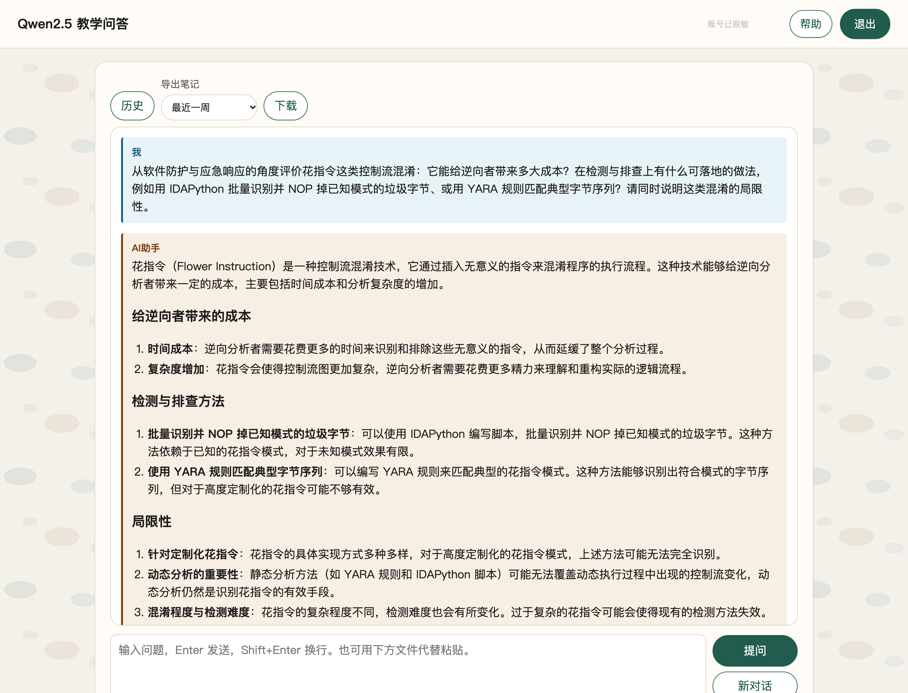

# 8-4 系统层漏洞利用与逆向分析 · 软件逆向静态分析-G4（花指令/控制流混淆：`je`+`jne` 同目标 + 1 字节垃圾，NOP 去花后还原 42 字节 XOR 校验）

## 题目信息

| 项目 | 内容 |
| --- | --- |
| 题目名称 | 系统层漏洞利用与逆向分析-软件逆向静态分析-G4（sectionID `6723`，课程内 number 33，题目内部编号 `C036-G4-F`） |
| 分类 | 逆向分析 / 控制流混淆（花指令）：线性扫描反汇编错位的识别与修复 → 恢复被隐藏的校验函数 → 42 字节 `input[i] ^ 0x7C == table[i]` 求逆 |
| 题目描述 | 题面提供**一个** ELF 附件 `challenge.elf`，一句话点明现象：「F5 按下去只有一片红，看来有人不想让你好好反编译。」要求在这份「反编译看不到东西」的二进制里把 flag 挖出来。**本题没有靶机实例**（章节 `experimentID=0`），flag 完全来自对附件的静态分析，另以容器内真实执行、qemu-user gdbstub 动态读表做交叉验证，不涉及任何网络端点。 |
| Flag 题（questionID=9449，`questionType=4` 代码/Flag 题）题干原文 | > * F5 按下去只有一片红，看来有人不想让你好好反编译。flag 格式为 `flag{}`。*<br>> `{{input}}` |
| 附件表（作答页） | `challenge.elf`，页面显示 `690.02K`（实际 706576 B，平台按 1 KB = 1024 B 换算后显示 690.02K） |

Note：本题与同批的 **8-1** 尺寸完全相同（都是 706576 B 的静态链接 glibc 模板），但**不是同一个程序**：MD5 不同、逐字节 diff 有 **523188** 处差异；8-1 里那句 `83 f2 aa`（`xor edx,0xffffffaa`）在本题中**根本不存在**，8-1 的 target 数组偏移在本题上也是别的数据。两题可以放在一起对照着看：

- **8-1**：同样是 stripped 静态 ELF，难点是**在 514 KB 的 `.text` 里定位校验逻辑**，校验只是朴素的 `^0xAA`；
- **8-4（本题）**：校验逻辑本身更简单（42 字节单字节 XOR），但**函数入口被塞了花指令**，线性扫描从函数第一条指令起就错位，反编译器的数据流整段崩掉——难点从「找」变成了「先修好反汇编器的指令边界，再找」。
- 两题的 Flag 题都是 **`questionType=4`**，提交格式 `{"answer":["flag{...}"],"num":1}`（实测一次通过）。

## 环境信息

| 项目 | 内容 |
| --- | --- |
| 平台 | VMCourse 国产化教学实训平台（自签名证书，`curl` 需加 `-k --noproxy '*'`），课程 ID `1639`，本章节 `sectionID` `6723`（课程内 number 33）。平台地址、账号与口令只保存在本地未跟踪的 `.local/` 目录（不入库），本文不记录任何凭据、cookie 或个人身份信息 |
| 题型 | 3 道单选（9431 / 9433 / 9435，`questionType=2`）+ 1 道多选（9437，`questionType=3`）+ 1 道 Flag 题（9449，**`questionType=4`**），共 5 题，每题 2 分 |
| 靶机实例 | **没有**：`experimentID = 0`，`GET /api/student/lab/vm?ID=6723…` 查不到实验环境；全流程**未创建、未启动任何实例**，也没有 SSH/HTTP 端点可连（与 8-1/8-2 同型，区别于 5-x/7-4 的在线靶机） |
| 判分机会 | `newTestPaper` 返回 `isResubmit = false` ⇒ **只有一次提交机会**；`questionEndStamp = 1793525400` |
| 附件 | `.local/process/8-4-scripts/files/challenge.elf`，**706576 B**，MD5 **`790ba952f0cb01b54dbdc50110f0b2b2`**（来源 `GET /api/student/section/file/challenge.elf?ID=6723&decryptStr=`） |
| 附件属性 | `ELF 64-bit LSB executable, x86-64, statically linked, BuildID e113f95e…67633828, for GNU/Linux 3.2.0, stripped`；**non-PIE**（`e_type=EXEC`、`e_entry=0x4017e0`），26 个节，**无 `.symtab`/`.strtab`/`.dynsym`**（完全 stripped）；`.text` = `0x401180` 起 `0x7db20` 字节（514336 B，静态 glibc 的一大坨），`.rodata` = `0x47f000` 起 `0x1c1d4` 字节 |
| 本机工具 | macOS 26 / Apple M5（**arm64**）；Apple `objdump`（支持 `elf64-x86-64`）、`file` / `md5` / `stat`、Python 3.14；**Docker 29.4.3 可用**（`docker run --platform linux/amd64` 实测可跑）；无头 Chrome + playwright-core（`/tmp/shot`）用于真实页面截图；PIL 用于脱敏与量测 |
| 容器内工具 | `alpine:3.19` + `apk add gdb binutils strace file qemu-x86_64`（gdb 14.1、qemu-x86_64 8.1.5）；`qemu-user` 自带 gdbstub，是本题绕过 Rosetta 限制的关键 |
| 脚本与日志 | `.local/process/8-4-scripts/`（`dejunk.py`、`ask_qa.py`、`gen_render.py`、`gen_qa_overview.py`、`shots_render.mjs`、`shots_vmc_answer.mjs`、`shots_qa.mjs`、`mask_pages.py`；`files/` 附件；`logs/` 全部原始输出；`render/` 渲染源）。注：图 01/02 中调用的 `parse_elf.py` / `scan_xref.py` / `hexdump_junk.py` 与 gdb 脚本 `dyn1.gdb` / `dyn4.gdb` 是当时即时运行的分析脚本，**未单独留存**；其关键输出都以原文落在 `logs/13-strings-xref.txt`、`logs/14-elf-summary.txt`、`logs/12-hexdump-junk-region.txt`、`logs/07-gdb-qemu-dynamic.txt`、`logs/08-gdb-dump-expected.txt` 中 |
| 选择题判分 | **9431=A、9433=C、9435=B、9437=A,C,D（`num:3`）**；`GET /api/student/get/answerHistory?sectionID=6723&contestMode=0` 返回 **5/5 `isCorrect=true`**（含 9449）。按仓库惯例本文只在环境信息备注结果，不展开选择题解析 |

## 解题过程

### 1. 附件核对与题面：本题没有靶机实例

先按题面确认「没有实例、只有附件」，再核对附件身份（图 01 上半）：

```console
$ cd .local/process/8-4-scripts
$ md5 files/challenge.elf ; file files/challenge.elf ; stat -f "%z" files/challenge.elf
MD5 (files/challenge.elf) = 790ba952f0cb01b54dbdc50110f0b2b2
files/challenge.elf: ELF 64-bit LSB executable, x86-64, statically linked, BuildID[sha1]=e113f95e50169d45417f97a09868c00467633828, for GNU/Linux 3.2.0, stripped
706576
```

```console
$ python3 parse_elf.py            # 自写 ELF 解析：节表 / 关键字符串 / xref 扫描
e_type=2(EXEC) e_machine=62(x86-64) e_entry=0x4017e0 e_shnum=26
size=706576
  .init          addr=0x401000 off=0x001000 size=0x00001b
  .plt           addr=0x401020 off=0x001020 size=0x000160
  .text          addr=0x401180 off=0x001180 size=0x07db20
  .fini          addr=0x47eca0 off=0x07eca0 size=0x00000d
  .rodata        addr=0x47f000 off=0x07f000 size=0x01c1d4
  .eh_frame      addr=0x49b240 off=0x09b240 size=0x009560
  .init_array    addr=0x4a5f68 off=0x0a4f68 size=0x000008
  .fini_array    addr=0x4a5f70 off=0x0a4f70 size=0x000010
  .got           addr=0x4a9f48 off=0x0a8f48 size=0x000090
  .data          addr=0x4aa0c0 off=0x0a90c0 size=0x001a00
  .bss           addr=0x4abac0 off=0x0aaac0 size=0x005788
  (无 .symtab / .strtab / .dynsym  → 完全 stripped)

== .text 范围 ==
  0x401180 .. 0x401180+0x7db20-1 = 0x47ec9f   (512 KB+ 的静态 glibc 代码)
== 关键字符串 ==
  0x47f010 "Enter the flag: "   0x47f021 "Wrong!"   0x47f028 "Correct!"
== 目标表 ==
  0x481140 起 42 字节（.rodata 内，紧随其他常量，无符号无名字）
```

三个关键字符串 + 「目标表 42 字节」已经提示了本题的形状：**读入一行 → 按 42 字节长度检查 → 逐字节比对**。而且本题是 **non-PIE**（`EXEC`，装载基址 `0x400000`），所以**虚拟地址与文件偏移只差 `0x400000`**——后面所有「按 VA 取字节」的操作都靠这条换算。


### 2. 字符串 xref：4 处引用把校验流程锁进 98 字节

stripped 的静态 ELF 没有 `main`，但**字符串就是最好的锚点**。用自写的扫描器在 `.text` 里找「指向这三个 VA 的直接引用」，同时覆盖两种编码：`48 8d 3d/35 … disp32`（`lea r64,[rip+d32]`）与 `B8..BF imm32`（`mov r32,imm32`）——non-PIE 下两种都可能出现，本题实测**全部是 RIP 相对 `lea`**：

```text
== .text 中指向这些 VA 的直接引用（lea r64,[rip+d32] / mov r32,imm32）==
  0x40195b  lea          -> 0x47f010  "Enter the flag: "   bytes=488d35aed60700
  0x4019a9  lea          -> 0x47f021  "Wrong!"              bytes=488d3d71d60700
  0x4019e0  lea          -> 0x47f028  "Correct!"            bytes=488d3d41d60700
  0x4019f3  lea          -> 0x47f021  "Wrong!"              bytes=488d3d27d60700
  合计 4 处，全部聚在 0x40195b..0x4019f3 区间 ⇒ 校验流程就在 0x401942 起的 main 内
```

4 处引用**全部挤在同一个 152 字节（`0x98`）的窗口里**，这不是巧合：「提示串 → 失败串 → 成功串 → 失败串」的典型排布，说明**校验器是一个顺序执行的单函数**，函数入口就在 `0x40195b` 之前最近的函数序言处——也就是 `0x401942` 的 `endbr64; push rbx; sub rsp,0x50; canary = fs:0x28`。顺着这个入口把调用链读出来（`logs/13-strings-xref.txt`）：

```text
0x40195b  lea  rsi,[rip+0x7d6ae]  = 0x47f010  ; "Enter the flag: "
0x401962  mov  edi,2                          ; stderr
0x401967  call 0x41bba0                       ; fputs(prompt, stderr)
0x40196c  mov  rdi,rsp; mov rdx,[0x4aa6d8]; mov esi,0x40; call 0x404e60   ; fgets(buf, 64, stdin)
0x401980  test rax,rax; je 0x401a01           ; 读失败 -> ebx=1 -> exit 1
0x401988  lea  rsi,=0x4801f0                  ; "\n"
0x401992  call 0x401140                       ; strcspn(buf, "\n")（.plt 里的 IFUNC 桩）
0x401997  movb $0, (%rsp,%rax)                ; 去掉行尾换行
0x40199e  call 0x401160                       ; strlen(buf)
0x4019a3  cmp  rax,0x2a ; je 0x4019d2         ; ★ 长度必须 42 (=0x2a)
0x4019a9  lea  rdi,=0x47f021                  ; "Wrong!"（长度不符直接走这里，ebx=1）
0x4019d2  mov  rdi,rsp                        ; rdi = buf（check 的唯一参数）
0x4019d5  call 0x401905                       ; ★ check(buf) —— 被花指令保护的那个函数
0x4019da  mov  ebx,eax ; test eax,eax ; je 0x4019f3   ; 返回 0 -> 打 "Wrong!"（ebx=0 -> exit 0）
0x4019e0  lea  rdi,=0x47f028                  ; "Correct!"（check()==1）
```

到这里 `main`（`0x401942`）与 `check()`（`0x401905`）已经双双定位：**`0x4019d5: call 0x401905` 是 `main` 里唯一一处「拿输入去判」的调用**。而 `0x401905` 正是「按 F5 一片红」的元凶所在——见下一步。

> 关于 `0x401140` / `0x401160`：静态链接的 glibc 会把 `strcspn` / `strlen` 做成 `.plt` 里的 IFUNC 桩，所以在 stripped 二进制里看不到这两个名字，只能靠「参数与调用位置」反推；分隔串在 `0x4801f0`，实测字节 `0a 00` 即 `"\n"`，与 `strcspn(buf,"\n")` 完全吻合。

### 3. 花指令识别：全 `.text` 只有 3 组，全在 `check()` 入口（截图 02）

从 `0x401905` 起 dump 原始字节（`logs/12-hexdump-junk-region.txt`）：

```text
.text 文件偏移 0x18f8 起，VA 0x4018f8（校验函数入口前后）

== 原始字节 ==
0x4018f8  0f 1f 84 00 00 00 00 00
0x401900  e9 4b ff ff ff 74 03 75
0x401908  01 e8 74 03 75 01 48 74
0x401910  03 75 01 ff b8 00 00 00
0x401918  00 48 8d 0d 20 f8 07 00

== 真实执行流（按分支语义手工解码）==
0x401900  e9 4b ff ff ff        jmp  0x401850        <-- 上一个函数的尾跳
0x401905  74 03                 je   0x40190a
0x401907  75 01                 jne  0x40190a
0x401909  e8                    <-- 垃圾字节：两条跳转都到 0x40190a(=下一条真实指令)，0x401909 永不被执行
0x40190a  74 03                 je   0x40190f
0x40190c  75 01                 jne  0x40190f
0x40190e  48                    <-- 垃圾字节：两条跳转都到 0x40190f(=下一条真实指令)，0x40190e 永不被执行
0x40190f  74 03                 je   0x401914
0x401911  75 01                 jne  0x401914
0x401913  ff                    <-- 垃圾字节：两条跳转都到 0x401914(=下一条真实指令)，0x401913 永不被执行
```

全 `.text`（`0x7db20` 字节）按 `74 03 75 01` 扫一遍，**只命中 3 次**，而且**连续挤在 `check()` 入口**：

| # | 组起始 VA | 5 字节原文 | 垃圾字节 | `je` 目标 | `jne` 目标 | 同目标 |
| --- | --- | --- | --- | --- | --- | --- |
| 1 | `0x401905` | `74 03 75 01 e8` | `e8` | `0x40190a` | `0x40190a` | ✅ |
| 2 | `0x40190a` | `74 03 75 01 48` | `48` | `0x40190f` | `0x40190f` | ✅ |
| 3 | `0x40190f` | `74 03 75 01 ff` | `ff` | `0x401914` | `0x401914` | ✅ |

这就是题面「一片红」的成因，也是本题唯一的一处混淆点：作者**只在函数最开始放花**，让反汇编器从第一条指令起就错位，后面整段自然崩，而不是全量加花（全量加花代价大、也更容易被模式扫描一网打尽）。


### 4. 去花：先校验语义，再按 5 字节整组 NOP，最后重反汇编（截图 03）

处理原则：**不按「看到 `74 03 75 01` 就抹掉」的盲扫思路做，而是先把这两条跳转的目标算出来、确认「目标相同且恰好等于 `p+5`」再动手**——否则会误伤合法的相邻 `je`/`jne` 代码。脚本 `dejunk.py` 就是这么写的（`logs/03-dejunk.txt`）：

```console
$ python3 dejunk.py files/challenge.elf logs/challenge.dejunk.elf
[*] pattern 74 03 75 01 occurrences in .text: 3
    VA 0x401905: junk=0xe8 je->0x40190a jne->0x40190a same_target=True
    VA 0x40190a: junk=0x48 je->0x40190f jne->0x40190f same_target=True
    VA 0x40190f: junk=0xff je->0x401914 jne->0x401914 same_target=True
[*] patched 3 junk groups -> NOP
[*] wrote logs/challenge.dejunk.elf
```

产物 `logs/challenge.dejunk.elf`（706576 B，MD5 `ecdb4bc9d90e59fb171343f896c5a184`，单独用 `md5` 核对）。**替换长度刻意选 5 字节 → `5 × 0x90`**：`p+2` 的 `je` 占 2 字节、`p+4` 的 `jne` 也占 2 字节、再加 1 字节垃圾，整组正好 5 字节；用 5 个 `nop` 覆盖后**后续所有字节的地址与偏移完全不变**，程序里任何指向 `0x401914` 及以后的跳转/引用都不需要重定位——这是「按组 NOP」相对「单字节 NOP + 重排」的关键好处。

重反汇编 `0x401914..0x401941`，一次成型、**没有一条 `<unknown>`**（`logs/04-objdump-dejunked-checkfn.txt`）：

```text
  401905: 90                            nop
  401906: 90                            nop
  …（0x401905–0x401913 共 15 字节全为 90）
  401914: b8 00 00 00 00                movl	$0x0, %eax
  401919: 48 8d 0d 20 f8 07 00          leaq	0x7f820(%rip), %rcx     # 0x481140
  401920: 0f b6 14 07                   movzbl	(%rdi,%rax), %edx
  401924: 83 f2 7c                      xorl	$0x7c, %edx
  401927: 3a 14 01                      cmpb	(%rcx,%rax), %dl
  40192a: 75 10                         jne	0x40193c <.text+0x7bc>
  40192c: 48 83 c0 01                   addq	$0x1, %rax
  401930: 48 83 f8 2a                   cmpq	$0x2a, %rax
  401934: 75 ea                         jne	0x401920 <.text+0x7a0>
  401936: b8 01 00 00 00                movl	$0x1, %eax
  40193b: c3                            retq
  40193c: b8 00 00 00 00                movl	$0x0, %eax
  401941: c3                            retq
  401942: f3 0f 1e fa                  	endbr64
```


### 5. `check()` 的真实语义与目标表：`input[i] ^ 0x7C == tab[i]`

去花后的函数体（`0x401914..0x401941`）语义极其干净：

```c
int check(const char *input) {
    const unsigned char *tab = (const unsigned char *)0x481140;   /* .rodata 目标表 */
    for (unsigned long i = 0; i < 0x2a; i++)                      /* 42 字节 */
        if ((unsigned char)(input[i] ^ 0x7c) != tab[i]) return 0;
    return 1;
}
// 求逆：input[i] = tab[i] ^ 0x7c
```

| 要素 | 值 | 机器码证据 |
| --- | --- | --- |
| 目标表地址 | `0x481140`（`.rodata` 内无符号无名） | `0x401919: lea rcx,[rip+0x7f820]  # 0x481140` |
| 变换 | `^ 0x7c`（单字节 XOR） | `0x401924: xor edx,0x7c` |
| 比较 | `(uint8_t)(input[i]^0x7c) == tab[i]` | `0x401920: movzbl edx,(rdi,rax)` → `0x401927: cmp dl,(rcx,rax)` |
| 长度 | `0x2a = 42` | `0x401930: cmp rax,0x2a`（`main` 侧另有 `0x4019a3: cmp rax,0x2a`） |
| 返回 | 全等 `1`，任一不等 `0` | `0x401936: mov eax,1` / `0x40193c: mov eax,0` |

XOR 是自逆的，所以「求逆」就是**对表再 XOR 一次 `0x7C`**。non-PIE 下 `offset = VA - 0x400000`，`0x481140 - 0x400000 = 0x81140`，取 42 字节：

```text
enc (0x481140, 42B) = 1a101d1b071a4d1f4f19491e4b514e18481d5148454a4451441d4c1f514a19451e4f1a4b4d49184e4c01
flag = bytes(b ^ 0x7c for b in enc)
     = flag{f1c3e5b7-2d4a-4968-8a0c-6e9b3f715d20}      (len = 42 = 0x2a ✓)
```

（写本文时按同一路径重新取字节复核过：表字节与上式逐字一致，结果 42 字节、以 `flag{` 开头以 `}` 结尾；换成 8-1 的 `^0xAA` 得到的是乱码 `b0bab7b1adb0e7b5…`，反证 key 确为 `0x7C`。）

### 6. 本地执行验证：`Correct!` 与 3 组失败对照（截图 05）

静态结论要落地，最直接的办法是**让真实二进制跑一遍**。本题是 Linux ELF，本机 Docker 可用，直接 `--platform linux/amd64` 跑 `alpine:3.19`：

```console
$ docker run --rm -i --platform linux/amd64 -v "$PWD":/w -w /w alpine:3.19 sh -c \
    'printf "%s\n" "flag{f1c3e5b7-2d4a-4968-8a0c-6e9b3f715d20}" | ./files/challenge.elf'
Enter the flag: Correct!        (exit=0)
```

失败对照（`logs/05-control-tests.txt`，同一容器内、同一命令形态）：

```text
--- wrong flag control ---
Enter the flag: Wrong!
exit=0
Enter the flag: Wrong!
(41B) exit=1
--- empty ---
Enter the flag: Wrong!
exit=1
--- patched binary (junk NOPed) ---
Enter the flag: Correct!
exit=0
```

三种反例覆盖了三类「看起来像但不对」的输入：**同长度（42 B）但内容错**、**截断到 41 B**、**空输入**。这里有一个容易读错但很有价值的细节——**退出码并不全都一样**，而它恰好与反汇编逐条对得上：

- 长度 ≠ 42：`0x4019a9` 直接打 `Wrong!` 并 `movl $0x1,%ebx` ⇒ `exit=1`（空输入 / 41 B）；
- 长度 = 42 但内容不符：走 `0x4019d5: call check`，`check` 返回 `0`，`0x4019da: movl %eax,%ebx` 把 `0` 存进 `ebx`，再打 `Wrong!` ⇒ **`exit=0`**；
- 长度 = 42 且全等：打 `Correct!`，`0x4019ec: movl $0x0,%ebx` ⇒ `exit=0`。

所以「42 字节错 flag 的退出码是 0、41 字节的退出码是 1」不是异常，而是 `main` 里 `ebx` 赋值位置的直接后果（`logs/01-objdump-401800-401a60.txt` 第 95–140 行）。另一条交叉验证是：**把花指令 NOP 掉的 `challenge.dejunk.elf` 喂同一个 flag 仍然 `Correct!`** —— 证明被去掉的 3 组跳转 + 3 个垃圾字节与判定逻辑无关（NOP 后语义不变），也反证我们对「真实指令流」的划分是对的。


### 7. 动态路线的坑：Rosetta 下 gdb 不可用，改 `qemu-x86_64 -g` + `target remote`（截图 04）

「动态优先」通常是绕开控制流混淆最省力的路：花指令只欺骗**静态线性扫描**，CPU 取指走的是真实分支，垃圾字节永远不会执行；断点按 **VA** 下，也不依赖任何指令边界。于是第一反应是在容器里装 gdb 直接下断点。**这一步在本机失败了**：

```console
Breakpoint 1 at 0x4019a3
Breakpoint 2 at 0x401927
Breakpoint 3 at 0x4019da
warning: linux_ptrace_test_ret_to_nx: Cannot PTRACE_GETREGS: I/O error
warning: linux_ptrace_test_ret_to_nx: PC 0x7ffffed3c844 is neither near return address 0x7ffffe62f000 nor is the return instruction 0x5555558f6291!
/tmp/dyn1.gdb:22: Error in sourced command file:
Couldn't get CS register: I/O error.
```

根因不在程序、也不在容器：**本机是 Apple M5（arm64），`linux/amd64` 容器由 Rosetta 转译执行，`ptrace` 的寄存器读取（`PTRACE_GETREGS`）不被支持**，gdb 拿不到 `CS` 与通用寄存器，`run` 直接死在 `ptrace` 自检上。补 `--cap-add=SYS_PTRACE --security-opt seccomp=unconfined` 也一样（限制在转译层，不在权限）。先试的 `debian:bullseye-slim` 还额外踩了 apt 索引 404 的坑（见步骤 10 失败 1）。

**绕行方案：不依赖 `ptrace`。** 容器内用 `qemu-x86_64`（qemu-user）自带 **gdbstub** 起服务，gdb 用 `target remote` 通过 TCP 连上去读寄存器/内存——这条路径完全不碰 `ptrace`：

```console
$ qemu-x86_64 -g 1234 ./files/challenge.elf &       # 容器内（alpine:3.19 + apk add qemu-x86_64）
$ gdb -q -batch -x dyn4.gdb ./files/challenge.elf    # target remote 127.0.0.1:1234
```

```text
0x00000000004017e0 in ?? ()
Breakpoint 1 at 0x401927
Breakpoint 2 at 0x4019e0
[*] first compare hit: rcx = 0x481140 (target table), rdi = 0x2aaaab2abc60 (input buffer)
0x481140:	0x1a	0x10	0x1d	0x1b	0x07	0x1a	0x4d	0x1f
0x481148:	0x4f	0x19	0x49	0x1e	0x4b	0x51	0x4e	0x18
0x481150:	0x48	0x1d	0x51	0x48	0x45	0x4a	0x44	0x51
0x481158:	0x44	0x1d	0x4c	0x1f	0x51	0x4a	0x19	0x45
0x481160:	0x1e	0x4f	0x1a	0x4b	0x4d	0x49	0x18	0x4e
0x481168:	0x4c	0x01
[*] input string: flag{f1c3e5b7-2d4a-4968-8a0c-6e9b3f715d20}
[*] recovered expected input = flag{f1c3e5b7-2d4a-4968-8a0c-6e9b3f715d20}
[*] reached Correct! branch at 0x4019e0 (check()==1)
0x47f028:	"Correct!"
[Inferior 1 (process 121) exited normally]
```

断点选在**比较指令本身**（`0x401927: cmpb (%rcx,%rax),%dl`）：第一次命中时 `rcx = 0x481140`（期望表基址）、`rdi` = 输入缓冲区，`x/42xb $rcx` 一次 dump 出整表；再在 `0x4019e0`（`Correct!` 分支）下断，确认 `check()` 返回 `1`。另有一版逐次循环的 trace（`logs/07-gdb-qemu-dynamic.txt`）把 **42 次逐字节比对全部打出来**，每一行都是 `input[i] ^ 0x7c == rodata[0x481140+i]`，与静态提取的表**逐字节一致**。还有一个小坑：断点 `0x401927` 在循环里会命中 42 次，`commands … continue` 会刷 42 遍，需在 `commands` 首行 `disable 1` 只 dump 一次（见步骤 10 失败 4）。


### 8. 提交答案与平台判分：5/5 全对（截图 06、07）

四道选择题在提交前已独立判定并落盘（`.local/process/8-4-answers-rationale.md`），随后**只提交一次**（`isResubmit=false`，只有一次机会）：

```bash
set -a; . .local/qa-platform.env; . .local/vmc-platform.env; set +a
FLAG='flag{f1c3e5b7-2d4a-4968-8a0c-6e9b3f715d20}'
curl -sS -k --noproxy '*' -m 60 -b .local/vmc-cookies.txt -X POST "$VMC_BASE_IP/api/student/submitAnswers" \
  -F 'sectionID=6723' \
  -F 'answers={"questionID": 9431, "answer": "{\"answer\": [\"A\"], \"num\": 1}"}' \
  -F 'answers={"questionID": 9433, "answer": "{\"answer\": [\"C\"], \"num\": 1}"}' \
  -F 'answers={"questionID": 9435, "answer": "{\"answer\": [\"B\"], \"num\": 1}"}' \
  -F 'answers={"questionID": 9437, "answer": "{\"answer\": [\"A\",\"C\",\"D\"], \"num\": 3}"}' \
  -F "answers={\"questionID\": 9449, \"answer\": \"{\\\"answer\\\": [\\\"$FLAG\\\"], \\\"num\\\": 1}\"}" \
  -F 'contestMode=0'
```

响应 `code:0`，5 条记录 `answerTimes:1`，`questionID` 与提交内容一一对应（`logs/09-submit-answers.txt`）。顶层 `isCorrect:false` / `scoreRate:0` 是平台已知现象（未判分前不返回分数），**不作为判分依据**。

判分以 `GET /api/student/get/answerHistory?sectionID=6723&contestMode=0` 为准（`logs/10-answerHistory.json`）：

| order | questionID | 题型 | 提交值 | isCorrect |
| --- | --- | --- | --- | --- |
| 1 | 9431 | 2 单选 | `{"answer":["A"],"num":1}` | **true** |
| 2 | 9433 | 2 单选 | `{"answer":["C"],"num":1}` | **true** |
| 3 | 9435 | 2 单选 | `{"answer":["B"],"num":1}` | **true** |
| 4 | 9437 | 3 多选 | `{"answer":["A","C","D"],"num":3}` | **true** |
| 5 | 9449 | **4 代码/Flag** | `{"answer":["flag{f1c3e5b7-2d4a-4968-8a0c-6e9b3f715d20}"],"num":1}` | **true** |

**5/5 全部 `isCorrect=true`。** 平台作答页（`/student/course/answer/6723`）同屏可见 5 题「作答正确」、我的选项高亮、第 5 题输入框内的 flag 与附件表 `challenge.elf 690.02K`，与接口判分互为独立证据（图 07）。


### 9. 教学问答：5 问 5 答，如实记录一处口径偏差（截图 08、09、10）

围绕本题主题向课程教学问答平台（Qwen2.5）提了 **5 个问题**，覆盖「花指令原理 / IDA 操作机制 / 不透明谓词 / stripped ELF 定位方法论 / 成本评估与检测落地」；脚本 `ask_qa.py`（SSE 增量拼接，相邻提问间隔 12 s，限速约 10 次/分），**每题各自独立成一个会话**：

| # | cid | 问题主题 | 回答要点（摘要） |
| --- | --- | --- | --- |
| Q1 | **5715** | 花指令为什么让线性扫描反汇编器错位；互补跳转同目标 + 垃圾字节为何执行不到；还有哪些常见花指令形态 | 线性扫描逐字节推进、不追踪分支；CPU 因 `je`/`jne` 互补必跳；列举填充类 `nop`、调试陷阱 `int3`、前缀字节、填充指令、反汇编器特征码误导等（被 1024 token 截断） |
| Q2 | **5717** | NOP patch 后为何要 `U → C → Reanalyze → F5`，跳过任一步的现象 | `U` 清掉旧分析结果/指令定义 → `C` 重新定义为代码并重建指令序列 → Reanalyze 更新交叉引用与控制流 → F5 才基于新边界出伪码；跳过 `U` 会沿用旧结果 |
| Q3 | **5719** | 恒假不透明谓词怎么构造、如何判定、切除死分支的风险 | 以「恒返回 0 / 恒返回 −1」一类不变量为例；判定靠常量传播/符号执行；风险：误判破坏控制流、与真实语义耦合、依赖外部状态 |
| Q4 | **5720** | stripped 静态 ELF 如何定位校验函数；字符串 xref 的技巧；入口被花指令破坏时如何恢复指令流 | 字符串 + `objdump`/`readelf`、`strings \| grep read`、按 `call`/输入函数定界、数据流追输入、按分支复原指令流；提到 Ghidra/IDA 与动态调试 |
| Q5 | **5721** | 花指令混淆的成本评价；IDAPython/YARA 等可落地检测手段与局限 | 时间成本 + 复杂度成本；IDAPython 批量 NOP 已知模式、YARA 匹配典型字节序列；局限：定制化花指令难覆盖、静态方法难覆盖动态控制流变化，仍需动态分析 |

**口径偏差（如实记录，不作为解题依据）**：Q4（cid 5720）回答里先建议「用 `objdump` / `readelf` 查看**已有符号表**」，这对本题这种**完全 stripped（无 `.symtab`/`.dynsym`）**的样本并不适用——模型自己也补了一句「剥离后符号信息较少」；本题实际有效的路径是**字符串 xref**（我们正是这样定位到 `main@0x401942` 与 `check@0x401905` 的）。其余回答无原则性错误。

问答页截图（会话 **5715**、**5721**）在落图前做了**逐字指纹校验**，不命中就拒绝截图（见步骤 11）：

```text
cid=5715 row="在 x86 反汇编中，花指令（junk byte）为什么会让线性扫描反汇… 10-17 22:17 · 2 条 删除" len=1096 qFp=true aFp=true
cid=5721 row="从软件防护与应急响应的角度评价花指令这类控制流混淆：它能给逆向者带来多大…10-17 22:20 · 2 条删除" len=735 qFp=true aFp=true
```





### 10. 失败尝试与踩坑清单

| # | 尝试 | 现象 | 原因 | 如何调整 |
| --- | --- | --- | --- | --- |
| 1 | `docker run … debian:bullseye-slim` 内 `apt-get install gdb` | `404 Not Found`（`libicu67`、`libc6-dbg`、`libglib2.0-data`、`libxml2` 等） | bullseye-security 索引过期/镜像源已滚动 | 换 `alpine:3.19` + `apk add gdb`（gdb 14.1 正常安装） |
| 2 | 直接执行下载的附件 | `./files/challenge.elf: Permission denied`（exit=126） | 附件从平台下载后**没有执行位**（`-rw-r--r--`） | `chmod +x files/challenge.elf` 后正常（权限位变化，内容未改，MD5 不变） |
| 3 | 容器内 gdb 直接 `run` | `Cannot PTRACE_GETREGS: I/O error` / `Couldn't get CS register: I/O error` | 本机 arm64，amd64 容器由 **Rosetta 转译**，`ptrace` 寄存器读取不被支持；补 `--cap-add=SYS_PTRACE --security-opt seccomp=unconfined` 仍失败 | 改用 `qemu-x86_64 -g 1234`（qemu-user 自带 gdbstub）+ gdb `target remote`，不依赖 `ptrace` |
| 4 | gdb 脚本在 `0x401927` 下断点 | 脚本输出刷 42 遍 | 断点在 42 次循环里每次都命中，`commands … continue` 会重复触发 | 在 `commands` 首行 `disable 1` 只 dump 一次；另用 `x/42xb` 整表输出 |
| 5 | 问答页第二张截图的指纹校验 | `qFp=true aFp=false`，拒绝截图 | 答案指纹切片落在有序列表处：页面把 `1. **时间成本**：` 渲染成 `时间成本：`（序号与 `**` 都消失），逐字比对必然失败 | 指纹改为「问题前 24 字 + 答案结尾 25 字」，并统一 `norm()` 去掉 `*`、`#`、反引号、`_` 与空白；重跑后两张都 `verified: true` |
| 6 | 渲染稿里出现 `<span class="…">` 文本 | 标签被当成正文显示 | `gen_render.py` 中该块用了转义分支（`'o'`） | 把含标记的块改为原样分支（`'h'`），重渲染 |
| 7 | 首次 VMC 作答页截图 | 右下角盖着悬浮帮助按钮的提示气泡 | 鼠标停在悬浮按钮上触发 tooltip | 截图前 `page.mouse.move(4,4)` + 等 1.2 s 重拍；**最终交付的图 07 中该气泡仍在画面右侧**（属平台常驻悬浮提示，不影响 5 题「作答正确」与 flag 的可读性），如实保留、未再修图 |

> 说明：失败 3 是本题**唯一一条真正卡住主线的**问题；它同时构成「动态优先」这条建议在本机的反例——**本机 arm64 环境下 gdb 不可用，必须用 qemu-user gdbstub 或纯静态**。

### 11. 截图真实性与脱敏说明

`8-4/screenshots/` 共 **10 张 PNG，目录内无其他文件**（渲染源 HTML 在 `.local/process/8-4-scripts/render/`，脚本与原始日志在 `.local/process/8-4-scripts/`，均不入库）。按取证方式分**三类**——① 真实命令回显的渲染稿（`01`–`05`，图内标注「非终端实拍」）；② 平台 API 真实返回 + 浏览器内渲染稿（`06`，已删 `currentUser`）；③ 真实页面截图（`07`–`09`，无头 Chrome）；另 `10` 为问答原文渲染稿（图内标注「渲染稿/非页面实拍」）。**图注与正文均如实区分**：

| 文件 | 内容 | 真实性 | 脱敏 |
| --- | --- | --- | --- |
| `01-附件信息-ELF结构与字符串xref.png` | `md5`/`file`/`stat` + 节表 + 关键字符串 VA + 4 处 xref + `main` 调用链 | **真实命令回显的渲染稿**（非终端实拍，图内顶部自带标注） | 无个人信息 |
| `02-花指令识别-jz-jnz同目标加1字节垃圾.png` | 原始字节、真实执行流 vs `objdump` 线性扫描错位视图 | 同上 | 无 |
| `03-去花指令-NOP重反汇编恢复干净函数.png` | `dejunk.py` 输出 + 去花后 `objdump` + 等价 C | 同上 | 无 |
| `04-动态突破-qemu-gdb读出期望表.png` | Rosetta 下 gdb 失败原文 + qemu gdbstub 断点 dump 期望表 | 同上 | 无 |
| `05-本地验证-Correct与Wrong对照.png` | 静态求逆 + 容器内 `Correct!` + 3 组失败对照 + 去花二进制复跑 | 同上 | 无（flag 为题解内容） |
| `06-平台判分-answerHistory五题全对.png` | `answerHistory` 原文 + 逐题汇总 | 渲染稿（平台 API 真实返回） | **渲染前整段删除 `currentUser`**（账号/姓名/学号/lastIP） |
| `07-VMC作答页-五题已提交-作答正确.png` | 作答页 5 题「作答正确」、选项高亮、第 5 题 flag、附件 690.02K、倒计时 | **真实页面截图**（无头 Chrome，viewport 1440×1820、`deviceScaleFactor=2`、`fullPage` ⇒ PNG 2880×3640） | 顶栏右上角涂白 + 标注「账号已脱敏」 |
| `08-AI问答-教学平台真实页面-本题会话.png` | 会话 **5715**：历史列表 + Q1 提问与回答开头 | **真实页面截图**（viewport 1440×1100、dsf=2 ⇒ PNG 2880×2200） | 账号胶囊涂白 + 标注「账号已脱敏」 |
| `09-AI问答-教学平台真实页面-Q5会话.png` | 会话 **5721**：Q5 完整问答 | 真实页面截图（同参数） | 同上 |
| `10-AI问答-本题问答总览.png` | 5 组 Q/A 原文总览 + 每问 cid | **本地渲染稿**（图内标注「渲染稿 / 非页面实拍」） | 问答原文不含账号字段，无需涂白 |

**为什么终端类截图是渲染稿**：本题**没有靶机服务**，本机 Agent 进程又没有屏幕录制权限（`screencapture -x` 报 `could not create image from display`），无法对真实终端窗口截图。因此 `01`–`05` 把真实命令与原始日志输出逐字复制、`html.escape` 后渲染成黑底 HTML 再截图，**每张图顶部都标注「【非终端实拍】本图为真实命令回显的渲染稿」**；`06` 是「平台 API 真实返回 + 浏览器内渲染」；`07`–`09` 是**真实页面截图**；`10` 是问答原文渲染稿。四类形态在表里分开写明，不冒充平台原页面。

**脱敏实测参数（脚本 `.local/process/8-4-scripts/mask_pages.py`，本批次按各自 viewport 逐图实测，未照抄其他题目；量测落 `logs/41-mask-metrics.json`、`logs/40-answerpage-geom.json`、`logs/44-qa-page-meta.json`）**

**(A) VMC 作答页顶栏（图 07）** —— viewport **1440×1820**、dsf=2 ⇒ 图 **2880×3640**

- 顶栏 `.el-header` 实测背景色 `rgb(114,177,239)`、高 80 CSS px；
- 白色墨迹簇判据：`R,G,B` 均 `> 220`，扫描区 `x ≥ 2450`、`y ∈ [0,160)` device px。实测 3 簇：`2473–2514`（⊕ 图标）、`2542–2575`（文A 翻译图标）、**`2620–2684`（「用户」文字）**；
- `.menubar-right .user-name` 的 `getBoundingClientRect()` = `x 1309, y 35.30, w 59, h 23`（CSS px）× 2 ⇒ device `2618–2736`，与第 3 簇吻合；
- **涂白 box = `(2604, 54, 2746, 120)`** device px（四周约 14 px 余量），填充实测背景色 `(114,177,239)`，写「账号已脱敏」；
- 裁剪复验：`logs/crops/vmc-masked-zoom.png`（2× 放大）——该区域**实测只有通用标签「用户」，不含昵称/学号/姓名**；按仓库「公开仓库、保守涂白」的约定仍然涂白，并在图注写明这一点，避免让读者误以为该位置本来就有 PII。

**(B) 教学问答平台顶栏账号胶囊（图 08、09）** —— viewport **1440×1100**、dsf=2 ⇒ 图 **2880×2200**

- `header.top .who span` 实测 `getBoundingClientRect()` = `x 1070.05, y 25.00, w 169.55, h 26.48`（CSS px），节点文本为「姓名（学号）」形式的**真实 PII**，顶栏背景 `rgb(255,252,247)`；
- **涂白 box = `(2126, 42, 2493, 111)`** device px（由上述 rect × 2 外扩约 14/8 px 得到），填充 `(255,252,247)`，写「账号已脱敏」；
- 裁剪复验：`logs/crops/qa-masked-zoom.png`、`logs/crops/qa-masked-zoom-q5.png` —— 已确认姓名与学号被完全覆盖，其余页面内容（历史列表、问答正文、输入区）未受影响。

**(C) 会话指纹（本批次硬要求）** —— 脚本 `shots_qa.mjs` 先 `GET /api/chat/history?conversation_id=<cid>` 取回本题原文，再点 `#hist-list .hist-item[data-id=<cid>] .hist-open` 载入会话，把 `#log` 文本归一化（`norm()` 去掉 `*`、`#`、反引号、`_` 与空白）后与「问题前 24 字 + 答案结尾 25 字」两组指纹逐字比对，**不命中就抛错、拒绝截图**。会话 5715（len=1096）与 5721（len=735）均 `qFp=true aFp=true` 后才落盘。这条校验不是形式主义：该平台是**共用账号**，历史列表里同时能看到别人做 8-3 的会话（「从防御与检测角度：CTF 里这种『自实现字节变换 + 常量数组比较』的手…」），不校验就可能把别的题的会话截进来。

### 12. 靶机与遗留物

| 位置 | 内容 | 说明 |
| --- | --- | --- |
| 靶机 | **无** | 章节 `experimentID=0`，全流程未创建任何实例，平台侧没有可清理的容器/端口映射 |
| 本机 Docker | 容器 `ctf84dbg`（`alpine:3.19` + gdb/qemu）仍在运行 | 可 `docker rm -f ctf84dbg` 清理；镜像 `alpine:3.19`、`debian:bullseye-slim` 为原有机型 |
| 本机文件 | `.local/process/8-4-scripts/logs/challenge.dejunk.elf`（去花后的二进制，706576 B，MD5 `ecdb4bc9d90e59fb171343f896c5a184`） | 留作复现证据，**未**拷入 `8-4/`（`.local/` 被 `.gitignore` 忽略，不入库） |
| 本机文件 | `.local/process/8-4-scripts/files/challenge.elf` 被 `chmod +x` | 只改权限位，内容未改，MD5 仍为 `790ba952…b2b2` |
| 仓库 | `.local/process/8-4-scripts/`（脚本 + 附件 + `logs/` 原始输出 + `render/` 渲染源 + `logs/crops/` 复验裁剪）、`8-4/screenshots/`（10 张 PNG）、本文件 `8-4/writeup.md` | `.local/` 均不入库；未执行任何 git 写操作 |

## 分析路径与关键证据

> 本题没有靶机，**所有关键结论都必须能在这一份 706576 B 的二进制里指到具体字节**。下面按「问题 → 结论 → 证据（地址/字节/命令）→ 为什么这条证据足够」组织。

### 问题与结论一览

| 问题 | 结论 | 关键证据 |
| --- | --- | --- |
| 程序是干什么的？ | 读一行输入当 flag 的**校验器** | `strings`/`.rodata`：`0x47f010 "Enter the flag: "`、`0x47f021 "Wrong!"`、`0x47f028 "Correct!"`；`main` 里 `fgets`/`strcspn`/`strlen` 的调用链 |
| 校验器在哪个函数？ | `main = 0x401942`（`endbr64` 起，到 `0x401a08` 的 canary 失败分支） | 4 处字符串引用**全部落在 `0x40195b..0x4019f3`（152 B / `0x98`）**；函数序言 `endbr64; push rbx; sub rsp,0x50; fs:0x28` 在该区间正前方 |
| 校验函数在哪？ | `check = 0x401905`（真实函数体 `0x401914..0x401941`） | `0x4019d5: call 0x401905` 是 `main` 里唯一「拿输入去判」的调用；返回 `eax` 直接决定 `Correct!`/`Wrong!` 分支 |
| 为什么「F5 一片红」？ | 函数入口 3 组花指令让线性扫描从第一条指令起就错位 | `0x401905/0x40190a/0x40190f` 各为 `74 03 75 01` + 1 字节垃圾（`e8`/`48`/`ff`），两跳转目标同为 `p+5`；`objdump` 在 `0x401909` 把 `e8` 当 `call rel32`，吞掉整组跳转 |
| 校验逻辑是什么？ | `for (i=0;i<42;i++) if ((uint8_t)(input[i]^0x7C) != tab[i]) return 0; return 1;` | `0x401919: lea rcx,[rip+0x7f820] # 0x481140`、`0x401924: xor edx,0x7c`、`0x401927: cmp dl,(rcx,rax)`、`0x401930: cmp rax,0x2a` |
| 目标表在哪、多长？ | `.rodata` `0x481140`，**42 字节**（无符号、无名字） | `lea` 的 RIP 相对位移 `0x7f820` 精确算出 `0x481140`；长度由 `cmpq $0x2a` 与 `main` 的 `cmp rax,0x2a` 双重限定 |
| flag 是什么？ | `flag{f1c3e5b7-2d4a-4968-8a0c-6e9b3f715d20}` | 静态求逆 + 容器内 `Correct!` + qemu/gdb 动态 dump 同表 + 去花二进制复跑，四路互证 |
| 判分如何？ | 5/5 `isCorrect=true` | `answerHistory?sectionID=6723`（`logs/10-answerHistory.json`）+ 作答页 5 处「作答正确」 |

### 每条关键证据为什么足够（可复核性）

1. **定位不是猜的，是「引用密度」逼出来的**：stripped 静态 ELF 没有 `main`，但三个字符串的引用点全挤在 `0x40195b..0x4019f3` 的 **152 字节**里。提示串与三处结果串**只可能出现在同一个顺序执行的校验函数内**；而 `0x4019d5: call 0x401905` 位于「长度检查通过」与「打印 `Correct!`」之间，是 `main` 里唯一以输入缓冲区（`rdi = rsp`）为参数的调用 ⇒ **`0x401905` 就是校验函数**，这一点由调用图与数据流双向锁定，不依赖任何「看着像」。
2. **花指令的模式不是猜的，是先算目标再动手**：三组都是 `74 03`（`je +3`）+ `75 01`（`jne +1`）+ 1 字节垃圾，`je` 目标 `p+2+3 = p+5`、`jne` 目标 `p+4+1 = p+5`，**数学上同目标**；`dejunk.py` 把 `p+5` 算出来并逐组打印 `same_target=True` 才打补丁，因此不会误伤合法的「`je` 后面紧跟 `jne`」代码。全 `.text` 514 KB 只命中 3 次，也说明这是**定点保护函数入口**，而不是全量加花。
3. **「垃圾字节永不可达」是可证明的**：`je` 在 `ZF=1` 时跳、`jne` 在 `ZF=0` 时跳，`ZF ∈ {0,1}` ⇒ **无论寄存器/内存处于什么状态，必有一条成立并跳到 `p+5`**，`p+4` 那个字节在任何输入、任何路径下都不会被取指。这是**控制流层面的恒等式**，不是「跑几次没崩所以安全」的经验判断。
4. **线性扫描为什么必错，可以逐条对上**：`0x401909` 的 `e8` 是 `call rel32` 的操作码，需要 4 字节立即数 ⇒ 反汇编器把 `e8 74 03 75 01` 当成一条 `call 0x1b51c82`，于是 `0x40190a` 起的整组 `je/jne`（4 字节）被吞进立即数；随后 `0x40190e` 的 `48` 被当 REX 前缀、`0x401913` 的 `ff` 被当操作码，边界继续漂移，直到 `0x401919` 才偶然重新对齐。**三处垃圾字节恰好选了 `e8`/`48`/`ff` 这三种「本身是合法操作码或前缀」的值**，正说明作者是按「让边界逐步漂移」设计的，而不是随便填 `00`。
5. **语义不是靠工具猜的，是去花后一次反汇编成型**：`5 × 0x90` 覆盖后 `0x401914..0x401941` 无一条 `<unknown>`，`xor edx,0x7c` / `cmpb` / `cmp rax,0x2a` / 两个 `ret` 全部可读，等价 C 一目了然。反过来说，如果 NOP 长度选错（比如只 NOP 1 字节），`0x40190a` 起的跳转仍在，边界依旧错位——**按组 5 字节 NOP 是保持后续地址不变的正确做法**。
6. **flag 有四路独立互证**：① 静态：从 `0x481140` 取 42 字节 `^0x7C`；② 执行：容器内喂入得 `Correct!`，同长度错内容/41 B/空输入全部 `Wrong!`；③ 动态：qemu-gdbstub 在 `0x401927` 读 `rcx = 0x481140`，`x/42xb` 出来的表与静态**逐字节一致**，并命中 `0x4019e0` 的 `Correct!` 分支；④ 去花二进制：`challenge.dejunk.elf` 喂同一 flag 仍 `Correct!`。四条路径的输入/输出彼此独立，任何一条「碰巧对」都解释不了四条同时吻合。
7. **Lead 另做了两条与解题者无关的独立验证**：① 动态——`docker run --rm -i --platform linux/amd64 -v <dir>:/w alpine:3.19 /w/challenge.elf`，喂该串得 `Enter the flag: Correct!`，把末位改成 `…21`（仍是 42 B）得 `Wrong!`；② 静态——自己按 `offset = VA - 0x400000 = 0x81140` 取 42 字节 `^0x7C`，精确得到同一 flag，并用 `^0xAA`（8-1 的 key）得到乱码作为反证。**两条路都不依赖解题者的脚本与结论**，因此可以作为交付前的独立背书。

### 从「看不清」到「看清」的两个转折点

- **转折一：把「一片红」当成线索而不是障碍**。看到 `74 03 75 01` 这种「条件互补 + 同目标 + 目标前 1 字节」的字节组合，先算跳转目标（`p+5` 是否相同），而不是先猜「这是不是某个已知花指令」。目标一算出来，「垃圾字节永不可达」就是显然的，NOP 也就有了正当理由与正确长度。**先证明它无用，再删掉它**——这一步决定了后面是「干净地重反汇编」还是「越补越乱」。
- **转折二：动态路线失败时，换的是「调试通道」而不是「分析目标」**。Rosetta 下 `ptrace` 不可用，但这并不否定「动态读表」这条路——`qemu-user` 的 gdbstub 走 TCP 读写寄存器/内存，完全绕开 `ptrace`。**把「跑不起来」拆成「哪一层不可用」**，结论就是「Linux 用户态模拟器 + gdb 远程协议」这一层仍然可用，于是 `0x401927` 的断点照样断得下来。

## 花指令识别与处理

> 本节把本题的唯一一处混淆点单独拆开讲：**它长什么样、为什么执行不到、为什么反汇编器会被带偏、以及两条处理路线各自适合什么场景**。

### 1. 识别：字节模式 + 语义校验，两步缺一不可

**第一步，按字节模式扫。** 在整段 `.text`（`0x401180` 起 `0x7db20` 字节）里找 `74 03 75 01`：

```text
[*] pattern 74 03 75 01 occurrences in .text: 3
    VA 0x401905: junk=0xe8 je->0x40190a jne->0x40190a same_target=True
    VA 0x40190a: junk=0x48 je->0x40190f jne->0x40190f same_target=True
    VA 0x40190f: junk=0xff je->0x401914 jne->0x401914 same_target=True
```

**第二步，逐组校验语义。** 只匹配 4 字节模式是不够的——合法的「`je` 后面紧跟 `jne`」在真实代码里也会出现（条件互补但**目标不同**）。判据必须包括：

1. 两条跳转都是 **8 位相对短跳**（`74 cb` / `75 cb`）；
2. `je` 目标 = `p + 2 + rel8(je)`，`jne` 目标 = `p + 4 + rel8(jne)`，两者**算出来的绝对地址相同**；
3. 该共同目标恰好等于 `p + 5`（即「整组 5 字节之后的下一字节」）；
4. `p + 4` 的那 1 字节是**独立垃圾**（在本例中分别是 `e8`/`48`/`ff`）。

四条同时成立，才判定为花指令。本题 3 组全部满足，且**目标都恰好是 `p+5`**——这正是「跳过 1 字节垃圾继续执行」的语义。

### 2. 为什么 CPU 永远走不到那个垃圾字节

每组的结构是：

```text
p+0:  74 03        je  p+5      ; ZF=1 时跳
p+2:  75 01        jne p+5      ; ZF=0 时跳
p+4:  e8/48/ff     <垃圾>
p+5:  ...          <下一条真实指令>
```

`je`（`ZF=1` 跳转）与 `jne`（`ZF=0` 跳转）的条件**互补且穷尽**：对任意 `ZF`，两条跳转中**恰有一条成立**，而且**两条的目标都是 `p+5`**。因此：

- 从 `p` 开始执行时，第一条指令就必然把控制流送到 `p+5`；
- 没有**任何**输入、寄存器状态或内存布局能让执行落到 `p+4`；
- `p+4` 那 1 字节既不是指令、也不是数据，是**纯占位垃圾**（它对程序的唯一作用就是干扰反汇编器）。

这也解释了为什么**动态调试完全不受影响**：CPU 按真实分支取指，`p+4` 从未进入流水线；断点按 VA 下，也不需要知道「`p+4` 到底算不算一条指令」。

### 3. 为什么线性扫描反汇编器一定被带偏

线性扫描（`objdump -d` 的默认策略，也是 IDA 初始分析的一部分）**不追踪分支**：它从某个起点开始，按「当前字节是操作码 → 查表得指令长度 → 地址 += 长度」机械推进。于是：

```text
0x401905: 74 03               je   0x40190a          ← 到这里都还对
0x401907: 75 01               jne  0x40190a          ← 到这里也还对
0x401909: e8 74 03 75 01      call 0x1b51c82          ← ★ e8 被当 call rel32，把 0x40190a 起的整组 je/jne 吞成立即数
0x40190e: 48 74 03            je   0x401914          ← 以 0x48(REX) 开头，边界继续错
0x401911: 75 01               jne  0x401914
0x401913: ff b8 00 00 00 00   <unknown>               ← ff 是垃圾字节，被当操作码
0x401919: 48 8d 0d 20 f8 07 00  lea rcx,[rip+0x7f820]  ← 直到这里才偶然重新对齐
```

三个垃圾字节的选择很讲究，**每一个都能让边界继续漂**：

| 垃圾字节 | 被误认成 | 后果 |
| --- | --- | --- |
| `e8` | `call rel32`（5 字节） | 把 `0x40190a`–`0x40190d` 的整组 `je/jne` 吞进立即数，**第一组跳转直接消失** |
| `48` | REX.W 前缀 | 把后面的 `74 03` 变成 `48 74 03`（`je` 带前缀），指令边界再错一次 |
| `ff` | 操作码（需 ModRM） | 把后面的 `b8 00 00 00 00` 吞成 `<unknown>`，直到 `0x401919` 才重新对齐 |

**函数入口被错位**是致命的：F5（Hex-Rays）是在「指令边界 + 控制流图 + 变量数据流」之上做事的，边界一错，`check()` 的整段数据流就崩了，于是呈现为「**一片红**」（大量未定义字节/解析失败）。而作者只在**函数入口**放 3 组（而不是在每个分支前都放），性价比最高：**一处错位，整函数报废**。

### 4. 处理路线一：静态——校验语义后批量 NOP，再重反汇编

脚本 `dejunk.py` 的核心逻辑（与上面四条判据一致）：

```python
# 伪码：定位 .text，按 74 03 / 75 01 扫；算出两条跳转目标；同目标且 == p+5 才打补丁
for p in scan(text, b"\x74\x03\x75\x01"):
    je_t  = p + 2 + s8(text[p+2])
    jne_t = p + 4 + s8(text[p+4])
    if je_t == jne_t == p + 5:
        text[p:p+5] = b"\x90" * 5      # 整组 5 字节 → 5 个 NOP
```

产物与效果：

```text
[*] patched 3 junk groups -> NOP
[*] wrote logs/challenge.dejunk.elf
  401905: 90 90 90 90 90   …（0x401905–0x401913 共 15 字节全 90）
  401914: b8 00 00 00 00                movl	$0x0, %eax
  401919: 48 8d 0d 20 f8 07 00          leaq	0x7f820(%rip), %rcx     # 0x481140
  …
  40193b: c3                            retq
```

**为什么是「5 字节 → 5 个 NOP」而不是「1 字节 → 1 个 NOP」**：5 字节整组覆盖后，`p+5` 及之后**所有字节的地址与相对偏移都不变**，程序里任何指向 `0x401914` 之后的跳转、`lea` 的 RIP 相对位移都不需要重算；若只抹掉 1 字节，剩下的 `je/jne` 仍在，边界依旧错，还得做重定位。这是静态去花时最容易出错、也最值得写进脚本注释的一点。

在 IDA 里做同一件事，等价的操作顺序是「**先取消旧指令定义（`U`）→ 再把字节重新定义为代码（`C`）→ 重算函数（Analyze → Reanalyze function）→ 最后 `F5`**」——本质上就是「把旧的指令定义与反编译缓存作废，让 IDA 按新字节重新解码边界」。跳过第一步会沿用旧定义，跳过重算会让交叉引用/控制流仍是旧的，直接 `F5` 只会得到同样的错误伪码。

### 5. 处理路线二：动态——不必先去混淆，直接读运行期值

花指令只骗静态扫描，**不改变运行期语义**。因此还有一条更省力的路：**不修二进制，直接在运行期把期望值读出来**。

```text
qemu-x86_64 -g 1234 ./files/challenge.elf &        # 容器内，qemu-user 自带 gdbstub
gdb -q -batch -x dyn4.gdb ./files/challenge.elf    # target remote 127.0.0.1:1234
break *0x401927        # cmpb (%rcx,%rax),%dl —— 比较指令本身
→ [*] first compare hit: rcx = 0x481140 (target table), rdi = 0x2aaaab2abc60 (input buffer)
  0x481140: 0x1a 0x10 0x1d 0x1b … 0x4c 0x01
  [*] recovered expected input = flag{f1c3e5b7-2d4a-4968-8a0c-6e9b3f715d20}
break *0x4019e0        # Correct! 分支
→ [*] reached Correct! branch at 0x4019e0 (check()==1)   0x47f028: "Correct!"
```

这条路的价值在于**独立性**：它不依赖我们对「哪几个字节是垃圾、NOP 该多长」的判断，直接拿 CPU 真实执行的结果。**但它有环境前提**——本机 arm64 下容器内的 `gdb` 因为 `ptrace` 不可用而失败，必须借 `qemu-user` 的 gdbstub（详见步骤 7 与失败 3）。在 Intel 机器上则可以直接用普通 gdb。

### 6. 两条路线的取舍

| 维度 | 静态（NOP + 重反汇编） | 动态（断点读运行期值） |
| --- | --- | --- |
| 是否需要猜垃圾字节位置 | 需要，但可用「同目标 `p+5`」判据严格校验 | 不需要 |
| 是否需要可执行环境 | 不需要（纯文件分析） | 需要（本题靠 Docker + qemu-user） |
| 能否恢复完整语义 | 能（得到可读的整段函数、可写等价 C） | 只能拿到「运行到某点时的值」，看不到全貌 |
| 适合的场景 | 要写 writeup、要理解算法、要交给别人复核 | 只想要答案、或静态路线被卡住时的快速通道 |
| 本题的坑 | 补丁长度必须为 5 字节，否则地址错位 | 本机 arm64 + Rosetta 下 `ptrace` 不可用，需 qemu gdbstub |

本题两条都做了，而且**结论一致**（表逐字节相同、`Correct!` 分支命中），这本身就是对「花指令只是障眼法」的最好证明。

## Flag

```text
flag{f1c3e5b7-2d4a-4968-8a0c-6e9b3f715d20}
```

该 flag 由四条独立路径互证取得：① 静态——`0x481140` 的 42 字节目标表逐字节 `^0x7C`（`offset = VA - 0x400000 = 0x81140`）；② 执行——容器内（`alpine:3.19`、`--platform linux/amd64`）喂入得 `Enter the flag: Correct!`，同长度错内容、41 字节、空输入三种对照全部 `Wrong!`；③ 动态——`qemu-x86_64 -g 1234` + gdb `target remote`，在 `0x401927` 读 `rcx = 0x481140` 并 `x/42xb` dump 出与静态**逐字节一致**的表，且在 `0x4019e0` 命中 `Correct!` 分支；④ 去花二进制——`challenge.dejunk.elf`（3 组花指令整组 NOP）喂同一 flag 仍 `Correct!`，证明被去掉的字节与判定逻辑无关。另与平台 `answerHistory` 第 5 条（questionID 9449）判定为正确的提交值、作答页第 5 题输入框内的值三者逐字一致；Lead 亦以「容器内喂入 + 独立静态取表」两条互不依赖的路径复现了同一结果。

## 总结与心得

### 原理：花指令是「欺骗反汇编器」而不是「欺骗 CPU」

1. **花指令的三要素在本题里全部可见**：① **条件互补**（`je`/`jne` 覆盖 `ZF` 的全部取值）；② **同目标**（两条都跳到 `p+5`）；③ **目标前有 1 字节垃圾**（`p+4`）。三者合起来保证「**运行期必跳过垃圾、静态扫描必踩到垃圾**」。这是花指令最经典的形态，也是它「性价比高」的原因：只加 5 字节，就能让整个函数的反汇编报废。
2. **它利用的是工具的工作方式，而不是程序的语义**。线性扫描不追踪分支、按字节长度机械推进，所以**只要让「第一个字节的指令长度」与实际控制流不一致**，后面就会连锁错位。本题三个垃圾字节 `e8`/`48`/`ff` 分别对应「吞掉后续 4 字节」「REX 前缀」「需要 ModRM 的操作码」，**每一个都把错位往后推**，直到某个位置偶然对齐——这解释了为什么错位是「一段一段」的，而不是「整片随机」。
3. **花指令不提供任何机密性，它只提高时间成本**。本题的校验逻辑（42 字节单字节 XOR）本身极弱：目标表就在 `.rodata` 里，key 就是一条 `xor edx,0x7c` 的立即数；花指令唯一的作用是**让静态工具暂时看不见**。一旦知道「入口被花」这件事，NOP 掉 15 字节就能拿到完整语义，或者干脆用动态调试绕过——**它的强度上限就是「让人多花几分钟」**。
4. **「垃圾字节永不可达」是一个可证明的控制流不变量**，而不是经验判断。这种「把不变量做成代码形态」的思路，正是控制流混淆（OLLVM 的虚假控制流、不透明谓词、`junk byte`）的共同内核：**语义不变，形态变复杂**。理解了这一点，去混淆就有了方向——**先恢复不变量（指令边界），再谈语义**。

### 做题方法

- **先做「廉价侦察」再决定深挖**：`file` + `md5` + `stat` 三件套就能确认「706576 B、ELF64、静态链接、stripped、non-PIE」，而 `non-PIE` 这一条直接给出「VA = 文件偏移 + 0x400000」的换算，后面所有按 VA 取字节的操作都靠它。题面那句「F5 一片红」则直接提示「本题的难点是反汇编，不是算法」。
- **stripped 静态 ELF 的定位顺序：字符串 → xref → 引用密度 → 函数边界**。不要从 `e_entry`（`0x4017e0`，`__libc_start_main` 一类 CRT 启动代码）顺着读——那要穿过 514 KB 的 glibc。先找 `"Enter the flag: "` / `"Wrong!"` / `"Correct!"` 的 VA，再找 `.text` 里指向它们的 RIP 相对 `lea`，**引用点全挤在 152 字节内**这个事实本身就把函数范围圈死了。
- **识别花指令要「先算目标再动手」**：只匹配 `74 03 75 01` 会误伤合法代码；必须算出两条跳转的绝对目标、要求「同目标且等于 `p+5`」。这条判据既严谨又可自动化，比「看起来像花指令」可靠得多。
- **打补丁要保证后续地址不变**：整组 5 字节换 5 个 `nop`，`p+5` 之后所有偏移不变；单字节 NOP 反而要重定位，容易引入新错误。补完之后**必须重反汇编复验**（本题的验收标准是「`0x401914..0x401941` 无一条 `<unknown>`」）。
- **静态与动态互为兜底**：静态给全貌（能写等价 C、能复核），动态给独立值（不依赖「哪几个字节是垃圾」的判断）。本题两条都走通且结果一致，才敢说「这不是碰巧」。**当一条路被环境卡住时，换的是「通道」而不是「目标」**：Rosetta 下 `ptrace` 不可用，但 qemu-user 的 gdbstub 走 TCP，照样能读寄存器。
- **读退出码也是证据**：本题「长度不符」返回 1、「长度合格但内容错」返回 0，一开始看起来像 bug，回到反汇编才发现是 `0x4019da: movl %eax,%ebx` 把 `check()` 的 0 存进了 `ebx`。**这类「看起来不合常理」的细节，往往正是读懂代码的钥匙**，不要急着判它错。
- **对教学模型的回答保持复核**：本题 Q4 建议「查符号表」，而样本是完全 stripped 的，这条在本题上不成立（实际靠字符串 xref）。教学问答适合梳理思路、列检测清单，**结论必须回到反汇编、字节与真实执行上验证**。

### 修复与加固建议

- **不要把「答案」放进客户端二进制**：本题 flag 能被解出的根因不是「花指令被绕过」，而是**校验所需的全部信息（目标表 + `0x7C` 常量 + 长度）都在同一个文件里**，且校验完全在本地完成。花指令、加壳、反调试都只是提高静态分析成本，**只要攻击者能执行这个文件，就一定能拿到答案**。正确做法是把校验放到服务端（客户端只提交凭据），或者把「答案」换成一次性、有时效的令牌。
- **混淆的定位要摆正：它是「提高成本」而不是「安全边界」**。花指令对抗的是**线性扫描类工具**，对动态调试、符号执行、模拟执行几乎无效；而且它的模式高度可枚举（本题 `74 03 75 01` + 同目标 `p+5` 就能一条规则命中）。如果确实需要保护关键逻辑，应优先考虑**服务端化、代码签名与完整性校验、白盒密码/密钥托管**等有明确安全假设的手段，而不是把安全性寄托在「反编译器看不见」上。
- **代码审计与检测的可落地点**：① **二进制扫描**——用 YARA 规则匹配「`74 03 75 01` 之类互补短跳对 + 目标前 1 字节」的字节序列，以及 `e8`/`e9`/`eb` 等转移类操作码与 `0f 1f`/`66 90` 等填充序列在函数入口的异常聚集；② **IDAPython/脚本化去混淆**——对命中模式**先算 `je`/`jne` 目标、要求同目标且等于 `p+5`**，再整组 NOP 并重反汇编，避免误伤；③ **动态验证**——对可疑函数下断点（按 VA，不依赖静态边界），直接观察运行期寄存器/内存，判断「静态看到的」与「实际执行的」是否一致；④ **代码审计**——对二进制/固件样本，重点看「函数入口是否有 5 字节可疑短跳对」「`.text` 中是否有连续 `nop` 填充」「反汇编出现大量 `<unknown>` 或非法 `call` 目标」这三类信号。
- **应急处置要点**：遇到被花指令保护的样本时，**先备份原始文件**（本题的 `challenge.elf` 与 `challenge.dejunk.elf` 分开保存，MD5 各自留痕），所有补丁都作用在副本上；把「补丁脚本 + 补丁前后反汇编 diff + 运行验证（正确/错误对照）」三件一起作为处置证据存档，便于回溯与复核。对于教学/CTF 场景，还应记录**版本差异**——本题与 8-1 同为 706576 B，只差 523188 字节却是完全不同的程序，**不能用「文件大小相同」推断「程序相同」**。
- **对平台/课程侧的启示**：本题的 `isResubmit=false`（只有一次提交机会）说明「先证明、再提交」的流程纪律很重要；本次四道选择题先独立判定、落盘理由、再与 Lead 结论比对，全部一致后才提交，属于可复用的做法。

原始过程记录：`.local/process/8-4-ctf-process.md`（含「分析路径与关键证据」「花指令识别与处理」两个专节与 7 条失败尝试）；教学问答原文：`.local/process/8-4-qa-transcript.json`（cid 5715/5717/5719/5720/5721）；选择题判定预登记：`.local/process/8-4-answers-rationale.md`；Lead 独立复核（容器内喂入 `Correct!` + 独立静态取 `0x481140` 42 字节 `^0x7C`）：`.local/process/8-3-8-4-lead-verification.md`；脚本与全部证据日志：`.local/process/8-4-scripts/`（`dejunk.py`：校验语义后批量 NOP；`ask_qa.py`：问答 SSE 采集；`gen_render.py` / `gen_qa_overview.py` / `shots_render.mjs`：渲染稿；`shots_vmc_answer.mjs` / `shots_qa.mjs`：真实页面截图；`mask_pages.py`：脱敏与量测；`files/challenge.elf`；`logs/` 原始输出，含 `challenge.dejunk.elf`、`crops/` 复验裁剪图）。
